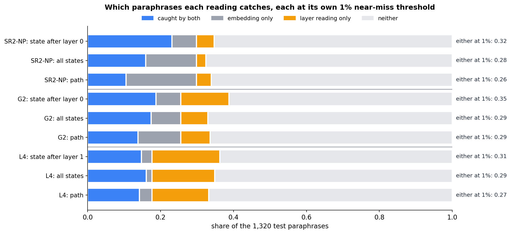
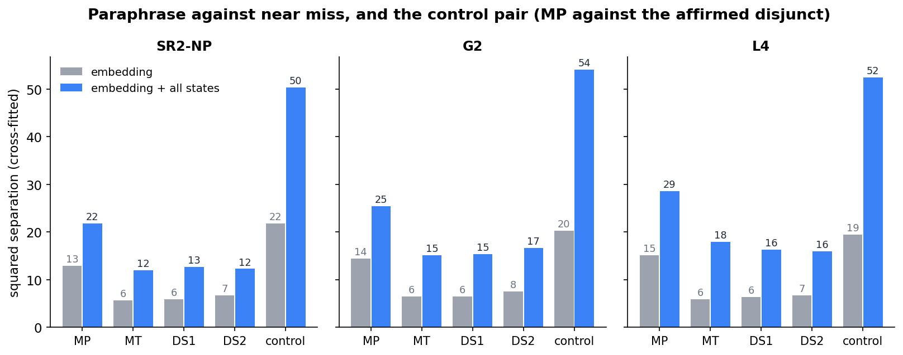

# Hybrid Matchers, Step 0: Do the Embedding and the Layer States Catch Different Paraphrases?

**Report of step 0 of [Hybrid_Template_Matchers.md](Hybrid_Template_Matchers.md) (CPU, 2026-11-26).** The hybrid note asked whether the embedding reading and the layer readings of the template matcher fail on the same paraphrases, and proposed a decision rule before the check. This report gives the check on three models (SR2-NP, G2, L4), from the extractions already saved; nothing was extracted anew. The decision rule was proposed by the agent and **has not been confirmed by the author**, so everything here is exploratory, and the test clauses had been read by every earlier matcher.

**In brief.**
- **The readings partly complement each other.** The best single layer state catches paraphrases the embedding misses: 4.8% of all test paraphrases on SR2-NP, 13.3% on G2, 18.6% on L4. On L4 most of that is the weak embedding there.
- **About two thirds of the paraphrases are caught by neither reading** (61 to 68% on every model and reading). Choosing between the two vectors, or taking both, cannot reach them.
- **"Either reading fires", at a matched 1% of near misses, gains little:** +0.017 and +0.029 over the best single reading on SR2-NP and G2, and −0.020 on L4.
- **The information to tell a paraphrase from its near miss is in the coordinates already.** Read with a direction fitted for that purpose, the embedding's coordinates alone separate each paraphrase kind from its near miss by 2.4 to 3.9 widths. Under the Gaussian model that would catch 52 to 94% of paraphrases at 1% false alarms, against the 18 to 30% the matcher catches. Adding the layer states raises the separation further.
- **So the ceiling is the fit, not the vector.** The matcher has no cloud for paraphrases: none are in the development clauses, so a paraphrase can only fire by landing in the cloud of the exact restatement. A fit that sees paraphrases is the lever this check points to (approach G of the hybrid note, or paraphrase kinds in the development set).
- **A prediction of the hybrid note fails.** Its §3.1 said the layer states add nothing to telling the conditional frame from the disjunctive one, because the connective is a word. The control pair says the opposite: the layer states raise that separation the most of all.

---

## Contents

1. [What was measured](#1-what-was-measured)
2. [Definitions](#2-definitions)
3. [Which paraphrases each reading catches](#3-which-paraphrases-each-reading-catches)
4. [Either reading at a matched rate](#4-either-reading-at-a-matched-rate)
5. [How well the coordinates separate a paraphrase from its near miss](#5-how-well-the-coordinates-separate-a-paraphrase-from-its-near-miss)
6. [Scoring against the proposed rule](#6-scoring-against-the-proposed-rule)
7. [Interpretation](#7-interpretation)
8. [What to test next](#8-what-to-test-next)
9. [Caveats](#9-caveats)
10. [Reproduce and files](#10-reproduce-and-files)

---

## 1. What was measured

Three models, the same 60 test clauses and twelve wordings, "unless" left out as in the primary readings of the depth reports:

| model | layers | pair force | reverse channel | tokens |
| --- | ---: | --- | --- | --- |
| SR2-NP | 2 | no | no | 0.5B |
| G2 | 2 | yes | yes | 0.5B |
| L4 | 4 | yes | yes | 0.5B |

For each model, four matchers, each fitted exactly as the primary reading of `template_depth_analysis.py` (known wordings, its own number of particles and dimension chosen on the development clauses):

- the **embedding** reading;
- the **best single state**: the state after one layer that catches the most paraphrases at 1% near misses (after layer 0 on SR2-NP and G2, after layer 1 on L4);
- **all states** joined;
- the **path**: all displacements joined.

The script reproduces the depth reports' paraphrase rates to the third decimal (for example SR2-NP's embedding 0.298, L4's state after layer 1 0.334). SR2-2B is not included: its extraction has a different format.

## 2. Definitions

- **Paraphrase.** A test premise whose second sentence keeps the subject and paraphrases the predicate of the clause it restates (kinds MPsyn, MTsyn, DS1syn, DS2syn): 1,320 per model.
- **Near miss.** The same subject with a different predicate (kinds near, nearn, nearQ, nearQn): 2,640 per model.
- **Caught at 1%.** The matcher's top template is the right one, and its log-odds is above the 99th percentile of the near misses' log-odds. Each matcher uses its own threshold.
- **Squared separation.** For two kinds of premise $p$ and $q$, with the difference of their mean coordinates $\delta$ and the pooled within-kind covariance $\Sigma$, the squared Mahalanobis distance $\Delta^2 = \delta^{\top} \Sigma^{-1} \delta$. Its square root is the distance between the two kinds in widths.
- **Cross-fitted.** The test clauses are split into two halves by content; $\delta$ is estimated on each half, and the separation is $\delta_A^{\top} \Sigma^{-1} \delta_B$. The noise in two independent estimates of the mean does not add up, so the estimate has no upward bias from it.
- **Residual separation.** The separation in the embedding's coordinates and a layer reading's together, minus the separation in the embedding's alone ([Hybrid_Template_Matchers.md](Hybrid_Template_Matchers.md), §3.3).

## 3. Which paraphrases each reading catches



**Figure 1.** For each model and layer reading, the share of the test paraphrases caught by both the embedding and the layer reading, by the embedding only, by the layer reading only, and by neither. Right: the share caught when either fires, at a matched rate (§4).

| model | layer reading | embedding only | layer only | both | neither | rank correlation |
| --- | --- | ---: | ---: | ---: | ---: | ---: |
| SR2-NP | state after layer 0 | 0.067 | 0.048 | 0.231 | 0.653 | 0.84 |
| SR2-NP | all states | 0.139 | 0.026 | 0.159 | 0.676 | 0.89 |
| SR2-NP | path | 0.193 | 0.041 | 0.105 | 0.661 | 0.82 |
| G2 | state after layer 0 | 0.068 | 0.133 | 0.187 | 0.612 | 0.77 |
| G2 | all states | 0.081 | 0.074 | 0.174 | 0.670 | 0.90 |
| G2 | path | 0.117 | 0.081 | 0.138 | 0.664 | 0.75 |
| L4 | state after layer 1 | 0.029 | 0.186 | 0.148 | 0.637 | 0.80 |
| L4 | all states | 0.016 | 0.172 | 0.161 | 0.652 | 0.92 |
| L4 | path | 0.034 | 0.155 | 0.142 | 0.668 | 0.79 |

The rank correlation is Spearman's, between the two matchers' log-odds over the paraphrases and the near misses together.

- **The overlap is large but not dominant.** "Both" is the largest caught share in five of the nine rows; in the other four the share caught by one reading only is larger (the path on SR2-NP, all three readings on L4).
- **The layer reading adds most where the embedding is weak.** On L4 the embedding catches 0.177 of the paraphrases, and almost all of those are also caught by the layer readings (embedding only: 0.016 to 0.034). On SR2-NP, where the embedding is strongest, the layer readings add little and miss much of what it catches.
- **The near misses that pass the two thresholds are mostly different ones:** each matcher passes 1.02% by construction, and both pass only 0.04 to 0.49%. The scores agree on the order (rank correlation 0.75 to 0.92) and disagree in the tail.
- **Neither reading catches about two thirds of the paraphrases,** on every model.

## 4. Either reading at a matched rate

The simplest hybrid (approach A of the hybrid note, the larger of two scores): fire when either matcher passes its threshold, with both thresholds moved to one common rate so that 1% of near misses pass at least one.

| model | layer reading | either fires | embedding alone | layer reading alone |
| --- | --- | ---: | ---: | ---: |
| SR2-NP | state after layer 0 | 0.315 | 0.298 | 0.280 |
| G2 | state after layer 0 | 0.349 | 0.255 | 0.320 |
| L4 | state after layer 1 | 0.314 | 0.177 | 0.334 |

The gain over the better of the two is +0.017 on SR2-NP and +0.029 on G2; on L4 it is −0.020, because the weak embedding spends half of the near-miss budget. The joint readings do worse than the single best state under this rule (0.26 to 0.29).

## 5. How well the coordinates separate a paraphrase from its near miss

Each paraphrase kind against the near miss of the same frame (MPsyn against near, MTsyn against nearQn, DS1syn against nearn, DS2syn against nearQn, all in their template's frame), and a control pair: modus ponens against the affirmed disjunct, which differ only in the frame. Cross-fitted squared separations, embedding alone and embedding plus all states:



**Figure 2.** Squared separation, embedding alone (grey) and with all states (blue), for the four paraphrase pairs and the control.

| model | pair | embedding | with the best single state | with all states | with the path |
| --- | --- | ---: | ---: | ---: | ---: |
| SR2-NP | MP | 12.9 | 20.5 | 21.8 | 18.5 |
| SR2-NP | MT | 5.7 | 9.6 | 12.0 | 9.0 |
| SR2-NP | DS1 | 5.9 | 10.8 | 12.7 | 8.5 |
| SR2-NP | DS2 | 6.7 | 10.6 | 12.3 | 11.0 |
| SR2-NP | control | 21.8 | 38.7 | 50.3 | 47.4 |
| G2 | MP | 14.5 | 24.0 | 25.5 | 23.4 |
| G2 | MT | 6.4 | 13.9 | 15.2 | 12.3 |
| G2 | DS1 | 6.5 | 14.1 | 15.3 | 12.5 |
| G2 | DS2 | 7.5 | 14.4 | 16.6 | 15.2 |
| G2 | control | 20.3 | 42.5 | 54.0 | 61.5 |
| L4 | MP | 15.2 | 24.4 | 28.6 | 21.0 |
| L4 | MT | 5.9 | 12.0 | 17.9 | 9.4 |
| L4 | DS1 | 6.4 | 11.2 | 16.3 | 9.7 |
| L4 | DS2 | 6.8 | 12.1 | 15.9 | 11.4 |
| L4 | control | 19.4 | 30.3 | 52.4 | 59.5 |

**What a separation predicts.** For two unit Gaussian clouds at distance $\Delta$ in widths, the share of $p$ caught when 1% of $q$ is let through is

$$
\Phi \left( \Delta - z_{0.99} \right), \qquad z_{0.99} = 2.326 .
$$

With the embedding alone, $\Delta^2$ = 5.7 to 7.5 (MT, DS1, DS2) gives 52 to 66%, and $\Delta^2$ = 12.9 to 15.2 (MP) gives 90 to 94%. With all states added, 82 to 100%. The matcher catches 18 to 30%.

- **The information is there; the matcher does not use it.** These separations are read along the one direction that best separates each pair. The matcher never fits that direction: its development clauses contain no paraphrases, so it has no cloud for them, and a paraphrase fires only if it lands in the cloud of the exact restatement. It lands near the near-miss cloud instead ([The_Embedding_Template_Matcher.md](The_Embedding_Template_Matcher.md), §9).
- **The layer states add separation for every pair,** by 3 to 13 squared widths for the paraphrase pairs.
- **The control gains the most,** by 11 to 41. The hybrid note's §3.1 predicted no gain there, since the frame is the connective's word. The layer states spread the connective's identity into the other particles of the premise, so the frame becomes readable from many coordinates. The prediction is withdrawn.
- These are the best case: the direction is fitted with the test labels, the Gaussian law understates the tails of these clouds ([Template_Matcher_From_Geometry.md](Template_Matcher_From_Geometry.md), §5.9), and a fit on fewer clauses would lose some of it.

## 6. Scoring against the proposed rule

The hybrid note's §6 proposed, before the check: if the share caught by the layer reading only is at least 0.05 on two models or more, the readings complement each other, and the role split (approach D), then the factorised templates (F), come next; if it is below 0.05 on every model and the rank correlation is above 0.8, the ceiling holds, and a new identity coordinate (E, then G) comes next.

- **By the letter, the first branch applies:** 0.133 (G2) and 0.186 (L4), with SR2-NP just below (0.048).
- **The agent's stated expectation** (ranks above 0.8; small on SR2-NP, moderate on L4) was **partly right**: the single states' rank correlations are 0.77 to 0.84, the joint states' 0.89 to 0.92; SR2-NP is small; L4 is larger than "moderate".
- **The rule did not foresee §5.** It assumed that the choice of vector was the lever. Two thirds of the paraphrases are caught by neither reading, while the coordinates hold enough to catch most of them. That favours the second branch's approach G (a fitted identity direction) over D, whatever the letter of the rule. The rule was never confirmed, so the author decides.

## 7. Interpretation

**The paraphrase ceiling is a property of the fit.** Every reading orders paraphrases against near misses in much the same way (AUROC 0.76 to 0.79 in the depth reports, rank correlation 0.75 to 0.92 here), and every reading catches at most a third of them at 1% near misses. The cause is not that the vectors cannot tell the two apart. Along a direction fitted for the purpose, the embedding's own coordinates separate them well. The matcher was built to recognise forms, never shown a paraphrase, and so never learned which direction separates "same statement, other words" from "same subject, other statement".

**The layer states do carry extra separable information,** for paraphrases and for the frame alike, which is what the dynamics matchers were looking for. At two and four layers it shows in a fitted contrast, not in the forms matcher as built. The mechanism question of the hybrid note's §5 gets a cautious yes on this measure. It needs a null check (§9) before it is stated anywhere else.

**For the hybrid designs.** Combining the two readings as they stand gains at most 0.03. A role split (D) keeps the matcher's fit and would move within the same third. The gain available is in a fit that sees paraphrases.

## 8. What to test next

1. **A paraphrase gate fitted across clauses, on the saved extractions (cheap).** Fit the paraphrase-against-near-miss direction on half of the test clauses and catch paraphrases at 1% near misses on the other half, then swap the halves. Do it for the embedding, a layer state, and both. This is approach G without new data, and it measures how much of §5's best case survives a fit.
2. **The null check for §5.** The same cross-fitted residual with the layer block replaced by noise of the same dimension, which must read about zero.
3. **Paraphrases in the development clauses (new extraction).** Paraphrase and near-miss kinds added to the 60 development clauses, so that the matcher fits a cloud for them. This needs new paraphrases drafted and checked.
4. **D and F stay on the list,** for the frame and polarity parts where §5 shows the layer states carry more than the words.

## 9. Caveats

- **Exploratory.** The decision rule was not confirmed; the test clauses have been read by every earlier matcher.
- **The separations of §5 use the test labels** to place the direction; they bound what a fitted gate could do.
- **No null check yet** for the residual separation. The cross-fit removes the bias from the noise of the means, but the covariance is shrunk 10% toward its diagonal and estimated on the same premises.
- **Three models, one seed each, English premises drafted by the agent;** the paraphrases and near misses await the author's check.
- **SR2-2B is not included.**

## 10. Reproduce and files

```bash
cd notebooks/conservative_arch/scaleup
python3 debug/template_hybrid_check.py RUNDIR results/template_matcher np,g2,l4    # RUNDIR holds depth_<stem>.pkl; about 30 min on 8 threads
python3 ../../../companion_notes/figures/_make_hybrid_figs.py
```

Outputs: `results/template_matcher/template_hybrid_check_{np,g2,l4}.json` and `template_hybrid_check.txt` (the printed tables). Figures: `figures/template_matcher/hyb_overlap.png`, `hyb_residual.png`. The script fits each matcher by `template_depth_analysis.py`'s own `score` and reads its per-premise outputs through a one-line hook.
