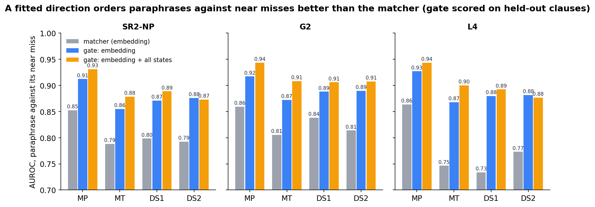
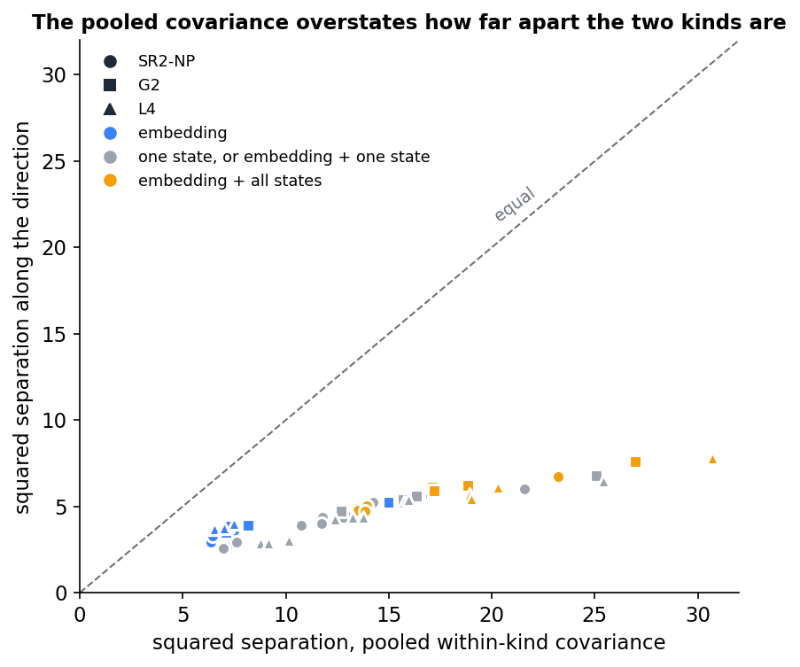
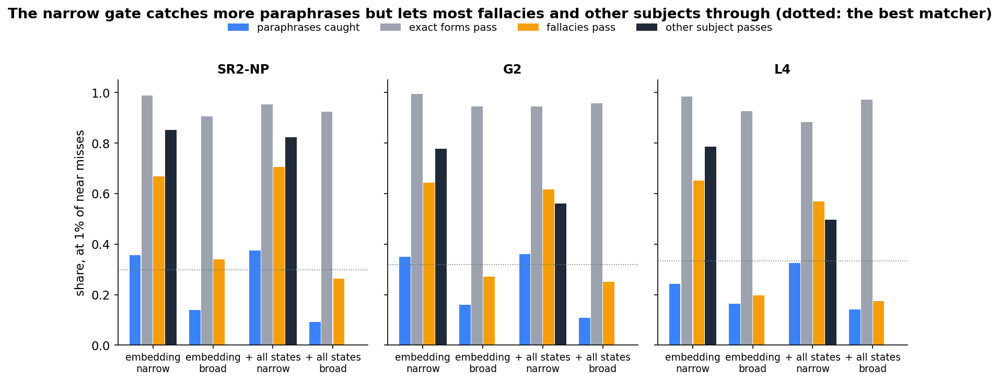

# Hybrid Matchers, Step 1a: A Paraphrase Gate Fitted Across Clauses

**Report of the first test after step 0 of [Hybrid_Template_Matchers.md](Hybrid_Template_Matchers.md) (CPU, 2026-11-26).** Step 0 ([Hybrid_Step0_Complementarity.md](Hybrid_Step0_Complementarity.md)) found that two thirds of the test paraphrases are caught by neither the embedding reading nor any layer reading. It argued that the matcher's coordinates already hold what is needed to catch most of them. The author chose to test that next, with a gate fitted for the purpose (approach G of the hybrid note, in its simplest linear form), on the extractions already saved. This is exploratory: no decision rule was confirmed, and the test clauses have been read by every earlier matcher.

**In brief.**
- **A fitted direction orders paraphrases against near misses better than the matcher.** Scored on clauses it was not fitted on, its AUROC for each paraphrase kind against its near miss is 0.86 to 0.93 from the embedding's coordinates, against the matcher's 0.73 to 0.86. Adding all the layer states raises it further on 10 of the 12 pairs, by up to 0.04.
- **It catches far fewer paraphrases than step 0 predicted.** At 1% of near misses it catches 0.20 to 0.53 of each paraphrase kind with the embedding (step 0's Gaussian prediction was 0.52 to 0.94), and 0.26 to 0.61 with all states (predicted 0.87 to 1.00).
- **Step 0's separations were overstated by a factor of 1.8 to 3.9.** Step 0 measured the distance between a paraphrase kind and its near miss in units of the spread of all premise kinds pooled. Along the direction that separates them, the paraphrases spread 1.9 to 4.8 times wider than the pooled kinds, and the near misses 1.3 to 3.3 times. Almost all of that spread lies between clauses (88 to 100% for the paraphrases, 81 to 100% for the near misses): each clause's paraphrase lands at its own place. The corrected squared separation is 2.9 to 5.2 for the embedding (step 0 said 5.7 to 15.2), and 4.7 to 7.8 with all states.
- **The gate does not work on its own.** A gate that separates paraphrases from near misses also passes 52 to 71% of the fallacies and 40 to 85% of the premises about another subject. A broader gate that also excludes those catches fewer paraphrases than the matcher (0.09 to 0.17).
- **Pooled, the narrow gate gains a little on two models.** With the matcher's template choice, it catches 0.375 and 0.361 of the paraphrases on SR2-NP and G2, against the best matcher's 0.298 and 0.320. On L4 it catches 0.324, against 0.334.
- **What survives of step 0:** the layer states add separation of paraphrases from near misses (along the direction, by 1.1 to 2.6 squared widths in sample; *corrected by step 1b, [Hybrid_Step1b_Null_Check.md](Hybrid_Step1b_Null_Check.md): 0.25 to 1.42 held-out, above a null of the same size*), and they make the frame readable from the relational coordinates (AUROC 0.84 to 0.88 for the embedding, 1.00 with all states). **What is withdrawn:** the claim that the coordinates "separate paraphrases well" and its 52 to 94% prediction. The step 0 report is corrected.

---

## Contents

1. [What was measured](#1-what-was-measured)
2. [Definitions](#2-definitions)
3. [Per pair: the fitted direction against the matcher](#3-per-pair-the-fitted-direction-against-the-matcher)
4. [Why the catch falls short of step 0's prediction](#4-why-the-catch-falls-short-of-step-0s-prediction)
5. [Pooled: what the gate catches and what it lets through](#5-pooled-what-the-gate-catches-and-what-it-lets-through)
6. [The expectations stated before the run](#6-the-expectations-stated-before-the-run)
7. [What this corrects in step 0](#7-what-this-corrects-in-step-0)
8. [Interpretation](#8-interpretation)
9. [What to test next](#9-what-to-test-next)
10. [Caveats](#10-caveats)
11. [Reproduce and files](#11-reproduce-and-files)

---

## 1. What was measured

The same three models as step 0 (SR2-NP, G2, L4), the same 60 test clauses, the eleven wordings other than "unless", and the same matchers. Each matcher's relational coordinates were rebuilt with the number of particles and dimension step 0 used, so nothing was tuned again.

Four sets of coordinates feed the gate:

- the **embedding**'s (60 to 80 coordinates);
- the **best single state**'s, as in step 0 (after layer 0 on SR2-NP and G2, after layer 1 on L4; 50 to 80);
- the **embedding and that state** stacked (110 to 160);
- the **embedding and all states** stacked (190 to 260).

**The fit.** The test clauses are split by content into two halves of 30 clauses (6,300 premises each). A gate is fitted on one half and scored on the other, then the halves swap. A fit is a linear discriminant for each template:

$$
w_t = S^{-1} \left( m_p - m_q \right),
$$

where $m_p$ and $m_q$ are the mean standardised coordinates of the positive and negative kinds on the fitting half, and $S$ is the pooled within-kind covariance on the fitting half, shrunk 10% toward its diagonal (the same estimate step 0 used). The gate's score of a premise is $w_t^{\top} z$.

**Two gates.**

- **Narrow:** the positive kind is the paraphrase (MPsyn, MTsyn, DS1syn, DS2syn) and the negative kind is its near miss in the same frame (near, nearQn, nearn, nearQn). This is the contrast step 0 measured.
- **Broad:** the positive kinds are the exact form and its paraphrase, and the negatives are every other kind of the same frame except ordinary text. This is an identity gate: "this premise restates the right part of this clause".

## 2. Definitions

- **Held-out.** Scored on the half of the clauses the gate was not fitted on, averaged over the two swaps.
- **Caught at 1%, per pair.** The share of held-out paraphrases whose gate score is above the 99th percentile of the held-out near misses of the same kind. With 30 clauses per half that percentile rests on about two premises, so this figure is noisy; the AUROC is the steadier reading.
- **In-sample.** The direction fitted on all 60 clauses and scored on the same clauses. It uses the test labels.
- **Gaussian prediction.** Step 0's prediction from its squared separation $\Delta^2$: the share caught at 1% would be $\Phi(\Delta - 2.326)$ if both kinds were Gaussian with the pooled covariance.
- **Pooled, caught at 1%.** Comparable with the matcher's own figure: a paraphrase is caught when the embedding matcher's top template is the right one and the gate score of that template is above the 99th percentile of all the held-out near misses' scores. Each template's score is standardised by the near misses of that template on the fitting half, so the four templates share one threshold. The embedding matcher picks the right template for 86 to 88% of the paraphrases, which caps this figure.
- **Passes.** The share of another family of premises whose score is above the same threshold: the exact forms in their frame, the fallacies (AC, DA, DAnot, P, Q and their paraphrases), the other-subject kinds (swap, swapn, swapQ, swapQn) and the unrelated kinds (U, Un).
- **Spread ratio.** The variance of a kind along the fitted direction divided by $w^{\top} S w$, the variance the pooled covariance assigns to that direction. It is 1 when the kind spreads like the pooled kinds.
- **Squared separation along the direction.** The squared gap between the two kinds' means along $w$, divided by the average of their two variances along $w$. Unlike step 0's measure, it uses the spread these two kinds actually have.

## 3. Per pair: the fitted direction against the matcher



**Figure 1.** AUROC of each paraphrase kind against its near miss: the embedding matcher's log-odds (grey), and the fitted gate scored on held-out clauses, from the embedding's coordinates (blue) and from the embedding's and all states' (amber).

Held-out AUROC of the gate, with the matcher's AUROC over all test clauses:

| model | pair | matcher | gate: embedding | gate: best state | gate: embedding and best state | gate: embedding and all states |
| --- | --- | ---: | ---: | ---: | ---: | ---: |
| SR2-NP | MP | 0.852 | 0.912 | 0.920 | 0.925 | 0.931 |
| SR2-NP | MT | 0.788 | 0.855 | 0.836 | 0.865 | 0.878 |
| SR2-NP | DS1 | 0.798 | 0.871 | 0.850 | 0.889 | 0.889 |
| SR2-NP | DS2 | 0.793 | 0.876 | 0.830 | 0.876 | 0.873 |
| G2 | MP | 0.859 | 0.917 | 0.928 | 0.935 | 0.944 |
| G2 | MT | 0.805 | 0.872 | 0.892 | 0.898 | 0.908 |
| G2 | DS1 | 0.838 | 0.888 | 0.888 | 0.907 | 0.906 |
| G2 | DS2 | 0.814 | 0.890 | 0.893 | 0.903 | 0.908 |
| L4 | MP | 0.864 | 0.927 | 0.936 | 0.937 | 0.944 |
| L4 | MT | 0.747 | 0.868 | 0.858 | 0.878 | 0.900 |
| L4 | DS1 | 0.734 | 0.880 | 0.852 | 0.879 | 0.893 |
| L4 | DS2 | 0.773 | 0.882 | 0.846 | 0.873 | 0.877 |

- **The fit raises the AUROC on every pair,** by 0.05 to 0.15 from the same embedding coordinates the matcher reads. The hybrid note said approach G is the only one that can raise the AUROC rather than move the operating point; it does.
- **The layer states add a little more:** with all states, the AUROC rises on 10 of the 12 pairs, by up to 0.04 (G2's MT); it falls slightly on SR2-NP's DS2 and L4's DS2. A single state alone is worse than the embedding on MT, DS1 and DS2 of SR2-NP and L4, and as good or better on MP and on G2.

Paraphrases caught at 1% near misses of the same kind:

| model | pair | matcher | embedding, held-out | embedding, in-sample | embedding, Gaussian prediction | all states, held-out | all states, in-sample | all states, Gaussian prediction |
| --- | --- | ---: | ---: | ---: | ---: | ---: | ---: | ---: |
| SR2-NP | MP | 0.28 | 0.28 | 0.37 | 0.90 | 0.38 | 0.59 | 0.99 |
| SR2-NP | MT | 0.25 | 0.20 | 0.44 | 0.52 | 0.57 | 0.59 | 0.87 |
| SR2-NP | DS1 | 0.34 | 0.25 | 0.27 | 0.54 | 0.61 | 0.68 | 0.89 |
| SR2-NP | DS2 | 0.26 | 0.53 | 0.52 | 0.61 | 0.46 | 0.57 | 0.88 |
| G2 | MP | 0.30 | 0.32 | 0.40 | 0.93 | 0.41 | 0.64 | 1.00 |
| G2 | MT | 0.24 | 0.25 | 0.49 | 0.58 | 0.53 | 0.62 | 0.94 |
| G2 | DS1 | 0.30 | 0.23 | 0.34 | 0.59 | 0.49 | 0.63 | 0.94 |
| G2 | DS2 | 0.28 | 0.25 | 0.48 | 0.66 | 0.61 | 0.71 | 0.96 |
| L4 | MP | 0.28 | 0.21 | 0.28 | 0.94 | 0.26 | 0.60 | 1.00 |
| L4 | MT | 0.14 | 0.26 | 0.41 | 0.54 | 0.46 | 0.54 | 0.97 |
| L4 | DS1 | 0.19 | 0.35 | 0.23 | 0.58 | 0.45 | 0.57 | 0.96 |
| L4 | DS2 | 0.19 | 0.30 | 0.55 | 0.61 | 0.43 | 0.65 | 0.95 |

("All states" is the embedding's coordinates and all states' together. The "matcher" column also requires the right template.)

- **Even in-sample, with the test labels, the direction falls far short of the Gaussian prediction:** 0.23 to 0.55 against 0.52 to 0.94 with the embedding. The prediction was wrong, not just hard to reach with a fit on 30 clauses (§4).
- **Held-out, the embedding's gate is not clearly better than the matcher at 1%:** it is higher on 6 of the 12 pairs, lower on 5. The better AUROC sits mostly away from the 1% tail.
- **With all states, the held-out catch is above the matcher's on 11 of 12 pairs** (0.26 to 0.61 against 0.14 to 0.34). The exception is L4's MP.
- In-sample is below held-out on some pairs (L4's DS1). At 1% the tail rests on two or three clauses, so these numbers move by 0.1 or more with the split.

## 4. Why the catch falls short of step 0's prediction



**Figure 2.** For each paraphrase pair, model and reading, the squared separation under the pooled within-kind covariance (step 0's measure, here in-sample) against the squared separation the two kinds actually have along the fitted direction. Every point lies far below the diagonal.

Step 0's squared separation $\Delta^2 = \delta^{\top} S^{-1} \delta$ is the distance between two kinds in units of the pooled spread. It equals the separation the two kinds actually have along $w$ only if they spread along $w$ like the pooled kinds. They do not:

| model | pair | reading | pooled | along the direction | spread ratio, paraphrase | spread ratio, near miss | near miss 99th percentile | between clauses, paraphrase |
| --- | --- | --- | ---: | ---: | ---: | ---: | ---: | ---: |
| SR2-NP | MP | embedding | 13.6 | 4.9 | 3.7 | 1.8 | 3.43 | 1.00 |
| SR2-NP | MT | embedding | 6.4 | 2.9 | 2.6 | 1.7 | 2.30 | 0.91 |
| SR2-NP | DS1 | embedding | 6.4 | 3.3 | 2.5 | 1.4 | 2.93 | 0.88 |
| SR2-NP | DS2 | embedding | 7.5 | 3.6 | 2.9 | 1.3 | 2.43 | 0.97 |
| SR2-NP | MP | all states | 23.2 | 6.7 | 4.4 | 2.5 | 3.16 | 0.98 |
| SR2-NP | MT | all states | 13.5 | 4.8 | 3.9 | 1.7 | 2.69 | 0.92 |
| SR2-NP | DS1 | all states | 13.9 | 5.0 | 3.8 | 1.8 | 2.52 | 0.93 |
| SR2-NP | DS2 | all states | 13.9 | 4.7 | 4.1 | 1.7 | 2.75 | 0.97 |
| G2 | MP | embedding | 15.0 | 5.2 | 3.7 | 2.0 | 3.23 | 1.00 |
| G2 | MT | embedding | 7.1 | 3.5 | 2.4 | 1.7 | 2.23 | 0.92 |
| G2 | DS1 | embedding | 7.2 | 3.8 | 2.3 | 1.4 | 2.73 | 0.89 |
| G2 | DS2 | embedding | 8.2 | 3.9 | 2.7 | 1.5 | 2.54 | 0.98 |
| G2 | MP | all states | 27.0 | 7.6 | 4.2 | 2.9 | 3.00 | 0.95 |
| G2 | MT | all states | 17.1 | 6.1 | 3.6 | 2.0 | 2.71 | 0.95 |
| G2 | DS1 | all states | 17.2 | 5.9 | 3.6 | 2.2 | 2.50 | 0.93 |
| G2 | DS2 | all states | 18.8 | 6.2 | 4.1 | 1.9 | 2.38 | 0.95 |
| L4 | MP | embedding | 15.7 | 5.2 | 3.3 | 2.7 | 3.03 | 0.98 |
| L4 | MT | embedding | 6.5 | 3.7 | 1.9 | 1.7 | 2.24 | 0.89 |
| L4 | DS1 | embedding | 7.0 | 3.7 | 2.0 | 1.7 | 2.77 | 0.89 |
| L4 | DS2 | embedding | 7.5 | 4.0 | 2.1 | 1.6 | 1.99 | 0.96 |
| L4 | MP | all states | 30.7 | 7.8 | 4.6 | 3.3 | 3.17 | 0.97 |
| L4 | MT | all states | 20.3 | 6.1 | 4.6 | 2.1 | 3.14 | 0.95 |
| L4 | DS1 | all states | 18.9 | 5.7 | 4.0 | 2.6 | 2.81 | 0.92 |
| L4 | DS2 | all states | 19.0 | 5.4 | 4.4 | 2.6 | 2.47 | 0.94 |

("Near miss 99th percentile" is in the near misses' own standard deviations above their mean; a Gaussian gives 2.33. "Between clauses" is the share of the paraphrases' variance along the direction that lies between the clause means.)

Three things widen the gap.

1. **The two kinds spread more along this direction than the pooled kinds do.** The direction $w = S^{-1} \delta$ leans toward coordinates in which the pooled kinds vary little. The paraphrase kinds are the only kinds whose second sentence is a new wording of the predicate, so they vary much more in those coordinates: 1.9 to 4.8 times the pooled variance. The near misses, also new predicates, vary 1.3 to 3.3 times as much.
2. **The spread is between clauses.** 88 to 100% of the paraphrases' variance along the direction lies between clauses: the six wordings of the connective barely move a clause, and each clause's drafted paraphrase sits at its own place. In effect each paraphrase kind has 60 points, not 360.
3. **The near misses' upper tail is heavier than Gaussian** on most pairs: in 20 of the 24 rows the 99th percentile is above the Gaussian 2.33 standard deviations, up to 3.4 (MP).

The pooled measure overstates the separation by a factor of 1.8 to 3.9 over every pair, model and reading. Along the direction, the squared separation is 2.9 to 5.2 for the embedding (1.7 to 2.3 widths) and 4.7 to 7.8 with all states (2.2 to 2.8 widths). Step 0 reported 5.7 to 15.2 for the embedding, cross-fitted.

**The control pair.** Step 0's control, modus ponens against the affirmed disjunct (which differ only in the frame), cannot be read in squared widths at all. Along its direction the affirmed-disjunct premises vary 10 to 28 times more than the pooled kinds, and nearly all of that variation lies within clauses: it is the five disjunctive wordings, which this direction pulls apart. The AUROC can be read: 0.84 to 0.88 from the embedding's relational coordinates, 0.96 to 1.00 from a single state, 1.00 from the embedding and all states. So step 0's qualitative reading holds (the layer states make the frame readable from the relational coordinates, where the embedding's barely carry it), but its sizes do not. The matcher itself reads the frame from a separate axis (the connective's position), which none of these coordinates include.

## 5. Pooled: what the gate catches and what it lets through



**Figure 3.** At the threshold that passes 1% of the held-out near misses: paraphrases caught (with the right template), and the share of exact forms, fallacies and other-subject premises that pass. Dotted: the best matcher of step 0 on that model.

| model | gate coordinates | gate | paraphrases caught | exact forms pass | fallacies pass | other subject passes | unrelated passes |
| --- | --- | --- | ---: | ---: | ---: | ---: | ---: |
| SR2-NP | embedding | narrow | 0.357 | 0.988 | 0.667 | 0.853 | 0.137 |
| SR2-NP | embedding | broad | 0.139 | 0.907 | 0.340 | 0.001 | 0.000 |
| SR2-NP | embedding and all states | narrow | 0.375 | 0.954 | 0.705 | 0.824 | 0.231 |
| SR2-NP | embedding and all states | broad | 0.092 | 0.925 | 0.263 | 0.000 | 0.000 |
| G2 | embedding | narrow | 0.349 | 0.994 | 0.643 | 0.778 | 0.070 |
| G2 | embedding | broad | 0.159 | 0.945 | 0.272 | 0.001 | 0.000 |
| G2 | embedding and all states | narrow | 0.361 | 0.945 | 0.616 | 0.561 | 0.123 |
| G2 | embedding and all states | broad | 0.109 | 0.958 | 0.251 | 0.000 | 0.000 |
| L4 | embedding | narrow | 0.242 | 0.985 | 0.652 | 0.786 | 0.078 |
| L4 | embedding | broad | 0.164 | 0.927 | 0.197 | 0.001 | 0.000 |
| L4 | embedding and all states | narrow | 0.324 | 0.884 | 0.568 | 0.497 | 0.155 |
| L4 | embedding and all states | broad | 0.141 | 0.973 | 0.174 | 0.000 | 0.000 |

The single-state rows are in `template_gate_fit_<stem>.json`. The best state alone catches 0.207 to 0.248 and lets only 70 to 75% of the exact forms through on G2 and L4.

The best matchers of step 0 catch 0.298 (SR2-NP, the embedding), 0.320 (G2, after layer 0) and 0.334 (L4, after layer 1).

- **The narrow gate gains 0.08 and 0.04 on SR2-NP and G2, and loses 0.01 on L4,** with the embedding and all states. Against the embedding matcher alone, the embedding's own narrow gate gains 0.06 to 0.09 on every model.
- **The narrow gate is not a gate on its own.** It learned "the second sentence says the same kind of thing as the clause's part", and so it passes most fallacies (whose second sentence restates the wrong part, or its denial) and most premises about another subject. It can only be used behind the matcher's form decision.
- **The broad gate excludes the other subjects and the unrelated premises completely, but catches only 0.09 to 0.17 of the paraphrases.** Its positives are dominated by the exact forms, which are easy to separate, so its direction serves the exact forms. It still passes 17 to 41% of the fallacies, which restate a part of the clause, only the wrong one.

## 6. The expectations stated before the run

Written in the script's header before any result:

| expectation | result | verdict |
| --- | --- | --- |
| The held-out catch per pair keeps at least half of the Gaussian prediction. | 8 of 24 pair-and-reading cells. | Miss: the prediction was wrong (§4). |
| The states raise it on every model. | Pooled narrow: yes on all three models. Per pair: on 11 of 12 (held-out catch) and 10 of 12 (AUROC). | Mostly hit. |
| The pooled narrow catch with the embedding alone is at least 0.40. | 0.357, 0.349, 0.242. | Miss. |
| The narrow gate lets more than 10% of the fallacies through, the broad gate fewer. | 64 to 67% (narrow), 20 to 34% (broad). | Hit. |

## 7. What this corrects in step 0

[Hybrid_Step0_Complementarity.md](Hybrid_Step0_Complementarity.md) has been corrected in place, and the hybrid note's status line and both README rows with it.

- **Withdrawn:** "the coordinates already separate a paraphrase from its near miss by 2.4 to 3.9 widths in the embedding alone", and the prediction of 52 to 94% at 1% near misses. The measured separation along the best direction is 1.7 to 2.3 widths, and a direction fitted with the test labels catches 0.23 to 0.55.
- **Withdrawn:** "the ceiling is the fit, not the vector" as stated. A fit does raise the AUROC (0.05 to 0.15 per pair), but each clause's paraphrase lands at its own place, so a linear gate fitted on 30 clauses gains little at 1% near misses. Both the fit and the vectors limit it.
- **Kept, with smaller sizes:** the layer states add separation for every paraphrase pair, by 1.1 to 2.6 squared widths along the direction in sample instead of 3 to 13 under the pooled covariance (held-out, step 1b: 0.25 to 1.42, above both nulls).
- **Kept:** the layer states make the frame readable from the relational coordinates (AUROC 0.84 to 0.88 for the embedding, 1.00 with all states). Step 0's sizes for the control (gains of 11 to 41) are not meaningful.
- **Unchanged:** the complementarity counts (step 0 §3) and "either fires" (§4).

## 8. Interpretation

**A paraphrase is a clause-level event.** Each test clause has one drafted paraphrase per kind, and the matcher's coordinates place each of them somewhere different. Telling a paraphrase from a near miss is then a question about 60 drafted sentences per kind, not about 360 premises. A linear direction fitted on 30 of them orders the other 30 better than the matcher (AUROC up by 0.05 to 0.15), but the clauses where the paraphrase lands among the near misses stay there. That is also why the 1% tail moves so much with the split.

**The ceiling is shared by the fit and the vector.** Step 0 put it on the fit alone. A fit helps the ordering; the vectors limit the tail. More layer states help both a little.

**The gate needs the form decision.** A gate that knows "same statement" does not know "right part of the clause" or "right subject". It has to sit behind a form reader that has already rejected the fallacies and the other subjects. That is the structure of approach F of the hybrid note (frame times clause times polarity, plus an identity gate), and approach D's role split is the cheapest way to try it on the saved extractions.

## 9. What to test next

1. **Done: [Hybrid_Step1b_Null_Check.md](Hybrid_Step1b_Null_Check.md).** **The null check, adjusted.** The same cross-fitted residual as step 0 with the layer block replaced by noise of the same dimension, now read both ways: under the pooled covariance and along the direction. It tells whether the states' added separation (1.1 to 2.6 squared widths) is more than the noise of a fit with that many coordinates.
2. **The gate behind the matcher's form decision.** Fire when the matcher's form reading picks a template and its log-odds against the fallacy and other-subject clouds is high, and the narrow gate passes. All of it can be done on the saved extractions; it is approach D's idea with approach G's gate.
3. **Paraphrases in the development clauses** (new extraction), so that the matcher fits a cloud for them. §4 suggests a single cloud per kind will be wide.
4. **More clauses.** The 1% tail rests on two or three clauses per half. Any gate read at 1% needs more than 60 test clauses to be measured well.

## 10. Caveats

- **Exploratory.** No decision rule was confirmed; the test clauses have been read by every earlier matcher, and the gate is fitted on test clauses.
- **One split.** The clauses are split even against odd, as in step 0. The per-pair 1% figures move by 0.1 or more with the split; the AUROC is steadier.
- **Linear gate, fixed 10% shrinkage.** A non-linear gate, or one that weights clauses equally, might do better. Nothing was tuned.
- **The pooled rule uses the embedding matcher's template,** which is right for 86 to 88% of the paraphrases.
- **The coordinates are the matcher's relational coordinates only,** without its frame axis.
- **Three models, one seed each, English premises drafted by the agent;** the paraphrases and near misses await the author's check.

## 11. Reproduce and files

```bash
cd notebooks/conservative_arch/scaleup
python3 debug/template_gate_fit.py RUNDIR results/template_matcher np,g2,l4 CACHEDIR    # needs step 0's JSON; a few minutes per model
python3 debug/template_gate_diag.py CACHEDIR results/template_matcher np,g2,l4           # seconds
python3 ../../../companion_notes/figures/_make_hybrid_figs.py
```

`RUNDIR` holds `depth_<stem>.pkl` of `template_depth_test.py`. `template_gate_fit.py` rebuilds each matcher's coordinates with `template_depth_analysis.py`'s own `score`, at step 0's settings, and with `CACHEDIR` saves them for the diagnostic and the null check. `template_gate_diag.py` was written after the fit's result, to explain it.

Outputs in `results/template_matcher/`: `template_gate_fit_{np,g2,l4}.json`, `template_gate_fit.txt` (the printed tables), `template_gate_diag_{np,g2,l4}.json`, `template_gate_diag.txt`. Figures: `figures/template_matcher/hyb_gate_auroc.png`, `hyb_gate_separation.png`, `hyb_gate_pass.png`.
