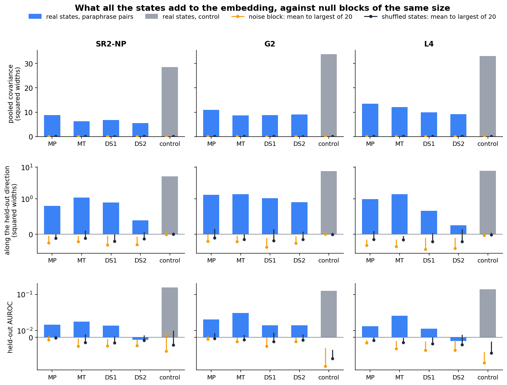

# Hybrid Matchers, Step 1b: The Null Check for the Residual Separation

**Report of the second test after step 0 of [Hybrid_Template_Matchers.md](Hybrid_Template_Matchers.md) (CPU, 2026-11-26).** Step 0 ([Hybrid_Step0_Complementarity.md](Hybrid_Step0_Complementarity.md)) measured what the layer states add to the embedding's coordinates in telling a paraphrase from its near miss, and asked for a null check before that was quoted elsewhere. Step 1a ([Hybrid_Step1a_Fitted_Gate.md](Hybrid_Step1a_Fitted_Gate.md)) found that step 0's measure overstates the separation, so the check reads the added separation in three ways. This is exploratory, on the saved extractions and on test clauses read by every earlier matcher.

**In brief.**
- **The states' added separation is real.** With all states, it is above every one of 40 null draws on every paraphrase pair and model, under step 0's pooled measure and along a direction fitted on held-out clauses. Under the pooled measure the nulls average 0.0 to 0.2 squared widths, so step 0's estimator has no bias of note; its problem was the unit (step 1a), not the noise.
- **It is small.** Read along a direction fitted on the other half of the clauses, all states add 0.25 to 1.42 squared widths to the embedding's 2.2 to 4.9. Against a block of pure noise of the same size, which costs 0.10 to 0.43, the gain is 0.65 to 1.77.
- **In AUROC it is smaller still:** all states add −0.005 to +0.036, and on two of the twelve pairs (DS2 of SR2-NP and of L4) the gain is not above every null draw.
- **The frame is the exception.** For the control pair (modus ponens against the affirmed disjunct), the states add 0.13 to 0.17 to the AUROC, against null draws at most +0.01.
- **Correction to step 1a.** Its figure of 1.1 to 2.6 squared widths for the states' added separation was in-sample; held-out it is 0.25 to 1.42. Step 1a and step 0 are corrected.

---

## Contents

1. [What was measured](#1-what-was-measured)
2. [Results](#2-results)
3. [The expectations stated before the run](#3-the-expectations-stated-before-the-run)
4. [Interpretation](#4-interpretation)
5. [Caveats](#5-caveats)
6. [Reproduce and files](#6-reproduce-and-files)

---

## 1. What was measured

The same three models, test clauses, wordings and coordinates as step 1a. For each paraphrase pair (MPsyn against near, MTsyn against nearQn, DS1syn against nearn, DS2syn against nearQn, in the template's frame) and step 0's control pair, the coordinates of a layer block $b$ are joined to the embedding's coordinates $a$. The block is the best single state (as in step 0) or all states. The **residual** is a reading in $(a, b)$ minus the same reading in $a$ alone:

- **pooled:** step 0's cross-fitted measure $\delta_A^{\top} S^{-1} \delta_B$, with the class-mean differences from the two halves of the clauses and the pooled within-kind covariance $S$ of all test premises but ordinary text, shrunk 10% toward its diagonal;
- **along:** a direction fitted on one half of the clauses (as step 1a's gate), read on the other half as the squared gap between the two kinds' means over the average of their two variances, then averaged over the two swaps;
- **AUROC:** the held-out AUROC of that direction.

Each residual is read with the real block and with two **null blocks** of the same dimension, 20 draws each:

- **noise:** independent standard normal values;
- **shuffled:** the real block with its rows shuffled at random over all premises, which keeps the block's own distribution and breaks its tie to the premise.

A null block carries nothing about the premise, so its residual shows what the measure reads from coordinates alone: the bias of the pooled estimate, and the cost of fitting more coordinates for the held-out readings.

## 2. Results



**Figure 1.** The residual of all states, by model and pair (bars), against the two nulls (each line runs from the mean of 20 draws, the dot, to the largest draw). Top: pooled; middle: along the held-out direction; bottom: held-out AUROC. The middle and bottom rows are on a scale that is linear near zero and logarithmic beyond.

Ranges over the four paraphrase pairs and three models (twelve cells per row):

| block | reading | real residual | null mean | largest null draw | real above every null draw |
| --- | --- | ---: | ---: | ---: | ---: |
| best single state | pooled | 3.84 to 9.52 | −0.02 to +0.10 | +0.33 | 12 of 12 |
| best single state | along | 0.12 to 1.17 | −0.22 to −0.04 | +0.14 | 12 of 12 |
| best single state | AUROC | −0.009 to +0.025 | −0.008 to 0.000 | +0.007 | 9 of 12 |
| all states | pooled | 5.54 to 13.48 | +0.01 to +0.17 | +0.56 | 12 of 12 |
| all states | along | 0.25 to 1.42 | −0.43 to −0.10 | +0.14 | 12 of 12 |
| all states | AUROC | −0.005 to +0.036 | −0.019 to −0.001 | +0.007 | 10 of 12 |

The embedding alone, read the same held-out way: squared separation along the direction 4.7 to 4.9 for MP and 2.2 to 3.1 for MT, DS1 and DS2; AUROC 0.855 to 0.927.

Per pair, all states (`template_gate_null.txt` has every cell):

| model | pair | pooled | along | AUROC |
| --- | --- | ---: | ---: | ---: |
| SR2-NP | MP | +8.87 | +0.80 | +0.019 |
| SR2-NP | MT | +6.28 | +1.10 | +0.023 |
| SR2-NP | DS1 | +6.81 | +0.90 | +0.017 |
| SR2-NP | DS2 | +5.54 | +0.39 | −0.003 |
| SR2-NP | control | +28.46 | +5.15 | +0.168 |
| G2 | MP | +11.00 | +1.35 | +0.027 |
| G2 | MT | +8.75 | +1.40 | +0.036 |
| G2 | DS1 | +8.84 | +1.06 | +0.018 |
| G2 | DS2 | +9.12 | +0.90 | +0.018 |
| G2 | control | +33.77 | +7.59 | +0.130 |
| L4 | MP | +13.48 | +0.99 | +0.016 |
| L4 | MT | +12.09 | +1.42 | +0.032 |
| L4 | DS1 | +9.92 | +0.66 | +0.013 |
| L4 | DS2 | +9.15 | +0.25 | −0.005 |
| L4 | control | +33.00 | +7.70 | +0.147 |

- **The pooled estimate is not biased by extra coordinates.** Its null residual averages 0.0 to 0.2 squared widths, against real residuals of 4 to 13. The cross-fit does its job; step 0's numbers were in the wrong unit (step 1a, §4), not inflated by noise.
- **A held-out fit pays for every coordinate.** A noise block of 50 to 200 coordinates lowers the held-out separation by 0.04 to 0.43 squared widths and the AUROC by up to 0.02. The real states pay the same price and still come out ahead on the separation.
- **The real gain along the direction is 3 to 18% of the pooled one,** and 9 to 55% of the embedding's own separation along the direction (largest on MT, on every model).
- **On the control pair** the held-out AUROC rises by 0.13 to 0.17, far beyond any null draw. Its "along" figure is not a distance (step 1a, §4).

## 3. The expectations stated before the run

Written in the script's header before any result:

| expectation | result | verdict |
| --- | --- | --- |
| Under both nulls the pooled residual is within 0.5 squared widths of zero on average. | −0.02 to +0.17. | Hit. |
| Under both nulls the along and AUROC residuals are zero or negative. | Means −0.43 to −0.04 (along), −0.019 to 0.000 (AUROC); single draws reach +0.14 and +0.007. | Hit on the means. |
| With all states, the real residual is above every null draw on every paraphrase pair, in all three readings. | Pooled 12 of 12, along 12 of 12, AUROC 10 of 12. | Miss on AUROC (DS2 of SR2-NP and L4). |

## 4. Interpretation

**For the mechanism question** of the hybrid note (§5): do the trained dynamics carry something about the form that the words do not? On paraphrase against near miss, yes, and it survives both nulls, but it is small. With all states it adds 0.25 to 1.42 squared widths to the embedding's 2.2 to 4.9, held-out, and it hardly moves the ordering (AUROC −0.005 to +0.036). On the frame, yes, and it is large: the layer states make the connective's frame readable from the relational coordinates, which the embedding's barely carry.

**For the engineering question:** the layer states will not lift paraphrase detection much by themselves. What limits it is that each clause's paraphrase lands at its own place (step 1a, §4), and the states share that. The frame result suggests where the states are worth using: as the frame reader of a factorised matcher (approach F), not as a better identity gate.

**What can be quoted.** "The layer states add separation of paraphrases from near misses beyond the embedding, above a null of the same size: 0.25 to 1.42 squared widths held-out, with all states." Not step 0's 3 to 13, and not step 1a's in-sample 1.1 to 2.6.

## 5. Caveats

- **Exploratory, post hoc,** on test clauses read by every earlier matcher.
- **One split of the clauses** (even against odd). The held-out readings move with the split; the nulls were drawn on the same split.
- **Twenty draws per null.** "Above every null draw" means above the largest of 40; it is not a p-value.
- **Three models, one seed each, English premises drafted by the agent;** the paraphrases and near misses await the author's check.

## 6. Reproduce and files

```bash
cd notebooks/conservative_arch/scaleup
python3 debug/template_gate_null.py CACHEDIR results/template_matcher np,g2,l4 20    # CACHEDIR from template_gate_fit.py; about 15 min on 8 threads
python3 ../../../companion_notes/figures/_make_hybrid_figs.py
```

Outputs in `results/template_matcher/`: `template_gate_null_{np,g2,l4}.json`, `template_gate_null.txt`. Figure: `figures/template_matcher/hyb_null.png`.
