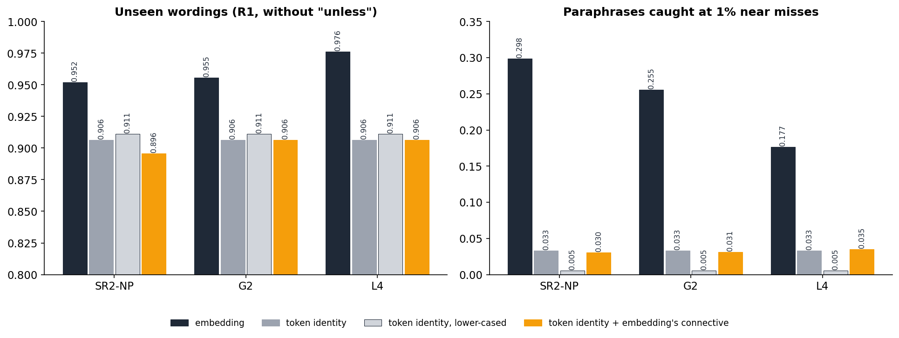
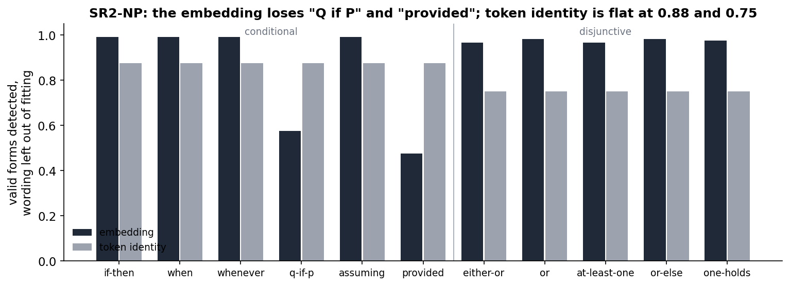

# The Lexical Baseline: How Much of the Template Test Is String Matching?

**Report of a CPU test (2026-11-26), exploratory.** The author pointed out that the methodology favours the embedding matcher: the test premises repeat their clauses word for word, and the embedding gives a repeated word the same vector. This test measures how far a matcher with no vectors at all gets on the same test. The template matcher is unchanged; only the geometry of the particles is replaced by token identity. The expectations were written in the script's header before the run. The test clauses have been read by every earlier matcher.

**In brief.**
- **Token identity alone scores 0.906 on unseen wordings (R1),** against the embedding's 0.952 (SR2-NP), 0.955 (G2) and 0.976 (L4). It fires on no fallacy, on known or unseen wordings.
- **All of its loss is one kind of clause.** It misses exactly the 15 of 60 clauses whose denial changes the verb ("the candle burns", "the candle does not burn"), on modus tollens and both disjunctive syllogisms. On the other 45 clauses it detects every valid form. That gap is geometry in the embedding: "burns" and "burn" have similar word vectors.
- **Unseen wordings cost token identity nothing.** Its detection on a wording left out of fitting equals its detection on known wordings. The embedding, by contrast, loses "Q if P" on every model (0.57 to 0.60) and "provided" on SR2-NP and G2 (0.47 and 0.49).
- **The reason: a string rule decides the frame.** Every disjunctive wording except "unless" contains the token "or", so token identity reads "contains *or*: a disjunction; otherwise a conditional", and that rule carries over to every left-out wording of this set. "Unless", the one disjunctive wording without "or", is the wording that defeats every matcher and that the primary reading leaves out.
- **On paraphrases the embedding's geometry does add:** token identity catches 0.033 of the paraphrases at 1% near misses, against the embedding's 0.18 to 0.30.
- **The four expectations missed,** two of them narrowly. The baseline did worse than predicted on the denied forms and on the paraphrase ranking, and better than predicted on new wordings.
- **What it says about the test.** On this test set the embedding's lead over token identity is morphology and synonymy, not a reading of logical form. The test cannot reward analogy or in-context meaning. The design of a test that can is [Analogy_and_Context_Test_Set.md](Analogy_and_Context_Test_Set.md). **Update 2026-11-27 (the author's question):** "Mostly string matching" describes this verbatim test, not the models. On tests built so that the words cannot decide, token identity and the embedding fall to chance or tie, and the layer states carry the form: when the form must be carried to "Therefore" (task A, [Summary_State_Test.md](Summary_State_Test.md)) the embedding reads 20 to 22% against the states' 54 to 62%, and when only a context sentence sets the form (B-logic and its control, [BLogic_Test.md](BLogic_Test.md)) the embedding ties at 0.5 by construction while the states at "Therefore" carry which clause the context bound. Templates there rank; they do not fire.

---

## Contents

1. [Definitions](#1-definitions)
2. [What was run](#2-what-was-run)
3. [Results](#3-results)
4. [Why the misses are the inflected clauses](#4-why-the-misses-are-the-inflected-clauses)
5. [How token identity reads the frame of a new wording](#5-how-token-identity-reads-the-frame-of-a-new-wording)
6. [The expectations stated before the run](#6-the-expectations-stated-before-the-run)
7. [Interpretation](#7-interpretation)
8. [Caveats](#8-caveats)
9. [Reproduce and files](#9-reproduce-and-files)

---

## 1. Definitions

- **The template matcher** is the one of [The_Embedding_Template_Matcher.md](The_Embedding_Template_Matcher.md): relational coordinates from the cosines and lengths of the premise's particles, the connective's position on the axis from the disjunctive to the conditional wordings, one Gaussian cloud per kind of premise, and the 1% false-fire rule, with the number of particles and the dimension searched on the development clauses.
- **Token identity (lex).** The cosine of two particles is 1 if they are the same token and 0 otherwise, every length is 1, and the connective's vector is the mean of the one-hot vectors of its tokens over the vocabulary of template connectives. No learned vector enters.
- **Lower-cased token identity (lexn).** As lex, with tokens compared after lower-casing and stripping the leading space, so "The" and " the" match.
- **Token identity with the embedding's connective (lex+c).** As lex for every cosine, but the connective's vector is the model's own whitened embedding.
- **R1** is the score on unseen wordings without "unless": half the detection of the four valid forms, half the silence on the five fallacy kinds, each wording left out of fitting in turn.
- **An inflected clause** is a test clause whose denial does not contain all the tokens of its affirmation: 15 of the 60, all with a verb predicate ("fails", "does not fail").

## 2. What was run

The token ids of every particle were rebuilt by the item construction of the extraction script, which is deterministic, and checked against the saved premise texts (all 21,180 premises match). Token identity does not depend on the model, so its numbers are the same on the three models; each model's embedding matcher was recomputed alongside it so that the differences are paired by clause. Scoring as in the depth runs: "unless" left out, 60 test clauses, intervals from 4,000 resamples of the clauses.

## 3. Results



**Figure 1.** R1 on unseen wordings (left) and paraphrases caught when 1% of near misses fire (right), the embedding of each model against the three token-identity readings.

| reading | R1 | known wordings: MP, MT, DS1, DS2 | fallacies fired | paraphrases at 1% | paraphrase against near miss (AUROC) |
| --- | ---: | --- | ---: | ---: | ---: |
| embedding, SR2-NP | 0.952 | 0.99, 0.98, 0.97, 0.98 | 0% | 0.298 | 0.757 |
| embedding, G2 | 0.955 | 0.99, 0.98, 0.97, 0.98 | 0% | 0.255 | 0.760 |
| embedding, L4 | 0.976 | 1.00, 0.97, 0.98, 0.98 | 0% | 0.177 | 0.759 |
| token identity | 0.906 | 1.00, 0.75, 0.75, 0.75 | 0% | 0.033 | 0.618 |
| token identity, lower-cased | 0.911 | 1.00, 0.75, 0.75, 0.75 | 0% | 0.005 | 0.648 |
| token identity with the embedding's connective (SR2-NP) | 0.896 | 1.00, 0.75, 0.75, 0.75 | 0% | 0.030 | 0.619 |

Token identity minus the embedding on R1: −0.046 (−0.078 to −0.014) on SR2-NP, −0.049 (−0.084 to −0.016) on G2, −0.070 (−0.104 to −0.037) on L4. On paraphrases at 1%: −0.27, −0.22 and −0.14, all intervals below zero. The embedding's connective adds nothing to token identity (lex+c, −0.049 to −0.070 on R1).



**Figure 2.** SR2-NP, detection of the valid forms with each wording left out of fitting. Token identity is the same on every wording of a frame (0.88 conditional: MP at 1.00 and MT at 0.75; 0.75 disjunctive). The embedding is near 1 except on "Q if P" (0.57) and "provided" (0.47).

## 4. Why the misses are the inflected clauses

On known wordings token identity misses 15 clauses on each denied form (MT, DS1, DS2), and those are, for each form, exactly the 15 inflected clauses: for modus tollens and the second disjunctive syllogism the denied clause is clause 2, for the first syllogism clause 1, and in each case all 15 missed premises deny an inflected clause (`template_lexical_frame_probe_np_when.txt`). **Measured.**

The mechanism follows from the coordinates. The decisive coordinate is the second-worst match of the second sentence's particles to the clause ([The_Embedding_Template_Matcher.md](The_Embedding_Template_Matcher.md), §8). In "The candle does not burn" against "the candle burns", the particles "does" and "burn" match nothing under token identity, so two particles are unmatched and the second-worst match is 0, as for a near miss. In the embedding, "burn" has a cosine with "burns" high enough to keep the denial on the right side. **Derived from the coordinates; consistent with the measured misses.**

## 5. How token identity reads the frame of a new wording

With "when" left out of fitting (SR2-NP's development clauses, token identity at its searched 7 particles and 6 directions):

- **Its connective coordinate is exactly 0.** "When" shares no token with any fitted connective, so its one-hot vector is orthogonal to the axis.
- **0 lies on the conditional side.** On the development premises the coordinate averages 0.31 for conditional wordings and −0.46 for disjunctive ones. The modus ponens premises of "when" sit at squared distance 11.8 from the modus ponens cloud and 24.1 from the affirmed disjunct's, and all 60 fire MP.
- **Without the coordinate the frame is nearly unreadable.** Set to its development mean for every premise, the distances become 16.6 and 18.2; modus ponens still fires (rate 0.73 against a threshold of 0.60), but the two clouds are nearly tied.

So an unknown connective is read as conditional. Every disjunctive wording except "unless" contains the token "or" (either-or, or, at least one … or, or else, one of these holds … or), so a left-out disjunctive wording keeps a disjunctive coordinate through "or". Token identity has, in effect, the rule "contains *or*: a disjunction; otherwise a conditional", and every wording of this set obeys it except "unless". **Measured for "when"; the extension to the other wordings is read from the flat detection of Figure 2.**

## 6. The expectations stated before the run

| expectation | result | verdict |
| --- | --- | --- |
| L1: on known wordings token identity detects the four valid forms at a mean within 0.05 of the embedding's on every model, firing on at most 2% of the fallacies | mean 0.81 against 0.98 (the denied forms at 0.75); no fallacy fired | miss |
| L2: on R1 token identity is at least 0.05 below the embedding on every model | −0.046, −0.049, −0.070 | miss (two models by a hair) |
| L3: with the embedding's connective, token identity is within 0.02 of the embedding on R1 | −0.056, −0.049, −0.070 | miss |
| L4: token identity catches at most 0.05 of the paraphrases at 1% near misses, with AUROC at most 0.60 | 0.033; AUROC 0.618 | miss (narrowly, on the AUROC) |

The expectations assumed the connective would be token identity's weak point and that the valid forms would be pure string patterns. Both assumptions were wrong in the same direction: the connective is solved by a string rule, and the forms are string patterns only where the denial keeps the verb's form.

## 7. Interpretation

**The test is mostly string matching.** A matcher with no knowledge of any word reaches 0.906 on unseen wordings and is perfect on the 45 clauses whose predicate keeps its form under denial. **Derived from §3 and §4.**

**Where the embedding leads, it leads by word similarity, not by structure.** Its advantage over token identity is the 15 inflected clauses ("burn" and "burns") and the paraphrases ("sluggish" and "slow"). Both are similarity between words, a real but small piece of geometry. Neither is a reading of the logical form, which token identity reads as well.

**Generalisation to new wordings measures a string rule.** On this wording set, "the connective contains *or*" separates the frames on every left-out wording but "unless". R1 therefore cannot show whether a reading generalises the frame beyond its tokens. The embedding is worse than token identity on "Q if P" on every model and on "provided" on two, where its word vectors place the connective near the middle of the axis.

**For the comparison between readings.** The best layer state differed from the embedding on R1 by −0.009 to +0.043 ([Early_State_Matcher_Runner_Up.md](Early_State_Matcher_Runner_Up.md)), small beside the 0.906 that string identity alone reaches. The test cannot show what the states add, because it never asks for anything but the repetition of words and the presence of "or". The author's conclusion follows: a test where the words do not carry the form is needed ([Analogy_and_Context_Test_Set.md](Analogy_and_Context_Test_Set.md)).

## 8. Caveats

- Exploratory, after the fact, on test clauses read by every earlier matcher; one split; one search of the particle count and dimension.
- Token identity uses GPT-2 tokens. A tokenizer that kept "burn" inside "burns" as a shared piece would score higher; lower-casing (lexn) changed little.
- The frame analysis of §5 was read for one left-out wording ("when"); the others are inferred from their detection, which is the same on every wording.
- The vocabulary of connective tokens is that of the template wordings. An ordinary-text premise's connective outside it is the zero vector, as an unseen wording's is.

## 9. Reproduce and files

```bash
cd notebooks/conservative_arch/scaleup
python3 debug/template_lexical_baseline.py RUNDIR results/template_matcher np,g2,l4        # RUNDIR holds depth_<stem>.pkl; about 45 min
python3 debug/template_lexical_frame_probe.py RUNDIR results/template_matcher np when      # the frame and the missed clauses, a few minutes
python3 ../../../companion_notes/figures/_make_lexical_figs.py
```

Outputs in `results/template_matcher/`: `template_lexical_{np,g2,l4}.json`, `template_lexical.txt` (the scoring log), `template_lexical_frame_probe_np_when.txt`. Figures: `figures/template_matcher/lex_scores.png`, `lex_wordings.png`.
