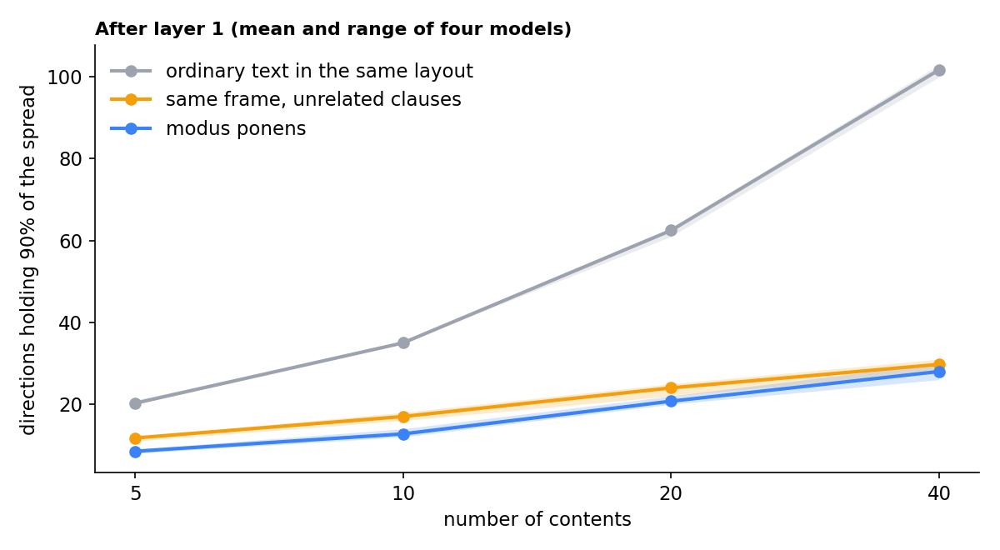
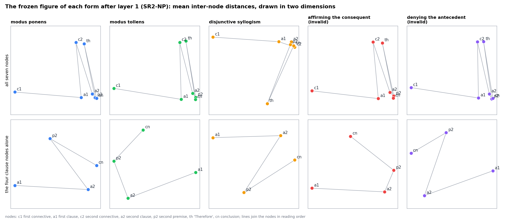
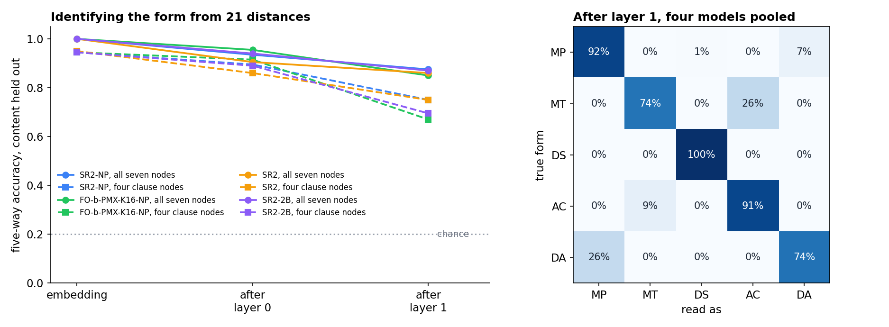
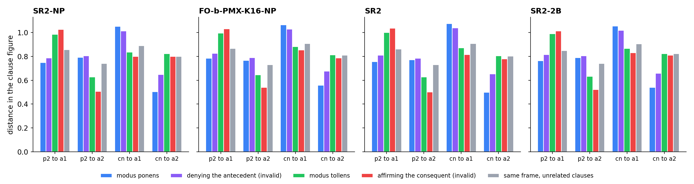
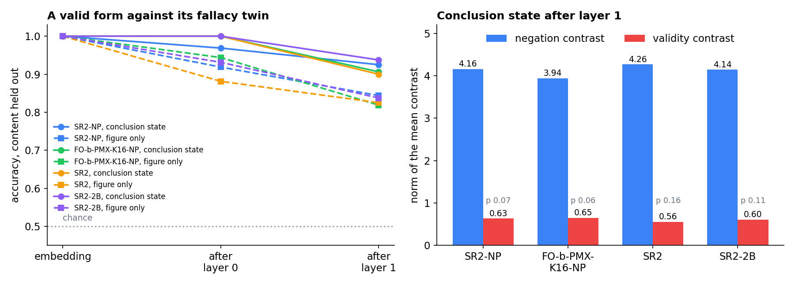
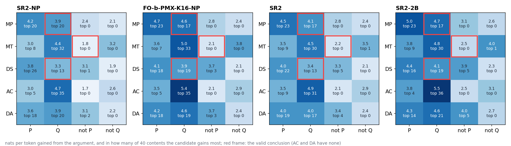

# Logical Forms as Geometric Figures in a Trained Landscape

**Where do short logical arguments end up in the state space of a trained conservative model, and can each form be frozen as a small geometric figure? A preliminary look (CPU, 2026-11-25)**

The author proposed the experiment: pass modus ponens, modus tollens and disjunctive syllogism through a converged landscape, find the smallest subspace that encloses each, and capture the representations as figures that can be frozen and memorised. It was run without registered calls, at the author's request. It feeds the template programme ([Implementing_Semantic_Templates_A_Path.md](../Implementing_Semantic_Templates_A_Path.md)) and the author's proposal of templates as geometric structures at several scales.

**In brief.**
- A form can be frozen as 21 numbers, the distances between seven nodes. After layer 1 the frozen figure identifies the form of a new argument 85 to 88% of the time (chance 20%), and a figure frozen on one model reads another model's arguments 78 to 89% of the time.
- The figure describes the frame of the sentences, which clause is restated where, and whether it is negated. It is not evidence of logic: no validity signal was found beyond negation, and the models' predictions follow copying.
- The embedding alone identifies the forms better than the final state. The layers do not build the figure; they keep most of it and make it more alike across models.
- Four times more training tokens changed none of this.

---

## Contents

1. [Definitions](#1-definitions)
2. [The problem](#2-the-problem)
3. [Mathematical analysis](#3-mathematical-analysis)
4. [The experiment](#4-the-experiment)
5. [Results](#5-results)
6. [Interpretation](#6-interpretation)
7. [Conjectures](#7-conjectures)
8. [Further directions](#8-further-directions)
9. [Caveats and corrections](#9-caveats-and-corrections)
10. [Reproduce and files](#10-reproduce-and-files)

---

## 1. Definitions

**Form and content.** An argument is two premises and a conclusion. Its content is a pair of clauses $P$, $Q$; its form is the pattern they fill.

| label | form | premise 1 | premise 2 | conclusion | valid |
| --- | --- | --- | --- | --- | --- |
| MP | modus ponens | If P, then Q. | P. | Therefore, Q. | yes |
| DA | denying the antecedent | If P, then Q. | not P. | Therefore, not Q. | no |
| MT | modus tollens | If P, then Q. | not Q. | Therefore, not P. | yes |
| AC | affirming the consequent | If P, then Q. | Q. | Therefore, P. | no |
| DS | disjunctive syllogism | Either P or Q. | not P. | Therefore, Q. | yes |

**Twins.** MP and DA restate the same clauses in the same places and differ only in negation; so do MT and AC. In the first pair the affirmed member is valid, in the second the negated one.

**Nodes.** Seven per argument, in reading order: c1 (the first connective), a1 (the first clause), c2 (the second connective), a2 (the second clause), p2 (premise 2), th ("Therefore"), cn (the conclusion). The clause nodes are a1, a2, p2, cn.

**State.** A vector in $\mathbb{R}^d$ with $d = 384$: $h^{(0)}$ enters layer 0 (called the embedding below), $h^{(1)}$ leaves layer 0, $h^{(2)}$ leaves layer 1. A node's state is the mean over its tokens. An argument is a matrix $X \in \mathbb{R}^{7 \times d}$.

**Figure.** The node matrix, centred and scaled to unit size:

$$\bar{X} = \frac{C X}{\lVert C X \rVert_F}, \qquad C = I_7 - \tfrac{1}{7} \mathbf{1} \mathbf{1}^\top .$$

The symbols, in words (added 2026-11-25 at the author's request):

- $X$ is the argument's node matrix: 7 rows, one per node in the order c1, a1, c2, a2, p2, th, cn, and $d = 384$ columns. Row $i$ is the state of node $i$.
- $\mathbf{1}$ is the column of seven ones, and $\mathbf{1}^\top$ the same as a row. Their product $\mathbf{1} \mathbf{1}^\top$ is the $7 \times 7$ matrix with every entry equal to 1.
- $I_7$ is the $7 \times 7$ identity matrix: ones on the diagonal, zeros elsewhere.
- $C$ is the **centring matrix**: 6/7 on the diagonal and -1/7 everywhere else. Multiplying by it subtracts the mean row: $C X = X - \mathbf{1} \bar{x}^\top$, where $\bar{x}^\top = \tfrac{1}{7} \mathbf{1}^\top X$ is the mean of the seven node states. So $C X$ is the node matrix with the argument's centre moved to the origin. Each row is a node's state minus the mean node.
- $\lVert C X \rVert_F$ is the Frobenius norm: the square root of the sum of the squares of all $7 d$ entries. Dividing by it gives the centred figure unit size.

The figure is therefore the shape of the seven nodes, without where the argument sits in the state space or how spread out it is. Moving every node by the same vector, or scaling them all by the same factor, leaves it unchanged. In the code (`debug/logic_analysis.py`) this is `X = X - X.mean(-2, keepdims=True); X / np.linalg.norm(X, axis=(-2, -1), keepdims=True)`.

**A small example,** with 3 nodes in 2 dimensions instead of 7 in 384, so $C = I_3 - \tfrac{1}{3} \mathbf{1} \mathbf{1}^\top$:

$$
X = \begin{pmatrix} 1 & 0 \\ 3 & 0 \\ 2 & 3 \end{pmatrix}, \qquad
C = \frac{1}{3} \begin{pmatrix} 2 & -1 & -1 \\ -1 & 2 & -1 \\ -1 & -1 & 2 \end{pmatrix}, \qquad
C X = \begin{pmatrix} -1 & -1 \\ 1 & -1 \\ 0 & 2 \end{pmatrix} .
$$

The mean row of $X$ is $(2, 1)$, and $C X$ is $X$ with $(2, 1)$ subtracted from every row. Its Frobenius norm is the square root of $1 + 1 + 1 + 1 + 0 + 4 = 8$, about 2.83, so the figure is $C X / 2.83$. The rows of $C X$ sum to zero, as every centred figure's do.

**Frozen figure.** The mean, over the arguments of a form, of the distances between the nodes of the figure: $7 \cdot 6 / 2 = 21$ numbers. An argument is read as the form whose frozen figure is nearest. Every such reading holds out one content, in all its forms, from the frozen figures.

**Enclosing dimension.** The number of leading singular directions that hold 90% of the squared norm of a set of centred points.

**Gain.** For a candidate conclusion, its loss per token after "Therefore," with no argument before it, minus its loss after the argument. The clause's own difficulty and length cancel.

## 2. The problem

1. **Where.** In how many dimensions does one argument live, and all arguments of a form?
2. **A figure.** Can a form be frozen so that new arguments, and other models' arguments, are recognised?
3. **Of what.** Does the figure encode the logic, or the wording?

Any answer needs baselines. Seven points always span at most six dimensions, the connectives are the same words in every argument of a form, and the twins differ by a visible word. Two baselines are used: **NR**, the frame of MP filled with four unrelated clauses, and **TXT**, ordinary text in the token layout of the MP arguments.

## 3. Mathematical analysis

**A figure up to rotation is its distances.** For an orthogonal $R$,

$$
(\bar{X} R)(\bar{X} R)^{\top} = \bar{X} R R^{\top} \bar{X}^{\top} = \bar{X} \bar{X}^{\top} ,
$$

and two point sets with equal Gram matrices differ by an orthogonal map. The distances determine the Gram matrix of a centred figure, so the 21 distances are a complete description of a figure up to rotation and reflection. They discard where in the state space the figure sits and how it is turned.

The symbols (added 2026-11-25 at the author's request):

- $X$ is the node matrix of one argument, 7 rows (nodes) by $d = 384$ columns, and $\bar{X}$ the figure of §1: $X$ centred over its nodes and scaled to unit Frobenius norm. Same shape, 7 by 384.
- $R$ is a $d \times d$ **orthogonal matrix**, $R R^{\top} = I_d$: a rotation or reflection of the whole state space. Since the nodes are rows, $\bar{X} R$ applies the same rotation to all seven nodes at once. It moves the figure without bending it.
- $\bar{X} \bar{X}^{\top}$ is the $7 \times 7$ **Gram matrix**: entry $(i, j)$ is the inner product of node $i$ with node $j$. The first equation says a rotation does not change it.
- From the Gram matrix $G$ the squared distances follow, $\lVert x_i - x_j \rVert^2 = G_{ii} + G_{jj} - 2 G_{ij}$. For a centred figure the converse also holds: $G = -\tfrac{1}{2} C D C$, with $D$ the matrix of squared distances and $C$ the centring matrix of §1. So distances and Gram matrix carry the same information.

**Example,** the three-node figure of §1 before scaling, $C X$ with rows $(-1, -1)$, $(1, -1)$, $(0, 2)$, and $R$ the rotation of the plane by 90 degrees acting on row vectors, $(x, y) \mapsto (-y, x)$:

$$
R = \begin{pmatrix} 0 & 1 \\ -1 & 0 \end{pmatrix}, \qquad
C X R = \begin{pmatrix} 1 & -1 \\ 1 & 1 \\ -2 & 0 \end{pmatrix}, \qquad
(C X)(C X)^{\top} = (C X R)(C X R)^{\top} = \begin{pmatrix} 2 & 0 & -2 \\ 0 & 2 & -2 \\ -2 & -2 & 4 \end{pmatrix} .
$$

The rotated rows are different vectors, but every inner product between them is the same. So are the distances: nodes 1 and 2 are 2 apart, nodes 1 and 3 and nodes 2 and 3 are the square root of 10 apart, before and after. Dividing by the norm (the square root of 8) scales every entry of the Gram matrix by 1/8 and leaves this unchanged.

**The rank bound.** Centring removes one direction, so one figure has rank at most 6 whatever $d$ is. A form's enclosing dimension is bounded only by 6 times the number of contents, so it must be read against the number of contents and against the baselines.

**High dimension makes unrelated figures look alike.** Independent isotropic points in $\mathbb{R}^{384}$ are nearly equidistant, so any two such figures nearly coincide after rotation; on one random pair the squared distance was 0.011. A small alignment residual is therefore not evidence of a shared figure. Identification on held-out contents is.

**Separating validity from negation.** Let a node's state be, for each content, $x_{\mathrm{MP}}$ and so on. Define

$$N = \tfrac{1}{2}\left( x_{\mathrm{MP}} - x_{\mathrm{DA}} - x_{\mathrm{MT}} + x_{\mathrm{AC}} \right), \qquad V = \tfrac{1}{2}\left( x_{\mathrm{MP}} - x_{\mathrm{DA}} + x_{\mathrm{MT}} - x_{\mathrm{AC}} \right).$$

$N$ is affirmed minus negated. In $V$, valid minus invalid, a negation effect that adds the same vector in both pairs cancels. A validity signal must appear in the content mean of $V$. The converse fails: any interaction of negation with the place of the restatement also appears in $V$. The null distribution flips the sign of $V$ at random per content.

**The transfer test.** Learn the direction from invalid to valid on MP and DA, and apply it to MT and AC. A direction that means validity scores near 1; one that means negation scores near 0, since the valid member is then the negated one.

## 4. The experiment

- **Contents:** 40 pairs of clauses, each affirmed and negated, all in the five forms: 200 arguments. The author's three examples are among them. For instance: "If the service is overloaded, then latency exceeds 500 ms. Latency does not exceed 500 ms. Therefore, the service is not overloaded."
- **Context:** the same 256 tokens of OpenWebText validation text and a blank line before every argument, so the arguments sit inside the window.
- **Models:** best checkpoints, two layers each. SR2 and SR2-2B share a design and differ in training tokens.

| model | what it is | training tokens | settled perplexity |
| --- | --- | ---: | ---: |
| SR2-NP | second order, no pair force | 0.53B | 58.51 |
| FO-b-PMX-K16-NP | first order, 16 Poisson-mode wells, no pair force | 0.53B | 53.39 |
| SR2 | second order, pair force | 0.53B | 58.32 |
| SR2-2B | second order, pair force | 2.13B | 48.58 |

- **The frozen-figure reading**, the core of the analysis (`debug/logic_analysis.py`):

```python
def dv(X, idx=ALL):                          # X: (contents, 7, d) -> the distances of each figure
    U = unit(X[:, idx]); i, j = np.triu_indices(len(idx), 1)
    return np.linalg.norm(U[:, i] - U[:, j], axis=-1)

k = np.arange(n) != i                        # content i held out
M = np.stack([V[a][f][k].mean(0) for f in FM])            # the five frozen figures, model a
read = np.linalg.norm(M - V[b][f][i], axis=1).argmin()    # model b's argument, read against them
```

- **Cost:** 4 to 18 minutes per model on 8 CPU threads, at most 6.3 GB.

## 5. Results

### 5.1 Dimensions

Enclosing dimension after layer 1, 90%, range over the four models:

| | one figure (median) | 5 contents | 10 | 20 | 40 |
| --- | ---: | ---: | ---: | ---: | ---: |
| modus ponens | 4 | 8 to 9 | 12 to 14 | 20 to 22 | 26 to 30 |
| NR, same frame, unrelated clauses | 5 | 11 to 12 | 16 to 18 | 22 to 25 | 28 to 31 |
| TXT, ordinary text | 5 | 20 to 21 | 35 | 61 to 63 | 100 to 103 |



**Figure 1.** The enclosing dimension against the number of contents.

One argument uses one dimension fewer than the baselines, as expected when clauses repeat. A form has no fixed enclosing subspace at these sizes: the dimension grows with every content added. It is small against ordinary text because the frame is shared: the baseline with unrelated clauses grows almost the same way.

### 5.2 The frozen figure



**Figure 2.** The frozen figures after layer 1 in SR2-NP, drawn in two dimensions from the mean distances. Top: all nodes. Bottom: the clause nodes alone.

Five-way identification, frozen on the row's model and read on the column's, after layer 1 (chance 0.20):

| frozen on | SR2-NP | FO-b-PMX-K16-NP | SR2 | SR2-2B |
| --- | ---: | ---: | ---: | ---: |
| SR2-NP | 0.88 | 0.82 | 0.85 | 0.86 |
| FO-b-PMX-K16-NP | 0.86 | 0.85 | 0.85 | 0.84 |
| SR2 | 0.89 | 0.78 | 0.86 | 0.81 |
| SR2-2B | 0.84 | 0.83 | 0.83 | 0.87 |



**Figure 3.** Left: identification within each model, by state. Right: what is read as what after layer 1, the four models pooled.

- **Errors are between twins.** Apart from 1% of MP read as DS, every error confuses MP with DA or MT with AC. The place of the restatements is always recovered; negation is sometimes missed.
- **The clause nodes alone identify the form 67 to 75% of the time.** The connectives hold about two thirds of the figure's squared size, and they are the same words in every argument of a form.
- **The embedding does better than the final state:** 1.00 within each model, then 0.91 to 0.95 after layer 0 and 0.85 to 0.88 after layer 1.
- **The final figures are more alike across models than the embeddings.** The distance between two models' frozen figures of one form falls to 0.06 to 0.07, a third of the distance between forms; in the embedding SR2-2B's differ from the others' by more, and reading them across models scores as low as 0.56.
- **Rejection.** With a threshold that keeps 95% of the arguments, all ordinary text is rejected, but only 22 to 30% of the unrelated clauses in the same frame. The figure recognises the frame first.

### 5.3 What is restated where



**Figure 4.** Distances in the clause figure after layer 1, against unrelated clauses in the same frame (grey).

A restatement of the second clause lies well inside the baseline: 0.50 to 0.56 for the conclusion of MP against 0.80 to 0.82. A restatement of the first clause barely does: 0.75 to 0.78 for premise 2 of MP against 0.85 to 0.87, and 0.80 to 0.85 for the conclusion of AC against 0.89 to 0.91. Negating the restatement weakens it (DA against MP, MT against AC).

### 5.4 Valid form against fallacy



**Figure 5.** Left: a valid form against its twin, by state. Right: the norms of the negation and validity contrasts at the conclusion after layer 1, with the sign-flip $p$ value of the second.

- **The twins are separable:** after layer 1, 80 to 85% by the figure alone and 89 to 99% by the conclusion's state. In the embedding it is 100%: the words differ.
- **The separating direction is negation.** In the transfer test it picks the wrong member for 40 of 40 contents, both ways, in every model and at every state.
- **No validity signal beyond that was detected.** With negation cancelled, the contrast at the conclusion is 0.13 to 0.17 of the negation contrast, with $p$ between 0.06 and 0.16. The embedding, where no inference is possible, gives a ratio of 0.11 to 0.12 and $p$ between 0.14 and 0.17. A small signal is not excluded by 40 contents.

### 5.5 What the models predict



**Figure 6.** What each argument adds to the four candidate conclusions, before any conclusion is read.

How often the valid conclusion gains most, of 40:

| form | SR2-NP | FO-b-PMX-K16-NP | SR2 | SR2-2B |
| --- | ---: | ---: | ---: | ---: |
| MP (Q) | 20 | 17 | 17 | 17 |
| MT (not P) | 0 | 0 | 0 | 0 |
| DS (Q) | 13 | 19 | 13 | 19 |

Candidates that repeat a clause already read gain most. After AC, whose premise 2 is Q, the invalid repetition of Q wins 31 to 36 times. In MP the choice between P and Q is even. A negated conclusion almost never wins. SR2-2B's gains exceed SR2's on every candidate, valid or not, and its valid counts are the same except in DS (19 against 13), a difference within what 40 contents can produce.

## 6. Interpretation

**Figures can be frozen.** Twenty-one numbers identify a form across contents and across models, at 78 to 89%, and reject ordinary text. That supports caching figures rather than searching states.

**They are figures of the frame.** What the figure holds is the connectives, the place of the restatements, and, less reliably, negation. All of this is in the words, and the embedding carries it better than the final state. A template frozen this way would recognise the sentence pattern. It would fire on most arguments that use the frame without any restatement, and on the fallacies.

**No inference was found, in state or in prediction.** This agrees with what two-layer models at this scale can be expected to do, and with the recall results: they copy through the context channels.

**The converged states add one thing: agreement.** Models that differ in order, wells, pair force and training tokens arrive at nearly the same figures. That is the property a transferable template needs.

## 7. Conjectures

1. **The frame is the finest scale.** The frozen figure is a template of the sentence frame. A template of the logical form would have to be read one scale up, on relations between restatements, with negation as its own node.
2. **Restatement is drawn by the context channels.** The nearer clause is restated more closely because the channels weigh recent tokens more. Cutting the earlier occurrence from them should move the restatement to the baseline.
3. **Validity needs depth, not tokens.** It requires combining where a clause is restated with whether it is negated. Four times the tokens did not produce it at two layers.

## 8. Further directions

1. **More contents,** so that the validity contrast has power, and the enclosing dimension can be extrapolated.
2. **Same premises, right and wrong conclusions.** The twins differ in their premises too; this comparison was not made.
3. **Reference models:** the matched GPT-2 at 0.53B and 2B tokens, on the same arguments.
4. **Depth:** the eight-layer code models, with arguments written in code.
5. **Varied wording:** several frames per form ("P implies Q", "Q if P"), so a frozen figure cannot rely on the connectives.
6. **Negation as a node,** and token-level rather than mean node states.
7. **Earlier checkpoints:** when the agreement across models appears, and whether it coincides with the admissible window ([Admissible_Regions_for_Template_Search.md](Admissible_Regions_for_Template_Search.md)).
8. **Clouds.** Replace each node by the Gaussian of its 40 states and compare clouds by overlap, as in the Doi–Peliti reading ([Semantic_Templates_as_Doi_Peliti_Reactions.md](../Semantic_Templates_as_Doi_Peliti_Reactions.md)).

## 9. Caveats and corrections

- **Exploratory.** No calls. The fallacies, the baselines, the gain, the transfer test, the validity contrast and the identification test were all designed after the first numbers were seen. No correction is made for the number of comparisons.
- **One wording per form, one prefix, 40 contents,** some of them odd as disjunctions ("Either the glass falls or the glass breaks").
- **Node states are means** over different numbers of tokens, and clauses differ in length.
- **Rotation is discarded** by the figure. The raw states keep it and separate the twins better.
- **One seed per model.** SR2 and SR2-2B differ in tokens and, with them, in the length of the schedule.
- **The dominant well says nothing here.** Every argument lies in one well per layer, but so does ordinary text: that well owns every token ([Well_Settling_Map_SR2_NP.md](Well_Settling_Map_SR2_NP.md)). The script also records a figure in that well's four stiff coordinates. It is not reported, because each token has its own centre and directions there, so the coordinates do not share a frame.
- **Withdrawn first readings.** Before the controls, the results were reported in conversation as: the layers erase negation; the arguments settle in one well; a four-dimensional figure exists in the well frame; the models copy the second premise. The first is wrong (§5.4), the second and third are explained above, and the fourth does not hold for DA. The alignment residuals in `logic_figures_*.txt` belong to that first analysis and should be read with §3.

## 10. Reproduce and files

```bash
cd notebooks/conservative_arch/scaleup
python3 debug/logic_figures.py  results/logic_figures <run folder> name=<stem>    # node states
python3 debug/logic_controls.py results/logic_figures <run folder> name=<stem>    # baselines and gains
python3 debug/logic_analysis.py results/logic_figures > results/logic_figures/logic_analysis.txt
python3 ../../../companion_notes/figures/_make_logic_figures_figs.py
```

Stems: `sr2np`, `fobk16np`, `sr2`, `sr2_2b`; the run folders are the Drive folders with their `checkpoints/`. Outputs are in `results/logic_figures/`: node states and frozen figures (`.npz`), readings (`.json`), reports (`.txt`). Figures: [`figures/_make_logic_figures_figs.py`](../figures/_make_logic_figures_figs.py).
