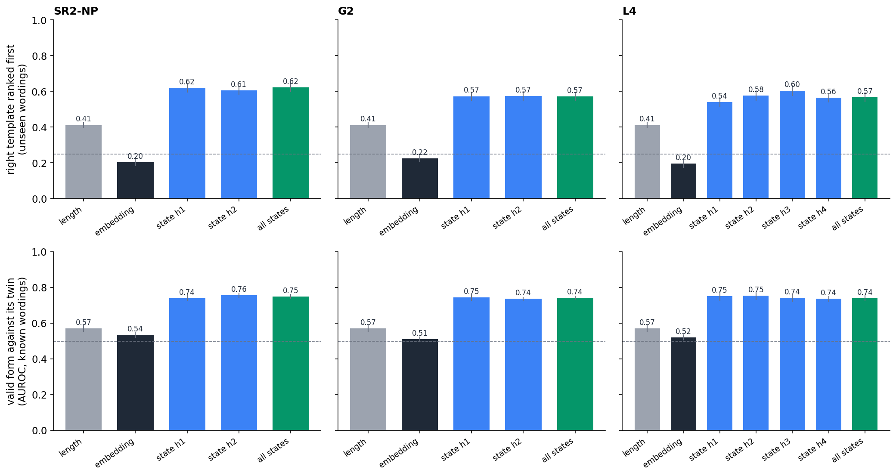

# Task A: the Logical Form Read From the State at "Therefore"

**Status (2026-11-27).** Design and calls drafted by the agent; **the calls were confirmed by the author on 2026-11-27, before any score was computed.** The script was dry-run on a subset first (no score printed). **Run and scored the same day (§6): SA2 and SA3 hit, SA1 and SA5 miss, SA4 hits only vacuously.** The states at "Therefore" rank the right template first on 54 to 62% of valid premises in unseen wordings (the embedding 20 to 22%, the length 41%) and tell valid forms from their twins with AUROC 0.74 to 0.76 (embedding 0.51 to 0.54, length 0.57). The 1% firing rule never fires on any single-vector reading, so the score built on it (R1u) is 0.5 for every reading and decides nothing. This is the first of three tasks the author asked for (A, B, C) in which the layer states should add more to the embedding than on paraphrases ([Analogy_Test_Results.md](Analogy_Test_Results.md); terminology as in [README.md](README.md)).

**In brief.**
- **The question.** Can the logical form of a premise be read from one vector, the state of the final token "Therefore"? That token is the same in every premise, so whatever its state says about the premise, the layers carried there from the clauses and the second sentence.
- **One correction to the first framing.** The embedding of "Therefore" is not identical across premises: the model adds a position vector, and the position of "Therefore" is the premise's length. So the embedding can read the length. A reading of the length alone is the control, and the layer states must beat both it and the embedding.
- **Data.** The premises of the depth tests (60 development and 60 test clauses, eleven wordings without "unless", every kind of premise), whose state vectors were kept when test 3 ran: SR2-NP, G2, L4. No new extraction.
- **Calls.** Five: the states beat the length and the embedding (SA1), rank the four templates well above chance (SA2), tell a valid form from its twin (SA3, the hard one), the embedding at "Therefore" reads only the length (SA4), and deeper states carry more on L4 (SA5).

---

## 1. Definitions

- **Premise.** As in every template test: two clauses joined by a connective, a second sentence, then "Therefore". The particles are the connective, the two clauses, the second sentence and "Therefore".
- **The state at "Therefore".** The whitened vector of the last particle, at the entry of each layer: $h^{(0)}$ (the embedding: the word vector of "Therefore" plus the position vector), $h^{(1)}$ (after layer 0, the early state), up to $h^{(L)}$.
- **Readings.**
  - **length**: the premise's length in tokens, one number;
  - **$h^{(\ell)}$ at "Therefore"**, for each $\ell$;
  - **states**: the states at "Therefore" after every layer, side by side.
- **The classifier** is the cloud part of the geometry matcher: one Gaussian cloud per kind of premise in a discriminant subspace, a template's rate from its clouds' densities, the 1% false-fire rule. There are no relational coordinates and no connective position, because there is one particle. Each vector reading is first reduced to 64 principal components fitted on the development premises; the subspace dimension is chosen by the usual content-wise five-fold development score.

## 2. Why this task

On paraphrases the embedding already does part of the work, so the states' gains are small ($+0.05$ to $+0.16$). At "Therefore" the embedding has only the length. The form of a premise is not its length: modus ponens and affirming the consequent restate a clause each, of whatever length; modus tollens and denying the antecedent both add "not". To read the form, the state must carry three things from earlier tokens:

1. **the frame**: conditional or disjunctive, from the connective;
2. **the polarity of the second sentence**: whether it says "not";
3. **which clause the second sentence restates**: clause 1 or clause 2. This is what separates every valid form from its twin, and it needs a comparison between the second sentence and the clauses, made in context.

The first two can be carried by a summary of the tokens seen. The third needs the layers to have compared phrases. That is why SA3 is the hard call.

## 3. Scores

On the 60 test clauses; intervals from 4,000 resamples of the clauses; differences paired by clause.

| score | what is measured | chance or floor |
| --- | --- | --- |
| R1u | unseen wordings (each left out of the fit in turn): half the detection of MP, MT, DS1, DS2, half the silence on AC, DA, DAnot and the affirmed disjuncts | 0.5 for a matcher that fires on nothing |
| rank | unseen wordings, valid premises: the right template has the largest density of the four | 0.25 |
| twin | known wordings: AUROC of the valid template's log odds, valid form against its twin (MP against AC, MT against DA, DS1 against the affirmed P, DS2 against the affirmed Q) | 0.5 |
| para | known wordings: paraphrases caught with the right template when 1% of the near misses fire | 0 |

Secondary, exploratory: the clouds fitted on all development premises read the Test 2 premises, scored as in [Analogy_Test_Results.md](Analogy_Test_Results.md) (foil and twin pairs per level).

## 4. The calls

"Best layer state" is the best of the single states after layer 0 and the joint reading "states", chosen per model; the choice is reported.

| id | call | probability |
| --- | --- | ---: |
| SA1 | On every model, the best layer state at "Therefore" is above both the length and the embedding on R1u by at least 0.05, with the interval of each difference above zero. | 70% |
| SA2 | On every model, the best layer state ranks the right template first on at least half of the valid premises in unseen wordings (rank at least 0.50; chance 0.25). | 65% |
| SA3 | On at least two of the three models, the best layer state separates valid forms from their twins with AUROC at least 0.60, interval above 0.5. | 45% |
| SA4 | On every model, the embedding at "Therefore" and the length are within 0.05 of each other on R1u (the embedding at that token carries only its position). | 75% |
| SA5 | On L4, the best of the states after layers 1, 2 and 3 is above the early state on R1u (deeper states carry more to the summary position). | 50% |

**Reasoning.** SA1 and SA2: the models predict the next token at every position, and after "Therefore" the next tokens depend on the frame and on whether the premise denied something, so the states should carry both. SA3: separating twins needs the second sentence matched against the right clause, which the geometry matcher does from the particles directly but a summary state may not hold; the models may not do it at two layers. SA4: "Therefore" has one word vector; only the position varies. SA5: the depth runs found no flow-gap improvement with depth, so the call is even.

**Not called:** the paraphrase score, the analogy items, the single states other than the best, and differences between models.

## 5. Reproduce and files

```bash
cd notebooks/conservative_arch/scaleup
python3 debug/template_summary_state.py VECDIR results/template_matcher np,g2,l4 analogy=ANALOGYDIR
```

VECDIR holds the `depth_<stem>.pkl` files of `debug/template_vectors_extract.py` (test 3's extraction, with every particle's state vector); ANALOGYDIR the `analogy_<stem>.pkl` files of Test 2 (extracted with `vec=1`). Script: `debug/template_summary_state.py`. Output: `results/template_matcher/template_summary_state_{np,g2,l4}.json`.

## 6. Results

Run on 2026-11-27 after the calls were confirmed: 21,180 premises per model, every reading on SR2-NP, G2 and L4, a few minutes per model. Output `results/template_matcher/template_summary_state_{np,g2,l4}.json` and the log `template_summary_state.txt`.



**Figure 1.** Per model: the share of valid premises in unseen wordings whose right template ranks first (top; chance 0.25), and the AUROC of valid forms against their twins (bottom; chance 0.5). Grey: the premise's length; black: the embedding at "Therefore"; blue: each layer state; green: all states. Intervals 95% over the 60 test clauses.

| model | reading | rank (unseen wordings) | twin AUROC (known wordings) |
| --- | --- | --- | --- |
| all | length | 0.412 (0.395 to 0.427) | 0.572 (0.551 to 0.592) |
| SR2-NP | embedding | 0.202 | 0.536 |
| SR2-NP | early state | 0.620 (0.593 to 0.646) | 0.741 (0.723 to 0.757) |
| SR2-NP | all states | 0.621 (0.597 to 0.646) | 0.750 (0.735 to 0.765) |
| G2 | embedding | 0.224 | 0.511 |
| G2 | early state | 0.573 (0.548 to 0.597) | 0.745 (0.726 to 0.765) |
| L4 | embedding | 0.196 | 0.521 |
| L4 | early state | 0.540 (0.513 to 0.567) | 0.752 (0.722 to 0.782) |
| L4 | state after layer 2 | 0.604 (0.574 to 0.633) | 0.743 (0.720 to 0.765) |

Every layer state is above both controls on both scores, every interval of the difference above zero: on rank by 0.13 to 0.21 over the length and 0.34 to 0.42 over the embedding, on twins by 0.16 to 0.18 over the length. **Measured.**

### 6.1 The calls, scored

| id | result | verdict |
| --- | --- | --- |
| SA1 | R1u is 0.475 to 0.500 for every reading, the states slightly below the length and the embedding | miss |
| SA2 | best layer state's rank 0.621 (SR2-NP, all states), 0.573 (G2, the states after layers 0 and 1), 0.604 (L4, after layer 2); every interval above 0.50 | hit |
| SA3 | best layer state's twin AUROC 0.756 (SR2-NP, after layer 1), 0.745 (G2, early state), 0.753 (L4, after layer 1); every interval above 0.5 | hit |
| SA4 | R1u 0.500 (embedding) against 0.497 (length) on every model | hit, vacuously: see below |
| SA5 | on L4, R1u of the states after layers 1 to 3 is 0.479 to 0.489, below the early state's 0.493 | miss (the score is uninformative) |

- **SA1 and SA5 miss because the firing rule never fires.** With one vector per premise, no template's rate reaches the threshold inside its cloud's reach: detection is 0 to 2% for every reading, so R1u, half detection and half silence, sits at 0.5 for everyone, and the small false fires push the states just under. The call was set on a score that cannot separate these readings. The threshold-free scores (rank, twin) are the ones that read the vectors. **Measured; the reason is read from the detection rates.**
- **SA4 hits only on that same flat score.** On rank the embedding at "Therefore" (0.20 to 0.22) is far below the length (0.41), even below chance: after whitening, the small differences the position vector makes are not read as length by the clouds. The spirit of SA4 (the embedding carries the length and nothing else) does not hold; it carries less than the length. **Measured.**
- **Depth on L4, on the threshold-free scores.** Rank rises from the early state (0.540) to the state after layer 2 (0.604) and falls after the last layer (0.564); the twin AUROC is flat (0.74 to 0.75). Not a call; exploratory.

### 6.2 What it says

**The layers carry the form to the summary position, including which clause was restated.** The state of a token that is the same in every premise ranks the right one of four templates first on 54 to 62% of valid premises in wordings it was not fitted on, and separates each valid form from its twin with AUROC 0.75, on all three models. The twin pairs differ only in which clause the second sentence restates (modus ponens and affirming the consequent both affirm; modus tollens and denying the antecedent both deny), so the state at "Therefore" holds the outcome of a comparison between the second sentence and the clauses. The embedding cannot hold it, and the length holds little. **Derived from the measurements.** One shortcut is possible and not excluded: in a twin pair one form restates the clause just before the second sentence and the other the clause before that, so a state that marks "the last clause was repeated" would separate them without a full comparison. A test with the clause order varied would separate the two.

**This is the clearest case so far where the layer states add to the embedding.** On the geometry matcher's own coordinates the states were level with the embedding or a little above it; on information that has to travel to one position, the embedding has nothing and the states have most of the answer.

**The firing rule needs its own design for single-vector readings.** A follow-up that keeps the clouds and calibrates the threshold on the readings' own development scores would turn the rank and twin signals into fires; it was not part of the calls.

**Secondary: the Test 2 premises at "Therefore"** (exploratory). The early state separates valid forms from twins on most levels (0.70 to 0.80, and 0.75 to 1.00 on C1 and C2) and its foil reading is 0.52 to 0.81 on L2, L5, L6 and C4 (point estimates) but 0.45 to 0.50 on C1; the embedding and the length are at 0.46 to 0.55 on every foil reading except C2′, where the length follows the false friend. Numbers in the JSON outputs under `analogy`.
