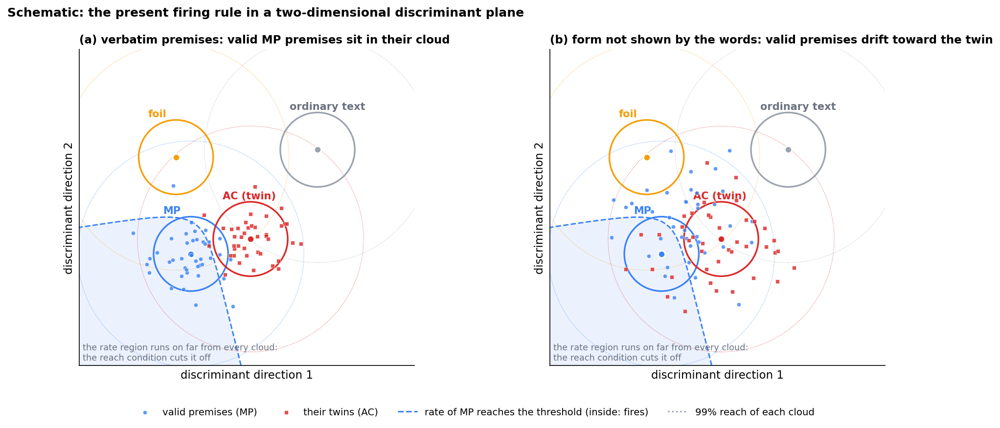
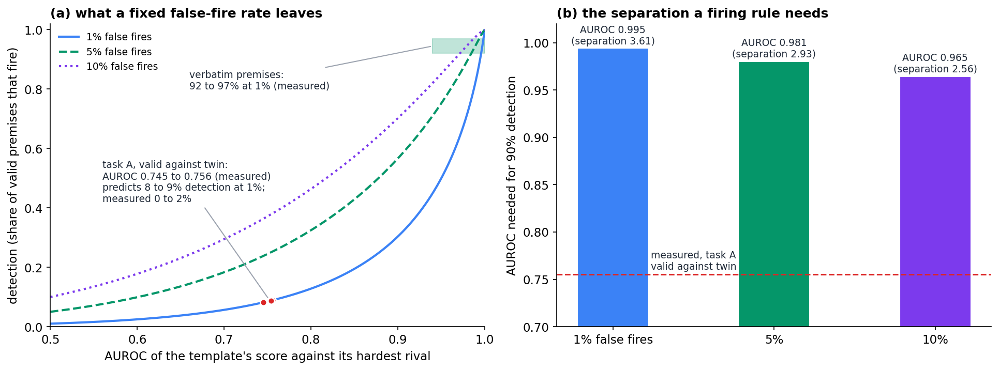
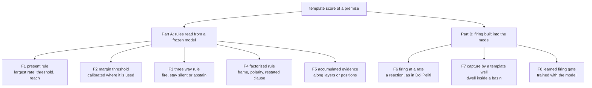
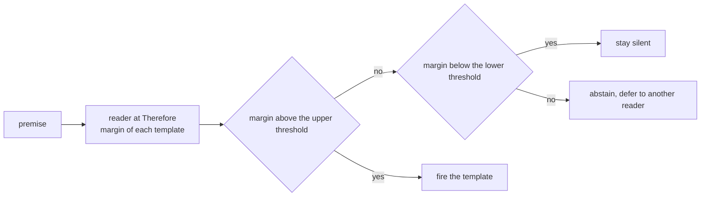
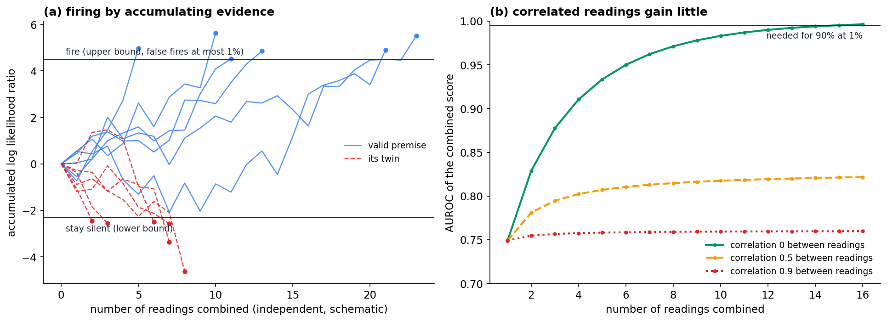
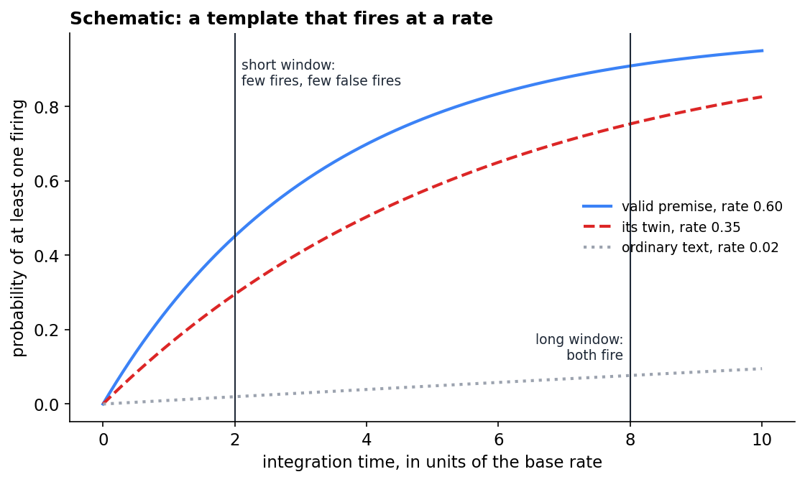
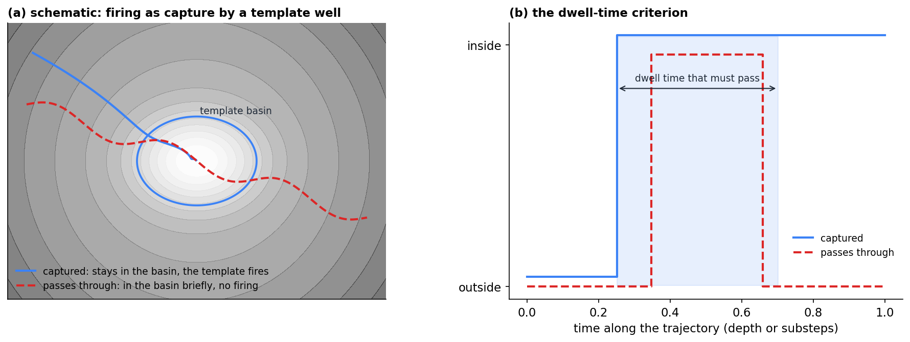
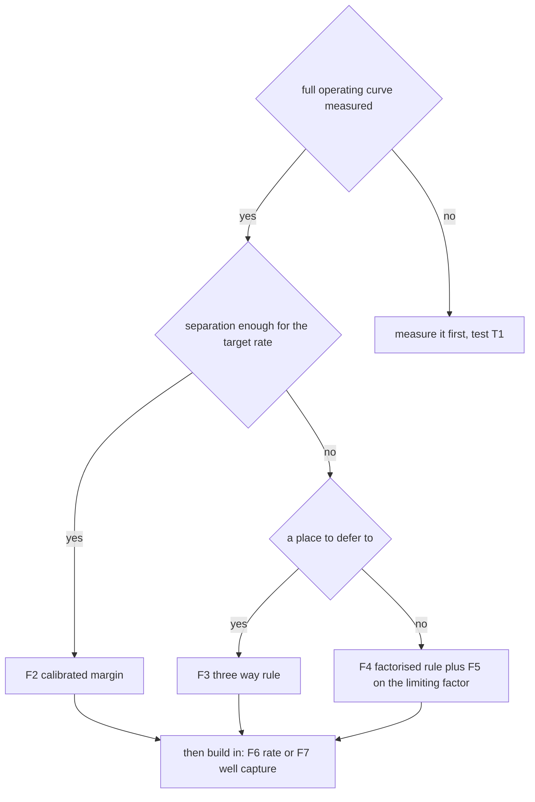

# Firing a Template: Possible Mechanisms and Their Analysis

**What this note is.** A design and analysis note, written 2026-11-27 at the author's request. It studies how a template matcher could **fire**: turn its score on a premise into a decision, with a known rate of false fires. That is Part 2 of the template work. Part 1 reads templates from trained states ([Template_Programme_Status_and_Plan.md](Template_Programme_Status_and_Plan.md)); Part 3, the Inference Structure that acts when a template fires, is not started. The note adds no new measurement. Every number is quoted from an existing report or computed from a textbook model, and is marked as such. The figures are schematic, except Figure 2, which places measured operating points on a textbook curve. The tests in §7 are proposals, not calls.

**In brief.**
- **The present rule fires only where the words decide.** A template fires when its share of the cloud density is the largest of the four, reaches a threshold set for 1% false fires on development rivals, and the premise lies within the reach of its nearest cloud. On verbatim premises this detects 92 to 97% of valid premises. On the readings that carry what the words cannot (the state at "Therefore"), it detects 0 to 2%, even on known wordings.
- **This is a property of the operating point, not a bug.** Under the textbook equal-variance model, a score that tells a valid form from its twin with AUROC 0.75 (the measured value at "Therefore") can detect at most about 9% of valid premises at 1% false fires. Detecting 90% at 1% needs an AUROC of about 0.995 against the hardest rival (derived, §3.2).
- **Eight mechanisms are analysed, in two groups.** Rules read from a frozen model: the present rule, a margin threshold calibrated on the premises it will meet, a three-way rule that may abstain, a factorised rule, and evidence accumulated along a trajectory. Firing built into the model: firing as a reaction with a rate, capture by a template well, and a learned gate.
- **No threshold rule by itself removes the bottleneck.** A valid form differs from its twin in one factor: which clause the second sentence restates (MP and MT against AC and DA), or its polarity (DS1 and DS2 against the affirmed disjuncts). When a context sentence sets the form, both factors come from the context, and only the state at "Therefore" carries them. Factorising isolates that factor, abstaining trades coverage for accuracy, and accumulation helps only as much as the readings are independent: layer states are strongly correlated, so they gain little (derived, §4.5).
- **Recommended order (§6).** First measure the full operating curve of the reader at "Therefore" against each rival. Then test a calibrated threshold with abstention, then the factorised rule. The built-in mechanisms (rate, well capture) come after there is a separation worth building on.

---

## Contents

1. [Definitions](#1-definitions)
2. [The problem](#2-the-problem)
3. [Mathematical formulation](#3-mathematical-formulation)
4. [The mechanisms](#4-the-mechanisms)
5. [The mechanisms compared](#5-the-mechanisms-compared)
6. [What the analysis implies](#6-what-the-analysis-implies)
7. [Proposed tests (not calls)](#7-proposed-tests-not-calls)
8. [Caveats](#8-caveats)
9. [References](#9-references)

---

## 1. Definitions

- **Premise.** Two clauses joined by a connective, a second sentence, then "Therefore", as in every template test ([Template_Matcher_From_Geometry.md](Template_Matcher_From_Geometry.md), §1).
- **Template.** One of the four valid forms: modus ponens (MP), modus tollens (MT), the two disjunctive syllogisms (DS1, DS2). A template $T$ is a set of **kinds** of premise (for MP, the valid MP premises in every wording).
- **Rivals.** The kinds on which no template should fire: the fallacy twins (affirming the consequent AC, denying the antecedent DA, the affirmed disjuncts), near misses, other subjects, unrelated clauses, ordinary text. **The hardest rival** of a template is the rival kind its score separates worst; for every valid form it is expected to be the twin, which shares everything with it but one factor (§4.4). The separation against each rival kind has not been measured separately.
- **Reading.** The vector that stands for a premise: the relational coordinates of the geometry matcher, built from a premise's particles, or one state at the summary position "Therefore" (task A's reader, [Summary_State_Test.md](Summary_State_Test.md)).
- **Clouds and discriminant coordinates.** One Gaussian per kind, with a common covariance; in the discriminant coordinates $y$ each cloud is a unit Gaussian with centre $m_p$.
- **Rate.** The share of the total cloud density that lies in the template's clouds, $\lambda_T(y)$ (§3.1).
- **Margin.** The log odds of the template against its strongest rival, $s_T(y)$ (§3.1).
- **Firing.** A discrete event: the template is declared present in the premise. **Ranking** is weaker: among several premises, or several templates on one premise, the right one gets the higher score.
- **False-fire rate** $\alpha$: the share of rival premises on which the template fires. **Detection** $\delta$: the share of its valid premises on which it fires. An **operating point** is a pair of the two, set by a threshold.
- **AUROC.** The probability that a random valid premise scores above a random rival premise. **Separation** $d'$: the distance between the two score distributions in units of their common spread.
- **Reach.** The region within which a premise counts as explained by its nearest cloud (99% of that cloud's mass).
- **Abstention.** A third outcome besides fire and stay silent: the rule declines to decide. **Coverage** is the share of premises on which it decides.

## 2. The problem

### 2.1 What firing must do

Reading a template is enough for a researcher, but every use of a template needs a decision. A tool that flags valid arguments needs a known false-alarm rate. The Inference Structure of the book's definition (Definition 8, §2.6) acts "whenever the Pattern Matching Structure activates", which is a discrete event. The deployment note puts it as requirement D1 ([Deploying_Semantic_Templates.md](Deploying_Semantic_Templates.md), §0.2).

A firing mechanism should meet six requirements:

1. **A known false-fire rate on the premises it will meet,** not only on the premises it was fitted on.
2. **Useful detection at that rate.**
3. **One decision per template,** so that templates can be added and removed separately.
4. **Robustness to context,** where the form is set by an earlier sentence rather than by the words of the premise.
5. **Interpretability,** so that a firing can be traced to the evidence that caused it.
6. **An event the Inference Structure can use:** discrete when it fires, and trainable when the template is learned with the model.

### 2.2 The present rule, and where it fails

The geometry matcher fires template $T$ when three conditions hold ([Template_Matcher_From_Geometry.md](Template_Matcher_From_Geometry.md), §3.3):

1. $T$'s rate is the largest of the four templates' rates;
2. the rate reaches a threshold $\rho$, the smallest value that keeps false fires on development rivals at or below 1%;
3. the premise lies within the 99% reach of its nearest cloud.

| reading | premises | detection at 1% false fires | source |
| --- | --- | --- | --- |
| geometry matcher, layer states | verbatim, known wordings | 92 to 97% | Template_Matcher_From_Geometry |
| geometry matcher, every vector | analogy items | 0 to 21% beyond levels L0 and C2 | Analogy_Test_Results |
| reader at "Therefore", every state | verbatim, known and unseen wordings | 0 to 2% | Summary_State_Test |
| reader at "Therefore" | B-logic and its control | not scored as firing: the premises were only ranked | BLogic_Test |

The reader at "Therefore" is the one that carries what the words cannot: it ranks the right form first on 57 to 62% of valid premises in unseen wordings (GPT-2: 65%) and tells a valid form from its twin with AUROC 0.745 to 0.756. Yet it almost never fires, even on the wordings it was fitted on. §3 explains why, and §4 asks what could replace the rule.

**Figure 1 (schematic, made-up clouds).** The present rule in a two-dimensional discriminant plane. Each cloud is drawn at one standard deviation (solid) and at its 99% reach (dotted). The shaded region is where the rate of MP reaches the threshold. (a) On verbatim premises, the valid premises sit inside their cloud, and most of them fire. (b) When the words do not show the form, the valid premises spread toward their twins: few reach the threshold, and twins land in the same region. The rate region also runs on far from every cloud, which is why the rule needs the reach condition.

## 3. Mathematical formulation

### 3.1 The rate and the margin

In the discriminant coordinates the clouds are unit Gaussians, and the rate of template $T$ is

$$
\lambda_T(y) = \frac{\sum_{p \in T} e^{-\lVert y - m_p \rVert^2 / 2}}{\sum_{q} e^{-\lVert y - m_q \rVert^2 / 2}},
$$

the denominator running over every kind, rivals included. The **margin** against the strongest rival is

$$
s_T(y) = \log \sum_{p \in T} e^{-\lVert y - m_p \rVert^2 / 2} - \max_{q \notin T} \left( -\tfrac{1}{2} \lVert y - m_q \rVert^2 \right).
$$

The two carry the same ordering of premises when one rival dominates the denominator, which is the case near the decision boundary. They differ far from the boundary: the rate saturates at 1, while the margin keeps growing. A threshold on the rate, $\lambda_T \ge \rho$, is a threshold on a monotone function of the margin.

### 3.2 The operating-point bound

Let the score of a template (rate or margin) be Gaussian on valid premises and on the hardest rival, with equal spread and separation $d'$. Then

$$
\mathrm{AUROC} = \Phi\left( d' / \sqrt{2} \right), \qquad \delta(\alpha) = \Phi\left( d' - z_{1-\alpha} \right),
$$

where $\Phi$ is the standard normal distribution function and $z_{1-\alpha} = \Phi^{-1}(1-\alpha)$. To detect a share $\delta$ of valid premises at false-fire rate $\alpha$ the separation must be

$$
d' = z_{1-\alpha} + z_{\delta} .
$$

| target | separation needed | AUROC needed |
| --- | ---: | ---: |
| 90% detection at 1% false fires | 3.61 | 0.995 |
| 90% detection at 5% false fires | 2.93 | 0.981 |
| 90% detection at 10% false fires | 2.56 | 0.965 |

The measured AUROC at "Therefore", 0.745 to 0.756 against the twin, corresponds to a separation of about 0.95. At that separation the bound gives about 9% detection at 1% false fires, 25% at 5% and 37% at 10% (derived). The measured detection, 0 to 2%, is below the bound because the present rule adds two more conditions, largest of four and inside the reach, and because the false-fire rate counts every rival, not only the twin (§3.3).

On verbatim premises the geometry matcher detects 92 to 97% at 1%, so its separation there is at least 3.7 against its hardest rival: the repetition of the clause words separates almost perfectly (that is what [Lexical_Baseline.md](Lexical_Baseline.md) found).

**Figure 2.** (a) Detection at 1%, 5% and 10% false fires against the AUROC of the hardest rival, under the equal-variance Gaussian model. The red points are the measured twin AUROCs of the reader at "Therefore" (SR2-NP, G2, L4, GPT-2 W2) placed on the 1% curve; the green box is the measured detection of the geometry matcher on verbatim premises. (b) The AUROC a rule needs for 90% detection, against the measured value.

### 3.3 Several rivals, and a shift between fitting and use

The false-fire rate is a mixture over the rival kinds $r$, with their shares $\pi_r$ among the premises met:

$$
\alpha = \sum_r \pi_r \alpha_r(\tau).
$$

A threshold set on development premises keeps the mixture at 1% under the development shares. If the twins are more common where the template is used, or if the valid premises' scores shift, the rate changes. A shift $\Delta$ of the valid scores toward the rivals, in units of the spread, lowers detection to

$$
\delta' = \Phi\left( d' - \Delta - z_{1-\alpha} \right).
$$

That is the step from Figure 1a to 1b: a threshold placed far in the tail of the verbatim rivals leaves almost nothing when the valid premises move.

### 3.4 The reach

Under the Gaussian model, the squared distance of a premise of kind $p$ from its centre follows a chi-square law with $d$ degrees of freedom. The reach at 99% is

$$
\lVert y - m_{p} \rVert^2 \le \chi^2_{d}(0.99).
$$

A premise between two clouds, which is where a hard valid premise sits, can lie outside every reach and is then silent whatever its rate. The reach protects against premises unlike anything fitted; it also removes exactly the premises that a context-sensitive reader moves away from the verbatim clouds.

## 4. The mechanisms

**Figure 3.** The eight mechanisms, in two groups. Part A needs nothing but the stored readings; Part B changes the model.

### Part A: rules read from a frozen model

### 4.1 F1, the present rule

**What it is.** §2.2: largest rate, rate threshold at 1% false fires, inside the reach.

**Pros.**
- It is the rule every report used, so its results are comparable across all tests.
- The reach rejects premises unlike anything fitted.
- It needs no data beyond the development premises.

**Cons.**
- Its threshold is set on verbatim rivals, so its false-fire rate is unknown on any other kind of premise (§3.3).
- It needs a separation that only verbatim premises provide (§3.2).
- The reach removes the hard premises (§3.4).

**Verdict.** Keep it as the reference for verbatim premises; replace it everywhere else.

### 4.2 F2, a margin threshold calibrated where it is used

**What it is.** Template $T$ fires when $s_T(y) \ge \tau_T$, with one threshold per template set on development premises of the kind it will meet: context-defined premises for the reader at "Therefore", for example a held-out set of B-logic frames. This is the firing test planned in [Template_Programme_Status_and_Plan.md](Template_Programme_Status_and_Plan.md), §5.2, item 4.

**A guarantee from calibration.** With $n$ calibration rival premises, exchangeable with those met in use, take $\tau_T$ as the $k$-th smallest of their margins, with

$$
k = \lceil (n+1)(1-\alpha) \rceil .
$$

The false-fire rate on a new rival premise is then at most $\alpha$ in expectation (split conformal calibration; Vovk, Gammerman and Shafer 2005; Angelopoulos and Bates 2021). The guarantee holds for any score, with no Gaussian assumption, as long as the calibration rivals are drawn like the rivals in use.

**Pros.**
- A known false-fire rate on the premises it will meet, with a finite-sample guarantee.
- One threshold per template; no reach needed, since the calibration rivals include the far ones.

**Cons.**
- It cannot beat the bound of §3.2: with a separation of 0.95 it stays near 9% detection at 1%.
- It needs calibration premises from the setting of use, and a new calibration for every new setting.
- At 1% false fires the calibration needs many rivals: 1% of a few hundred is a handful of premises, so the threshold is noisy.

**First test.** §7, T1 and T2.

### 4.3 F3, a three-way rule that may abstain

**What it is.** Two thresholds per template: fire when $s_T \ge \tau_{\mathrm{hi}}$, stay silent when $s_T \le \tau_{\mathrm{lo}}$, and abstain in between (the reject option of Chow 1970; selective classification, Geifman and El-Yaniv 2017). The thresholds are calibrated as in F2, for a target false-fire rate among the premises on which the rule decides.

**Figure 4.** The three-way rule. The deferred premises can go to a slower reader, to a person, or to a later stage that accumulates more evidence (F5).

**Pros.**
- It keeps a low false-fire rate where it decides, at any separation; the price is coverage, not accuracy.
- It fits a deployment with an outside action (deployment note, I.2), where a deferred premise can be checked.
- The risk–coverage curve is a full description of the reader's usefulness, and it can be read from stored scores.

**Cons.**
- At a separation of 0.95, high accuracy comes only at low coverage: most premises are deferred.
- It does not give the Inference Structure a decision on every premise.

### 4.4 F4, a factorised rule

**What it is.** A logical form factors into three parts ([Hybrid_Template_Matchers.md](Hybrid_Template_Matchers.md), §3.1):

1. **the frame**, conditional or disjunctive, from the connective;
2. **the polarity** of the second sentence, affirmed or denied;
3. **which clause the second sentence restates**, the first or the second.

| template | frame | polarity | restated clause |
| --- | --- | --- | --- |
| MP | conditional | affirmed | first |
| MT | conditional | denied | second |
| DS1 | disjunctive | denied | first |
| DS2 | disjunctive | denied | second |

Each twin differs from its valid form in one factor. AC (conditional, affirmed, second clause) and DA (conditional, denied, first clause) differ from MP and MT in the restated clause. The affirmed disjuncts (disjunctive, affirmed, first or second clause) differ from DS1 and DS2 in polarity. The rule fires $T$ when every factor's reader is confident in $T$'s value:

$$
P(T \mid x) = P(f_T \mid x) \cdot P(\pi_T \mid f_T, x) \cdot P(c_T \mid f_T, \pi_T, x),
$$

each factor read by the reading that is best at it. The frame comes from the matcher's particle coordinates, where it is readable. On verbatim premises the polarity is a word ("not") and can be read there too. The restated clause, and under context both the clause and the polarity (in B-logic the context sentence says whether the signal means a clause or its denial), come from the state at "Therefore", the only reading that carries them ([BLogic_Test.md](BLogic_Test.md), §5.6).

**What the factorisation shows.** If the factors' errors are independent, detection is the product of the factor detections, and a false fire on a twin needs an error in one factor alone: the clause factor for the conditional forms, the polarity factor for the disjunctive ones. **That factor is the bottleneck.** On verbatim premises the polarity is a word and the clause factor should limit; under context both come from the state at "Therefore". The measured twin AUROC of about 0.75 pools the four forms; how it splits between the conditional and the disjunctive twins has not been reported (T1 splits it). Factorising does not raise the separation. It isolates it: the frame can be set at almost no false fires, and the work of the firing rule goes into the one factor that needs more evidence.

**Pros.**
- Each factor gets its best reading; this is the factorised hybrid proposed earlier (approach F).
- The factors are interpretable: a firing says which frame, polarity and clause it read.
- The bottleneck is named, so effort goes where it matters (F5 on the limiting factor, a deeper model, a trained well).

**Cons.**
- Factor errors are not independent (the clause match depends on the frame), so the product is optimistic.
- More readers to calibrate, and the limiting factor still has the separation of §3.2.

### 4.5 F5, evidence accumulated along a trajectory

**What it is.** Combine several readings of the same premise, at successive layers or at successive positions after "Therefore", into one score, and fire when it crosses a bound. Two forms:

- **The manuscript's rule.** The companion manuscript fires a template when the average template density along the probe's path exceeds a threshold, $\bar{w} \gt \Theta$ ([Semantic_Templates_as_Doi_Peliti_Reactions.md](../Semantic_Templates_as_Doi_Peliti_Reactions.md), §1.4). Read over depth, the path is the premise's trajectory through the layers, and the rule averages the template's density over it. This is the "signature along a trajectory" of the book's definition, made into a firing rule.
- **A sequential test** (Wald 1945). Add the log likelihood ratios of successive readings, and fire at the upper bound or stay silent at the lower bound:

$$
\Lambda_n = \sum_{i=1}^{n} \log \frac{p(x_i \mid T)}{p(x_i \mid \bar{T})}, \qquad A = \log \frac{1-\beta}{\alpha}, \qquad B = \log \frac{\beta}{1-\alpha},
$$

which, for independent readings, gives false fires near $\alpha$ and misses near $\beta$ with the fewest readings on average. For $\alpha = 0.01$ and $\beta = 0.1$ the bounds are 4.50 and −2.29. The same mechanism is the drift-diffusion model of decisions (Ratcliff 1978).

**How much accumulation gains.** For $n$ readings, each with separation $d'_1$ and mean correlation $\bar{r}$ between them, the combined separation is

$$
d'_n = d'_1 \sqrt{n_{\mathrm{eff}}}, \qquad n_{\mathrm{eff}} = \frac{n}{1 + (n-1) \bar{r}} .
$$

With independent readings ($\bar{r} = 0$), about 15 readings of separation 0.95 would reach the separation of 3.61 needed for 90% at 1%. With $\bar{r} = 0.5$ the combined separation can never exceed $d'_1 \sqrt{2} = 1.34$ (AUROC 0.83); with $\bar{r} = 0.9$, about 1.0. The layer states of one premise are strongly correlated: each is the previous one plus a step. So accumulation over layers should gain little (derived; the correlation has not been measured). Positions after "Therefore", the tokens the model goes on to produce, may be less correlated, but they are not yet read.

**Figure 5.** (a, schematic) Accumulated log likelihood ratio over independent readings of separation 0.95, for valid premises and their twins, with the two bounds of a sequential test at 1% false fires and 10% misses. (b) The AUROC of the combined score against the number of readings, for correlations 0, 0.5 and 0.9 between readings. The horizontal line is the AUROC needed for 90% detection at 1%.

**Pros.**
- It uses evidence the single readings leave unused; with a sequential test the average number of readings needed is small.
- It is the framework's own matching rule (the trajectory average), so a result here bears on the theory.
- It combines well with F3: abstained premises get more readings.

**Cons.**
- The gain is set by the correlation of the readings, which for layer states is likely high.
- A trajectory average dilutes a short strong signal (one layer that carries the form) with layers that do not.

### Part B: firing built into the model

### 4.6 F6, firing as a reaction with a rate

**What it is.** The Doi–Peliti reading of templates makes firing a creation term with a rate, and the hard gate its sharp limit ([Semantic_Templates_as_Doi_Peliti_Reactions.md](../Semantic_Templates_as_Doi_Peliti_Reactions.md), §4.2):

$$
r_T = r_0 \sigma\left( \beta (s_T - \Theta) \right), \qquad P(\text{at least one firing in a window } \tau) = 1 - e^{-r_T \tau} .
$$

As $\beta \to \infty$ the rate becomes the gate $r_0 \mathbf{1}[s_T \gt \Theta]$, the present kind of rule. At finite $\beta$ the template fires stochastically, more often where its margin is larger.

**Figure 6 (schematic rates).** The probability of at least one firing against the integration time, for a valid premise, its twin and ordinary text. A short window keeps false fires rare but misses most valid premises; a long window makes both fire.

**What the rate form implies.** For a short window the firing probabilities are proportional to the rates, so the ratio of valid to twin firings is the ratio of their rates. A rate cannot separate better than the margin it is computed from: the bound of §3.2 applies to the expected firings. What the rate adds is a smooth, trainable gate.

**Pros.**
- It is the framework's own description of firing, and it is differentiable, so a template can be trained with the model.
- Firings carry a probability, which the Inference Structure can use (create with weight, or sample).

**Cons.**
- Stochastic false fires: every rival fires with some probability.
- Three constants to set ($r_0$, $\beta$, $\Theta$) and a window; the window has no natural length in a two-layer model.

### 4.7 F7, capture by a template well

**What it is.** Install a template as a well of the landscape (deployment note, I.3 and I.4) and let the dynamics decide: the template fires when the state of the summary particle enters the well's basin and stays there for a dwell time,

$$
q_k(h_t) = (h_t - \mu_k)^{\top} P_k (h_t - \mu_k) \le r^2 \quad \text{for all } t \in [t_0, t_0 + \tau_d],
$$

or, more simply, when the well's energy at the final state falls below a level. Time runs over the layers, or over the substeps of a layer.

**Figure 7 (schematic).** (a) A trajectory captured by a template well, against one that passes through the basin. (b) The dwell-time criterion: only a stay longer than the dwell time fires.

**Pros.**
- Firing is a dynamical event, local in the state space, and readable: which well, at which layer, how deep.
- The dwell time is a natural guard against passing trajectories, the dynamical counterpart of the reach.
- It is the mechanism a transformer has no counterpart for: there is no landscape for a well to sit in.

**Cons.**
- The trained wells do not capture today: on SR2-2B the particles move away from the well that dominates them on entry, at both layers ([What_the_Matchers_Read.md](What_the_Matchers_Read.md), §5). A template well would have to be trained to capture.
- With two layers there are only two time steps; dwell needs depth or substeps.
- A well that captures changes the state, so firing and the model's prediction interact (the interference bound of the deployment note, I.4).

### 4.8 F8, a learned firing gate

**What it is.** A small head on the state at "Therefore", $g_T = \sigma(w_T^{\top} h + b_T)$, trained with a firing loss on labelled premises, with a straight-through or Gumbel-softmax estimator when the firing must be discrete during training (Bengio, Léonard and Courville 2013; Jang, Gu and Poole 2017). In a transformer this is a probe with a threshold (deployment note, II.1).

**Pros.**
- The most capacity of any mechanism; it can find a direction the clouds miss.
- Simple to serve.

**Cons.**
- It needs labelled premises for every template and every setting, and it can learn a shortcut of the training premises.
- It is the least interpretable: the firing has no cloud, no well and no factor to point at.
- Its scores need calibration before any false-fire rate is claimed (Guo and others 2017), so it returns to F2 or F3 at the end.

### 4.9 The same mechanisms in a transformer

F1 to F5 apply unchanged to the matched GPT-2's residual stream: they need only readings. F8 is the probing literature's classifier with a threshold. F6 has no natural place, since a transformer's forward pass has no rate equation, and F7 has none at all, since a trained transformer has no energy for a well to lower ([Deploying_Semantic_Templates.md](Deploying_Semantic_Templates.md), Part II).

## 5. The mechanisms compared

| mechanism | known false-fire rate in use | detection at the measured separation | interpretable | usable by the Inference Structure | needs |
| --- | --- | --- | --- | --- | --- |
| F1 present rule | only on verbatim premises | near zero off verbatim premises | yes | yes, discrete | nothing new |
| F2 calibrated margin | yes, with a finite-sample guarantee | low at 1%, moderate at 10% | yes | yes, discrete | calibration premises from the setting of use |
| F3 three-way rule | yes, among decided premises | high where it decides, at low coverage | yes | only on decided premises | the same, plus a place to defer to |
| F4 factorised rule | yes, per factor | set by the clause factor | most: names the factor | yes, discrete | a reader per factor |
| F5 accumulated evidence | yes, by the test's bounds | gains only as far as readings are independent | yes | yes, after a variable delay | several readings per premise |
| F6 firing at a rate | in expectation | as F2, in expectation | yes | yes, with a probability | a trainable rate; a window |
| F7 well capture | to be measured | unknown: no template well exists | most: which well, when | yes, as a dynamical event | a trained template well; depth or substeps |
| F8 learned gate | after calibration | possibly higher | least | yes | labelled premises; calibration |

## 6. What the analysis implies

1. **The obstacle to firing is separation, not the rule** (derived, §3.2). The reader at "Therefore" ranks well and separates a valid form from its twin with AUROC 0.75. No threshold, however placed, turns that into high detection at 1% false fires.
2. **The obstacle sits in one factor per form** (derived, §4.4): the restated clause for the conditional forms, the polarity for the disjunctive ones; under context, both come from the state at "Therefore". The frame is easy.
3. **Three ways forward follow:**
   - **raise that factor's separation:** more evidence per premise (F5 at less correlated positions), a deeper model (SR2-NP-L8 is training), or a template trained into the model (F7, F8);
   - **change the operating point honestly:** a calibrated threshold at 5% or 10% false fires (F2), or abstention (F3);
   - **accept a ranker where a ranker suffices:** a research tool that orders premises needs no firing.
4. **The built-in mechanisms come last.** F6 and F7 make firing part of the model, which is where the conservative family has a claim of its own, but they inherit the separation of the readings they are built on. Building them before there is a separation worth building on would test the mechanism and the reading at once.

**Figure 8.** The order this note recommends.

## 7. Proposed tests (not calls)

Each test would get its own calls, confirmed by the author before it is run.

| id | test | data | cost |
| --- | --- | --- | --- |
| T1 | the full operating curve of the reader at "Therefore": detection at 1%, 5% and 10% false fires, against each rival kind separately, on SR2-NP, G2, L4 and GPT-2 | the stored states; the reader must also save per-premise margins | minutes on the CPU |
| T2 | a calibrated threshold (F2) on context-defined premises: thresholds set on half the B-logic frames, false fires and detection measured on the other half | the stored B-logic and control states | minutes |
| T3 | the risk–coverage curve of the three-way rule (F3) | as T1 and T2 | minutes |
| T4 | the factorised rule (F4): frame and polarity from the matcher's particle coordinates, the clause from the state at "Therefore"; each factor's separation measured on its own | the stored readings of both kinds | an hour |
| T5 | accumulation (F5): the correlation of the margins across layers, and the combined score; then the positions after "Therefore", which need a new extraction | stored states first; then an extraction | minutes, then an hour per model |
| T6 | firing at a rate (F6), simulated from the stored margins: firing probabilities of valid premises and twins over windows | the margins from T1 | minutes |
| T7 | capture by a template well (F7): a well trained to hold one form's summary states, and its dwell statistics | a training run | later; after T1 to T4 |

SR2-NP-L8, due 2026-11-28, joins T1 to T5 as soon as its battery runs: depth is one of the ways to raise the clause factor's separation.

## 8. Caveats

- **The bound of §3.2 assumes Gaussian scores with equal spread.** Real score distributions have heavier tails or unequal spreads, which can move the detection at 1% either way; T1 measures it directly.
- **The measured AUROCs are against the twin only.** Against the easier rivals the separation is larger; the false-fire rate mixes all of them (§3.3).
- **The schematic figures (1, 5a, 6, 7) use made-up clouds, rates and trajectories.** They show mechanisms, not measurements.
- **The correlation of layer readings has not been measured;** the claim that accumulation over layers gains little is derived from the structure of the residual step, not observed.
- **The literature references below are cited from memory and were not rechecked online on 2026-11-27;** they are standard works.

## 9. References

- Angelopoulos, A. N., and Bates, S. (2021). A gentle introduction to conformal prediction and distribution-free uncertainty quantification. arXiv:2107.07511.
- Bengio, Y., Léonard, N., and Courville, A. (2013). Estimating or propagating gradients through stochastic neurons for conditional computation. arXiv:1308.3432.
- Chow, C. K. (1970). On optimum recognition error and reject tradeoff. IEEE Transactions on Information Theory 16(1), 41–46.
- Fawcett, T. (2006). An introduction to ROC analysis. Pattern Recognition Letters 27(8), 861–874.
- Geifman, Y., and El-Yaniv, R. (2017). Selective classification for deep neural networks. NeurIPS 2017.
- Green, D. M., and Swets, J. A. (1966). Signal Detection Theory and Psychophysics. Wiley.
- Guo, C., Pleiss, G., Sun, Y., and Weinberger, K. Q. (2017). On calibration of modern neural networks. ICML 2017.
- Jang, E., Gu, S., and Poole, B. (2017). Categorical reparameterization with Gumbel-Softmax. ICLR 2017.
- Ratcliff, R. (1978). A theory of memory retrieval. Psychological Review 85(2), 59–108.
- Vovk, V., Gammerman, A., and Shafer, G. (2005). Algorithmic Learning in a Random World. Springer.
- Wald, A. (1945). Sequential tests of statistical hypotheses. Annals of Mathematical Statistics 16(2), 117–186.

**Companion notes.** [Template_Matcher_From_Geometry.md](Template_Matcher_From_Geometry.md) (the present rule), [Summary_State_Test.md](Summary_State_Test.md) (the reader at "Therefore"), [BLogic_Test.md](BLogic_Test.md) (context-defined premises), [Hybrid_Template_Matchers.md](Hybrid_Template_Matchers.md) (the factorisation), [Semantic_Templates_as_Doi_Peliti_Reactions.md](../Semantic_Templates_as_Doi_Peliti_Reactions.md) (firing as a reaction), [Deploying_Semantic_Templates.md](Deploying_Semantic_Templates.md) (where firing is used), [What_the_Matchers_Read.md](What_the_Matchers_Read.md) (particles and wells). Figures: [`_make_template_firing_figs.py`](../figures/_make_template_firing_figs.py).
