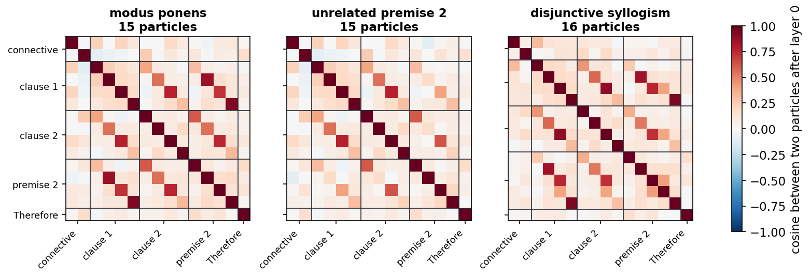
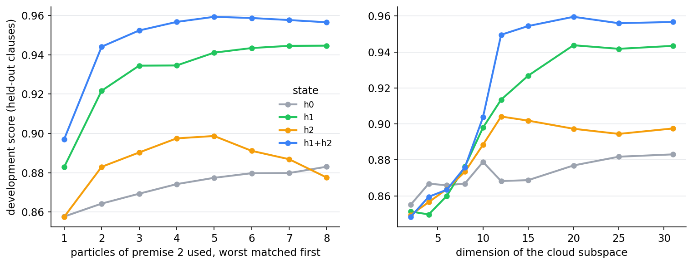
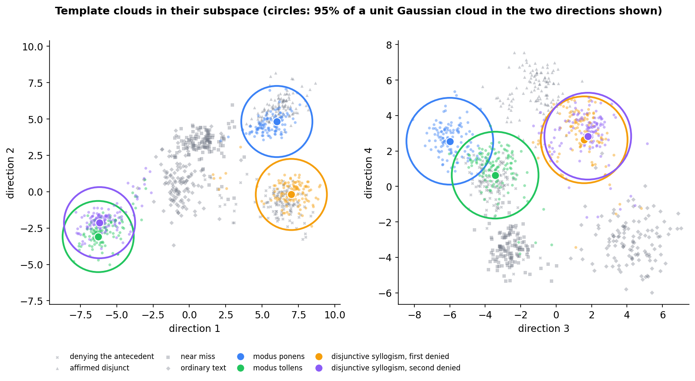
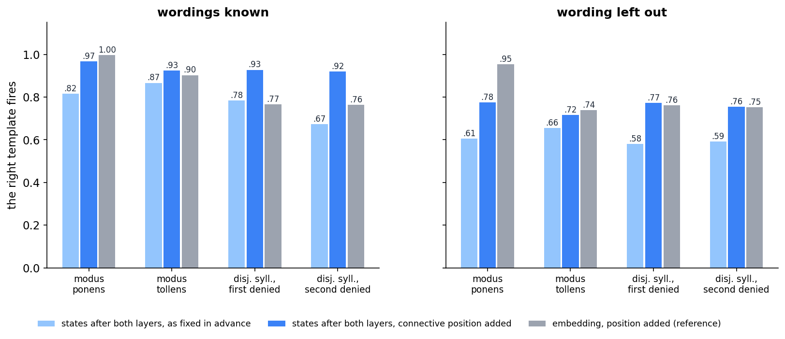
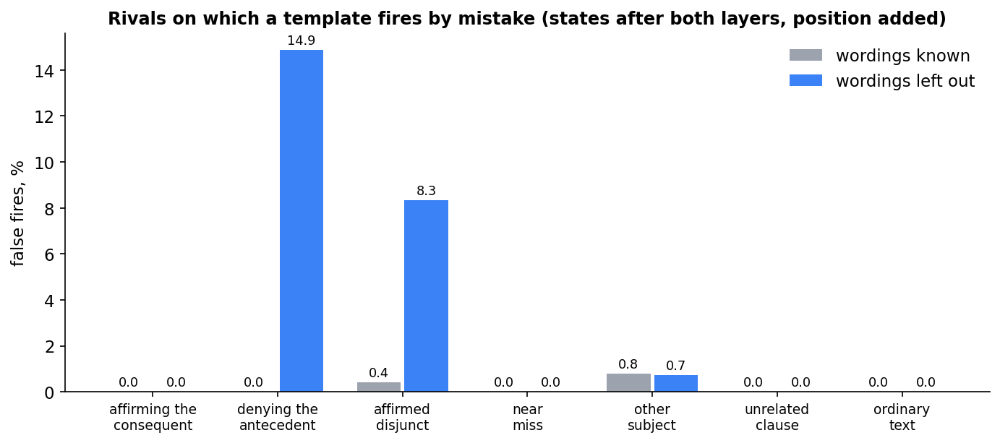
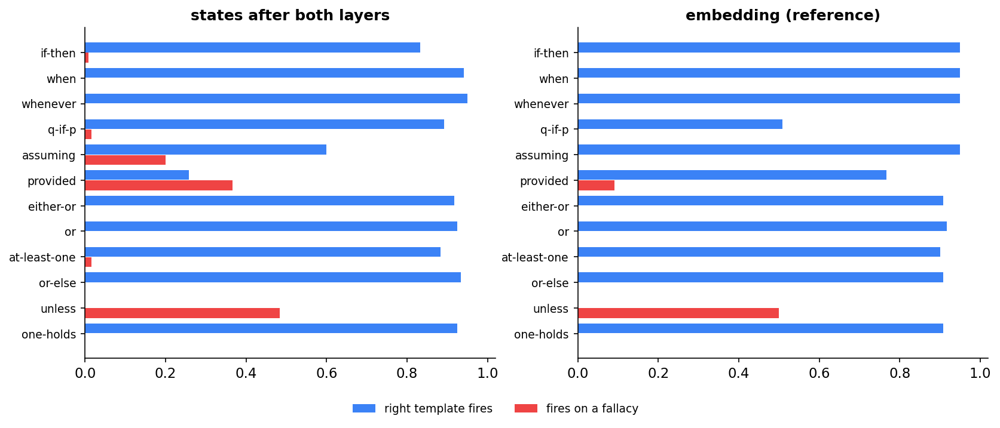
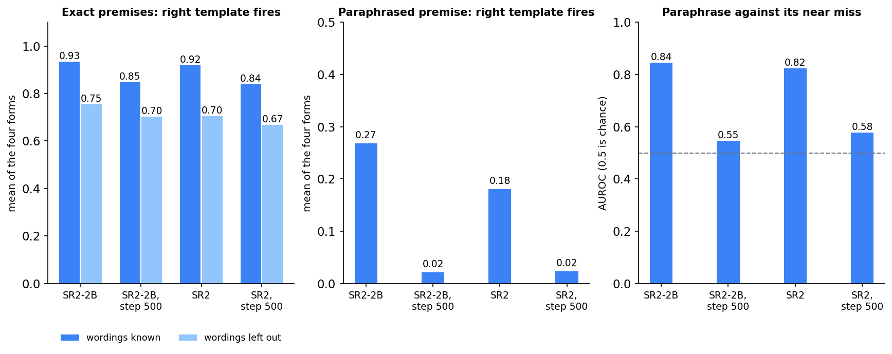
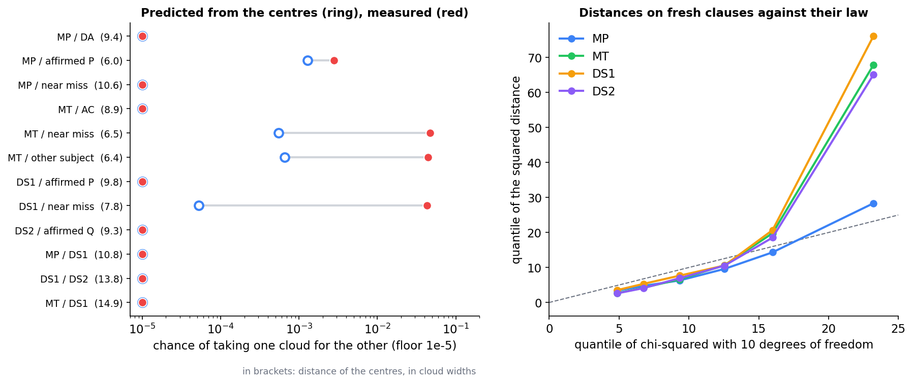

# A Template Matcher From Geometry

**Can a template for a logical form fire from the geometry of the premise alone? A two-part matcher on four trained checkpoints (CPU, 2026-11-25)**

This is the report of the first completed test of a template matcher. **Terminology (added 2026-11-27):** the matcher defined here is the geometry matcher of every later template test; in this report it is fed the trained layer states $h^{(1)}$ and $h^{(2)}$, and fed the embedding $h^{(0)}$ it is the reference, later called the embedding matcher ([README.md](README.md), terminology). The author asked for a separate template for each logical form, for as many particles of the premise as are needed to tell meanings apart, and for the differentiation to rest on geometry only, with no word list and no embedding. The test fits one cloud per kind of premise in the Doi–Peliti sense, asks which template's cloud a new premise belongs to, and records the smallest subspace that holds the clouds. It is the successor of [Logical_Forms_as_Geometric_Figures.md](Logical_Forms_as_Geometric_Figures.md) and feeds the template programme ([Implementing_Semantic_Templates_A_Path.md](../Implementing_Semantic_Templates_A_Path.md)).

**In brief.**
- With known wordings the right template fires on 92 to 97% of fresh valid premises, with false fires on 0.3% of the rivals, once the position of the connective is one of the coordinates. With the coordinates fixed in advance it is 67 to 87% and 1%. The position was added after the first results were seen.
- The smallest subspace that holds the matcher is 10-dimensional (20 without the position), reached with the 4 particles of premise 2 that match the clauses worst. A premise has about 15 particles.
- With a wording that the clouds were not fitted on, the right template fires on 72 to 78%, and denying the antecedent fires 15% of the time and an affirmed disjunct 8%. **Corrected on 2026-11-25:** these fallacy fires come from one wording, "unless", which the agent filed with the disjunctions; without it they are 0% (§5.4).
- The embedding read through the same geometry does as well on unseen wordings and not far behind on known ones. **Update 2026-11-27 (the author's question):** on verbatim premises, where the words decide. On tests built so that the words cannot decide, the picture reverses: when the form must be carried to "Therefore" (task A, [Summary_State_Test.md](Summary_State_Test.md)) the embedding reads 20 to 22% against the states' 54 to 62%, and when only a context sentence sets the form (B-logic and its control, [BLogic_Test.md](BLogic_Test.md)) the embedding ties at 0.5 by construction while the states at "Therefore" carry which clause the context bound. Templates there rank; they do not fire. Training shows mainly in one place: a paraphrased premise is told from its near miss with AUROC 0.84 in the trained models, 0.52 to 0.63 at step 500.
- Nothing here needs a validity signal. Each template is one cloud.

---

## Contents

1. [Definitions](#1-definitions)
2. [The problem](#2-the-problem)
3. [Mathematical analysis](#3-mathematical-analysis)
4. [The test](#4-the-test)
5. [Results](#5-results)
6. [Interpretation](#6-interpretation)
7. [Conjectures](#7-conjectures)
8. [Further directions](#8-further-directions)
9. [Caveats and corrections](#9-caveats-and-corrections)
10. [Reproduce and files](#10-reproduce-and-files)

---

## 1. Definitions

**Premise.** The text up to and including "Therefore": a first sentence that joins two clauses $P$ and $Q$, then a second sentence, then "Therefore". Four forms are valid and have a template each.

| template | first sentence | second sentence |
| --- | --- | --- |
| MP, modus ponens | conditional in P, Q | P |
| MT, modus tollens | conditional in P, Q | not Q |
| DS1, disjunctive syllogism | disjunctive in P, Q | not P |
| DS2, disjunctive syllogism | disjunctive in P, Q | not Q |

**Rivals.** Premises on which no template should fire: affirming the consequent (AC, second sentence $Q$ in a conditional frame), denying the antecedent (DA, second sentence not $P$), an affirmed disjunct ($P$ or $Q$ in a disjunctive frame), a near miss (the same subject with another predicate), another subject with the same predicate, an unrelated clause, and ordinary text in the same layout.

**Wording.** Twelve ways of writing the first sentence: six conditional (if-then, when, whenever, Q if P, assuming, provided) and six disjunctive (either-or, or, at least one, or else, unless, one of these holds).

**Particle.** A token of the connective, of one of the clauses, of the second sentence, or the token "Therefore". Its state is the vector of its state in $\mathbb{R}^{384}$, centred and whitened by ordinary text (a fixed affine map per state, fitted on 12,288 tokens of OpenWebText). The states are read entering layer 0 (h0, the embedding, a reference only), leaving layer 0 (h1), and leaving layer 1 (h2).

**Premise geometry.** For a premise with particles $z_1, \dots, z_n$, the cosines $z_i \cdot z_j / (\lVert z_i \rVert \lVert z_j \rVert)$ and the norms $\lVert z_i \rVert$. No token identity is used, and no list of words.



**What the matcher sees:** the cosines between the particles of one premise after layer 0 (SR2-2B). Left: modus ponens, where the second sentence repeats clause 1 and shows as a bright diagonal in that block. Middle: the same first sentence with an unrelated second sentence. Right: a disjunctive syllogism.

**Relational coordinates.** A vector $r(z) \in \mathbb{R}^{D}$ built from the premise geometry, for a number $m$ of particles:
- for each clause of the first sentence, the $m$ smallest best-cosines of the second sentence's particles to the clause, the $m$ smallest of the clause's particles to the second sentence, the cosine of the two last particles, and the cosine of the two mean states;
- for the $m$ particles of the second sentence worst matched to the nearer clause: the log norm, and the cosines to "Therefore", to the connective, to the neighbours on each side, and to the second sentence's mean;
- the six cosines among the mean states of the connective, the two clauses and "Therefore".

That is $10m + 10$ numbers per state. With two states concatenated and $m = 4$, $D = 100$.

**Position of the connective.** The connective's whitened mean state, unit length, along the axis from the disjunctive wordings' centroid to the conditional ones', one number per state. It was added after the first results (§4.3), so it is marked **post hoc** throughout. With it, $D = 102$.

**Cloud.** One Gaussian per kind of premise, with one common covariance. The covariance is the pooled within-kind covariance (Ledoit–Wolf shrunk). Ordinary text is one kind.

## 2. The problem

A template is a two-part matcher. It fires on a premise if the premise's geometry lies in the template's region, and it does not fire otherwise. Formally, given the premise's relational coordinates, decide between the four templates and "none". Three requirements are set in advance by the author:

1. **Separate template per form.** No geometry of validity is shared across forms or asked for.
2. **As many particles as needed.** The number of particles in the matcher is an output.
3. **Geometry only.** The particle's vectors, not its words.

The test asks whether the decision can be made, with how many particles, in how small a subspace, and how it degrades on wordings and clauses not seen in fitting. Whether the decision reads anything beyond the embedding is a question for the reference matcher on h0.

## 3. Mathematical analysis

### 3.1 The cloud as a Gaussian in the relational coordinates

For a kind $p$ of premise let $\mu_p$ be the mean of $r$ over its development premises, and $\Sigma$ the common covariance. The cloud of $p$ is

$$
\rho_p(z) \propto \exp\left( -\tfrac{1}{2} (r(z) - \mu_p)^{\top} \Sigma^{-1} (r(z) - \mu_p) \right).
$$

In the particles this is not a Gaussian: $r$ is a non-linear function of all the $z_i$, so the exponent is a **many-particle matching energy**

$$
E_p(z) = \tfrac{1}{2} (r(z) - \mu_p)^{\top} \Sigma^{-1} (r(z) - \mu_p), \qquad \rho_p(z) \propto e^{-E_p(z)},
$$

a sum over pairs and triples of particles through the coordinates of §1. This is the departure from the single-particle clouds of [the Doi–Peliti note](../Semantic_Templates_as_Doi_Peliti_Reactions.md): there a pattern element is one particle and its cloud is a root density; here the cloud is over a whole structure and lives in relational coordinates. Structure matching is not worked out in that note, and nothing is claimed for it there. The creation of the output particles is not tested.

### 3.2 The minimal subspace

Let $W \in \mathbb{R}^{D \times d}$ collect the leading linear discriminant directions of the kinds, whitened by $\Sigma$, so that

$$
W^{\top} \Sigma W = I_d, \qquad y = W^{\top} (r - \bar{r}).
$$

In $y$ the clouds are unit Gaussians, and each is given by its centre alone:

$$
\rho_p(y) = (2 \pi)^{-d/2} \exp\left( -\tfrac{1}{2} \lVert y - m_p \rVert^2 \right), \qquad m_p = W^{\top} (\mu_p - \bar{r}).
$$

At most (number of kinds minus 1) directions can separate the means, here 31. A template is then a set of centres $\lbrace m_p : p \in T \rbrace$ in $\mathbb{R}^d$, and the dimension of the subspace that encloses the templates and their rivals is $d$. $d$ is chosen on development clauses.

### 3.3 The rate, the threshold and the reach

For a premise at $y$ the rate of template $T$ is the share of the total density that lies in its clouds,

$$
\lambda_T(y) = \frac{\sum_{p \in T} e^{-\lVert y - m_p \rVert^2 / 2}}{\sum_{q} e^{-\lVert y - m_q \rVert^2 / 2}},
$$

the sum in the denominator running over all kinds, rivals and ordinary text included. This is the likelihood ratio against every other cloud that can explain the premise. Template $T$ fires when $\lambda_T$ is the largest of the four, $\lambda_T \ge \rho$, and the premise lies within the 99% reach $D_p$ of its nearest cloud,

$$
\lVert y - m_{p^{\ast}} \rVert^2 \le D_{p^{\ast}}, \qquad p^{\ast} = \arg\min_p \lVert y - m_p \rVert .
$$

The reach rejects a premise unlike anything seen; without it every premise would be assigned to some cloud. $\rho$ is the smallest value that keeps the false-fire rate on development rivals at or below 1%, in content-wise five-fold cross-validation. An incoming premise is one point drawn from some cloud, and this ratio is the decision that follows from that.

### 3.4 What distances predict

For two unit Gaussian clouds at distance $\delta = \lVert m_p - m_q \rVert$, the chance of assigning a point to the wrong one of the two, at the midpoint, is $\Phi(-\delta / 2)$. The Bhattacharyya overlap is

$$
\mathrm{BC}_{pq} = e^{-\delta^2 / 8} .
$$

The overlap is reserved for a later test on clouds against clouds; here a premise is a point, and the decision uses the ratio above. Under the Gaussian model a point of cloud $p$ has $\lVert y - m_p \rVert^2 \sim \chi^2_d$, which is checked on the fresh clauses.

### 3.5 The scaling of the problem

A premise of $n$ particles has $n(n-1)/2$ cosines. The relational coordinates keep the $m$ worst matched particles of the second sentence, both ways, and summarise the rest, so $m$ measures how many particles the differentiation needs. Firing costs $d$ multiplications per premise and cloud, with $d \le 31$.

## 4. The test

### 4.1 Material

- **Clauses.** 60 development clauses, from an earlier test; 60 fresh test clauses with none of the same subjects, drafted by the agent for the author to check. Each test clause has a subject-keeping paraphrase and a near miss. Examples: "the coffee is cold", paraphrase "is chilled", near miss "is strong".
- **Premises.** Two clauses per item; second sentences for all kinds of §1. 21,180 premises in all, of which 14,280 are test premises.
- **Models.** Four checkpoints of two-layer models with the pair force: SR2 (0.5B tokens) and SR2-2B (2.1B tokens), each at its best checkpoint and at step 500, which is inside the warm-up and serves as the untrained reference.
- **Context.** Every premise follows 48 tokens of OpenWebText and a blank line.

### 4.2 Procedure

1. Run each premise, take the three states of its particles, whiten.
2. Compute the cosines and norms, then $r$.
3. Fit the clouds on the development premises; choose $m$ (1 to 8 tested), $d$ and $\rho$ on development clauses only, cross-validated by clause.
4. Fire on test premises and score the kinds of §1. **Known wording**: clouds fitted on all twelve wordings. **Unseen wording**: each wording left out in turn, clouds and threshold refitted on the other eleven.

The code of the decision, from `debug/template_geometry_analysis.py`:

```python
Y = ((X - mu0) / sd) @ B                                # the projection W^T (r - mean)
D = ((Y[:, None] - C[None]) ** 2).sum(2); P = np.exp(-.5 * D); P /= P.sum(1, keepdims=True)
rate[T] = P[:, clouds_of(T)].sum(1)                     # the rate of template T
fire = (rate.max(1) >= rho) & (D.min(1) <= reach[nearest])
```

### 4.3 What was fixed before the results and what was not

| | |
| --- | --- |
| **written before any result** | the relational coordinates, the clouds, the rate, the threshold rule, the reach, the choice of particles and dimension on development clauses, the scores |
| **post hoc, after the first SR2-2B results** | the position of the connective, the matched comparisons, more than 5 particles, the pair predictions, the chi-squared check. With the position, the number of particles is set by hand per state (h1 6, h2 4, h1 with h2 4, h0 8) and only the dimension is searched |
| **not fixed at all** | the 60 test clauses were scored with both variants, so they informed the position. Fresh clauses are needed to confirm it (they are in [Template_Matchers_on_the_Dynamics.md](Template_Matchers_on_the_Dynamics.md)) |

Where a table shows "as fixed in advance" it is the first kind of matcher. The other column adds the position. An earlier, naive matcher (three hard gates on node means, no likelihood) fired on 10 to 55% of valid premises, at the same states, and was abandoned at the author's word.

## 5. Results

### 5.1 How many particles, how many dimensions



**Figure 1.** Development score against the number of particles of the second sentence used, and against the dimension of the cloud subspace (SR2-2B).

| state (as fixed in advance) | particles | dimension | coordinates | development score |
| --- | ---: | ---: | ---: | ---: |
| h1 | 5 | 20 | 60 | 0.94 |
| h2 | 4 | 12 | 50 | 0.90 |
| h1 and h2 | 4 | 20 | 100 | 0.96 |
| h0 (reference) | 5 | 15 | 60 | 0.88 |

Four to six particles of the second sentence suffice; more do not help. The subspace needs 12 to 20 dimensions with the cosines alone. With the position added it is 10, for h1 and for h1 with h2, because one direction carries the frame. A premise has about 15 particles, and the Gram matrix of one premise spans about 10 dimensions at 90% (8 for h0).

### 5.2 The clouds, explicitly

For SR2-2B, states h1 and h2 together, $m = 4$, $d = 10$, fitted on all development premises: the subspace is

$$
y = B^{\top} \left( (r - \mu_0) / s \right), \qquad r \in \mathbb{R}^{102}, \quad B \in \mathbb{R}^{102 \times 10},
$$

with $\mu_0$ and $s$ the mean and the standard deviation of the development coordinates, all given in `results/template_matcher/template_cloud_sr2_2b.npz`. The clouds are the unit Gaussians of §3.2 at the centres $m_p$:

| | direction 1 | 2 | 3 | 4 | 5 | 6 | 7 | 8 | 9 | 10 | 99% reach |
| --- | ---: | ---: | ---: | ---: | ---: | ---: | ---: | ---: | ---: | ---: | ---: |
| MP | 6.02 | 4.83 | -6.00 | 2.55 | 1.82 | 3.01 | 2.40 | -0.10 | 1.81 | 0.64 | 20.3 |
| MT | -6.28 | -3.08 | -3.44 | 0.64 | 0.59 | 0.54 | -1.76 | 0.14 | 0.95 | -0.93 | 48.0 |
| DS1 | 7.01 | -0.19 | 1.58 | 2.63 | 0.40 | -0.01 | -0.86 | -1.45 | -0.60 | -1.44 | 52.8 |
| DS2 | -6.18 | -2.13 | 1.78 | 2.84 | 2.22 | 0.51 | -1.74 | 0.01 | 1.60 | -0.89 | 43.0 |



**Figure 2.** The clouds and some rivals in the leading four directions. Circles: 95% of a unit cloud in the two directions shown.

What the directions read (the coordinates with the largest correlation):

| direction | reads mainly | share of the separation |
| --- | --- | --- |
| 1 | the last particle of the second sentence against clause 1, and the clause-1 match | singular value 28.5 |
| 2 | the match of the second sentence's particles to clause 1, worst matched | 22.1 |
| 3 | the position of the connective along the conditional–disjunctive axis (post hoc) | 17.3 |
| 4 | the odd particle out: its neighbours and norm | 16.2 |
| 5 to 10 | finer matches to clause 2, and which particle is odd | 13.4 down to 7.8 |

So direction 1 says whether the second sentence restates clause 1, direction 3 says which connective, and directions 2 and 4 say whether the restatement is exact. MP, MT, DS1 and DS2 are separated in directions 1 to 3 already.

The distances between the cloud centres, in cloud widths, and the Bhattacharyya overlap $\mathrm{BC} = e^{-\delta^2/8}$:

| | MP | MT | DS1 | DS2 |
| --- | ---: | ---: | ---: | ---: |
| MT | 15.9 | | | |
| DS1 | 10.8 | 14.9 | | |
| DS2 | 16.8 | 6.0 | 13.8 | |

All six overlaps are below 0.02. Modus tollens and DS2 are the closest pair (6.0): both deny the second clause, and they differ in the frame alone.

### 5.3 Firing on its own form



**Figure 3.** The right template fires, states after both layers (blue) and the embedding (grey), with and without the position.

| | MP | MT | DS1 | DS2 | any rival | wrong template |
| --- | ---: | ---: | ---: | ---: | ---: | ---: |
| known wording, as fixed in advance | 82% | 87% | 78% | 67% | 1.0% | 4% |
| known wording, position added | 97% | 93% | 93% | 92% | 0.3% | 0.05% |
| unseen wording, as fixed in advance | 61% | 66% | 58% | 59% | 3.0% | 8% |
| unseen wording, position added | 78% | 72% | 77% | 76% | 2.1% | 6.2% |

A reworded denial in the second sentence ("it is not true that $P$") fires 95% of the time with known wordings and 74% with unseen ones.

### 5.4 Rivals



**Figure 4.** False fires per rival kind, SR2-2B, states after both layers, position added.

| rival | known wording | unseen wording |
| --- | ---: | ---: |
| affirming the consequent | 0% | 0% |
| denying the antecedent | 0% | **14.9%** |
| affirmed disjunct | 0.4% | **8.3%** |
| near miss (same subject, other predicate) | 0% | 0% |
| other subject, same predicate | 0.8% | 0.7% |
| unrelated clause | 0% | 0% |
| ordinary text | 0% | 0% |

The pooled 2.1% of §5.3 hides the two rows that matter: of 9,000 rival premises 188 fire, 107 of them denying the antecedent and 60 affirmed disjuncts. For the fallacies alone the rate is 167 of 1,800, **9.3%**. Near misses never fire, even though they share the subject and the whole sentence frame with the valid premise.

**Correction (2026-11-25): the fallacy fires are one wording's.** "Unless P, Q" was filed with the disjunctive wordings. It has the layout of "When P, Q", and in every particle vector of the dynamics test its connective sits among the conditional wordings ([Template_Matchers_on_the_Dynamics_SR2_2B.md](Template_Matchers_on_the_Dynamics_SR2_2B.md), §5.4). Refitted on the eleven other wordings (dimension searched again), SR2-2B, states after both layers, unseen wordings:

| | all twelve wordings | without "unless" |
| --- | ---: | ---: |
| right template on MP, MT, DS1, DS2 | 78, 72, 77, 76% | 73, 88, 91, 92% |
| denying the antecedent | 14.9% | **0%** |
| affirmed disjunct | 8.3% | **0%** |
| any rival | 2.1% | 0.1% |
| wrong template | 6.2% | 0.2% |

The embedding changes the same way (denying the antecedent 3% to 0%, affirmed disjunct 8% to 0%). Outputs: `template_geometry_frame_without_unless.{json,txt}`.

### 5.5 Wordings left out



**Figure 5.** Each wording left out in turn, SR2-2B.

"Unless" fails in every variant: the template never fires (0%), and it fires on 48% of the fallacies. "Unless P, Q" means "P or Q" but reads like a conditional, and nothing in the matcher says otherwise. "Provided that" and "assuming that" are the next weakest when left out. The other nine fire on 83 to 95% of valid premises in the trained state with the position added.

### 5.6 Paraphrases

A premise whose second sentence keeps the subject and paraphrases the predicate, known wordings. It should fire the same template, and its near miss should not.

| state, position added | right template fires | against its near miss (AUROC) |
| --- | --- | --- |
| h1 with h2, SR2-2B | 12, 29, 34, 32% (MP, MT, DS1, DS2) | 0.83 to 0.87 |
| h1 with h2, SR2 | 5, 19, 26, 23% | 0.81 to 0.85 |
| h0 (reference), SR2-2B | 3, 19, 14, 15% | 0.80 to 0.91 |
| h1 with h2, SR2-2B at step 500 | 0, 3, 2, 3% | 0.52 to 0.62 |

The paraphrase is told from the near miss better than chance at any trained state, and not by the threshold: at 1% false fires only a fifth of paraphrases fire. The embedding separates them about as well (0.80 to 0.91), so this is a property of the trained word vectors, not of the layers.

### 5.7 The embedding as a reference

The same matcher on h0, with the position and 8 particles, fires on 100, 90, 77 and 76% with known wordings and 95, 74, 76 and 75% with unseen ones. With the coordinates fixed in advance it does not (88, 11, 13% for MP, MT, DS). The position of the connective is the connective's own vector there, so it reads the connective's word. The trained states win on the disjunctive syllogisms with known wordings (92 and 93% against 76 and 77%) and lose on unseen wordings for modus ponens (78% against 95%).

### 5.8 What training adds



**Figure 6.** Trained checkpoints against step 500, states after both layers, position added.

Step-500 models already fire on 80 to 100% of exact premises with known wordings. Training lifts modus tollens and the two disjunctive syllogisms from 80% to 92 to 93%, and the paraphrase rows of §5.6 from 0 to 3% to 12 to 34%. On unseen wordings training lifts modus tollens and the disjunctive syllogisms by 7 to 11 points and lowers modus ponens by 5 (78, 72, 77, 76% against 83, 65, 66, 66%). SR2-2B is not clearly ahead of SR2 (2.1B tokens against 0.5B): 92 to 97% against 89 to 93% with known wordings, 72 to 78% against 51 to 78% with unseen ones, the gap being mostly modus ponens.

### 5.9 The theory check



**Figure 7.** Left: chance of taking one cloud for the other, predicted from the distance of the centres (ring) and measured on the test clauses (red), SR2-2B, position added. Right: quantiles of the squared distance to the cloud centre against the chi-squared law.

- **The Gaussian picture is right in the bulk and wrong in the tails.** The squared distance of a test premise from its own cloud has a mean of 7.8 (MP), 10.7 (MT), 11.4 (DS1) and 10.5 (DS2) against 10 for the law, but 8 to 9% of modus tollens and disjunctive premises lie beyond its 99% point, against 1% expected; modus ponens has 2%.
- **The pair errors are of the predicted order except where the law breaks.** For pairs separated by 9 widths and more the predicted chance is $10^{-5}$ or less and the measured rate is below resolution. For MT against its near miss and against the other subject, and DS1 against its near miss, the predicted 0.005 to 0.07% is measured at 4 to 5%: the Gaussian law understates the tails there.
- The threshold is not active in the known-wording fit of §5.2: $\rho = 0.30$, the smallest value allowed, so the reach and the competition decide.

## 6. Interpretation

**A matcher of this kind can work with known wordings.** On 60 clauses it was not fitted on, the right template fires 92 to 97% of the time and the wrong one 0.05% of the time, with 10 dimensions and 4 particles. The answer is a list of centres and a matrix: it can be frozen and it is cheap, at ten multiplications per cloud and premise.

**What it recognises is the frame and the restatement.** Direction 1 is the restatement of a clause, direction 3 the connective, directions 2 and 4 the exactness. That is enough to separate the forms, and to reject near misses, unrelated clauses and ordinary text. It is not enough for a new wording: a connective not seen in fitting moves along direction 3 to a place the clouds do not cover, and its premise falls outside the reach or in the wrong cloud.

**The fallacies fire because of "unless", not because they are one step from a valid form** (corrected on 2026-11-25, §5.4). The earlier reading, kept for the record: denying the antecedent shares the first sentence with MP and the second sentence with DS; an affirmed disjunct shares the second sentence with MP. These are the only rivals that fire.

**This matcher does not read the evolution.** It reads angles and lengths of the states, with no well and no path, so it is not a test of the idea that the signature of a premise is in how its particles move. What each state is, why the embedding scores well and what would test the idea are in [What_the_Matchers_Read.md](What_the_Matchers_Read.md).

**The trained layers contribute less than the embedding does.** Word vectors and connectives suffice for most of the identification, and the layers contribute paraphrase tolerance and the disjunctive syllogisms with known wordings. The step-500 rows support this: the geometry is already there before the landscape is trained.

**Nothing in this says the models reason.** The matcher does not use the conclusion, and a template fires on sentence patterns.

## 7. Conjectures

1. **The failure on "unless" is a property of the connective's word.** Partly settled (2026-11-25): "unless" sits with the conditional connectives in the embedding and in every later vector, and "unless P, Q" is also "if not P, then Q". Filing it with the disjunctions is what makes the fallacies fire (§5.4).
2. **A paraphrase threshold is a matter of the metric:** the paraphrase AUROC of 0.84 and the low firing rate at 1% false fires say the paraphrases lie close to the near-miss cloud; a rival cloud for near misses that is wider on the paraphrase directions would help.
3. **Depth could move the point where the connective is read.** The connective's position enters the state after layer 0 already. Whether more layers give the second sentence a meaning of its own, rather than a cosine, is the test that comes next ([Template_Matchers_on_the_Dynamics.md](Template_Matchers_on_the_Dynamics.md)).

## 8. Further directions

1. **Confirm the position on clauses not seen here.** Done (2026-11-25): on the 60 fresh clauses of the dynamics test, states after both layers, 5 particles chosen by the search, the right template fires on 91, 98, 98 and 98% with known wordings and 69, 83, 81 and 80% with unseen ones, any false fire 0%; the embedding 100, 98, 83, 84 and 90, 77, 82, 82. Paraphrases are harder there (2, 10, 19, 11% for the states).
2. **More wordings,** including ones drawn from a language model's own paraphrases, and an explicit treatment of "unless".
3. **Displacements and well-frame vectors** in place of the states ([Template_Matchers_on_the_Dynamics.md](Template_Matchers_on_the_Dynamics.md)).
4. **Clouds against clouds.** The Bhattacharyya overlap between a template's cloud and a premise's cloud needs a premise with a spread of its own (several phrasings, several contexts), and is a separate test.
5. **Particles, not tokens,** as the unit of the second sentence: a multi-word predicate as one particle.
6. **Reference models:** matched GPT-2 at the same tokens, so that the share of the geometry that is common to any trained transformer can be read.
7. **Depth:** L = 4 on prose, L = 4 and 8 on code.

## 9. Caveats and corrections

- **Post hoc parts** are marked in §4.3 and in every table that uses them. The position of the connective was motivated by the confusion of MP with an affirmed disjunct on these same test clauses.
- **Clause boundaries are given.** The matcher is told which tokens form each clause.
- **One seed per model, one prefix.** Clauses and paraphrases were drafted by the agent and await the author's check. Some are odd as disjunctions.
- **The wording "unless"** was filed with the disjunctions by the agent; the fallacy rates of §5.3 to §5.5 for unseen wordings carry it (§5.4).
- **Reported as 2.1% and corrected here.** An earlier summary gave "0%" for the affirmed disjunct at known wordings; it is 0.4% (3 of 720). The pooled rate for unseen wordings was given without the fallacy split; §5.4 gives both.
- **Two layers only.** The states are taken at layer boundaries: no depth axis.
- **SR2 and SR2-2B share an architecture and differ in tokens and, with them, in the length of the schedule.**
- **The step-500 checkpoints** are inside the warm-up, so the reference is a partly trained model.

## 10. Reproduce and files

```bash
cd notebooks/conservative_arch/scaleup
python3 debug/template_robust_test.py   OUT <run folder> name=<stem> [ckpt=step500]     # 47 to 64 min per run, 8 threads
python3 debug/template_geometry_analysis.py OUT RES sr2_2b,sr2,sr2_2b_s500,sr2_s500      # as fixed in advance
python3 debug/template_geometry_detail.py   OUT RES ...                                  # matched rivals, pairs, chi-squared
python3 debug/template_geometry_frame.py    OUT RES ...                                  # with the connective's position
python3 debug/template_geometry_export.py   OUT RES sr2_2b                               # the clouds, written out
python3 ../../../companion_notes/figures/_make_template_matcher_figs.py
```

The clauses are in `debug/template_robust_clauses.py`; outputs and reports in `results/template_matcher/` (`template_geometry*.json` and `.txt`, `cloud_*.npz`, `template_cloud_sr2_2b.json` and `.npz`, `example_premises_sr2_2b.json`). Figures: [`figures/template_matcher/`](../figures/template_matcher/).
