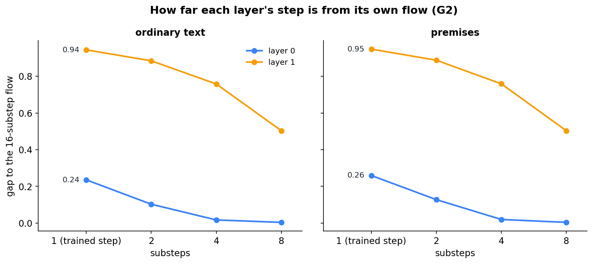
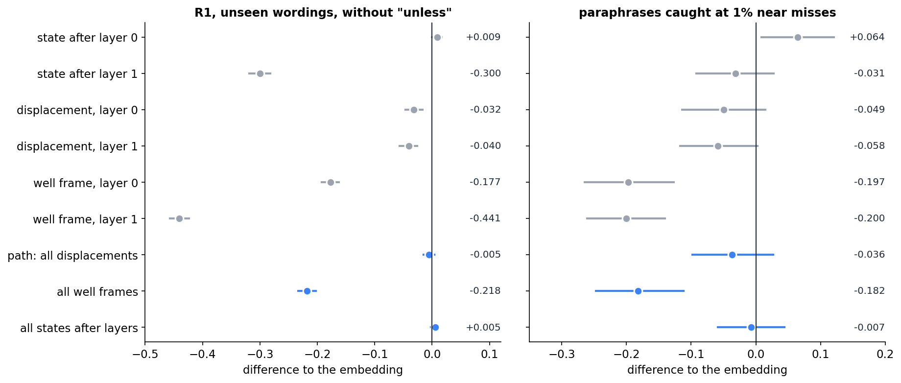
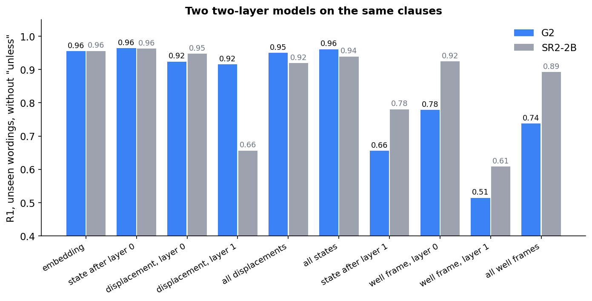

# Template Matchers and Depth: G2, the Two-Layer End

**Report of the first depth arm (CPU, 2026-11-25).** G2 is the two-layer prose model at 0.5B tokens, with the live gradient path, the pair force and the reverse channel. It is the two-layer end of the comparison pre-registered in [Template_Matchers_and_Depth.md](Template_Matchers_and_Depth.md). The calls TL1 to TL6 compare it with the four-layer model and cannot be scored until that model has run. This report gives the two-layer readings they will be compared against, and what they show on their own.

**In brief.**
- **The path matches the embedding.** The matcher on both displacements is level with the embedding on unseen wordings: -0.005, interval -0.015 to +0.004. On SR2-2B, read on the same clauses, it was 0.036 below.
- **The two-layer step is far from its flow at layer 1.** The trained step of layer 0 is 0.24 from its 16-substep flow; layer 1's is 0.94, and even 8 substeps are 0.50 from 16. So the reference flow of layer 1 is itself not converged at 16 substeps. This bears on TL1 (§6).
- **The state after layer 0 is the only reading to beat the embedding,** on paraphrases at 1% near misses, by 0.064 (interval +0.008 to +0.120). On R1 it is level (+0.009).
- **What layer 1 does differs between the two two-layer models.** On G2 the layer-1 displacement reads well (R1 0.915), but the final state, which includes the reverse channel, reads badly (0.656). On SR2-2B, which has no reverse channel, it was the other way round (0.656 and 0.780).
- **Giving "unless" clouds of its own breaks the conditional templates here too:** the embedding detects MP on unseen wordings 0% of the time and fires on 98% of denied antecedents. The path is the most robust reading under that filing (R1 0.841).

---

## Contents

1. [What was run](#1-what-was-run)
2. [How far each layer is from its flow](#2-how-far-each-layer-is-from-its-flow)
3. [The matchers](#3-the-matchers)
4. [Paraphrases](#4-paraphrases)
5. ["Unless"](#5-unless)
6. [What this means for the calls](#6-what-this-means-for-the-calls)
7. [Interpretation](#7-interpretation)
8. [Caveats](#8-caveats)
9. [Reproduce and files](#9-reproduce-and-files)

---

## 1. What was run

- **Model.** G2, best checkpoint: two layers, 0.5B tokens of OpenWebText, live gradient path, pair force, reverse channel (folder `..._cgqk_vplive_xilive_L2probe_..._idt4_lr0p0012_noattn`).
- **Premises.** The same 21,180 as on SR2-2B: 60 development and 60 test clauses, twelve wordings. Extraction 58 minutes on eight threads (`template_depth_test.py`), with the replay check on: replaying each layer's step reproduced the forward pass to within $10^{-4}$.
- **Scoring.** `template_depth_analysis.py`, 18 minutes, with the three readings fixed before any depth result was read: the primary reading without "unless", the twelve-wording reading, and "unless" with clouds of its own.
- **Matchers.** The embedding (reference); the states after layers 0 and 1; the displacements and well frames of both layers; and three joint ones: **path** (both displacements), **wells** (both well frames), **states** (both states after the layers).

## 2. How far each layer is from its flow



**Figure 1.** The gap of each layer's step, cut into 1, 2, 4 and 8 substeps, to the same step cut into 16 (§1 of the pre-registration), median over tokens.

| | layer 0 | layer 1 |
| --- | ---: | ---: |
| gap of the trained step, ordinary text | 0.236 | **0.944** |
| gap at 2, 4, 8 substeps, ordinary text | 0.103, 0.017, 0.004 | 0.884, 0.758, 0.503 |
| gap of the trained step, premises | 0.259 | 0.948 |
| cosine of the trained displacement with the flow's | 0.996 | 0.788 |
| median length of the displacement, ordinary text | 4.87 | 7.82 |
| median length of the entry state | 2.90 | 19.60 |
| cosine of the two layers' displacements, ordinary text | 0.41 | |

Layer 0 converges quickly: 4 substeps are within 2% of 16. **Layer 1 does not converge by 16 substeps:** halving the step from 8 to 16 still moves the displacement by half its length. The entry state of layer 1 has length 19.6, the LayerNorm's scale, against 2.9 for the embedding, so the forces of layer 1 act on much larger states. The trained displacement of layer 1 still points the same way as the 16-substep one (cosine 0.79).

## 3. The matchers



**Figure 2.** Each matcher against the embedding on the same clauses, with 95% intervals from 4,000 resamples of the clauses. Left: R1 on unseen wordings, "unless" left out. Right: paraphrases caught when 1% of near misses fire.

| matcher | particles | dimension | development | R1 | minus the embedding | twelve wordings |
| --- | ---: | ---: | ---: | ---: | --- | ---: |
| embedding | 7 | 10 | 0.986 | 0.955 | | 0.909 |
| state after layer 0 | 7 | 20 | 0.993 | **0.964** | +0.009 (-0.001 to +0.017) | 0.880 |
| state after layer 1 | 5 | 20 | 0.967 | 0.656 | -0.300 (-0.319 to -0.282) | 0.607 |
| displacement, layer 0 | 4 | 10 | 0.988 | 0.924 | -0.032 (-0.046 to -0.017) | 0.777 |
| displacement, layer 1 | 5 | 10 | 0.978 | 0.915 | -0.040 (-0.057 to -0.026) | 0.823 |
| well frame, layer 0 | 5 | 31 | 0.957 | 0.778 | -0.177 (-0.192 to -0.162) | 0.710 |
| well frame, layer 1 | 4 | 10 | 0.885 | 0.515 | -0.441 (-0.457 to -0.423) | 0.503 |
| **path** | 5 | 25 | 0.990 | 0.950 | **-0.005 (-0.015 to +0.004)** | 0.873 |
| wells | 5 | 15 | 0.965 | 0.738 | -0.218 (-0.233 to -0.202) | 0.716 |
| states | 5 | 10 | 0.992 | 0.961 | +0.005 (-0.002 to +0.011) | 0.844 |

**Where the unseen wordings are lost.** Detection of the valid forms, each wording left out in turn (per cent):

| matcher | if-then | when | whenever | Q if P | assuming | provided | disjunctive (five) |
| --- | ---: | ---: | ---: | ---: | ---: | ---: | --- |
| embedding | 99 | 98 | 99 | 60 | 98 | 49 | 97 to 98 |
| state after layer 0 | 96 | 95 | 96 | **97** | 93 | 59 | 97 |
| path | 93 | 96 | 97 | 38 | 94 | **82** | 97 to 98 |
| states | 97 | 95 | 97 | 85 | 93 | 54 | 96 to 98 |
| state after layer 1 | 38 | 75 | 75 | 2 | 24 | 0 | 21 to 70 |

"Q if P" and "provided" carry the losses, as on SR2-2B. The two wordings are hard in different ways. "Q if P" puts the consequent first: the state after layer 0 handles it (97%) and the path does not (38%). "Provided" sits nearest the middle of the connective axis: the path handles it best (82%).

**Against SR2-2B.** The two-layer readings on the same clauses, both without "unless":



**Figure 3.** R1 per reading, G2 and SR2-2B. SR2-2B's matchers keep the number of particles and the dimension chosen in its main run (with "unless" in the development set); G2's were chosen without it.

The embedding and the state after layer 0 read the same on both (0.96). The models part at layer 1: G2's displacement of layer 1 reads 0.915 against SR2-2B's 0.656, and G2's final state reads 0.656 against SR2-2B's 0.780. G2's final state is taken after its reverse channel, which SR2-2B does not have; its layer-1 displacement is taken before it. The well frames read worse on G2 at both layers.

## 4. Paraphrases

Paraphrases caught at a fixed rate of near-miss fires (known wordings), and the difference to the embedding:

| near misses that fire | embedding | state after layer 0 | path | states | state after layer 0 minus embedding |
| ---: | ---: | ---: | ---: | ---: | --- |
| 0.25% | 0.190 | 0.210 | 0.149 | 0.157 | +0.020 (-0.035 to +0.073) |
| 1% | 0.255 | **0.320** | 0.219 | 0.248 | **+0.064 (+0.008 to +0.120)** |
| 2% | 0.330 | 0.376 | 0.267 | 0.323 | +0.046 (-0.018 to +0.111) |
| 5% | 0.464 | 0.454 | 0.406 | 0.439 | -0.010 (-0.074 to +0.057) |

The path is below the embedding at every rate (-0.036 to -0.062), and the joint states are level with it. The state after layer 0 is the one reading above it, with the interval clear of zero at 1% only. On SR2-2B the joint states had been the reading above the embedding at 1% and 2% (+0.053 and +0.078). The pattern is the same: the paraphrase gain, where there is one, sits in the state after layer 0. But it is not the same reading on both, and it is small.

At the rule's own threshold the displacements again catch more paraphrases than the embedding (0.179 and 0.142 for the layer-0 displacement and the path, against 0.043), with near misses at 0.6% and 0.3%. As on SR2-2B, this is the operating point, not the ranking.

## 5. "Unless"

| matcher | R1, own clouds | MP detected, unseen | denied antecedent fires, unseen | "unless" detected, known (DS1, DS2) |
| --- | ---: | ---: | ---: | --- |
| embedding | 0.572 | 0.00 | 0.98 | 0.98, 0.98 |
| state after layer 0 | 0.667 | 0.21 | 0.74 | 0.98, 0.98 |
| path | **0.841** | 0.66 | 0.30 | 1.00, 0.98 |
| states | 0.765 | 0.46 | 0.52 | 0.97, 0.98 |

The failure of [Connectives_With_a_Hidden_Negation.md](Connectives_With_a_Hidden_Negation.md) repeats on G2: with "unless" in clouds of its own, conditional wordings left out of fitting fall into the "unless" clouds. In the embedding the left-out conditional connectives sit at 0.55 to 0.71 on the connective axis, and "unless" at 0.67. On G2 the embedding does detect "unless" on its known wording (98%), where SR2-2B's did not (33% and 78%). The path is the least affected, the only reading where most unseen MP premises still fire.

## 6. What this means for the calls

None of TL1 to TL6 is scored by this arm alone. Three facts matter for them:

- **TL1** compares the mean flow gap of the layers between the two models. On G2 the mean is 0.59 (0.236 and 0.944) on ordinary text. The 16-substep reference of layer 1 is not converged, so for G2's layer 1 the gap understates the distance to the true flow. The call is scored as written. Whether the four-layer reference is converged will be reported beside it.
- **TL2 and TL3** compare the path's gap to the embedding. G2's is -0.005 (-0.015 to +0.004): the four-layer model starts from a level path, not a deficit, so TL2 needs it to beat the embedding by about 0.015 or more.
- **TL5** compares the worst single displacement of layers 1 to 3 at four layers with G2's layer-1 displacement, R1 0.915. A gain of 0.10 would need R1 above 1, so TL5 cannot hit. The call was written expecting a broken layer-1 reading, as on SR2-2B (0.656). The agent wrote it before G2 was read, and the outcome is fixed by G2's number; it will be scored as a miss, with this note.

## 7. Interpretation

**On G2 the path is as good as the words, not better.** The two displacements together identify the forms on unseen wordings as well as the embedding does. That is more than on SR2-2B, where the same matcher was 0.036 below. A displacement that the whitening reads only through its non-linear part (§3.1 of the SR2-2B report) carries the forms as well as the embedding does, but no more.

**The reverse channel changes what the last state carries.** G2's final state reads 0.30 below the embedding, while its layer-1 displacement, before the reverse channel, reads only 0.04 below. On SR2-2B, without a reverse channel, the layer-1 displacement was the broken reading. So the step at which the reading breaks is not fixed by the depth. It depends on what comes after the conservative step. This was not foreseen.

**The layer-1 step is long and not close to a flow.** Its displacement still identifies the forms (0.915). Closeness to the flow and the quality of the reading are not tied together in this model.

**The paraphrase gain is small and sits in the state after layer 0.** It is the same layer on both two-layer models and near the noise in both.

## 8. Caveats

- One model, one seed; 0.5B tokens; English premises drafted by the agent, awaiting the author's check.
- The comparison with SR2-2B is not paired in the scoring and the two models' matchers were tuned on different development sets (with and without "unless").
- The flow reference of layer 1 is not converged at 16 substeps.
- The state after the last layer includes the reverse channel; the displacements do not.
- The paraphrase readings are many comparisons; only the 1% one of the state after layer 0 is clear of zero.

## 9. Reproduce and files

```bash
cd notebooks/conservative_arch/scaleup
python3 debug/template_depth_test.py OUT <G2 folder> name=g2       # 58 min on 8 threads
python3 debug/template_depth_analysis.py OUT OUT g2                # 18 min
python3 debug/template_depth_positions.py OUT OUT g2               # the connective axis
python3 ../../../companion_notes/figures/_make_template_depth_figs.py g2
```

Outputs in `results/template_matcher/`: `template_depth_g2.{json,txt}` (all three readings, with the differences to the embedding), `flow_g2.json`, `template_depth_positions_g2.{json,txt}`, `template_depth_g2_extraction.log`. The premise geometry (`depth_g2.pkl`, 0.2 GB) is not in the repository.
