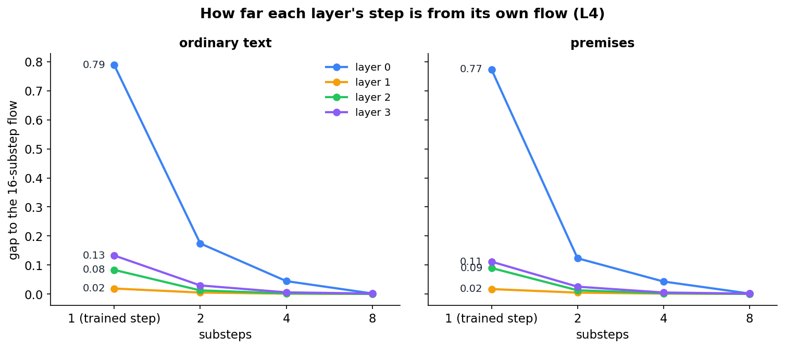
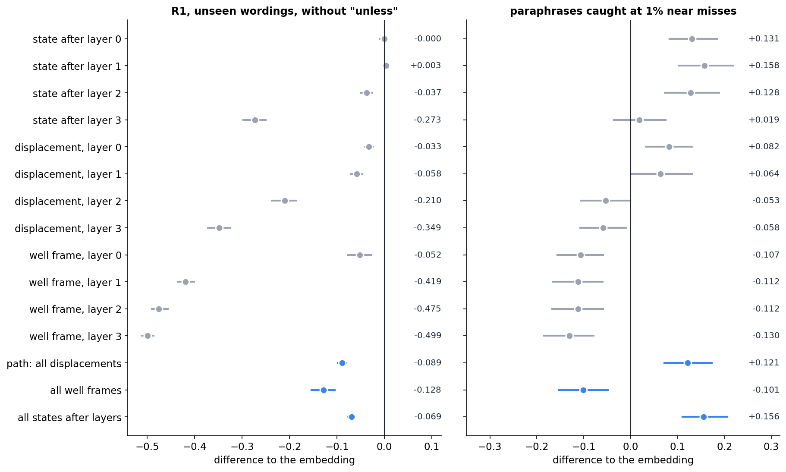
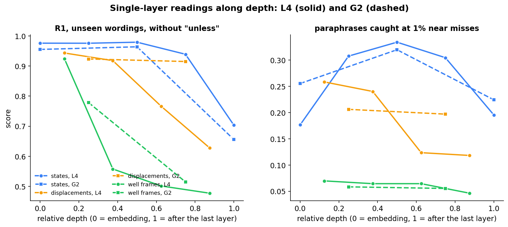
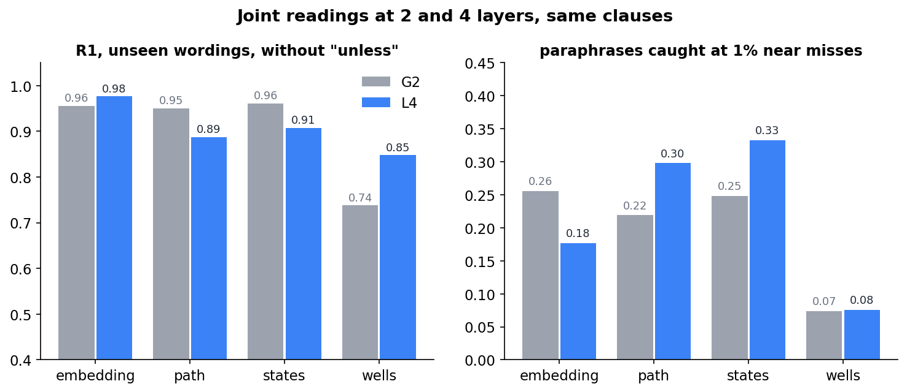

# Template Matchers and Depth: L4, the Four-Layer End, and the Calls

**Report of the second depth arm (CPU, 2026-11-25), with the scoring of the calls.** L4 is the four-layer prose model at 0.5B tokens, with the same settings as G2 except the depth and, with it, the step (half as long, same total time). Together with G2 ([Template_Matchers_and_Depth_G2.md](Template_Matchers_and_Depth_G2.md)) it scores the calls TL1 to TL6 pre-registered and confirmed in [Template_Matchers_and_Depth.md](Template_Matchers_and_Depth.md).

**In brief.**
- **Two of the six calls hit: TL4 and TL6.** At four layers the path and the joint states beat the embedding on paraphrases at 1% near misses, by 0.121 and 0.156, intervals well above zero. TL1, TL2, TL3 and TL5 miss.
- **Depth did not bring the layers closer to their flow (TL1 misses).** The mean gap of the trained step to its 16-substep flow is 0.256 at four layers against 0.140 at two. The gap sits in layer 0 (0.79 at four layers, 0.24 at two). The layers after it are within 2% to 13% of their flow in both models.
- **On unseen wordings depth hurts the joint readings.** The path is 0.089 below the embedding at four layers (TL3 misses), a fall of 0.084 from two layers (TL2 misses). The single readings stay level with the embedding up to the state after layer 1, then fall.
- **The paraphrase gain is real but partly the embedding's.** At four layers every early state and both joint readings beat the embedding at every near-miss rate. But L4's embedding catches fewer paraphrases than G2's (0.177 against 0.255 at 1%), while the best reading rises only from 0.320 to 0.334.
- **The flow gap reported first for G2 was a bug, found while scoring this arm.** The replay started each substepped step with the wrong velocity. G2's layer 1 is 0.045 from its flow, not 0.94. The G2 report is corrected. The matcher readings were not affected.

---

## Contents

1. [What was run](#1-what-was-run)
2. [How far each layer is from its flow](#2-how-far-each-layer-is-from-its-flow)
3. [The matchers](#3-the-matchers)
4. [Paraphrases](#4-paraphrases)
5. [Two layers against four](#5-two-layers-against-four)
6. ["Unless"](#6-unless)
7. [The calls](#7-the-calls)
8. [Interpretation](#8-interpretation)
9. [Conjectures and directions](#9-conjectures-and-directions)
10. [Caveats](#10-caveats)
11. [Reproduce and files](#11-reproduce-and-files)

---

## 1. What was run

- **Model.** L4, best checkpoint: four layers, 0.5B tokens of OpenWebText, live gradient path, pair force, reverse channel, step 2 (G2 has step 4) (folder `..._cgqk_vplive_xilive_L4probe_..._idt2_lr0p0012_noattn`).
- **Premises.** The same 21,180 as on G2 and SR2-2B: 60 development and 60 test clauses, twelve wordings. Extraction 102 minutes on eight threads (`template_depth_test.py`). Replaying each layer's step reproduced the forward pass to within $10^{-4}$.
- **Scoring.** `template_depth_analysis.py` on G2 and L4 together, 54 minutes: the three readings (without "unless", twelve wordings, "unless" with clouds of its own), and the differences between the two models, paired over the clauses. The G2 numbers it produced are identical to those already reported.
- **Matchers.** The embedding (reference); the state after each of the four layers; the displacement and well frame of each layer; **path** (all four displacements), **wells** (all four well frames), **states** (all four states after the layers).

**The flow-gap bug.** The integrator carries the velocity in the previous position, $v = (h - h_{\mathrm{prev}}) / \Delta t$. The replay that cuts a layer's step into $k$ substeps passed the trained step's $h_{\mathrm{prev}}$, encoded for the full step, together with the substep $\Delta t / k$. Every substepped replay therefore started $k$ times too fast. With $k$ substeps the displacement came out $k/16$ of the 16-substep one, and the gap exactly $1 - k/16$, on every layer that particles enter moving. That is every layer but layer 0, where they enter at rest. The scoring showed 0.935, 0.875, 0.75 and 0.50 on all three later layers of L4, which gave it away. Fixed by re-encoding the velocity for the substep, $h_{\mathrm{prev}} \leftarrow h - (h - h_{\mathrm{prev}})/k$. The flow was then rerun for both models (`flowonly=1`). The model's own substep mode, used by FLOW-R and the model cards, hands the velocity on at the substep's own step and was never affected. A search of all repositories found no other replay with this pattern.

## 2. How far each layer is from its flow



**Figure 1.** The gap of each layer's step, cut into 1, 2, 4 and 8 substeps, to the same step cut into 16, median over tokens (corrected replay).

| | layer 0 | layer 1 | layer 2 | layer 3 |
| --- | ---: | ---: | ---: | ---: |
| gap of the trained step, ordinary text | **0.789** | 0.019 | 0.083 | 0.133 |
| gap at 2, 4, 8 substeps, ordinary text | 0.174, 0.045, 0.002 | 0.005, 0.002, 0.001 | 0.013, 0.003, 0.001 | 0.030, 0.006, 0.002 |
| gap of the trained step, premises | 0.773 | 0.017 | 0.090 | 0.112 |
| cosine of the trained displacement with the flow's | 0.998 | 1.000 | 0.999 | 0.994 |
| median length of the displacement, ordinary text | 7.11 | 5.29 | 6.90 | 8.97 |
| median length of the entry state | 2.92 | 19.60 | 19.60 | 19.60 |

The cosine of successive displacements is 0.89, 0.87 and 0.75 (layers 0 and 1, 1 and 2, 2 and 3). At two layers it is 0.41.

Every reference is converged: 8 substeps are within 0.002 of 16. The mean gap over the layers is **0.256** at four layers and **0.140** at two (0.236 and 0.045). Layer 0 makes the difference. With half the step of G2's layer 0, L4's layer 0 moves a particle further (7.1 against 4.9, from an entry length of 2.9) and lands 79% of the displacement away from its flow's end point, although in the same direction (cosine 0.998). So the trained layer 0 has learned a stiffer first step at four layers. The later layers are close to their flow in both models, and at four layers they move further from it with depth (0.02, 0.08, 0.13).

## 3. The matchers



**Figure 2.** Each matcher against the embedding on the same clauses, with 95% intervals from 4,000 resamples of the clauses. Left: R1 on unseen wordings, "unless" left out. Right: paraphrases caught when 1% of near misses fire. Blue: the joint readings.

| matcher | particles | dimension | development | R1 | minus the embedding | twelve wordings |
| --- | ---: | ---: | ---: | ---: | --- | ---: |
| embedding | 5 | 31 | 0.988 | 0.976 | | 0.838 |
| state after layer 0 | 5 | 25 | 0.994 | 0.976 | -0.000 (-0.009 to +0.007) | 0.923 |
| state after layer 1 | 4 | 15 | 0.993 | **0.980** | +0.003 (-0.004 to +0.009) | 0.917 |
| state after layer 2 | 5 | 25 | 0.987 | 0.939 | -0.037 (-0.050 to -0.026) | 0.874 |
| state after layer 3 | 8 | 10 | 0.957 | 0.703 | -0.273 (-0.298 to -0.250) | 0.637 |
| displacement, layer 0 | 5 | 10 | 0.991 | 0.944 | -0.033 (-0.041 to -0.023) | 0.873 |
| displacement, layer 1 | 5 | 10 | 0.984 | 0.918 | -0.058 (-0.070 to -0.048) | 0.843 |
| displacement, layer 2 | 5 | 10 | 0.950 | 0.766 | -0.210 (-0.237 to -0.185) | 0.669 |
| displacement, layer 3 | 5 | 10 | 0.930 | 0.628 | -0.349 (-0.372 to -0.326) | 0.528 |
| well frame, layer 0 | 6 | 20 | 0.967 | 0.925 | -0.052 (-0.076 to -0.028) | 0.834 |
| well frame, layer 1 | 6 | 25 | 0.880 | 0.558 | -0.419 (-0.436 to -0.401) | 0.522 |
| well frame, layer 2 | 7 | 10 | 0.873 | 0.501 | -0.475 (-0.490 to -0.457) | 0.487 |
| well frame, layer 3 | 7 | 6 | 0.876 | 0.477 | -0.499 (-0.510 to -0.486) | 0.463 |
| **path** | 2 | 10 | 0.989 | 0.887 | **-0.089 (-0.098 to -0.081)** | 0.743 |
| wells | 6 | 20 | 0.965 | 0.848 | -0.128 (-0.153 to -0.104) | 0.762 |
| **states** | 4 | 10 | 0.993 | 0.907 | -0.069 (-0.076 to -0.062) | 0.856 |

The states after layers 0 and 1 are level with the embedding. From layer 2 on, every single reading falls, and the displacements and well frames fall faster. The state after the last layer includes the reverse channel and reads badly (0.703), as G2's did (0.656).

The search picked **two particles** for the path, which at four layers has four times the coordinates of one displacement. The pre-registration foresaw this (§7 there). With two particles the path reads few of the relations between the clauses.

**Where the unseen wordings are lost.** Detection of the valid forms, each wording left out in turn (per cent):

| matcher | if-then | when | whenever | Q if P | assuming | provided | disjunctive (five) |
| --- | ---: | ---: | ---: | ---: | ---: | ---: | --- |
| embedding | 99 | 99 | 99 | 59 | 99 | **99** | 98 |
| state after layer 0 | 95 | 94 | 98 | **91** | 95 | 80 | 98 |
| state after layer 1 | 98 | 95 | 98 | **94** | 97 | 79 | 98 |
| path | 50 | 86 | 98 | 1 | 86 | 68 | 67 to 99 |
| states | 67 | 97 | 98 | 48 | 95 | 42 | 49 to 98 |
| state after layer 3 | 78 | 78 | 73 | 0 | 58 | 0 | 41 to 58 |

L4's embedding handles "provided" (99%), where G2's did not (49%), and this is most of its higher R1 (0.976 against 0.955). As on G2, the early states handle "Q if P", the wording that puts the consequent first, and the embedding does not. The path loses "if-then" and "Q if P" and one disjunctive wording ("at least one", 67%).

## 4. Paraphrases

Paraphrases caught at a fixed rate of near-miss fires (known wordings), and the difference to the embedding:

| near misses that fire | embedding | state after layer 0 | state after layer 1 | path | states | path minus embedding | states minus embedding |
| ---: | ---: | ---: | ---: | ---: | ---: | --- | --- |
| 0.25% | 0.115 | 0.214 | 0.205 | 0.194 | 0.212 | +0.079 (+0.028 to +0.135) | +0.097 (+0.057 to +0.142) |
| 1% | 0.177 | 0.308 | **0.334** | 0.298 | 0.333 | **+0.121 (+0.072 to +0.173)** | **+0.156 (+0.111 to +0.206)** |
| 2% | 0.208 | 0.360 | 0.395 | 0.365 | 0.371 | +0.157 (+0.109 to +0.208) | +0.163 (+0.114 to +0.214) |
| 5% | 0.325 | 0.439 | 0.484 | 0.483 | 0.447 | +0.158 (+0.102 to +0.216) | +0.122 (+0.072 to +0.173) |

The threshold-free score (paraphrases against near misses) is 0.759 for the embedding, 0.778 and 0.779 for the states after layers 0 and 1, and 0.793 for the path and for the states. At two layers it was 0.760, 0.755, 0.770 and 0.779.

At four layers the gain is consistent: the states after layers 0, 1 and 2, the path and the joint states all beat the embedding at every rate, with intervals above zero. That is the clearest paraphrase result of the programme so far. Two facts bound it:

- **The embedding fell.** L4's embedding catches 0.177 at 1%, G2's 0.255. Its search took the largest dimension on the grid (31; G2's took 10), which may tighten its clouds around the wordings. That was not tested.
- **The best reading barely moved.** The best single reading is 0.334 at four layers (state after layer 1) and 0.320 at two (state after layer 0). What depth changed is that the joint readings now reach the level of the best single state (path 0.298 against 0.219 at two layers, states 0.333 against 0.248).

At the rule's own threshold the readings catch 0.023 (embedding) to 0.198 (state after layer 2), with at most 0.2% of near misses firing. As before, this is the operating point.

## 5. Two layers against four



**Figure 3.** Single-layer readings along relative depth: 0 is the embedding, 1 the state after the last layer, displacements and well frames at the middle of their layer. Solid L4, dashed G2.



**Figure 4.** The joint readings and the embedding at two and four layers, on the same clauses.

The change from two to four layers of each joint reading's difference to its own embedding, paired over the test clauses:

| joint reading | R1, unseen wordings | paraphrases at the rule | paraphrases at 1% near misses |
| --- | --- | --- | --- |
| path | -0.084 (-0.095 to -0.073) | -0.008 (-0.044 to +0.026) | +0.158 (+0.100 to +0.219) |
| states | -0.074 (-0.082 to -0.066) | +0.015 (-0.005 to +0.034) | +0.163 (+0.111 to +0.217) |
| wells | +0.089 (+0.063 to +0.114) | -0.004 (-0.054 to +0.042) | +0.081 (+0.015 to +0.145) |

These differences of differences contain the change of the embedding itself (R1 +0.021, paraphrases at 1% -0.079). The wells gain on R1 comes from the layer-0 well frame, which reads 0.925 at four layers against 0.778 at two. The later well frames read as badly as G2's layer-1 frame.

Figure 3 shows the same shape in both models. The states are flat up to about the middle of the depth, then fall to the broken final state. The displacements and well frames are best at layer 0 and fall with depth. Four layers add depth where the readings are already falling.

## 6. "Unless"

**Twelve wordings** (the number of particles and the dimension held at the primary reading's): the embedding falls to 0.838, the states after layers 0 and 1 to 0.923 and 0.917. The embedding's loss is not false fires but missed detections on unseen wordings (modus tollens 56%, first disjunctive syllogism 48%, against 98% and 82% for the state after layer 0). With its dimension of 31 this may be the cloud fit, not the wording. The joint states are +0.018 above the embedding here (interval +0.002 to +0.033), the path -0.095.

**"Unless" with clouds of its own:**

| matcher | R1, own clouds | MP detected, unseen | denied antecedent fires, unseen | "unless" detected, known (DS1, DS2) |
| --- | ---: | ---: | ---: | --- |
| embedding | 0.578 | 0.04 | 0.98 | 0.98, 0.98 |
| state after layer 0 | 0.595 | 0.02 | 0.98 | 0.95, 0.98 |
| path | 0.646 | 0.12 | 0.71 | 0.98, 0.95 |
| states | 0.550 | 0.01 | 0.98 | 0.98, 0.95 |
| wells | **0.738** | 0.36 | 0.03 | 0.60, 0.92 |

The failure of [Connectives_With_a_Hidden_Negation.md](Connectives_With_a_Hidden_Negation.md) repeats a third time. On the embedding's connective axis "unless" sits at 0.68, the known conditionals at 0.74 to 0.83. Left out of fitting, they move to 0.60 to 0.72, and five of six end at or below "unless". The path, most robust on G2 (0.841), is not here (0.646). The wells hold up best, at the cost of detecting "unless" itself less well.

## 7. The calls

Confirmed by the author on 2026-11-25 before any depth result; scored as written. A call hits when the point difference reaches the mark and, where named, the interval's lower end is above zero.

| id | prediction | called | measured | outcome |
| --- | --- | ---: | --- | --- |
| TL1 | mean flow gap on ordinary text lower at four layers than at two | 85% | 0.256 at four, 0.140 at two | **miss** |
| TL2 | path's gap to the embedding on R1 larger at four layers by at least 0.02, interval above zero | 30% | -0.084 (-0.095 to -0.073) | **miss** |
| TL3 | at four layers path at or above the embedding on R1 | 25% | -0.089 | **miss** |
| TL4 | at four layers path beats the embedding on paraphrases at 1% near misses by at least 0.05, interval above zero | 20% | +0.121 (+0.072 to +0.173) | **hit** |
| TL5 | worst single displacement of layers 1 to 3 at four layers at least 0.10 above G2's layer-1 displacement on R1 | 45% | 0.628 (layer 3) against 0.915: -0.287 | **miss** |
| TL6 | at four layers states beat the embedding on paraphrases at 1% near misses by at least 0.05, interval above zero | 40% | +0.156 (+0.111 to +0.206) | **hit** |

**Notes.** TL1 was called at 85% on the step sizes and on the code models' flow readings (FLOW-R, the model's own substep mode, not affected by the bug). The calls were confirmed before any G2 file was read, so the buggy replay did not shape them. It only shaped the G2 report's first reading of TL1. TL5 was unreachable once G2 was read (§6 of the G2 report), and it would have missed anyway. TL4 was the least likely call (20%) and hit.

By the pre-registration's own reading (§6 there): TL1 misses, so this pair does not test the conjecture that a layer closer to its flow gives a path that reads better. The steps of the later layers are already close to their flow at two layers, and depth did not bring layer 0 closer. TL6 hits: the states carry paraphrase information beyond the embedding at four layers, with the bound of §4.

## 8. Interpretation

**The premise of the depth conjecture does not hold at this pair.** The conjecture was that the trained step is far from the flow at few layers, and that more layers would bring it closer and make the path more meaningful. With the corrected replay, the layers after the first are within 5% of their flow at two layers. At four they are within 2% to 13%, further with depth. The step that is far from its flow is layer 0, the step from the embedding. At four layers it is further from its flow than at two (0.79 against 0.24), although its step is half as long. A layer is not a fixed vector field sampled more finely as the depth grows. Each model learns its own layers, and L4 learned a harder first step.

**Unseen wordings: depth does not help, and the joint readings lose.** What identifies a logical form on a wording never seen is in the embedding and the first two states. Later layers lose it (states after layers 2 and 3, displacements of layers 2 and 3, well frames of layers 1 to 3). Concatenating all layers dilutes it, and the search, faced with four times the coordinates, keeps fewer particles.

**Paraphrases: the first consistent gain over the embedding, at four layers.** It holds at every near-miss rate and for every early state and both joint readings. Read together with the fall of the embedding and the near-constant best reading, the safe statement is: **at both depths, the states after the first one or two layers catch about a third of subject-keeping paraphrases at 1% near misses. At four layers the embedding no longer does, and the joint readings now do.** Whether depth adds paraphrase invariance or L4's embedding is weaker, this pair does not separate.

**The reverse channel breaks the last state at both depths** (0.703 and 0.656), and the step before it reads well. This fits the G2 report's reading that the break follows the reverse channel, not the depth. The SR2 recipe has no reverse channel, so the SR2-NP depth series will test it.

## 9. Conjectures and directions

- **Conjecture (paraphrases).** The early states, after one or two layers, carry a paraphrase invariance that the embedding lacks. Depth helps it only by letting the joint readings collect it. A test: the same reading on SR2-NP (two layers, no pair force, no reverse channel) and SR2 at 0.5B, both already trained and next in the CPU queue.
- **Conjecture (layer 0).** The flow gap of layer 0 grows with depth because a deeper model asks its first layer to move the embedding into the LayerNorm's scale in a shorter time. The gap would then be an entry effect, not a sign of a coarse step. A check: the layer-0 gap of SR2-NP-L8 when it lands.
- **For the GPU plan (the author's decision).** Two things were set expecting a deep layer to be closer to its flow: the eight-layer runs (SR2-NP-L8, its pair-force twin SR2-L8, then SR2-NP-L4), and the pre-registration's rule to train eight layers if TL1 and TL2 hit. Neither hit, and the premise does not hold at this pair. What the eight-layer runs can still test: whether the paraphrase gain of §4 grows or stays, whether the layer-0 gap keeps growing, and the pair force's part. Calls for those runs will be written before they land. **The author's ruling (2026-11-25):** the runs are worth doing and will be done, but not before the productization order (VF0, twin PB, PMX-K16-NP); the author first reads the CPU template results.
- **Cheap CPU checks, post hoc and labelled as such.** (a) L4's embedding at G2's particles and dimension, and the reverse, to separate the embedding from its operating point. (b) The path at five particles, to see how much of its R1 loss is the search's choice of two.
- **"Unless".** Clouds of its own fail at every depth tried. The direction of [Connectives_With_a_Hidden_Negation.md](Connectives_With_a_Hidden_Negation.md) that keeps "unless" out of the conditional side (a polarity coordinate) stays open.

## 10. Caveats

- One pair of models, one seed each, 0.5B tokens. The two differ in depth, step and their trained embeddings at once.
- The differences between the models are paired over clauses and do not include the training-seed spread. They contain the change of the embedding.
- The search picked two particles for the path at four layers; a fixed particle count would read differently.
- The paraphrase readings are many comparisons. They are consistent across rates and readings, but each was not called separately.
- The flow gap was first computed with a bug (§1). TL1 is scored on the corrected numbers.
- English premises drafted by the agent, awaiting the author's check. The state after the last layer includes the reverse channel; the displacements do not.

## 11. Reproduce and files

```bash
cd notebooks/conservative_arch/scaleup
python3 debug/template_depth_test.py OUT <L4 folder> name=l4               # 102 min on 8 threads
python3 debug/template_depth_test.py OUT2 <folder> name=<stem> flowonly=1   # the flow gap alone, a few minutes
python3 debug/template_depth_analysis.py OUT OUT g2,l4                     # 54 min, with the comparison
python3 debug/template_depth_positions.py OUT OUT l4                       # the connective axis
python3 ../../../companion_notes/figures/_make_template_depth_figs.py l4 g2
```

Outputs in `results/template_matcher/`:
- `template_depth_l4.json`: all three readings, with the differences to the embedding.
- `template_depth_l4.txt`: the scoring log, G2 and L4.
- `template_depth_comparison.json`: four layers minus two.
- `flow_l4.json` and `flow_g2.json`: corrected; log in `flow_rerun_2026-11-25.log`.
- `template_depth_positions_l4.{json,txt}`.
- `template_depth_l4_extraction.log`.

The premise geometry (`depth_l4.pkl`, 0.37 GB) is not in the repository.
