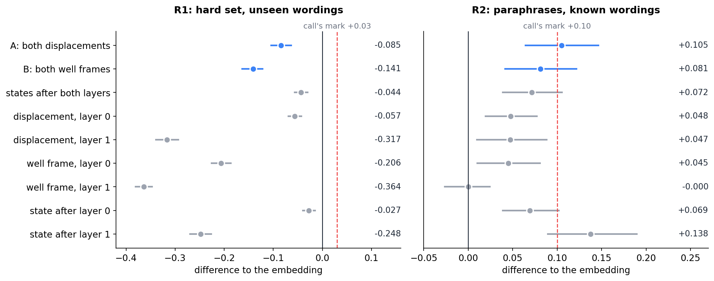
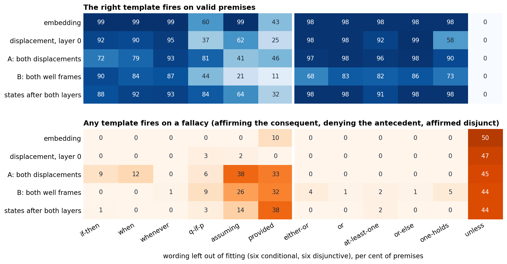
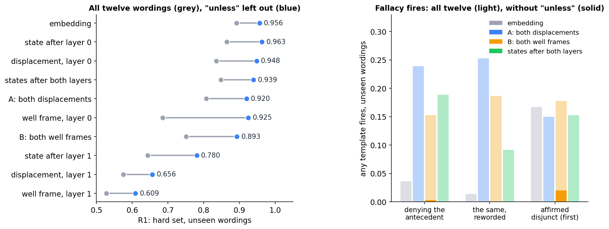
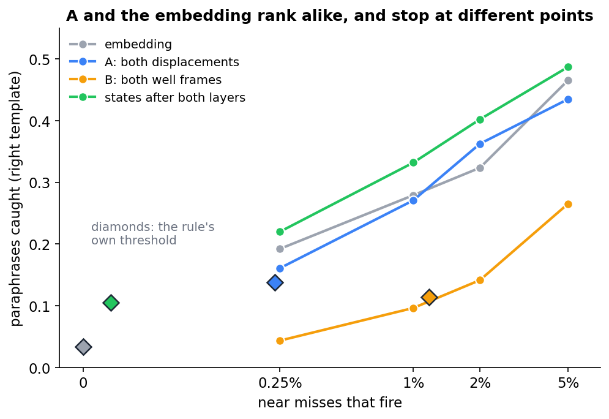
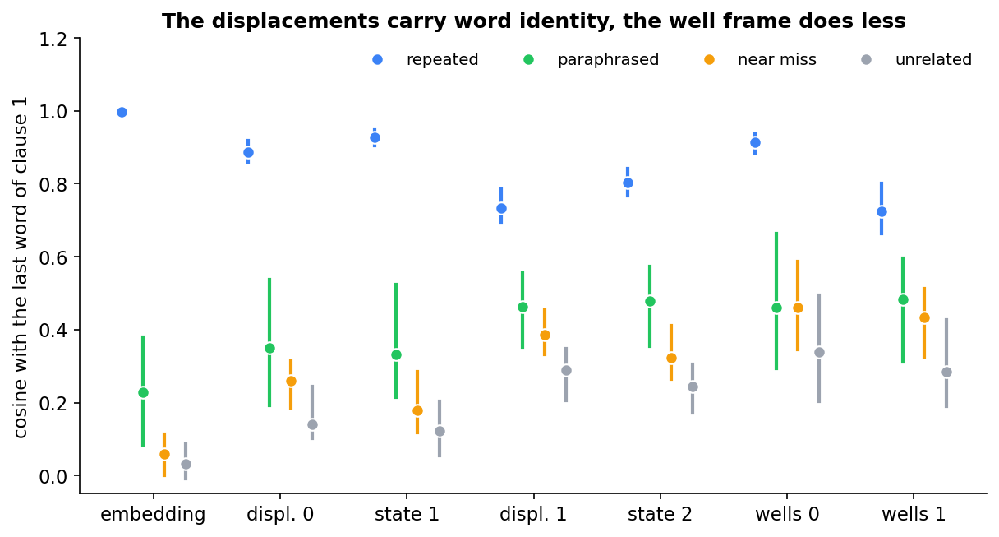
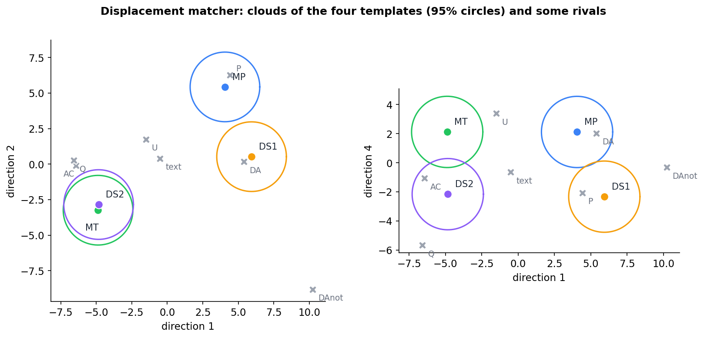

# Template Matchers on the Dynamics: SR2-2B

**Do the displacements of a premise's particles, or their position among the wells, identify its logical form better than the words do? Report of the first run (CPU, 2026-11-25)**

This is the report of the test pre-registered in [Template_Matchers_on_the_Dynamics.md](Template_Matchers_on_the_Dynamics.md), run on SR2-2B (two layers, 2.1B tokens). The calls TD1 to TD5 were confirmed by the author before the extraction and are scored here as written. Everything in §5.3 to §5.8 was read after the calls were scored and is **post hoc**: no call rests on it.

**In brief.**
- **Two of five calls hit.** TD2 (paraphrases, displacement) hits by a hair and TD5 (disjunctive syllogisms on known wordings) hits. TD1, TD3 and TD4 miss. The displacement and the well frame both fall below the embedding on unseen wordings, by 0.085 and 0.141.
- **The result that the calls did not foresee: one wording dominates the hard set.** "Unless" was filed under the disjunctions, but in every particle vector read here its connective sits among the conditional wordings. Without it, no template fires on any fallacy for the embedding, the displacement matcher, the state after layer 0 and the states after both layers, and the gap to the embedding shrinks to 0.036 for the displacement, 0.063 for the well frame, and nothing measurable for the state after layer 0 (+0.007).
- **The hit on TD2 is an operating point.** At the same rate of near-miss fires the displacement matcher and the embedding catch the same share of paraphrases. The matcher on the trained **states** (after both layers) catches 2 to 8 points more than the embedding, clear of zero at two of the four rates.
- **The hit on TD5 is the same wording again.** Every other disjunctive wording is detected 95 to 98% of the time by both matchers.
- So the evolution of the particles, at two layers, is **not** shown to identify logical forms better than the words. It does not contradict the idea either: layer 1, where the particles leave the wells, reads worse in every vector, which is the point the deeper models are meant to test. **Update 2026-11-27 (the author's question):** on the later tests that need context the layer states beat the embedding by a wide margin; the displacements and well frames have not been read there ([Template_Matchers_on_the_Dynamics.md](Template_Matchers_on_the_Dynamics.md), §9).

---

## Contents

1. [Definitions](#1-definitions)
2. [The problem](#2-the-problem)
3. [Mathematical analysis](#3-mathematical-analysis)
4. [The test](#4-the-test)
5. [Results](#5-results)
6. [Interpretation](#6-interpretation)
7. [Conjectures](#7-conjectures)
8. [Further directions](#8-further-directions)
9. [Caveats and corrections](#9-caveats-and-corrections)
10. [Reproduce and files](#10-reproduce-and-files)

---

## 1. Definitions

**Premise, particle, kinds, templates (MP, MT, DS1, DS2), rivals, wordings** are those of [Template_Matcher_From_Geometry.md](Template_Matcher_From_Geometry.md), §1. A premise is a first sentence that joins two clauses, a second sentence, and "Therefore". A template fires on a premise when the premise lies in its region.

**The layer's step.** The state that enters layer $\ell$ is $h_{\ell}$. The step moves it to $\tilde{h}_{\ell}$ and the LayerNorm at the end of the layer makes it the next state. The **displacement** is taken before the LayerNorm:

$$
\Delta_{\ell} = \tilde{h}_{\ell} - h_{\ell} .
$$

**The well-frame vector** of layer $\ell$ is the list, over the eight wells, of the log share of the well, the radius on entry, the change of the radius over the step, the stiff coordinates on entry, and their change. The radius of well $k$ is

$$
r_k = \sqrt{q_k}, \qquad q_k = (h - \mu_k)^{\top} P_k (h - \mu_k) ,
$$

with $\mu_k$ the centre and $P_k$ the precision, at the context of the layer.

**Parked (the author, 2026-11-27): the well frame is an impractical construct for now.** It reads a particle's position among a bank of eight wells whose number was fixed in advance, to fit memory, not chosen by the model; training optimised the next-token loss against that number, and the trained layers use few of the wells: one or two in every layer after the first, three to eight at layer 0, on every model measured ([Minimum_Well_Count_for_Conservative_Models.md](../Minimum_Well_Count_for_Conservative_Models.md), §2). Making well coordinates informative would need a model that chooses its own number of wells, and wells selective for content. That has never been tried and is not practical now, so this line of inquiry is not pursued. The well frames stay in the extraction, since they cost nothing, and are reported where they are computed, but no test is built around them. On SR2-2B the layer-0 well frame reads better than layer 1's on unseen wordings (0.685 against 0.528), but every layer-1 reading drops about as much (the state from 0.864 to 0.643), so that comparison does not isolate the well count (§5.2).

**Revisit (the author, 2026-11-27):** if SR2 or PMX is trained on 4B tokens, the well frames are read again on that model. There is a reason to expect more there: layer 1's need for well directions grows with training, from 8 at 0.5B tokens to 12 at the end of the 2B decay, while layer 0 fills its 32 at both budgets ([Well_Screen_and_Precision.md](../depth_ladder/Well_Screen_and_Precision.md)). For PMX the extraction reads the context bank's wells; whether to read its Poisson-mode wells too is open.

**Matchers.** They differ only in the vector that stands for a particle: A is the two displacements, B the two well-frame vectors, h0 the embedding (the reference to beat), the single layers and the states after the layers are secondary.

**R1**, the hard set on unseen wordings: half the mean detection of the four valid forms plus half the mean silence on the five fallacy kinds (affirming the consequent, denying the antecedent in two forms, affirmed disjunct in two forms). **R2**, paraphrases on known wordings: the rate at which the right template fires when the second sentence paraphrases the predicate and keeps the subject.

## 2. The problem

The geometry matcher, as first run ([Template_Matcher_From_Geometry.md](Template_Matcher_From_Geometry.md)), read the states and never a path. Its accuracy could rest on the words. The question of this test is whether a reading that **exists only because the forces acted** identifies the form better than the embedding, on the clauses and wordings the matcher was not fitted on. The embedding is the control because a figure of a premise that already shows in the embedding is in the words, and the landscape did not create it. The author accepts that particles move away from the wells; the matcher should take advantage of the evolution ([What_the_Matchers_Read.md](What_the_Matchers_Read.md), §5).

## 3. Mathematical analysis

### 3.1 A displacement that is linear in the entry state adds nothing

The matcher reads a premise only through the cosines and norms of its particles after whitening by ordinary text. Whitening is not a neutral step. Suppose for the moment that the displacement is an affine function of the entry state, with the same invertible matrix for every token,

$$
\Delta = M h + b ,
$$

and that whitening is exact. Let $C$ be the covariance of $h$ on ordinary text and $\bar{h}$ its mean. The covariance of $\Delta$ is $M C M^{\top}$, so

$$
(\Delta_i - \bar{\Delta})^{\top} (M C M^{\top})^{-1} (\Delta_j - \bar{\Delta}) = (h_i - \bar{h})^{\top} C^{-1} (h_j - \bar{h}) .
$$

Every whitened inner product, hence every cosine and norm, is the same as for the entry state. **A matcher that whitens is blind to any linear displacement.** It can tell A from h0 only through what the displacement has that is not a linear function of the entry state: the dependence on the other tokens (the context, the registers), the non-linear part, and the velocity. Two approximations limit this: the code adds a ridge to the whitening (a tenth of the mean eigenvalue), and the map from the embedding to the state after layer 0 explains 55% of held-out variance, so a good part is not linear (measured on ordinary text for the state, not for the displacement; [What_the_Matchers_Read.md](What_the_Matchers_Read.md), §4).

### 3.2 A difference of firing rates is a ranking plus a threshold

Let $s$ be the log rate of the best template cloud against the best rival cloud. A template fires when its rate reaches $\rho$ and the premise is inside the reach. For a matcher with threshold $\rho$ chosen by the rule (at most 1% of rivals fire on the development clauses), the paraphrases caught are

$$
\mathrm{R2} = \Pr \left( s_{\mathrm{para}} > s_{\rho} , \ \text{right template, inside the reach} \right) .
$$

A higher R2 can come from a better **ranking** of paraphrases over near misses, or from a threshold that lets more of both through. The two are separated by fixing the rate of near misses that fire, and reading the paraphrases caught, with the reach and $\rho$ dropped. That reading is in §5.5.

### 3.3 Two logical forms with one layout

"Unless P, Q" has the layout of "When P, Q": a connective, clause 1, a comma, clause 2. It is true when one of the clauses is, which is why it was filed with the disjunctions, but it is also "if not P, then Q". Let the connective's position along the axis from the disjunctive to the conditional centroids be $c$, 0 for the disjunctive and 1 for the conditional centroid. If "unless" sits at $c \approx 1$, then filing it under DS1 asks the DS1 cloud to contain conditional-looking premises. With one common covariance, the separation of DS1 from the denied antecedent then has to be bought on another direction. The consequence for an unseen wording is direct: "Provided that P, Q. Not P." is at distance from DS1's "Unless P, Q. Not P." only through the connective's word, and the DS1 template fires on it. That is the denied-antecedent fire of the earlier report.

## 4. The test

### 4.1 Material

- **Model.** SR2-2B, best checkpoint (step 126,500 of 130,000), two layers, frozen.
- **Clauses.** Development: the 60 clauses that shaped the earlier matcher. Test: 60 new clauses that no matcher was scored on before this run, drafted by the agent, **not yet checked by the author**.
- **Premises.** 21,180 in all, 14,280 test premises, each after 48 tokens of ordinary text. The extraction took 59 minutes on eight threads.
- **What was stored.** For every particle of the connective, the clauses, the second sentence and "Therefore": the entry state, the state before each LayerNorm and after it, and the well readings of each layer inside the forward pass.

### 4.2 Matchers and the search

Everything after the vector is as in the geometry matcher (the same for every vector): whitening, cosines and norms, the relational coordinates ($10 m + 10$ per vector), one Gaussian cloud per kind with one covariance, the discriminant subspace, the 1% false-fire rule, and the connective's position as one more coordinate. The number of particles of the second sentence $m$ (1 to 8) and the subspace dimension $d$ (6, 10, 15, 20, 25, 31) are the grid point with the best content-wise five-fold development score, and the search is the same for every matcher. Nothing else is tuned.

The code that forms the vectors (`debug/template_dynamics_analysis.py`):

```python
h0, p1, h1, p2, h2 = split(S)                      # entry state, before and after each LayerNorm
D1, D2 = p1 - h0, p2 - h1                          # displacements, before the LayerNorm
lg = log(w) - q_in / 2; share = lg - logsumexp(lg)  # the well's share on entry
W = concat(share, r_in, r_out - r_in, u_in, u_out - u_in)   # the well-frame vector
```

### 4.3 What the calls compare

Each matcher against h0 on the same 60 test clauses, the difference averaged over clauses, 95% interval from 1,000 resamples of the clauses. A call hits when the point difference reaches the mark and the lower end of the interval is above zero (TD1 to TD4). TD5 compares the mean detection of DS1 and DS2 on known wordings and has no interval condition.

## 5. Results

### 5.1 The calls

| call | what | difference to the embedding | 95% interval | mark | called | outcome |
| --- | --- | ---: | --- | ---: | ---: | --- |
| TD1 | A on R1 (unseen wordings) | -0.085 | -0.104 to -0.064 | +0.03 | 20% | **miss** |
| TD2 | A on R2, near misses fire 0.24% (at most 2%) | +0.105 | +0.065 to +0.147 | +0.10 | 50% | **hit**, by 0.005 |
| TD3 | B on R1 | -0.141 | -0.163 to -0.122 | +0.03 | 15% | **miss** |
| TD4 | B on R2, near misses fire 1.2% | +0.081 | +0.042 to +0.122 | +0.10 | 25% | **miss** |
| TD5 | A on DS1 and DS2, known wordings (0.936 against 0.835) | +0.101 | not computed | +0.05 | 60% | **hit** |

The hit on TD2 is within 0.005 of its mark; in a resample of the clauses the difference reaches the mark 57% of the time. The pre-registered reading of this pattern (TD2 hits, TD1 and TD3 miss) is: the evolution gives some invariance to paraphrase but not to wording. §5.5 shows how much of that survives.

### 5.2 Every matcher



**Figure 1.** Each matcher against the embedding, with 95% intervals over clauses. Blue: the two primary matchers. Red: the mark of the call.

| matcher | particles | dimension | development score | R1 unseen | R2 known | near misses fire |
| --- | ---: | ---: | ---: | ---: | ---: | ---: |
| embedding (h0) | 6 | 10 | 0.972 | **0.892** | 0.033 | 0% |
| A: both displacements | 4 | 10 | 0.978 | 0.807 | 0.138 | 0.2% |
| displacement, layer 0 | 5 | 10 | 0.969 | 0.835 | 0.081 | 0.1% |
| displacement, layer 1 | 3 | 10 | 0.924 | 0.575 | 0.081 | 0.3% |
| B: both well frames | 5 | 10 | 0.961 | 0.750 | 0.115 | 1.2% |
| well frame, layer 0 | 6 | 15 | 0.937 | 0.685 | 0.079 | 0.9% |
| well frame, layer 1 | 4 | 10 | 0.894 | 0.528 | 0.033 | 0.1% |
| states after both layers | 5 | 10 | **0.989** | 0.848 | 0.105 | 0.03% |
| state after layer 0 | 5 | 10 | 0.984 | 0.864 | 0.103 | 0% |
| state after layer 1 | 3 | 15 | 0.957 | 0.643 | **0.171** | 0.3% |

Three things stand out. First, the order on the development clauses (0.89 to 0.99) is not the order on unseen wordings: the states lead the first and the embedding the second, so the cost of a new wording is what separates them. Second, anything that involves layer 1 alone (displacement, well frame, state) reads R1 badly, 0.53 to 0.64. Third, the embedding is the best on R1 and, with the layer-1 well frame, the lowest on R2 (0.033).

The four valid forms on known wordings:

| matcher | MP | MT | DS1 | DS2 |
| --- | ---: | ---: | ---: | ---: |
| embedding | 1.00 | 0.98 | 0.83 | 0.84 |
| A: both displacements | 0.89 | 0.96 | 0.95 | 0.92 |
| B: both well frames | 0.92 | 0.86 | 0.76 | 0.86 |
| states after both layers | 0.91 | 0.98 | 0.98 | 0.98 |

The states after both layers read the same kind of numbers as on the earlier clauses (0.97, 0.93, 0.93, 0.92 known). The same pattern, with a searched number of particles (5) instead of a hand-set one (4), on new clauses, is the confirmation that the connective's position needed: it was added after the first results.

### 5.3 Where R1 is lost



**Figure 2.** Each wording left out of fitting in turn. Top: the right template fires on the valid premises. Bottom: any template fires on a fallacy.

The loss is not spread over the wordings. Three facts carry it:

1. **"Unless" is never detected** (0% for every matcher), and 44 to 50% of its fallacies fire, for the five matchers of the figure.
2. **"Assuming" and "provided" are weak.** A detects 41% and 46% of their valid premises, B 21% and 11%, the embedding 99% and 43%; a template fires on 26 to 38% of their fallacies for A and B, on 0% and 10% for the embedding.
3. **The template that fires on the denied antecedent is DS1,** every time, in the four matchers counted (embedding, A, B, states) and five of the six conditional wordings ("whenever" was not counted). For the states, of 60 premises per wording, "provided" gives 41 fires of DS1 and "assuming" 21; the embedding gives 13 and 0. The template that fires on the affirmed first disjunct of "unless" is MP: 47 of 60 already on a known wording for the embedding, 12 for A and 1 for the states.

### 5.4 One wording explains it



**Figure 3.** The same readings with "unless" left out of fitting and scoring (blue, solid) against all twelve wordings (grey, light). Left: R1. Right: how often any template fires on a fallacy with unseen wordings.

Refit with the eleven other wordings, at the same number of particles and dimension:

| | R1 unseen, all twelve | R1 unseen, without "unless" | minus the embedding, without "unless" |
| --- | ---: | ---: | --- |
| embedding | 0.892 | 0.956 | |
| state after layer 0 | 0.864 | **0.963** | +0.007 (-0.001 to +0.015) |
| displacement, layer 0 | 0.835 | 0.948 | -0.008 (-0.018 to +0.001) |
| states after both layers | 0.848 | 0.939 | -0.017 (-0.025 to -0.010) |
| A: both displacements | 0.807 | 0.920 | -0.036 (-0.051 to -0.024) |
| well frame, layer 0 | 0.685 | 0.925 | -0.031 (-0.055 to -0.009) |
| B: both well frames | 0.750 | 0.893 | -0.063 (-0.083 to -0.044) |
| state after layer 1 | 0.643 | 0.780 | -0.176 (-0.202 to -0.151) |
| displacement, layer 1 | 0.575 | 0.656 | -0.299 (-0.324 to -0.276) |
| well frame, layer 1 | 0.528 | 0.609 | -0.347 (-0.368 to -0.326) |

- **The denied-antecedent fires vanish.** On unseen wordings no template fires on a denied antecedent or an affirmed disjunct for the embedding, the state after layer 0, the states after both layers and A: 0% on all five fallacy kinds. For B it is 0 to 2% per kind; for the readings of layer 1 alone up to 14%.
- **Detection on unseen wordings** (MP, MT, DS1, DS2): the states after both layers go from 0.69, 0.83, 0.81, 0.80 to 0.59, 0.98, 0.97, 0.98, the embedding from 0.90, 0.77, 0.82, 0.82 to 0.82, 0.86, 0.98, 0.98. MP falls for both when "unless" is removed. The reason is not known.
- **The earlier report says the same.** Refitted without "unless" and scored on the 60 earlier test clauses (dimension searched again), the states after both layers fire on 0% of denied antecedents (15% before) and 0% of affirmed disjuncts (8%), and on 0.1% of all rivals (2.1% before). So the weak spot that report names is an artefact of filing one wording, and §9 corrects it there.

**What "unless" looks like to the model.** The connective's position between the two centroids, 0 for disjunctive and 1 for conditional, the axis fitted without "unless", median over the test premises:

| vector | "unless" | if-then | when | provided | either-or | or else |
| --- | ---: | ---: | ---: | ---: | ---: | ---: |
| embedding | 0.71 | 0.81 | 0.79 | 0.70 | 0.24 | 0.16 |
| displacement, layer 0 | 0.84 | 0.85 | 0.88 | 0.78 | 0.18 | 0.05 |
| state after layer 0 | 0.77 | 0.78 | 0.90 | 0.77 | 0.24 | 0.06 |
| state after layer 1 | 0.87 | 0.83 | 1.05 | 0.80 | 0.16 | -0.14 |
| well frame, layer 0 | 0.97 | 0.86 | 0.91 | 0.77 | 0.24 | 0.00 |

"Unless" is on the conditional side in every vector, and further along in all the others than in the embedding. The model is not at odds with the logic: "unless P, Q" is also "if not P, then Q". The design of the test was at odds with it, and that is the agent's error (§9).

The states nevertheless detect it on known wordings (98% and 95%), so a cloud with that wording in it can be fitted. The matcher then pays with the unseen wordings (§5.3).

### 5.5 Paraphrases: the same ranking, another operating point



**Figure 4.** Paraphrases caught when the rate of near misses that fire is fixed (threshold moved, reach and $\rho$ dropped, known wordings). Diamonds: where the pre-registered rule puts each matcher.

Paraphrases caught at a fixed rate of near-miss fires, and the difference to the embedding:

| near misses that fire | embedding | A | B | states after both layers | A minus embedding | states minus embedding |
| ---: | ---: | ---: | ---: | ---: | --- | --- |
| 0.25% | 0.192 | 0.161 | 0.044 | 0.220 | -0.031 (-0.087 to +0.024) | +0.028 (-0.017 to +0.072) |
| 1% | 0.279 | 0.271 | 0.097 | 0.332 | -0.008 (-0.062 to +0.043) | +0.053 (+0.006 to +0.097) |
| 2% | 0.324 | 0.362 | 0.142 | 0.402 | +0.039 (-0.015 to +0.091) | +0.078 (+0.034 to +0.123) |
| 5% | 0.465 | 0.435 | 0.265 | 0.487 | -0.031 (-0.079 to +0.017) | +0.022 (-0.022 to +0.069) |

- **A and the embedding rank paraphrases alike.** No difference is clear of zero at any of the four rates. The threshold-free score, paraphrase against near miss, is 0.812 (0.785 to 0.838) for the embedding and 0.793 (0.762 to 0.825) for A.
- **The rule stops the embedding earlier.** Its $\rho$ was 0.72 and A's 0.54. Both fall to the floor (0.30) when "unless" is left out, so that wording is what holds them up. With the near misses held at 0.25% the embedding would catch 19% of paraphrases instead of the 3% it does.
- **The operating point is not the whole story.** Without "unless" A still catches more at the rule's own point (0.162 against 0.053, +0.109), and near misses fire 0.3% and 0%. So the rule leaves the embedding very far to the left of its curve, and A sits on it. What we can say is that the two rank alike and are cut at different points. Refitted without "unless" and read at 1% near misses, the embedding catches 0.292 and A 0.261.
- **The states are the ones that rank better.** At 1% and 2% the matcher on the states after both layers is 5 and 8 points above the embedding with the interval above zero; at 0.25% and 5% it is above it with the interval across zero. The state after layer 0 is 5 and 4 points above at 1% and 2%, the second with the interval across zero. This was selected after the fact from many readings.
- **B ranks worse** than the embedding at every rate, by 15 to 20 points. The well frame loses the word content that a paraphrase needs.

Why most paraphrases do not fire: the right template is the best of the four for 81% (embedding), 85% (A) and 87% (states), but the premise is **nearest to a near-miss cloud** for at least 94% of the embedding's paraphrases, 83% of A's, 82% of the states' and 52% of the state after layer 1's (only clouds holding more than 5% are counted). They are told from a near miss by ranking, not by the nearest cloud.

### 5.6 What the displacements carry



**Figure 5.** Cosine (whitened) of the last word of the second sentence with the last word of clause 1, conditional wordings, median and 25 to 75%, on the test clauses.

| vector | repeated | paraphrased | near miss | unrelated | paraphrase above near miss (AUROC) |
| --- | ---: | ---: | ---: | ---: | ---: |
| embedding | 0.998 | 0.23 | 0.06 | 0.03 | 0.77 |
| displacement, layer 0 | 0.89 | 0.35 | 0.26 | 0.14 | 0.64 |
| state after layer 0 | 0.93 | 0.33 | 0.18 | 0.12 | 0.77 |
| displacement, layer 1 | 0.73 | 0.46 | 0.39 | 0.29 | 0.66 |
| state after layer 1 | 0.80 | 0.48 | 0.32 | 0.24 | 0.77 |
| well frame, layer 0 | 0.91 | 0.46 | 0.46 | 0.34 | 0.52 |
| well frame, layer 1 | 0.72 | 0.48 | 0.43 | 0.29 | 0.58 |

The displacement of a repeated word is close to the displacement of its first occurrence (0.89 at layer 0) and the similarity of unrelated words rises from 0.03 to 0.14. The single cosine separates a paraphrase from a near miss **worse** in the displacement than in the state or the embedding (0.64 and 0.66 against 0.77), and in the well frame it does not separate it (0.52). The well-frame vector says which well and how far, not which word.

### 5.7 The clouds of matcher A, explicitly



**Figure 6.** Centres of the clouds of the displacement matcher in its leading directions, with the 95% circles of the four templates.

The minimal subspace is ten-dimensional (the search over 6 to 31), with 4 particles of the second sentence. In the coordinates of §3.2 of the first report, $y = B^{\top} ((r - \mu_0) / s)$ with $r \in \mathbb{R}^{102}$, the clouds are unit Gaussians at the centres

| | 1 | 2 | 3 | 4 | 5 | 6 | 7 | 8 | 9 | 10 | 99% reach |
| --- | ---: | ---: | ---: | ---: | ---: | ---: | ---: | ---: | ---: | ---: | ---: |
| MP | 4.06 | 5.43 | 4.95 | 2.12 | -2.21 | -2.62 | -2.78 | 0.47 | -0.99 | 0.42 | 17.5 |
| MT | -4.87 | -3.25 | 2.22 | 2.12 | -0.60 | 0.06 | 0.61 | 2.15 | 0.07 | -0.63 | 36.3 |
| DS1 | 5.93 | 0.52 | 0.38 | -2.33 | -0.82 | 0.06 | 0.60 | 0.57 | 1.36 | -1.53 | 40.5 |
| DS2 | -4.83 | -2.85 | -0.33 | -2.16 | -2.62 | 0.04 | 0.75 | 2.61 | -0.21 | -0.62 | 33.4 |

with $\mu_0$, $s$, $B$ and all 32 centres in `template_cloud_dynamics_sr2_2b.npz`, threshold $\rho = 0.54$. The rule for a template is the one of the first report: its rate is the largest of the four, at least $\rho$, and the premise lies within the reach of its nearest cloud.

Singular values of the directions: 25.5, 21.4, 15.7, 14.7, 13.0, 10.1, 9.0, 8.3, 8.0, 7.3. What they read:

| direction | reads mainly |
| --- | --- |
| 1 | the last particle of the second sentence against clause 1, in the displacements of both steps |
| 2 | the worst matched particles of the second sentence against clause 1 |
| 3 | which particle of the second sentence is odd: its displacement relative to its neighbours |
| 4 | the connective's position, both steps (0.82 and 0.77) |
| 5 to 10 | finer matches to the two clauses, the odd particle, and "Therefore" |

Distances between centres, in cloud widths: MP to MT 13.7, MP to AC 14.9, MP to a near miss 9.6, MT to DA 11.2, DS1 to DS2 11.8, DS1 to MT 12.6, DS1 to the affirmed first disjunct 9.3. The closest rival of MP is the affirmed first disjunct: **5.2**. In the leading two directions they nearly coincide, and direction 4, the connective, separates them. The squared distance of a test premise from its own cloud has a median of 7.4 (MP), 6.4 (MT), 8.9 (DS1) and 7.5 (DS2); the law of ten dimensions has 9.3.

### 5.8 Joining the dynamics to the embedding

If the displacement carried information the embedding lacks, the concatenation would beat the embedding. On all twelve wordings, the search over particles and dimension repeated:

| matcher | R1 minus the embedding | R2 minus the embedding |
| --- | --- | --- |
| embedding with both displacements | -0.067 (-0.081 to -0.053) | +0.038 (+0.021 to +0.056) |
| embedding with both well frames | -0.030 (-0.040 to -0.020) | +0.061 (+0.032 to +0.097) |
| embedding with both states | -0.084 (-0.093 to -0.075) | +0.048 (+0.025 to +0.073) |

No joint matcher improves R1, and the reason is not known. The search picked 5 particles for the first and 2 for the other two, so a smaller coordinate vector. These are the numbers with "unless" in, which weighs on R1 for every matcher (§5.4); they were not repeated without it.

## 6. Interpretation

**By the pre-registered rule, the evolution gives some invariance to paraphrase and none to wording.** Two qualifications apply, and they reduce it. The paraphrase gain is a matter of where the rule puts the threshold: at a fixed rate of near misses A and the embedding rank paraphrases alike. The wording loss is mostly the wording "unless", which was filed wrongly: without it A is 0.036 below the embedding instead of 0.085.

**The layer-0 displacement is close to the embedding in content.** Its R1 without "unless" is within the interval of the embedding (-0.008). This is consistent with §3.1: the matcher cannot see the part of a displacement that is linear in the entry state. How large the non-linear part is was not measured.

**The states read better than the displacements** on R1 (0.939 and 0.963 for both layers and layer 0, against 0.920 and 0.948, without "unless"), on the paraphrase ranking and on the known wordings. Only the rule's own point on R2 goes the other way (A 0.138, states 0.105). The states also contain the copy of the entry state, which the displacement leaves out.

**Layer 1 is where the reading breaks.** Displacement, well frame and state are worst there. The layer throws the particles out of the well that dominates on entry (median radius 1.95 on entry and 9.23 after the step on ordinary text), so its readings come from states that no well holds. This is the fact that motivates the deeper models: in a two-layer model the step is long.

**Nothing here says that the model does not carry the forms.** The test reads particles one layer at a time with a matcher of fixed form. It says that the two readings of the evolution chosen before the run do not beat the words.

## 7. Conjectures

1. **The layer-0 displacement carries no form information beyond the embedding's,** because it is close to affine in the entry state. A direct test is the whitened Gram matrix of the displacement against the one of the entry state, premise by premise.
2. **The paraphrase ranking of the trained states is a small real gain** (2 to 8 points at fixed near-miss rates), and it belongs to the states, not to the path. Post hoc; to be confirmed on new clauses.
3. **"Unless" is a conditional with a denial inside it, and the model has it so.** A template for it would be MP or DS1 read through "if not". Whether its cloud, refitted as a form of its own, keeps the unseen wordings clean is not tested.
4. **Depth (the conjecture the author asked to verify) is untouched by this run.** Eight layers have shorter steps, close to their own flow. If the path carries a signature, it should show in the displacements of later layers, which at two layers are the worst readings.

## 8. Further directions

1. **The depth arms,** next in the queue: the 0.5B prose pair at two and four layers, and the code models. Their calls have not been proposed. Two lessons of this run should go into them: "unless" scored apart from the other wordings, and R2 also read at a fixed near-miss rate.
2. **Give "unless" a form of its own,** or drop it. The author's ruling is needed: a template per logical form makes "unless P, Q" either a conditional with a denied antecedent or a disjunction.
3. **A path reading that is not a displacement:** the angle between successive displacements, or the time the particle spends inside a well, at depths where there are enough steps.
4. **A reading of the velocity:** SR2 is a second-order model and the velocity was not read.
5. **The affine part removed:** displacements with the linear part of the entry state regressed out per layer, which is the part §3.1 shows the whitening cannot see.

## 9. Caveats and corrections

- **The wording "unless" was filed under the disjunctions by the agent,** in the geometry matcher's first run and here. It is the agent's error and it affects the earlier reports. Corrected in [Template_Matcher_From_Geometry.md](Template_Matcher_From_Geometry.md), §5.4 and §6, where the "fallacies are the weak spot" conclusion is replaced by this reading, verified there by refitting without it.
- **The calls stand as scored.** The rule, the threshold and the wordings were fixed before the run. Leaving "unless" out was decided after the results were seen, so it changes no call.
- **Clauses not checked.** The 60 test clauses were drafted by the agent and await the author's check. The paraphrases of this set are harder than the earlier ones for every matcher (states after both layers 2, 10, 19 and 11% on the four forms, against 12, 29, 34 and 32% before).
- **The near-miss rates of §5.5** are set on the test near misses and are not a tuned threshold.
- **The multiple readings** of §5.3 to §5.8 were chosen after the calls were scored. In §5.5 the states' advantage is one of many comparisons.
- **The mean of five-fold scores picks m and d on the development clauses,** which include "unless".
- **One model, one checkpoint, one seed, two layers, English premises, clause boundaries given.**
- **Ordinary text** for the whitening is 12,288 tokens; the whitening adds a ridge.

## 10. Reproduce and files

```bash
cd notebooks/conservative_arch/scaleup
python3 debug/template_dynamics_test.py OUT <run folder> name=sr2_2b           # extraction, 59 min on 8 threads
python3 debug/template_dynamics_analysis.py OUT OUT sr2_2b                     # the calls, 17 min
python3 debug/template_dynamics_readings.py OUT OUT sr2_2b OUT/template_dynamics.json   # per wording, clouds, pairs, 13 min
python3 debug/template_dynamics_rates.py OUT OUT sr2_2b OUT/template_dynamics.json      # fixed near-miss rates
python3 debug/template_dynamics_without_unless.py OUT OUT sr2_2b OUT/template_dynamics.json
python3 debug/template_connective_position.py OUT OUT sr2_2b OUT/template_dynamics.json
python3 debug/template_geometry_frame_without_unless.py RUN RES sr2_2b          # the same check on the geometry matcher's first run
python3 ../../../companion_notes/figures/_make_template_dynamics_figs.py
```

Outputs are in `results/template_matcher/`: `template_dynamics_sr2_2b.{json,txt}` (the calls), `template_dynamics_readings_sr2_2b.{json,txt}`, `template_dynamics_rates_sr2_2b.{json,txt}`, `template_dynamics_without_unless_sr2_2b.{json,txt}`, `template_connective_position_sr2_2b.{json,txt}`, `template_dynamics_fires_sr2_2b.npz` (the decision on every test premise) and `template_cloud_dynamics_sr2_2b.npz`. The readings script checks that its refit reproduces the stored R1 and R2 exactly. The raw states (2.9 GB) are not in the repository.
