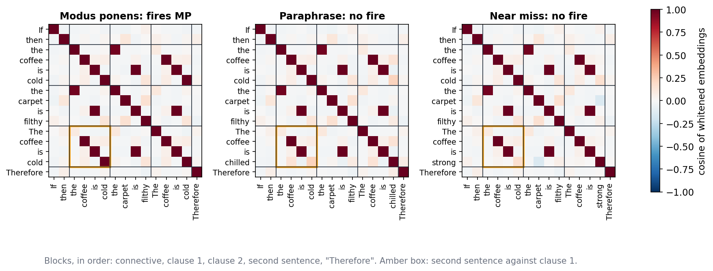
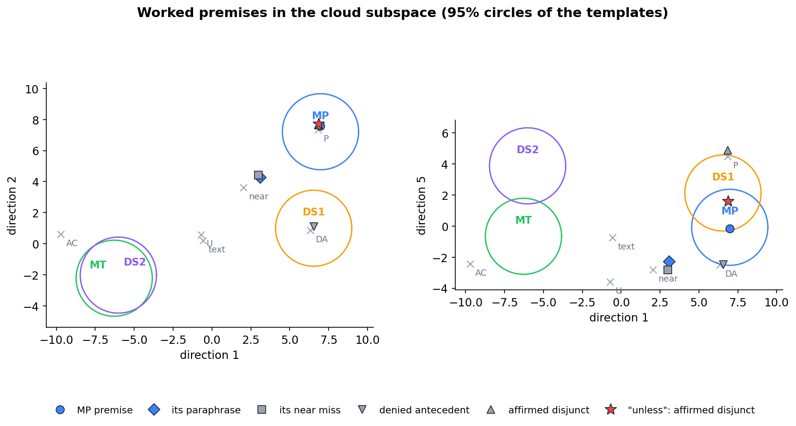
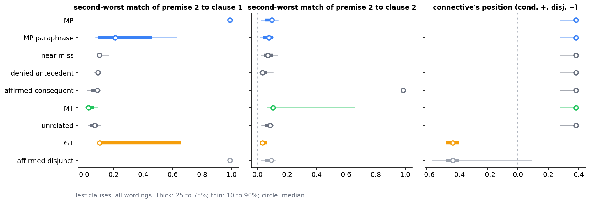

# The Embedding Template Matcher, Step by Step

**What this note is.** A walk-through of the geometry matcher of [Template_Matcher_From_Geometry.md](Template_Matcher_From_Geometry.md) fed the embedding ("the embedding matcher"): what it computes, one premise at a time, from the token vectors to the decision to fire. The embedding matcher is the reference that every reading of the trained layers has to beat ([Template_Matcher_From_Geometry.md](Template_Matcher_From_Geometry.md), §5.7; [Template_Matchers_on_the_Dynamics_SR2_2B.md](Template_Matchers_on_the_Dynamics_SR2_2B.md)). **Update 2026-11-27 (the author's question):** it is a strong reference only where the words decide, which is what this note shows on numbers. On tests built so that the words cannot decide, the picture reverses: when the form must be carried to "Therefore" (task A, [Summary_State_Test.md](Summary_State_Test.md)) the embedding reads 20 to 22% against the states' 54 to 62%, and when only a context sentence sets the form (B-logic and its control, [BLogic_Test.md](BLogic_Test.md)) the embedding ties at 0.5 by construction while the states at "Therefore" carry which clause the context bound. Templates there rank; they do not fire. Why it scores so well was discussed in [What_the_Matchers_Read.md](What_the_Matchers_Read.md), §3; this note shows the mechanism on numbers. Written 2026-11-25 at the author's request.

**In brief.**
- The matcher sees the angles and lengths between the premise's token vectors, never the tokens. In the embedding two copies of the same token have cosine 0.96 to 1.00, two different tokens about 0.0 to 0.2. So the geometry is a picture of **which words repeat**.
- One coordinate does almost all the work for modus ponens: the second-worst match of the second sentence to clause 1. It is 0.99 when the second sentence repeats clause 1 word for word and 0.1 to 0.2 otherwise. Replacing it alone with the near miss's value moves the log odds of the MP template by -40; no other single coordinate moves them by more than 3.
- Which logical form, given the repetition, is decided by **the connective's position**: the connective's own word vector, read along the axis from the disjunctive to the conditional wordings. Modus ponens and an affirmed disjunct ("Either P or Q. P.") have nearly the same coordinates otherwise, and so do the denied antecedent and the first disjunctive syllogism.
- This explains each result of the embedding matcher. It does well on exact premises, a paraphrase falls with the near misses, and "unless" (whose connective sits on the conditional side) fires the conditional templates.

---

## Contents

1. [The matcher in one paragraph](#1-the-matcher-in-one-paragraph)
2. [Step 1: the vector of a particle](#2-step-1-the-vector-of-a-particle)
3. [Step 2: the geometry of the premise](#3-step-2-the-geometry-of-the-premise)
4. [Step 3: the relational coordinates](#4-step-3-the-relational-coordinates)
5. [Step 4: the projection and the clouds](#5-step-4-the-projection-and-the-clouds)
6. [Step 5: the rate and the decision](#6-step-5-the-rate-and-the-decision)
7. [Twelve premises on one clause pair](#7-twelve-premises-on-one-clause-pair)
8. [What carries the decision](#8-what-carries-the-decision)
9. [Why it works, and where it breaks](#9-why-it-works-and-where-it-breaks)
10. [Caveats](#10-caveats)
11. [Reproduce and files](#11-reproduce-and-files)

---

## 1. The matcher in one paragraph

A premise is a first sentence that joins two clauses, a second sentence, and "Therefore". Each of its tokens (connective, clause 1, clause 2, second sentence, "Therefore") is a **particle**. The matcher takes each particle's vector, whitens it, computes the cosines and norms between all the particles of the premise, and condenses them into 91 numbers. It projects them onto 10 directions, where each kind of premise is one round Gaussian cloud. A template fires when its clouds hold most of the density at that point, at least the threshold, and the point is within the reach of its nearest cloud. The fitted values in this note are SR2-2B's embedding, with 8 particles, 10 directions and the connective's position (the variant of the earlier report's §5.7), fitted on all development premises.

## 2. Step 1: the vector of a particle

The embedding of token $x$ at position $t$ is a learned word vector plus a learned position vector,

$$
h^{(0)}_t = E[x] + P[t] \in \mathbb{R}^{384} .
$$

Each premise follows 48 tokens of ordinary text and a blank line, so its tokens sit at positions 50 and later. The vector is then **whitened** by ordinary text. With $\bar{h}$ and $C = U \Lambda U^{\top}$ the mean and covariance of 12,288 ordinary tokens,

$$
z = (\Lambda + 0.1 \bar{\lambda} I)^{-1/2} U^{\top} (h^{(0)} - \bar{h}) ,
$$

where $\bar{\lambda}$ is the mean eigenvalue. The small ridge keeps directions of tiny variance from dominating. Whitening makes a cosine measure similarity relative to how embeddings usually vary, not in raw units.

The matcher never sees which token a particle is. It sees $z$ only through the angles and lengths below.

## 3. Step 2: the geometry of the premise

The worked premise is a test premise: **"If the coffee is cold, then the carpet is filthy. The coffee is cold. Therefore"**, modus ponens. Its 15 particles, grouped by role:

| role | tokens |
| --- | --- |
| connective | If, then |
| clause 1 | the, coffee, is, cold |
| clause 2 | the, carpet, is, filthy |
| second sentence | The, coffee, is, cold |
| "Therefore" | Therefore |

The matcher's raw input is the matrix of cosines between all pairs of particles and the length of each particle:

$$
G_{ij} = \frac{z_i^{\top} z_j}{\lVert z_i \rVert \lVert z_j \rVert}, \qquad n_i = \lVert z_i \rVert .
$$



**Figure 1.** The cosine matrix of the worked premise (left), of its paraphrase "The coffee is chilled" (middle) and of its near miss "The coffee is strong" (right). The amber box is the second sentence against clause 1.

What the matrix shows:

- **Same token, cosine about 1.** "coffee" with "coffee" 1.00, "cold" with "cold" 1.00, "is" with "is" 0.99, wherever they stand, including "is" of clause 2. The two lower-case "the" have 0.96. The position vector moves a token's embedding only slightly.
- **Different tokens, cosine about 0.** "The" (capitalised, a different token in this vocabulary) against "the": 0.09. "chilled" against "cold": 0.23, "strong" against "cold": 0.16. Unrelated content words: 0.0 to 0.15.
- **Lengths separate kinds of word.** Content words, the connective's words and "Therefore" have whitened length 19 to 26, "is" about 9, "The" 11, "the" 5. Function words are close to the mean of ordinary text, so they are short after whitening.

So the amber box of modus ponens has three bright cells on a diagonal (coffee, is, cold) and one dark row ("The"). The paraphrase and the near miss lose one bright cell each, and they differ from each other by 0.23 against 0.16 in that cell.

## 4. Step 3: the relational coordinates

The cosine matrix has a different size for every premise. The matcher condenses it into a fixed list $r$ of $10 m + 10$ numbers, here $m = 8$, so 90, plus the connective's position: 91. The **best match** of a particle of the second sentence to clause 1 is its largest cosine with any particle of clause 1. Sorted from the smallest up, the $k$-th is called "premise 2 to clause 1, worst $k$". When the second sentence has fewer than $m$ particles, the list repeats its largest value.

| group | coordinates | worked premise |
| --- | --- | --- |
| second sentence to clause 1 | the 8 smallest best matches | 0.089, 0.987, 0.998, 0.999, then 0.999 repeated |
| clause 1 to second sentence | the same, the other way | 0.089, 0.987, 0.998, 0.999, ... |
| the last particles | cosine of the last particle of the second sentence with the last of clause 1 | 0.999 |
| the mean states | cosine of the mean of the second sentence with the mean of clause 1 | 0.95 |
| the same four groups for clause 2 | | low: 0.0 to 0.12, except "is" |
| the odd particles | for the 8 particles of the second sentence worst matched to their nearer clause: log length, cosine to "Therefore", to the connective, to their neighbours, to the mean of the second sentence | "The" first |
| the six node cosines | cosines among the means of connective, clause 1, clause 2, "Therefore" | |
| the connective's position | see below | 0.40 |

In the worked premise the smallest best match is "The" (0.089) and the second is "is" (0.987). The second smallest is the coordinate that decides (§8): it is high only when **all but one** particle of the second sentence repeat clause 1. The capitalised "The" is always the one that does not.

**The connective's position.** Let $c$ be the mean whitened vector of the connective's particles, scaled to length 1. On the development premises, take for each wording the mean of $c$ scaled to length 1, average those of the six conditional wordings into a centroid $c_{\mathrm{cond}}$ and those of the six disjunctive ones into $c_{\mathrm{disj}}$ (both scaled to length 1). Then

$$
a = \frac{c_{\mathrm{cond}} - c_{\mathrm{disj}}}{\lVert c_{\mathrm{cond}} - c_{\mathrm{disj}} \rVert}, \qquad \text{position} = \left( c - \tfrac{1}{2} (c_{\mathrm{cond}} + c_{\mathrm{disj}}) \right)^{\top} a .
$$

In the embedding, $c$ is the connective's own word vector. Its medians on the test premises:

| wording | position | wording | position |
| --- | ---: | --- | ---: |
| if-then | 0.40 | either-or | -0.39 |
| when | 0.38 | or | -0.56 |
| whenever | 0.40 | at least one | -0.42 |
| Q if P | 0.37 | or else | -0.47 |
| assuming | 0.39 | one of these holds | -0.43 |
| provided | 0.28 | **unless** | **0.09** |

"Unless" was filed with the disjunctive wordings and it pulls their centroid toward the conditional side, yet it sits on the conditional side of the midpoint.

## 5. Step 4: the projection and the clouds

Each coordinate is standardised by its mean and standard deviation on the development premises ($\mu_0$, $s$) and projected onto ten directions,

$$
y = B^{\top} \left( \frac{r - \mu_0}{s} \right) \in \mathbb{R}^{10}, \qquad B \in \mathbb{R}^{91 \times 10} .
$$

$B$ holds the leading linear discriminant directions of the 32 kinds of development premise, whitened by their common covariance, so that each kind is a unit Gaussian cloud around its centre $m_p$:

$$
\rho_p(y) \propto \exp \left( -\tfrac{1}{2} \lVert y - m_p \rVert^2 \right) .
$$

What the ten directions read (the coordinates most correlated with each, on the development premises):

| direction | separation | reads mainly |
| --- | ---: | --- |
| 1 | 30.2 | which clause the second sentence restates: the mean and last-particle cosines to clause 1 against clause 2 |
| 2 | 24.6 | how completely it restates clause 1: the worst matches of the second sentence to clause 1 |
| 3 | 19.6 | the same for clause 2 |
| 4 | 17.5 | the connective's position, with the second-worst match to clause 1 |
| 5 | 14.2 | the connective's position (correlation -0.83) |
| 6 to 10 | 12.6 to 9.3 | finer matches, the odd particles' neighbours and lengths |

For the worked premise $y = (6.98, 7.59, -4.01, 7.23, -0.15, -2.27, 1.16, 3.14, -0.97, 1.30)$. The centre of the modus ponens cloud begins $(6.98, 7.21, -3.53, 7.13, -0.08, \dots)$.



**Figure 2.** Worked premises in two pairs of directions, with the 95% circles of the four template clouds and the centres of some rival clouds (crosses). Left: direction 1 (which clause) against direction 2 (how completely clause 1 is restated). Right: direction 1 against direction 5 (the connective).

## 6. Step 5: the rate and the decision

The squared distance of the worked premise to the modus ponens centre is 1.6. The next clouds are the affirmed disjunct at 32.1 and the denied antecedent at 156.7. The **rate** of a template is the share of the total density that lies in its clouds,

$$
\lambda_T(y) = \frac{\sum_{p \in T} e^{-\lVert y - m_p \rVert^2 / 2}}{\sum_{q} e^{-\lVert y - m_q \rVert^2 / 2}} ,
$$

with the sum below over all 32 kinds, rivals and ordinary text included. For the worked premise the rate of MP is 1.000 to three decimals. The template fires because

1. its rate is the largest of the four templates,
2. the rate is at least $\rho = 0.54$, the smallest threshold that keeps the false fires on development rivals at 1% in cross-validation by clause,
3. the premise lies within the 99% reach of its nearest cloud: 1.6 against 23.2.

## 7. Twelve premises on one clause pair

Every premise below is a test premise on the same two clauses. "Nearest" is the nearest cloud and the squared distance to it.

| premise (second sentence) | wording | nearest | template that fires |
| --- | --- | --- | --- |
| The coffee is cold (MP) | if-then | MP, 1.6 | **MP** |
| The carpet is not filthy (MT) | if-then | MT, 2.5 | **MT** |
| The carpet is filthy (affirmed consequent) | if-then | its own cloud, 0.5 | none |
| The coffee is not cold (denied antecedent) | if-then | its own cloud, 1.5 | none |
| The coffee is chilled (paraphrase of MP) | if-then | near miss, 4.2 | none |
| The coffee is strong (near miss) | if-then | near miss, 3.0 | none |
| The village is poor (unrelated) | if-then | unrelated, 5.4 | none |
| The coffee is not cold (DS1) | either-or | DS1, 2.8 | **DS1** |
| The carpet is not filthy (DS2) | either-or | DS2, 2.4 | **DS2** |
| The coffee is cold (affirmed disjunct) | either-or | its own cloud, 2.1 | none |
| The coffee is cold (affirmed disjunct) | unless | MP, 5.2 | **MP**, wrongly (rate 0.99) |
| The carpet is not filthy (DS2) | unless | MT, 7.2 | **MT**, the wrong template (rate 0.95) |
| The coffee is not cold (DS1) | unless | denied antecedent, 5.4 | none, a miss |

The "when" wording gives the same decisions as "if-then" on all eight of its premises.

## 8. What carries the decision

**One coordinate at a time.** Take the worked premise and replace a single coordinate by its value in another premise of the same clause pair; read the change in the log odds of the MP template (log of the MP clouds' density over all the others', 15.3 for the worked premise):

| value taken from | the coordinate that moves the odds most | its value, MP and other | change in log odds | next largest change |
| --- | --- | --- | ---: | ---: |
| near miss | second sentence to clause 1, worst 2 | 0.987 and 0.162 | -40.4 | -2.6 |
| paraphrase | second sentence to clause 1, worst 2 | 0.987 and 0.225 | -32.5 | -2.4 |
| denied antecedent | second sentence to clause 1, worst 2 | 0.987 and 0.089 | -49.4 | -1.2 |
| unrelated | second sentence to clause 1, worst 2 | 0.987 and 0.089 | -49.4 | -2.8 |

One number turns a fire into a rejection. In the denied antecedent the extra particle "not" is unmatched, so "The" moves from the worst place to the second, and the coordinate falls from 0.99 to 0.09.



**Figure 3.** The three coordinates that carry the decision, per kind of premise, over all test clauses and wordings.

- **Second-worst match to clause 1:** 0.99 for MP and for the affirmed disjunct, which repeat clause 1 exactly, and 0.0 to 0.2 for everything else. Paraphrases spread from 0.08 to 0.63 (10 to 90%), depending on how similar the two predicates' embeddings are.
- **Second-worst match to clause 2:** high (0.99) only for the affirmed consequent, which repeats clause 2. Modus tollens and the second disjunctive syllogism are read in the coordinates of clause 2 with the negation, through the last particles.
- **The connective's position:** the conditional premises at 0.28 to 0.40, the disjunctive at -0.39 to -0.56, and "unless" at 0.09. **The four valid forms and their twins have nearly the same coordinates apart from this one.** In the worked clause pair, MP and the affirmed disjunct both read 0.089, 0.987, 0.998 (if-then) against 0.094, 0.985, 0.998 (either-or) for the second sentence against clause 1, and the denied antecedent and DS1 likewise.

## 9. Why it works, and where it breaks

**It works because the four forms are string patterns.** Each valid form repeats one clause, with or without "not", and is told from its twin by the connective. Repetition is near-perfect in the embedding, because the same token gets the same vector up to the position vector. So on known wordings the embedding matcher fires on 100, 90, 77 and 76% (MP, MT, DS1, DS2), with false fires on 1.1% of rivals. About two thirds of the shortfall on the disjunctive syllogisms is "unless": without it they are 91 and 90%.

**The paraphrase falls with the near miss.** A paraphrase replaces one repeated word by another, and the embedding gives "chilled" against "cold" a cosine (0.23) little above "strong" against "cold" (0.16). The paraphrase lands nearer the near-miss cloud (4.2) than any template. Its ranking above the near miss is better than chance (AUROC 0.80 to 0.91 by form) but not enough to fire at 1% false fires.

**A new wording must land on the right side of the axis.** The connective's position is the only coordinate that tells MP from an affirmed disjunct. A wording left out of fitting fires correctly only if its connective's word vector falls on the side of its own family. "Provided" (0.28) is the conditional nearest the midpoint and, with "Q if P", the weakest when left out (43 and 44% on the earlier clauses).

**"Unless" is read as a conditional because its word vector is one.** In the embedding, "unless" sits on the conditional side (0.09), so the affirmed disjunct of "unless" fires MP, and DS2 fires MT. "Unless P, Q" is also "if not P, then Q", so the vector is not wrong; the filing was ([Template_Matchers_on_the_Dynamics_SR2_2B.md](Template_Matchers_on_the_Dynamics_SR2_2B.md), §5.4).

**Without the position it fails.** Refitted without that coordinate, at the same 8 particles and 10 directions, the matcher fires on 27, 23, 28 and 36% of the valid premises (known wordings), and on none of the twelve premises of §7. With the number of particles and the dimension searched instead (5 and 15), it was 88% for MP and 11 to 13% for MT and DS. With the connective unread, the matcher cannot tell a form from its twin.

**What it does not use.** No well, no layer, no context: the embedding is a lookup table trained with the model and frozen. The only things it shares with the model are the learned word and position vectors. A matcher on the trained layers must beat this to show the layers add something.

## 10. Caveats

- SR2-2B only, one checkpoint; the known-wording fit on all development premises. The unseen-wording numbers of the earlier reports refit the clouds without the tested wording.
- The 8 particles and the position were set after the first results ([Template_Matcher_From_Geometry.md](Template_Matcher_From_Geometry.md), §4.3).
- The test clauses were drafted by the agent and await the author's check.
- The swap reading of §8 changes one coordinate at a time. Coordinates are correlated, so the changes do not add up, and the reading says what moves the decision, not how the clouds were learned.

## 11. Reproduce and files

```bash
cd notebooks/conservative_arch/scaleup
python3 debug/template_embedding_walkthrough.py RUN results/template_matcher sr2_2b    # RUN holds robust_sr2_2b.pkl
python3 ../../../companion_notes/figures/_make_template_embedding_figs.py
```

`results/template_matcher/template_embedding_walkthrough_sr2_2b.json` holds the standardisation, all 32 cloud centres and reaches, the threshold, the loadings of the directions, every step of §3 to §7 for the 30 worked premises (tokens, cosine matrix, lengths, coordinates, projection, distances, rates, decision), the swaps of §8 and the distributions of Figure 3. The premise geometry `robust_sr2_2b.pkl` comes from `debug/template_robust_test.py`.
