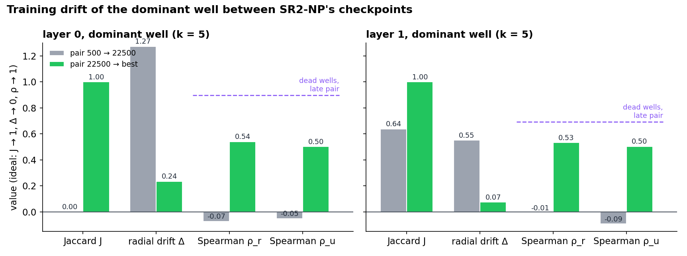
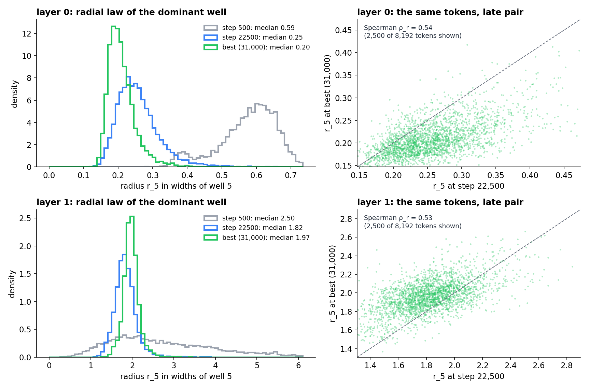

# Well Settling Map of SR2-NP

**When do the wells of a trained conservative model stop moving, and is the inside of a well ever stable enough to look for templates in? A first reading on three checkpoints (CPU, 2026-11-24)**

Technical report of the first measurement of [*Admissible Regions for Template Search*](Admissible_Regions_for_Template_Search.md) (the theory note: definitions, propositions and the admissibility criterion this report tests). The calls AR1 to AR4 were written into the theory note's §7 before the results were read and confirmed by the author on 2026-11-24, with one caveat recorded in §6 below.

---

## Contents

1. [Definitions](#1-definitions)
2. [The problem](#2-the-problem)
3. [Setup](#3-setup)
4. [Code](#4-code)
5. [Results](#5-results)
6. [The calls](#6-the-calls)
7. [Analysis](#7-analysis)
8. [What it means for template search](#8-what-it-means-for-template-search)
9. [Caveats](#9-caveats)
10. [Reproduce](#10-reproduce)

---

## 1. Definitions

The quantities are those of the theory note; they are repeated here so that the report reads on its own. Throughout, $k$ indexes the wells of the bank ($K = 8$), $\ell$ the layer ($L = 2$), $t$ the position in a 512-token window, and $\tau$ the training step of a checkpoint.

**The bank.** Well $k$ at context $\xi$ (the five concatenated context channels at the token) has a centre $\mu_k(\xi) = W_k(\xi + c_\ell) + b_k$, with $c_\ell$ the layer's learned depth code, a precision $P_k(\xi) = \mathrm{diag}(a_k(\xi)) + B_k(\xi) B_k(\xi)^{\top}$ with $B_k$ of rank $r = 4$, and a weight $w_k(\xi)$. The potential is $V_\theta(h, \xi) = -\sum_k w_k e^{-q_k/2}$.

**Per token and well** (all computed at the state $h$ the layer receives, before its step):

| quantity | formula | meaning |
| --- | --- | --- |
| squared well radius | q_k = (h − μ_k)ᵀ P_k (h − μ_k) | distance from the centre in the well's own metric |
| well radius | r_k = √q_k | the same, in widths of the well |
| force weight | g_k = w_k exp(−q_k / 2) | the well's share of the potential's pull before normalisation |
| dominance share | π_k = g_k / Σ_j g_j | the fraction of the pull that well k carries at the token |
| dominant well | k* = argmax_k π_k | the well that owns the token |
| stiff coordinates | u_k = B_kᵀ (h − μ_k), r = 4 numbers | the displacement along the well's narrowest directions |

**Per well, at one checkpoint** (medians over the 8,192 tokens unless stated):

| quantity | formula | meaning |
| --- | --- | --- |
| share | fraction of tokens with k* = k | how much of the data the well owns (clause 1, *live*) |
| dominance | median π_k over the tokens it owns | how completely it owns them (clause 2, *dominant*) |
| context spread s_k | √ median_t (μ_k(ξ_t) − μ̄_k)ᵀ P_k(ξ_t) (μ_k(ξ_t) − μ̄_k), μ̄_k the mean realised centre | how far the context moves the centre, in widths of the well (clause 3, *context-tame*) |
| Euclidean spread s_k,eu | √ median_t ‖μ_k(ξ_t) − μ̄_k‖² / ‖μ̄_k‖ | the same motion in plain units, relative to the centre's length |

**Per well, between two checkpoints** $\tau \lt \tau'$ (the same tokens in both; clause 4, *settled*):

| quantity | formula | ideal | meaning |
| --- | --- | --- | --- |
| assignment overlap J_k | \|S_k^τ ∩ S_k^τ′\| / \|S_k^τ ∪ S_k^τ′\|, S_k = tokens the well owns | 1 | does the well own the same tokens? |
| radial drift Δ_k | W₁(law of r_k^τ, law of r_k^τ′) / median r_k^τ′ | 0 | has the distribution of depths in the well changed shape? |
| rank agreement ρ_r | Spearman(r_k^τ, r_k^τ′) over the tokens | 1 | are the tokens in the same order of depth? |
| rank agreement ρ_u | Spearman(‖u_k^τ‖, ‖u_k^τ′‖) over the tokens | 1 | are they in the same order along the stiff directions? |

Two further quantities are used in the analysis only (they were not pre-registered): the radial drift in width units, $W_1$ without the division by the later median, and the per-token change $\lvert r_k^{\tau'} - r_k^{\tau} \rvert$ against the interquartile range of $r_k^{\tau'}$.

**The warmth of a position.** Channel $c$ is warm at position $t$ when the weight $\alpha_c^{\,t}$ of the missing prefix is below a tolerance; at tolerance 0.1 the five channels are warm from $t$ = 4, 8, 45, 229 and 459.

---

## 2. The problem

The author's question (2026-11-24): during training everything moves, including the wells, so in which regions of semantic space, and from which point in training, can a search for the patterns that become templates start? The theory note turns the question into Definition 6: a region (the basin of well $k$ at layer $\ell$, at positions past a warm-up, over a window of checkpoints) is admissible when the well is live, dominant, context-tame, settled and read at warm positions, and Proposition 3 shows that inside such a region a signature observed along a trajectory is reproducible to first order in the tolerances.

This report measures the five clauses on one trained model. It asks four concrete questions, one per call:

- does settling happen late, in the decay phase of the learning-rate schedule (AR1)?
- does the metric spread of Definition 3 see something the Euclidean spread does not (AR2)?
- when does the live set of wells form (AR3)?
- is the inside of a well (the order of tokens by depth and along its stiff directions) the last thing to settle (AR4)?

---

## 3. Setup

**Model.** SR2-NP: the Gen 3 conservative core with the second-order damped integrator (SR2), trained without the pair force ([Stage 3](../productization/Stage3_SR2_Without_Pair_Force.md)), $d = 384$, two layers, a joint anisotropic depth-conditioned bank of $K = 8$ wells of rank $r = 4$ read by five context channels (decays 0.50, 0.75, 0.95, 0.99, 0.995), untied output head, 76,434,307 parameters. Without the pair force the bank is the model's only context mechanism, so clause 3 captures the whole of the context's effect on the landscape.

**Training schedule.** 32,500 steps on OpenWebText, batch of 512-token windows, WSD schedule with peak learning rate $1.2 \times 10^{-3}$: warm-up over the first 1,625 steps (5%), constant to step 21,125 (65%), then decay to $6 \times 10^{-5}$.

**Checkpoints.** The three the run folder keeps:

| checkpoint | step | phase | learning rate (training log) | validation ppl (training log) | ppl on the 16 windows here |
| --- | --- | --- | --- | --- | --- |
| step500 | 500 | warm-up | 3.69e-4 | 463.1 | 490.9 |
| step22500 | 22,500 | 1,375 steps into the decay | 1.16e-3 (97% of peak) | 67.3 | 69.0 |
| best | 31,000 | late decay | 1.08e-4 | 56.7 | 58.4 |

The early pair (500 to 22,500) spans the warm-up and the constant phase; the late pair (22,500 to 31,000) spans most of the decay.

**Data.** 16 windows of 512 tokens spaced evenly over the OpenWebText validation set (8,192 tokens), the same windows as SR2-NP's well probe (`vtheta_well_probe.py`, `well_probe_sr2np_owt.txt`); the identical tokens go through every checkpoint, so all between-checkpoint comparisons are token by token.

**What is captured.** At each layer, the bank's components $(\mu_k, a_k, w_k, B_k)$ at every token and the incoming state $h$, at the bank's first evaluation in the layer (at $h$, not at the integrator's midpoint). Everything in §1 is computed from these in float32.

**Cost.** About 80 seconds for the three checkpoints on 8 CPU threads (log from 09:28:15 to 09:29:36); peak memory was not measured.

---

## 4. Code

Script: [`debug/well_settling_map.py`](../../notebooks/conservative_arch/scaleup/debug/well_settling_map.py). It builds each checkpoint through the ladder notebook's own Cells 0 to 5b (via `copy_split.py`'s rebuild from the run folder's tag, as every CPU probe of the ladder does), so the model is exactly the trained one.

**The hook.** The bank's `harmonic_terms_lowrank` is wrapped; the first call per layer is at the state the layer receives, and the components it was given are recorded:

```python
orig_lr = bank.harmonic_terms_lowrank
def lr(xi, h, *, comps=None):
    out = orig_lr(xi, h, comps=comps)
    if not cur['lr']:                                # the first evaluation of the layer: at h, not at h_mid
        cur['lr'] = True
        with torch.no_grad():
            mu, a, w, B = (c.detach().float() for c in (comps if comps is not None else bank._components(xi)))
            r = rec.setdefault(cur['layer'], {})
            for k_, v in dict(h=h.detach().float().reshape(-1, h.shape[-1]), mu=mu.reshape(-1, *mu.shape[-2:]),
                              a=a.reshape(-1, *a.shape[-2:]), w=w.reshape(-1, w.shape[-1]),
                              B=B.reshape(-1, *B.shape[-3:])).items():
                r.setdefault(k_, []).append(v)
    return out
```

**The frame-free quantities** (Definitions 1 to 3 of the theory note). The precision is never formed as a $d \times d$ matrix; its diagonal and low-rank parts are applied separately, as in the model:

```python
diff = h.unsqueeze(1) - mu                                          # (N, K, d)
u = torch.einsum('nkd,nkdr->nkr', diff, B)                          # stiff coordinates
q = (a * diff * diff).sum(-1) + (u * u).sum(-1)                     # squared well radius
g = w * torch.exp(-0.5 * q); pi = g / g.sum(-1, keepdim=True).clamp_min(1e-30)
mbar = mu.mean(0, keepdim=True); dm = mu - mbar
c = (a * dm * dm).sum(-1) + (torch.einsum('nkd,nkdr->nkr', dm, B) ** 2).sum(-1)   # context spread, well metric
ceu = (dm * dm).sum(-1) / (mbar * mbar).sum(-1).clamp_min(1e-30)                # Euclidean spread / |mean centre|^2
```

**The drift measures** (Definition 4), per well between consecutive checkpoints:

```python
s0, s1 = D0['kstar'] == k, D1['kstar'] == k                         # tokens the well owns at each checkpoint
jaccard = (s0 & s1).sum() / (s0 | s1).sum()
r0, r1 = np.sqrt(D0['q'][:, k]), np.sqrt(D1['q'][:, k])
w1 = np.abs(np.sort(r0) - np.sort(r1)).mean() / np.median(r1)      # 1-D Wasserstein of the radial laws, normalised
rho_r, rho_u = spearman(r0, r1), spearman(D0['un'][:, k], D1['un'][:, k])
```

Figures: [`figures/_make_admissible_regions_figs.py`](../figures/_make_admissible_regions_figs.py), from the script's JSON and NPZ outputs.

---

## 5. Results

### 5.1 The live set


Bars: the share of tokens that well 5 owns, per checkpoint and layer; dots: its median dominance on them.

| layer | checkpoint | well owning most tokens (share) | median of the largest π | median ‖h‖ |
| --- | --- | --- | --- | --- |
| 0 | step500 | well 3 (0.69); well 0 0.18, well 6 0.08 | 0.163 | 0.55 |
| 0 | step22500 | well 5 (1.000) | 0.745 | 3.01 |
| 0 | best | well 5 (1.000) | 0.775 | 3.05 |
| 1 | step500 | well 5 (0.64); well 4 0.27, well 1 0.09 | 0.959 | 19.53 |
| 1 | step22500 | well 5 (1.000) | 1.000 | 19.60 |
| 1 | best | well 5 (1.000) | 1.000 | 19.60 |

By step 22,500 one well, the same one at both layers (well 5 of the shared bank), owns every token. At layer 1 it already owns 64% of the tokens with dominance 0.96 at step 500, inside the warm-up; at layer 0 no well dominates anything at step 500 (largest share 0.16 at the median token, with the token mass split across four wells).

### 5.2 Training drift



The dominant well (well 5), both pairs; the dashed line is the median $\rho_r$ of the other seven wells in the late pair.

| layer | pair | J₅ | Δ₅ | ρ_r | ρ_u | other wells: median ρ_r (range) | other wells: Δ (range) |
| --- | --- | --- | --- | --- | --- | --- | --- |
| 0 | 500 → 22,500 | 0.001 | 1.274 | −0.073 | −0.052 | 0.10 (−0.11 to 0.44) | 0.35 to 0.70 |
| 0 | 22,500 → best | 1.000 | 0.235 | 0.540 | 0.502 | 0.90 (0.86 to 0.91) | 0.013 to 0.032 |
| 1 | 500 → 22,500 | 0.637 | 0.551 | −0.008 | −0.093 | 0.03 (−0.07 to 0.15) | 0.18 to 0.76 |
| 1 | 22,500 → best | 1.000 | 0.075 | 0.533 | 0.503 | 0.69 (0.61 to 0.77) | 0.008 to 0.112 |

The early pair shares nothing at the level of individual tokens: rank agreements are zero to two decimals at both layers. In the late pair the dominant well owns exactly the same tokens ($J_5 = 1$), but its tokens' order by depth and along its stiff directions agrees only at $\rho \approx 0.5$, and the seven wells that own no tokens agree far better (0.86 to 0.91 at layer 0).

**Absolute scale of the late-pair motion** (analysis quantities, not pre-registered):

| layer | W₁ in widths | median per-token change of r₅ | interquartile range of r₅ at best | change / range | Pearson of r₅ |
| --- | --- | --- | --- | --- | --- |
| 0 | 0.048 | 0.045 | 0.045 | 0.98 | 0.72 |
| 1 | 0.147 | 0.172 | 0.205 | 0.84 | 0.62 |

The tokens move by a twentieth of a width (layer 0) or a seventh of a width (layer 1): little on the scale of the well, but as much as the spread of the tokens inside it.

**Position does not explain the low agreement.** Late-pair $\rho_r$ for well 5 by position band:

| layer | t in [0, 8) | [8, 45) | [45, 229) | [229, 512) |
| --- | --- | --- | --- | --- |
| 0 | 0.76 | 0.49 | 0.53 | 0.54 |
| 1 | 0.61 | 0.49 | 0.52 | 0.54 |

Only the first eight tokens, whose context is nearly empty, agree better; past them the agreement is 0.5 whether or not the slow channels are warm.

### 5.3 The radial law



Left: the distribution of $r_5$ over the 8,192 tokens at each checkpoint. Right: the same tokens at step 22,500 against the best checkpoint.

| layer | step500 r₅ p10 / median / p90 | step22500 | best |
| --- | --- | --- | --- |
| 0 | 0.45 / 0.59 / 0.67 | 0.19 / 0.25 / 0.33 | 0.17 / 0.20 / 0.26 |
| 1 | 1.29 / 2.50 / 4.55 | 1.54 / 1.82 / 2.13 | 1.76 / 1.97 / 2.19 |

The two layers use the well differently. At layer 0 the tokens sit deep inside it, a fifth of a width from the centre, and sink deeper during the decay. At layer 1 they sit on a thin shell about two widths out, which is why the occupancy $e^{-q/2}$ at the token is about 0.14 ([well probe](../../notebooks/conservative_arch/scaleup/results/well_screen/well_probe_sr2np_owt.txt)) even though the well carries all of the pull; the shell moves outward slightly and narrows during the decay.

### 5.4 Context spread


At the best checkpoint, every well's context spread in its own metric ($s$) against its Euclidean spread ($s_{\mathrm{eu}}$); the dominant well in green.

| layer | well 5: s | well 5: s_eu | other wells: s (range) | other wells: s_eu (range) |
| --- | --- | --- | --- | --- |
| 0 | 0.24 | 1.81 | 0.90 to 1.24 | 3.65 to 4.82 |
| 1 | 1.63 | 2.57 | 4.95 to 6.46 | 1.34 to 1.49 |

At layer 0 the context moves the dominant well's centre by 1.8 times the centre's own length, yet by only a quarter of a width in its metric. At layer 1 the dominant well has the *largest* Euclidean spread of the eight and the *smallest* metric spread, by a factor of three to four.

---

## 6. The calls

Pre-registered in the theory note's §7 (2026-11-24). The run finished while the note was being written, and its log was read to check the run before the author confirmed the calls; the calls were composed before that reading, but the file times cannot show it. The author accepted this for an exploratory first reading (2026-11-24). Scored on their letter:

| call | prediction | reading | verdict |
| --- | --- | --- | --- |
| AR1 | late pair closer to settled than the early pair on all four measures, both layers | J, Δ, ρ_r, ρ_u all better in the late pair at both layers (table 5.2) | **hit** |
| AR2 | layer 0: s₅ < 1 and s₅,eu > 1; layer 1: s₅ > 1 | layer 0: s₅ = 0.24, s₅,eu = 1.81; layer 1: s₅ = 1.63 | **hit** |
| AR3 | same dominant well at 22,500 and best with J₅ ≥ 0.9; at step 500 median largest π < 0.5 at both layers | well 5 at both checkpoints, both layers, J₅ = 1.000; step 500: 0.163 at layer 0, **0.959 at layer 1** | **miss** (layer 1 at step 500) |
| AR4 | late pair: J₅ ≥ 0.9, Δ₅ ≤ 0.1, and ρ_u < 0.9 at at least one layer | J₅ = 1.000 both; Δ₅ = **0.235 at layer 0**, 0.075 at layer 1; ρ_u = 0.50 both | **miss** on the letter (layer 0's Δ); holds in full at layer 1 |

Two hits, two misses. AR3's miss is informative: the layer-1 well forms during the warm-up, long before the decay. AR4's miss is partly an artefact of the radial drift's normalisation (§7.3). Its substance, that the order of tokens inside the well settles last, holds at both layers.

---

## 7. Analysis

### 7.1 Settling is a decay-phase event, and it is not complete by the end

Between step 500 and step 22,500 nothing survives at the level of tokens: the layer-0 landscape is reorganised entirely (the tokens move from wells 3, 0 and 6 to well 5), and even at layer 1, where the same well was already dominant, the order of tokens is uncorrelated ($\rho \approx 0$). Between 22,500 and 31,000 the assignment is frozen ($J = 1$) and the radial law nearly so, but the order inside the well is still only half preserved. The learning rate at step 22,500 is 97% of its peak, so the late pair spans nearly the whole of the decay, and settling must happen inside that window. With three checkpoints the report cannot say whether the agreement rises smoothly with the falling learning rate or arrives near the end.

### 7.2 The live well is the least settled well

In the late pair the seven wells that own no tokens have rank agreements of 0.86 to 0.91 at layer 0 and radial drifts of 1% to 3%; the one well that owns every token has 0.54 and 24%. The likely reason (not measured here) is that nothing pulls on the dead wells: with no tokens they should receive almost no gradient, so the tokens' distances to them change only through the tokens' own motion. Settledness alone (clause 4) is therefore meaningless for a well that is not live and dominant (clauses 1 and 2), which is why Definition 6 conjoins them. The well that matters is the one that keeps being trained, and it is the one still moving.

### 7.3 The scale on which the inside moves

In width units the dominant well is nearly frozen in the late pair: a median token changes its radius by 0.045 widths at layer 0 and 0.17 at layer 1. Measured against the width, the well has settled. But the tokens inside it are spread over an interquartile range of only 0.045 and 0.205 widths, and the per-token change is 0.98 and 0.84 of that range. Against the spread of the tokens, the inside has not settled: half of the ordering is re-drawn. A signature inside the well distinguishes tokens from each other, so the spread is the relevant scale, not the width.

This also explains AR4's miss on the letter. Definition 4 divides the Wasserstein distance by the later median radius. At layer 0 that median is 0.2 widths, so a motion of 0.048 widths reads as 0.235. The radius is already measured in widths, so the division only re-scales by an arbitrary depth. The scale-free alternative that matches §7.3 is the per-token change against the interquartile range. Adopting it as Definition 4's radial measure is the author's call for the theory note (§8).

### 7.4 The metric spread separates what the Euclidean spread confuses

Proposition 2 predicted that a centre can move far in $\mathbb{R}^d$ while barely moving in its own metric, when the motion lies along the well's soft directions. Both layers show it, in different ways. At layer 0 the dominant well's centre moves by 1.8 times its own length, but only a quarter of a width in its metric. At layer 1 the Euclidean ordering of the wells is inverted: the dominant well has the largest Euclidean spread and the smallest metric spread. The centre-split readings of the well probe (channel term 10.6 against a centre of 8.6 at layer 0) had looked like "the context throws the wells about"; in the well's own terms it does not. Clause 3 must be read in the metric.

### 7.5 Two layers, two geometries

Layer 0 holds its tokens at the bottom of the well, and holds them more tightly as training ends (median radius 0.59, then 0.25, then 0.20 widths). Layer 1 holds them on a thin shell at about two widths, on the well's outer slope (the restoring force of a Gaussian well, proportional to $r e^{-r^2/2}$ in widths, is largest at one width and at two widths is still 45% of that maximum). For templates the difference matters. A signature at layer 0 is a small displacement from the well's centre; at layer 1 it is a position on the shell, an angular coordinate, which $\lVert u_5 \rVert$ only partly records.

---

## 8. What it means for template search

Applying Definition 6 with round tolerances ($\varepsilon_{\mathrm{drift}} = 0.1$, $\varepsilon_{\mathrm{ctx}} = 1$ width):

- **No region of SR2-NP is admissible over the window from step 22,500 to the end.** At both layers the only live well has $\rho_r, \rho_u \approx 0.5$. Under the pre-registered normalisation layer 0 also fails on $\Delta$; under the scale-free alternative of §7.3 both layers fail on the change-to-range ratio (0.98 and 0.84).
- **Clause 3 passes at layer 0 and fails at layer 1** ($s_5$ = 0.24 against 1.63). If any region of this model becomes admissible, it is the inside of the layer-0 well.
- **The earliest admissible training time lies inside the decay phase or at its end.** Three checkpoints cannot locate it more closely. A Tier 1 algorithm that searches during training therefore has to wait for the learning rate to fall. The safe alternative is a two-phase schedule: train the model, then search the frozen model for templates. Both are consistent with the Tier 1 decision (plan note §5): the bank is learned at training time and fired at inference.
- **The live well is the one to watch.** Monitoring settledness over all wells averages in the dead wells, which are trivially settled; the criterion has to be applied to the live, dominant wells only.

**What runs next, if the author agrees.**

1. **A finer map on an existing run.** The SR2-2B run (130,000 steps on 2B tokens) kept ten snapshots: steps 500, 6,500, 16,500, 32,500, 48,500, 65,000, 84,500, 97,500, 113,500 and 130,000. Running the same script on them (about 20 minutes of CPU, after a one-line change to accept `_snap.pt` names) would give the settling curve through the whole decay. Caveat: SR2-2B keeps the pair force, which adds a second context term to clause 3.
2. **Per-evaluation logging in a future arm.** Record $(J, \Delta, \rho_r, \rho_u, s)$ per well at every evaluation on the 16 fixed windows: a few kilobytes per 500 steps. Cell 0 would need a switch; nothing is changed yet.

---

## 9. Caveats

- **One model, three checkpoints, one seed.** The decay-phase claim rests on two intervals. The early checkpoint is inside the warm-up, so the early pair mixes the warm-up and the constant phase.
- **Spearman on a narrow law.** When the tokens' radii are concentrated (an interquartile range of 0.045 widths at layer 0), small motions reorder them, and $\rho$ penalises that fully. That is the intended behaviour for a signature, but it is a strict test. The Pearson correlations (0.72 and 0.62) say the same thing less severely.
- **‖u‖ is not the stiff coordinate.** $\rho_u$ compares the norms of the four stiff coordinates, not the vectors; a token that rotates around the well's narrow directions at fixed norm is counted as unchanged. The vector comparison needs the bases $B_5$ at the two checkpoints to be matched (they are defined only up to a rotation in their rank-4 span), and was not done.
- **The state is read at the layer's input.** The integrator's midpoint, where the bank is evaluated a second time, is not recorded.
- **The calls' timing.** As stated in §6: written before the reading, confirmed by the author after it, accepted as such for an exploratory first measurement.

---

## 10. Reproduce

```
cd notebooks/conservative_arch/scaleup/debug
python3 well_settling_map.py ../results/well_settling \
    semsimula_fock_cfc_baoab_owt_xi5long_topk16_dt32da16_mh4_aniso_dcvt5x8_vtjoint_cgqk_norc_nophi_xilive_sr2_L2probe_ob_untied_wsd_e5c_plgate_rep0.05_fockreg0.005_g0.1_baoab_cfc_lowrank_idt4_lr0p0012_noattn \
    windows=16 threads=8 val=<openwebtext_val_2M.npy> name=sr2np
cd ../../../../companion_notes/figures && python3 _make_admissible_regions_figs.py
```

Outputs: [`results/well_settling/settling_sr2np.txt`](../../notebooks/conservative_arch/scaleup/results/well_settling/settling_sr2np.txt) (the report the tables above are taken from), `settling_sr2np.json` (per-well tables), `settling_sr2np.npz` (per checkpoint, layer and token: $q$, $\pi$, $\lVert u \rVert$, the context spread, the dominant well), and the console log `run_sr2np.log`. The position-band, width-unit and range-ratio figures of §5.2 come from the NPZ: tokens are stored window by window, so the position is the token index modulo 512.
