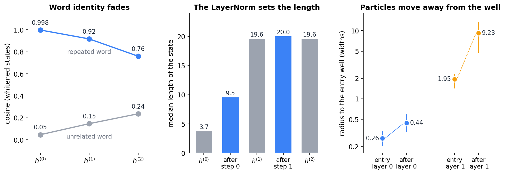

# What the Matchers Read: Embedding, Layer States and Wells

**What this note is.** The author asked whether the matcher built on the embedding is using the convergence of the model, and whether the semantic signatures are still taken from the model's evolution. This note records that discussion (2026-11-25), with the readings that answer it on SR2-2B and with two statements of the first answer corrected by later measurements. It is the reason the next matchers are built as they are ([Template_Matchers_on_the_Dynamics.md](Template_Matchers_on_the_Dynamics.md)). The matcher itself is reported in [Template_Matcher_From_Geometry.md](Template_Matcher_From_Geometry.md).

**In brief.**
- The embedding has not been moved by any well, so a matcher on it uses no convergence. It is the control.
- All states come from one forward pass through one frozen, trained checkpoint. Training converged; the particles of a premise do not come to rest.
- The geometry matcher, as first run, reads angles between particles and never reads a well. It is not yet a test of the idea that the signature comes from the evolution.
- On SR2-2B the particles move **away** from the well that dominates them on entry, at both layers. The author accepts this: what matters is that the matcher uses the evolution, not that the particles settle in wells.
- Two matchers on the evolution were run on SR2-2B (displacements, well frame; §6). A third, iterated settling, is parked.

---

## Contents

1. [Two kinds of convergence](#1-two-kinds-of-convergence)
2. [The states](#2-the-states)
3. [Why the embedding scores well](#3-why-the-embedding-scores-well)
4. [What the layers do to the state](#4-what-the-layers-do-to-the-state)
5. [Do the particles settle in a well?](#5-do-the-particles-settle-in-a-well)
6. [What would test the idea](#6-what-would-test-the-idea)
7. [Depth, and the conjecture to verify](#7-depth-and-the-conjecture-to-verify)
8. [Corrections to the first answer](#8-corrections-to-the-first-answer)
9. [Caveats](#9-caveats)
10. [Reproduce](#10-reproduce)

---

## 1. Two kinds of convergence

| | what moves | when it stops |
| --- | --- | --- |
| **training** | the parameters: the well centres, precisions and weights, the embedding, the context channels | at the final checkpoint; everything is frozen from then on |
| **evolution of one premise** | the particles (one state per token), through the layers of the frozen model | after the last layer; the model has two |

"Converged landscape" refers to the first. It does not say that a particle has come to rest in a well. The states $h^{(1)}$ and $h^{(2)}$ are **not** computed at a later training step than $h^{(0)}$: all three come from the same forward pass through the same checkpoint. Here that is SR2-2B at step 126,500 of 130,000, validation perplexity 47.56.

## 2. The states

For a token $x_t$ at position $t$, with $E$ the table of word vectors and $P$ the table of position vectors:

$$
h^{(0)}_t = E[x_t] + P[t] .
$$

| state | what it is | has a well acted on it? |
| --- | --- | --- |
| embedding | a learned vector for the word plus one for the position | no; it sees no other token |
| state after layer 0 | after layer 0's single integration step and its LayerNorm | yes, once |
| state after layer 1 | after layer 1's single integration step and its LayerNorm | yes, twice |

The embedding is $h^{(0)}$, the state after layer 0 is $h^{(1)}$, the state after layer 1 is $h^{(2)}$. Both lookup tables are trained with the model and then frozen, so $h^{(0)}$ is fixed for a token and a position. In the last column "a well" stands for the whole force of the layer, the context potential with its wells and the pair force. All three states go through the same matcher. If the figure of a premise already shows in $h^{(0)}$, it is in the words, and the landscape did not create it. That is why $h^{(0)}$ is kept as the control.

## 3. Why the embedding scores well

**Repeated words.** In $h^{(0)}$ the same word gets nearly the same vector wherever it stands. In "If P, then Q. P." the last word of the repeated clause has cosine 0.998 with its first occurrence, against 0.05 for an unrelated clause. On $h^{(0)}$ the matcher is therefore close to string matching, although it is written in angles.

**Connectives.** The added coordinate is the position of the connective between the disjunctive and the conditional wordings. In $h^{(0)}$ that is the connective's own word vector.

Without that coordinate the embedding fails. With the coordinates fixed in advance and known wordings, the right template fires on:

| state | MP | MT | DS (mean of two) |
| --- | ---: | ---: | ---: |
| states after both layers | 82% | 87% | 73% |
| embedding | 88% | 11% | 13% |

So "the embedding does nearly as well" holds only with the added coordinate. In that comparison the embedding also used 8 particles of the second sentence, against 4 for $h^{(1)}$ with $h^{(2)}$. Those numbers were set by hand for each state; only the dimension was searched there. The table above is from the earlier search, where both are chosen on development clauses (5 and 4).

The mechanism, step by step on one premise, is in [The_Embedding_Template_Matcher.md](The_Embedding_Template_Matcher.md).

## 4. What the layers do to the state



**Figure 1.** SR2-2B. Left: cosine of the last word of the second sentence with the last word of clause 1, when it repeats it and when it does not. Middle: median length of the state before and after each LayerNorm. Right: radius to the well that dominates on entry, median and 10 to 90% of tokens.

| state | repeated word, cosine | unrelated last word, cosine | correlation with the embedding's particle cosines |
| --- | ---: | ---: | ---: |
| embedding | 0.998 | 0.05 | 1 |
| after layer 0 | 0.917 | 0.15 | 0.84 |
| after layer 1 | 0.760 | 0.24 | 0.51 |

The first two columns are medians over the 60 test clauses in the if-then wording. The third is the correlation, over the pairs of particles of one premise, between their cosines in the embedding and in the state (median over 400 test premises).

The layers blur the identity of the word as they mix in context, and after layer 0 the figure of a premise is still mostly the embedding's. The **states** themselves are not a small change of the embedding. On 12,288 tokens of ordinary text:

| | layer 0 | layer 1 |
| --- | ---: | ---: |
| median length of the displacement | 8.03 | 24.04 |
| the same, over the length of the state on entry | 2.17 | 1.23 |
| cosine of the displacement with the state on entry | 0.21 | -0.60 |
| cosine of the state after the layer with the state on entry | 0.60 | 0.30 |
| held-out variance of the state after the layer explained by a linear map of the state on entry | 0.55 | 0.62 |

The displacement is taken before the layer's LayerNorm. The LayerNorm brings every state to length 19.6, while the embedding has length 3.7. The plain difference

$$
h^{(1)} - h^{(0)}
$$

would mostly measure that rescaling.

Some of the accuracy of $h^{(1)}$ is therefore inherited from the words. About 55% of it is a linear function of the embedding, and its figure of a premise correlates 0.84 with the embedding's. The tests so far do not separate this from what the evolution adds.

## 5. Do the particles settle in a well?

Not on SR2-2B. For well $k$ with centre $\mu_k$ and precision $P_k$ at the token's context, let

$$
q_k = (h - \mu_k)^{\top} P_k (h - \mu_k), \qquad r_k = \sqrt{q_k},
$$

so that $r_k$ is the distance to the centre in widths of the well, and $e^{-q_k/2}$ is the occupancy, 1 at the centre. The dominant well has the largest $w_k e^{-q_k/2}$.

| SR2-2B, 12,288 ordinary tokens | layer 0 | layer 1 |
| --- | ---: | ---: |
| radius to the dominant well on entry, median | 0.26 | 1.95 |
| occupancy of it on entry, median | 0.97 | 0.15 |
| radius to the **same** well after the step | 0.44 | 9.23 |
| tokens that end closer to it | 1.15% | 0.02% |
| tokens whose dominant well is the same after the step | 99.6% | 14.5% |
| radius to the well that dominates after the step | 0.44 | 4.24 |

- **Layer 0.** The tokens enter inside the well. That reading is of the embedding itself, so they start there and do not converge into it. The step moves them outwards a little and they stay in the same well.
- **Layer 1.** They enter on a shell about two widths out and leave it. The median token ends nine widths from that well and about four from the nearest one, where no well of the layer holds it (median occupancy of order $10^{-4}$).
- **On entry SR2-NP, the sibling without the pair force, reads the same:** 0.20 widths at layer 0 and 1.97 at layer 1 at its best checkpoint ([Well_Settling_Map_SR2_NP.md](Well_Settling_Map_SR2_NP.md), §5.3). Only the entry was measured there.

Which term drives the particles outwards, and what the velocity contributes, has not been measured.

**The author's position (2026-11-25).** That they move away from the wells is fine. The requirement is that the matcher takes advantage of the evolution of the system, its dynamics.

## 6. What would test the idea

The geometry matcher, as first run, reads angles and lengths of the states. It uses no well centre, no radius and no stiff direction, and it does not read the path. Whatever it finds, it does not test whether the signature of a premise is in how its particles evolve. Three readings exist only because the forces act:

| | reading | status |
| --- | --- | --- |
| 1 | **displacements** of each layer, before the LayerNorm; they remove the additive copy of the state on entry | run on SR2-2B: matcher A |
| 2 | **well-frame coordinates** of each particle: the share of each well, the radius, the stiff coordinates, and their change over the step | run on SR2-2B: matcher B |
| 3 | **iterated settling:** keep applying a layer's step with the context frozen until the particles stop moving, and freeze that figure | parked |

The stiff coordinates of well $k$ are

$$
u_k = B_k^{\top} (h - \mu_k),
$$

with $B_k$ the low-rank factor of its precision. The word still influences all three readings through the forces, so $h^{(0)}$ stays the control: **if one of them beats the embedding on unseen wordings or on paraphrases, the landscape adds something the words do not.** The author approved 1 and 2 on SR2-2B. **The run was scored on 2026-11-25:** neither beats the embedding on unseen wordings, the displacement reading beats it on paraphrases by the pre-registered rule but not at a fixed near-miss rate, and one wording drives most of the differences ([Template_Matchers_on_the_Dynamics_SR2_2B.md](Template_Matchers_on_the_Dynamics_SR2_2B.md)). The coordinates, the pass marks and the calls TD1 to TD5 were written and confirmed before the run ([Template_Matchers_on_the_Dynamics.md](Template_Matchers_on_the_Dynamics.md), §5).

Reading 3 is the closest to a converged figure, but it runs the model outside its training regime. §5 shows that one step moves the particles away from the wells at both layers, so whether repeated steps come to rest at all has to be checked before such a matcher is designed.

## 7. Depth, and the conjecture to verify

Two layers give a particle a path of two steps. The flow readings on the code models (FLOW-R, [Code_Depth_Runs.md](../depth_ladder/Code_Depth_Runs.md)) replace each trained layer by its own flow cut into finer substeps, and record how far the loss settles from the trained one:

| model | layers | settles at (nats) |
| --- | ---: | ---: |
| SO-CODE | 2 | 0.369 |
| L4-CODE | 4 | 0.306 |
| L8-CODE | 8 | 0.035 |

The three models integrate over the same total time, so an eight-layer step is four times shorter than a two-layer one. Part of the fall is simply that a shorter step is closer to the flow.

**Conjecture (the author asked to verify it).** At eight layers a layer is close to its own flow, so the path a particle takes means more, and more layers give a matcher a longer path to read. Templates read from the evolution should then improve with depth.

**What the readings do not say.** They are per layer. Refining the whole stack still fails at every depth (2.695 nats at $k = 4$ for L8-CODE). And no reading links a layer that is close to its flow to a better signature. That is what the runs have to show.

The pre-registration with the proposed calls is [Template_Matchers_and_Depth.md](Template_Matchers_and_Depth.md).

**Plan (author, 2026-11-25).** After SR2-2B, on the CPU, one model at a time, each with its report before the next:
1. the prose pair at 0.5B tokens, G2 (two layers) and the four-layer model with live gradients, the same settings except for depth and, with it, the step; the clean comparison;
2. the code models with two, four and eight layers. This is weaker evidence, since English premises are outside their training text.

There is no eight-layer prose model with live gradients. If the direction looks good, the author will train four- and eight-layer models on OpenWebText at 0.5B and 2B tokens. The estimates, from the step times recorded on code (2.0 s at four layers, 5.5 s at eight), are:

| | 0.5B tokens | 2B tokens |
| --- | ---: | ---: |
| four layers | about 18 h | about 72 h |
| eight layers | about 50 h | about 199 h |

Prose runs may differ somewhat.

## 8. Corrections to the first answer

The first answer was given before the readings of §4 and §5 existed on SR2-2B. It is corrected as follows.

| first answer | now |
| --- | --- |
| "each layer adds a displacement to the state instead of replacing it", as the reason why the first layer keeps most of the embedding's figure | the displacement is twice as long as the embedding and nearly orthogonal to it (cosine 0.21). The **figure** is kept (0.84); the state is not a carried-over embedding |
| displacements as plain differences of the states | taken before the LayerNorm; the plain difference mostly measures the rescaling |
| where the final state ends up relative to the wells on SR2-2B: not measured | measured, §5: away from them |
| "the embedding does nearly as well" | only with the connective's position, which was added after the first results (§3) |

## 9. Caveats

- One model, one checkpoint, one seed. The state and well readings are on ordinary text (12,288 tokens), not on premises; the cosines are on premises.
- The radius is measured to the well in the layer's own context, before and after the same step. After the LayerNorm the median radius to the entry well is 1.18 at layer 0 and 9.59 at layer 1.
- The readings of §4 and §5 were seen before the dynamics matchers were scored, and their pre-registration says so.
- The bank was read inside the forward pass, so the depth-code error found the same day in the conservativity test does not touch these numbers.

## 10. Reproduce

```bash
cd notebooks/conservative_arch/scaleup
python3 debug/template_state_readings.py robust_sr2_2b.pkl dyntext_sm.npz results/template_matcher/template_state_readings_sr2_2b
python3 ../../../companion_notes/figures/_make_template_states_figs.py
```

The inputs are the premise geometry of `debug/template_robust_test.py` and the ordinary text of `debug/template_dynamics_test.py`. The outputs are `results/template_matcher/template_state_readings_sr2_2b.txt` and `.json`.
