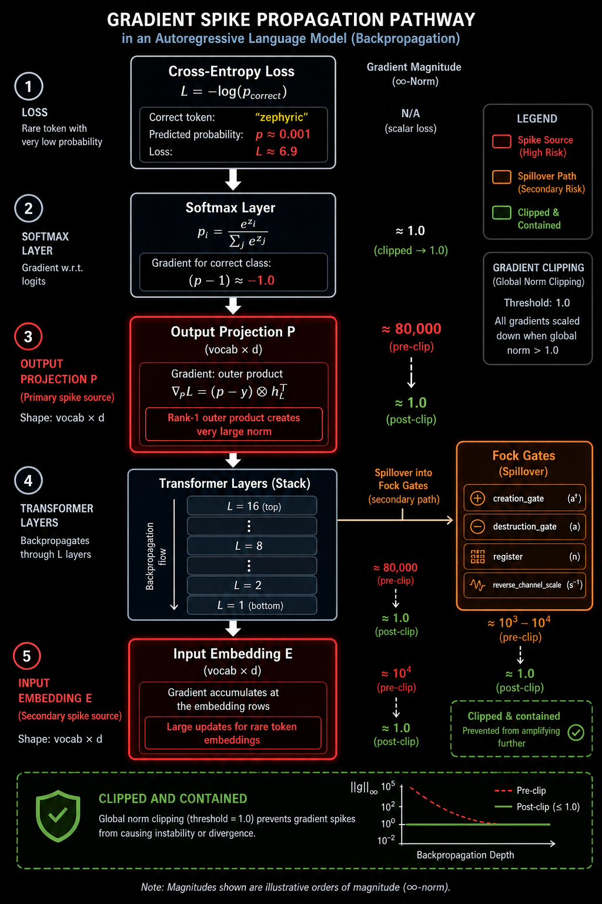
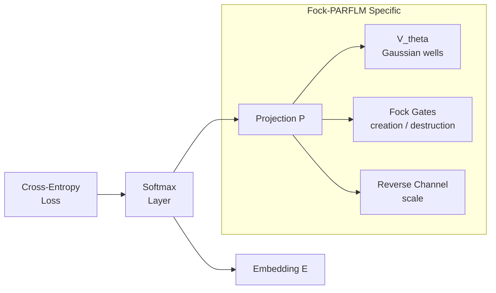
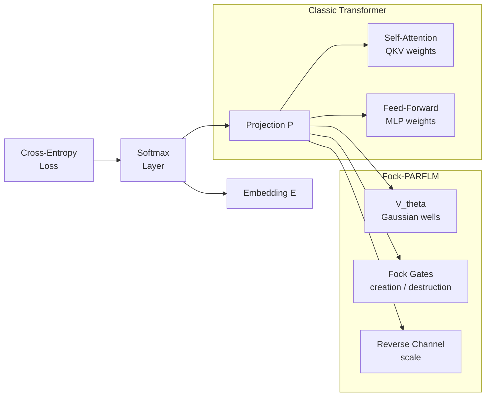
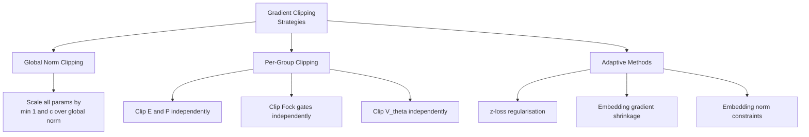

# Embedding Spikes: Anatomy, Comparison with Transformers, and Remediation

**What this note is.** §18–§20 of the training-instabilities record: embedding spikes (anatomy, root cause and propagation), how they compare with embedding spikes in attention transformers, and per-group against global-norm clipping. It was split on 2026-11-21 from [`Training_Instabilities_in_Fock-PARFLM_with_structured_V_theta.md`](https://github.com/dimitarpg13/semsimula-paper/blob/5551315/companion_notes/Training_Instabilities_in_Fock-PARFLM_with_structured_V_theta.md) (written June to August 2026). The text is that document's, unchanged except for its links, and keeps its section numbers, so a reference to "§N" anywhere in the record or in other notes finds its note through [the index](README.md).

> **Causal-leak caveat.** Every experiment in §1–§23 used the pre-fix, leaky Fock architecture: the reverse channel read a shared full-window register state, before the `prefix_causal_registers` fix. The stability findings stand; every perplexity reported here is leak-contaminated (optimistically low). The full caveat is in [the index](README.md#causal-leak).

## Contents

- [18. Embedding Spikes: Anatomy, Root Cause, and Propagation](#18-embedding-spikes-anatomy-root-cause-and-propagation)
- [19. Comparison with Embedding Spikes in Classic Attention-Based Transformers](#19-comparison-with-embedding-spikes-in-classic-attention-based-transformers)
- [20. Remediation: Per-Group Clipping vs Global Norm Clipping](#20-remediation-per-group-clipping-vs-global-norm-clipping)

---

## 18. Embedding Spikes: Anatomy, Root Cause, and Propagation

> **Context**: the `e5c_plgate` run (d=384, L=16, M=32,
> depth-conditioned multi-context Gaussian $V\_\theta$, per-layer
> reverse channel) on OpenWebText exhibits large transient gradient
> spikes that are distinct from the $V\_\theta$-mediated blowups
> documented in §§1–17.  This section analyses them.

### 18.1 Observed spike signature

During the `e5c_plgate` run (sequence length 512, effective batch
≈ 32k tokens), isolated spikes appear in the pre-clip total gradient
norm.  A representative log excerpt:

| Step | PPL | Pre-clip Total Grad | Top Contributors |
|---|---|---|---|
| 36 850 | 112.62 | 82 426 | P 58k, E 21k, creation\_gate 1.8k |
| 36 900 | 113.71 | 6 001 | (normal) |
| 37 250 | 115.76 | 103 577 | P 77k, E 22k |
| 37 300 | 111.77 | 3 488 | (normal) |

The **output projection** $P$ and **input embedding** $E$ account for
more than 95% of the spike energy.  Recovery to baseline happens within
one or two steps.

We call these **embedding spikes** — a term standard in the LLM
training literature (GPT-3 / OPT / PaLM post-mortems).

### 18.2 Cross-entropy gradient through softmax

Let $h \in \mathbb{R}^d$ be the final hidden state at a token position,
$z = P h \in \mathbb{R}^V$ the logit vector, with softmax probability

$$
p\_i = \frac{e^{z\_i}}{\sum\_{j=1}^{V} e^{z\_j}}.
$$

The cross-entropy loss for the correct class $c$ is

$$
\mathcal{L} = -\log p\_c.
$$

The gradient with respect to the logit vector is the residual:

$$
\frac{\partial \mathcal{L}}{\partial z} = p - y,
$$

where $y$ is the one-hot label with $y\_c = 1$.  For the correct class
$c$ the component is $(p\_c - 1)$; for every other class $j \neq c$
the component is $p\_j$.

### 18.3 Rank-1 gradient on the projection matrix

The gradient of $\mathcal{L}$ with respect to $P$ is the rank-1 outer
product:

$$
\nabla\_{P} \mathcal{L} = (p - y) h^\top \in \mathbb{R}^{V \times d}.
$$

Its Frobenius norm is

$$
\lVert \nabla\_{P} \mathcal{L} \rVert\_F = \lVert p - y \rVert\_2 \cdot \lVert h \rVert\_2.
$$

When a **rare token** is the correct answer and the model assigns it
near-zero probability ($p\_c \approx 0$), the residual norm
$\lVert p - y \rVert\_2 \approx 1$ and $\lVert h \rVert\_2 \sim \mathcal{O}(\sqrt{d})$,
so the per-position gradient norm is $\mathcal{O}(\sqrt{d})$.  The
mini-batch sums these over positions; because the gradient concentrates
in a **single row** of $P$ (the row indexed by the correct token $c$),
the norm compounds rather than cancels.

### 18.4 The softmax bottleneck amplifier

For a vocabulary of $V = 50{,}257$ (GPT-2 BPE), the matrix $P$ has
$V \times d$ entries but the gradient update is effectively rank-1 and
sparse in the vocabulary dimension.  The norm of this single row update
can be $\sim \lVert h \rVert\_2$, which is orders of magnitude larger
than the typical per-row gradient $\sim \lVert h \rVert\_2 / \sqrt{V}$.

### 18.5 Why the embedding $E$ is similarly affected

The gradient flows backward through the entire transformer stack into
the input embedding:

$$
\nabla\_{E\_{t}} \mathcal{L} = \frac{\partial \mathcal{L}}{\partial h\_0^{(t)}} \cdot \frac{\partial h\_0^{(t)}}{\partial E\_{t}},
$$

where $h\_0^{(t)}$ is the embedding lookup for position $t$.  Again this
is a sparse update: only the row of $E$ corresponding to **input
token** $t$ receives a gradient.  Rare input tokens see large gradients
that are not averaged with frequent-token gradients.

### 18.6 Batching amplification

The number of unlucky (rare + misclassified) tokens in a batch of $B$
sequences of length $T$ follows approximately

$$
N\_{\text{spike}} \sim \text{Poisson}(\lambda),
\quad
\lambda = B T \sum\_{w \in \text{rare}} f\_w (1 - p\_w),
$$

where $f\_w$ is the corpus frequency of token $w$ and $p\_w$ is the
model's current prediction probability for $w$ in context.  At small
effective batch sizes (Fock-PARFLM uses $B=4$ sequences $\times$ 2
gradient accumulation = 8 micro-batches), the Poisson count has high
relative variance, causing intermittent but dramatic spikes.

### 18.7 Spike propagation pathway

The following diagram illustrates how a single rare token creates a
gradient spike that propagates through the model during
backpropagation:



The spike originates at the softmax/cross-entropy interface,
concentrates in $P$ and $E$, and spills into auxiliary parameters
(Fock gates, reverse channel) through the chain rule.  Per-group
clipping intercepts each group independently, preventing the $P$/$E$
spike from contaminating the entire update.

### 18.8 Potential-mediated amplification channel

Fock-PARFLM has an additional amplification channel that classic
transformers lack.  The conservative force field

$$
F(h) = -\nabla\_h V\_\theta(h)
$$

means that the gradient with respect to $V\_\theta$ parameters involves
second derivatives of the potential:

$$
\nabla\_{\theta} \mathcal{L} = -\sum\_{t} \frac{\partial \mathcal{L}}{\partial h\_t} \cdot \nabla\_h \nabla\_\theta V\_\theta(h\_t).
$$

For the depth-conditioned multi-context Gaussian potential

$$
V\_\theta(h; \ell) = \sum\_{k=1}^{K} \alpha\_k^{(\ell)} \exp\left(-\frac{\lVert h - \mu\_k^{(\ell)} \rVert^2}{2 \sigma\_k^{(\ell)2}}\right),
$$

the Hessian $\nabla\_h^2 V\_\theta$ can amplify gradients in directions
aligned with narrow Gaussian wells ($\sigma\_k$ small).  This creates a
**potential-mediated amplification** on top of the universal softmax
bottleneck effect.

However, the `e5c_plgate` logs show that this secondary channel
contributes less than 5% of the total spike energy — the $P$/$E$ rows
remain the dominant source.



---

## 19. Comparison with Embedding Spikes in Classic Attention-Based Transformers

### 19.1 Universality of embedding spikes

Embedding spikes are **not** specific to Fock-PARFLM.  They have been
documented in every major autoregressive transformer family:

| Model | Parameters | Documented Instability | Remediation |
|---|---|---|---|
| GPT-3 (175B) | 175B | Loss spikes at 2-3 points during training | Rewound to earlier checkpoint, skipped data |
| OPT-175B | 175B | Divergence from loss spikes | Manual restart from 1-2k steps before |
| PaLM (540B) | 540B | ~20 loss spikes during training | Restarted from 100 steps before; skipped batches |
| LLaMA (65B) | 65B | Spike handling documented in training recipe | Global gradient clipping at 1.0 |
| Chinchilla (70B) | 70B | Instabilities during scaling experiments | z-loss regularisation |
| BLOOM (176B) | 176B | Significant training spikes | Embedding norm regularisation |
| GLM-130B | 130B | Gradient shrinkage instabilities | Embedding gradient shrinkage |

### 19.2 Root cause comparison

The root cause is **identical** across architectures — the
cross-entropy loss through softmax over a large vocabulary creates
sparse, high-norm gradient updates for rare tokens.  What differs is
the **propagation pathway**:



In classic transformers, the spike spills into the attention QKV
matrices and FFN weights.  In Fock-PARFLM, it spills into the
structured potential $V\_\theta$ parameters (Gaussian well centres,
widths, depths) and the Fock mechanism gates.

### 19.3 Structural difference: conservative dynamics

In classic transformers, the backward pass distributes the spike
gradient through:
- **Self-attention**: diluted across positions by the attention matrix.
  Uncertain attention heads (where $A\_{ij} \approx 0.5$) amplify the
  spike while confident patterns ($A\_{ij} \approx 0$ or $1$) attenuate
  it.
- **FFN**: the GELU activation derivative $\text{GELU}'(z) \in [0,1]$
  gates the spike — saturated neurons attenuate, active neurons pass
  through.
- **Residual stream**: the identity skip connections provide an
  unattenuated gradient highway from the output to the input.

Fock-PARFLM replaces attention + FFN with the Verlet/BAOAB integrator
over a conservative potential, meaning spike gradients flow through:
- **$V\_\theta$ Hessian**: can amplify in directions aligned with narrow
  Gaussian wells (§18.8).
- **Fock creation/destruction gates**: receive gradient through the
  register mechanism.
- **Reverse channel scale**: per-layer learnable parameters that see the
  full gradient.

> **⚠ Causal-leak note.** The reverse-channel-scale gradient discussed here is
> doubly significant. Beyond its spike behavior, the audit shows this scalar is
> what *opens the causal leak*: as training drives it away from zero, past
> predictions gain access to future tokens through the shared register state. Its
> persistent nonzero gradient is therefore simultaneously a stability signal and
> a leak signal. See the top-of-document banner.

Despite these architectural differences, the **primary spike source**
($P$ and $E$) and the **primary mitigation** (clipping) are identical.

---

## 20. Remediation: Per-Group Clipping vs Global Norm Clipping

### 20.1 Global norm clipping (classic transformers)

The standard approach in GPT-2/3, LLaMA, etc. is global gradient
clipping:

$$
g \leftarrow g \cdot \frac{c}{\max(c, \lVert g \rVert\_2)},
$$

where $g$ is the concatenation of all parameter gradients and $c$ is
the clip threshold (typically $c = 1.0$).

**Problem**: when $P$ and $E$ dominate the global norm (as they do
during a spike), the scaling factor $c / \lVert g \rVert\_2$ becomes
very small (e.g. $1.0 / 80{,}000 \approx 1.25 \times 10^{-5}$).
This **zeroes out** the useful gradients for all other parameters —
the entire step is wasted, and the optimizer state (Adam's first and
second moment estimates) gets corrupted.

$$
\text{Effective update for layer } \ell \neq E,P:
\quad
\Delta W\_\ell = \eta \cdot \frac{c}{\lVert g \rVert\_2} \cdot g\_\ell
\approx 0.
$$

This is why OPT-175B and PaLM required **manual restarts** — the
wasted steps and corrupted optimizer state created a slow recovery.

### 20.2 Per-group clipping (Fock-PARFLM)

Fock-PARFLM clips each parameter group independently:

$$
g\_k \leftarrow g\_k \cdot \frac{c\_k}{\max(c\_k, \lVert g\_k \rVert\_2)},
\quad k \in \lbrace E, P, V\_\theta, \text{creation}, \text{destruction}, \text{register}, \text{RC} \rbrace.
$$

**Advantage**: during a spike, the $P$ and $E$ groups are clipped to
their respective thresholds, but the $V\_\theta$ and Fock gate groups
receive their **full, unscaled** gradient.  The step is productive for
all non-spiking parameters.

$$
\text{Effective update for layer } \ell \neq E,P:
\quad
\Delta W\_\ell = \eta \cdot g\_\ell
\quad \text{(unchanged)}.
$$

This is why the `e5c_plgate` run recovers within a single step — the
optimizer state for all non-embedding groups remains clean.

### 20.3 Taxonomy of clipping strategies



### 20.4 Comparison summary

| Property | Global Clip | Per-Group Clip |
|---|---|---|
| Spike containment | Yes (prevents divergence) | Yes (prevents divergence) |
| Collateral damage to non-spiking params | Severe — entire step wasted | None — other groups unaffected |
| Optimizer state corruption | Yes — Adam moments integrate near-zero gradient | No — moments for clean groups stay accurate |
| Recovery time | 100-500 steps (slow); manual restart needed for severe spikes | 1 step (immediate) |
| Manual intervention required | Often (OPT, PaLM) | Never |
| Sensitivity to clip threshold | High — too low wastes steps; too high risks divergence | Low — each group tuned to its own scale |
| Implementation complexity | Simple | Moderate (requires parameter group registry) |

### 20.5 Other remediation strategies

Beyond clipping, several complementary strategies exist:

**z-loss regularisation** (Chinchilla, PaLM):
Adds a penalty on the log-partition function
$\log Z = \log \sum\_j e^{z\_j}$ to the loss:

$$
\mathcal{L}\_{\text{total}} = \mathcal{L}\_{\text{CE}} + \lambda\_z (\log Z)^2.
$$

This discourages logits from growing large, which reduces the softmax
bottleneck effect.  Compatible with per-group clipping.

**Embedding gradient shrinkage** (GLM-130B):
Scales down the gradient for $E$ and $P$ by a constant factor
$\alpha \lt 1$:

$$
g\_E \leftarrow \alpha \cdot g\_E,
\quad
g\_P \leftarrow \alpha \cdot g\_P.
$$

Effective but ad hoc; the shrinkage factor must be tuned.

**Embedding norm constraints** (BLOOM):
Projects $E$ rows back onto a sphere of fixed radius after each step:

$$
E\_i \leftarrow R \cdot \frac{E\_i}{\lVert E\_i \rVert\_2}.
$$

Prevents embedding drift but can interfere with learning.

### 20.6 Per-group clipping recovery flow

```mermaid
sequenceDiagram
    participant B as Batch
    participant M as Model
    participant C as Clipper
    participant O as Optimizer

    B->>M: Step t: batch with rare tokens
    M->>C: grad P = 58k, grad E = 21k, grad V_theta = 200
    C->>C: Clip P to 1.0, Clip E to 1.0
    C->>C: V_theta 200 below threshold: pass through
    C->>O: P_clipped=1.0, E_clipped=1.0, V_theta=200
    O->>M: Update all groups; V_theta gets full step

    B->>M: Step t+1: normal batch
    M->>C: grad P = 1.2k, grad E = 800, grad V_theta = 180
    C->>C: All within threshold: pass through
    C->>O: Full gradients for all groups
    Note over M: PPL returns to trend
```

### 20.7 Global clipping recovery flow (classic transformer)

```mermaid
sequenceDiagram
    participant B as Batch
    participant M as Model
    participant C as Clipper
    participant O as Optimizer

    B->>M: Step t: batch with rare tokens
    M->>C: global norm = 80000
    C->>C: Scale ALL grads by 1.0 / 80000
    C->>O: All groups receive near-zero gradient
    O->>M: Step wasted; Adam moments contaminated

    B->>M: Steps t+1 to t+100: normal batches
    Note over O: Adam slowly re-estimates moments
    Note over M: PPL recovery takes 100-500 steps

    B->>M: Steps t+100 to t+500: normal batches
    Note over M: If lucky PPL back to trend
    Note over M: If unlucky: manual restart needed
```
