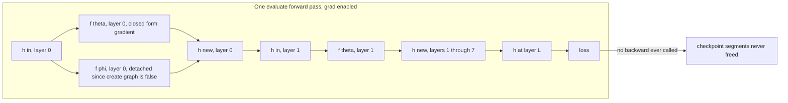

# The Eval-Time OOM at Step 47,500

**What this note is.** §43 of the training-instabilities record: four repeats of the same out-of-memory failure at evaluation time, and why `gc.collect()` could not fix it. It was split on 2026-11-21 from [`CfC_BAOAB_Integrator_and_Mitigations.md`](https://github.com/dimitarpg13/semsimula-paper/blob/5551315/companion_notes/CfC_BAOAB_Integrator_and_Mitigations.md) (written August to October 2026). The text is that document's, unchanged except for its links, and keeps its section numbers, so a reference to "§N" anywhere in the record or in other notes finds its note through [the index](README.md).

## Contents

- [43. Four Repeats of the Same Eval-Time OOM at Step 47,500: gc.collect() Was Never Going to Fix It, and Why](#43-four-repeats-of-the-same-eval-time-oom-at-step-47500-gccollect-was-never-going-to-fix-it-and-why)

---

## 43. Four Repeats of the Same Eval-Time OOM at Step 47,500: `gc.collect()` Was Never Going to Fix It, and Why

Resuming training after §42.6 hit a **fourth** `CUDA OutOfMemoryError`, at
the identical step (~47,500) and inside the identical call
(`evaluate()`'s first iteration), across four independent attempts —
including one made *after* patching `evaluate()` to call `gc.collect()` +
`torch.cuda.empty_cache()` on every iteration (not just every 10, the
weaker version that shipped first). The live per-iteration memory print
added alongside that patch read:

```
[evaluate] iter 0/40  mem_alloc=47.47GB  mem_resv=48.12GB
```

bit-for-bit identical, to two decimal places, both before and after the
`gc.collect()`-every-iteration change. That identity is the whole
diagnosis: if `mem_alloc` were a garbage-collectible Python reference
cycle (the theory the fix was built on), adding `gc.collect()` would have
to change the number. It changed nothing, which means the memory was
never Python garbage in the first place — it was live, validly
referenced, un-freed CUDA tensor data that no amount of `del` +
`gc.collect()` + `empty_cache()` was ever going to touch.

### 43.1 The `create_graph=True`-in-eval theory was falsified by the code itself

The fix that shipped with the original OOM patch assumed the CfC-BAOAB
analytic $V_\theta$ force "almost certainly" builds a `create_graph=True`
second-order graph even at eval time, and that `gc.collect()` is the
documented remedy for the reference cycle such graphs leave behind. Both
halves turn out to be checkable directly against `MultiXiPARFLM._layer_forces`
in `model_parf_multixi.py` — the class this run actually instantiates
(`FockMultiXiPARFLM` on top of it), *not* the superficially similar but
structurally different, unused `model_parf.PARFLM._layer_forces` (§42's
`Cell 5` regression guard exists specifically to catch that
stale-reference trap). `MultiXiPARFLM._layer_forces` contains the *only*
`torch.autograd.grad` call in the analytic-$V_\theta$ path (the one that
recovers $\nabla_h V_\phi$, since $V_\phi$ has no closed form):

```336:355:notebooks/conservative_arch/parf/model_parf_multixi.py
        if self._use_analytic_vtheta():
            # Closed-form V_theta force: no autograd, so V_theta never
            # enters the second-order create_graph chain at all.  Only the
            # (much smaller) V_φ graph is differentiated twice.
            if vtheta_comps is None:
                f_theta = -self.V_theta.analytical_grad(xis, h_in)
            else:
                f_theta = -self.V_theta.analytical_grad(
                    xis, h_in, comps=vtheta_comps,
                )
            with torch.autocast(device_type="cuda", enabled=False):
                grad_phi, = torch.autograd.grad(
                    U_pair.float(), h_in,
                    create_graph=self.training,
                    retain_graph=self.training,
                )
            f_phi = -grad_phi
```

`evaluate()` calls `model.eval()` first, so `self.training` is `False`
for the whole eval pass — `create_graph=False` for this call, exactly as
the comment two lines above it says is the point ("V_theta never enters
the second-order create_graph chain at all"). There is no hidden
`create_graph=True` anywhere in this call. `gc.collect()` had nothing
collectible to find, which is the direct, mechanical reason the number
never moved.

### 43.2 The real graph that survives eval: the analytic force itself, not the `V_phi` grad call

`f_theta = -self.V_theta.analytical_grad(xis, h_in)` is **not** a discrete
`autograd.grad()` call — it is ordinary differentiable tensor arithmetic
(the closed-form Gaussian-well gradient, built from matmuls against
$V_\theta$'s own parameters and against `h_in`). Ordinary tensor ops are
never gated by a `create_graph` flag; they stay connected to whatever
they were computed from — `h_in` and $V_\theta$'s parameters — for as
long as grad-tracking is enabled, in train mode or eval mode alike. Since
`h_new` of layer $\ell$ feeds `h_in` of layer $\ell+1$, this graph chains
across all $L$ layers:



`use_layer_checkpoint=True` (set in `Cell 5`'s `make_config`) wraps each
layer in `torch.utils.checkpoint.checkpoint(..., use_reentrant=False)`,
correctly gated on `torch.is_grad_enabled()` rather than `self.training`
(§42's own regression guard in `Cell 5` checks exactly this, and it
passed — this is *not* a repeat of that old bug). Checkpointing's promise
is "discard intermediates now, recompute them later if a backward ever
walks through here." During training, `loss.backward()` immediately
follows the forward and that promise is redeemed layer by layer: each
checkpoint segment is recomputed, differentiated, and freed as backward
walks from layer $L-1$ down to layer $0$. That is exactly why the
training loop's own periodic log line —

```
step 47500/100000  ...  mem_alloc=1.7GB  mem_resv=57.6GB  mem_peak=57.2GB  ...
```

— shows `mem_peak=57.2GB` (the transient forward+backward cost of one
`batch=8` microbatch, before backward frees it) alongside
`mem_alloc=1.7GB` (the steady-state cost of parameters + optimiser state
+ populated `.grad`, measured *after* backward has already run). Eval
reaches the same order of peak — `47.47GB` at `batch=8`, comparable to
training's `57.2GB` peak at the same microbatch size — for the same
underlying reason (the same per-layer analytic-force graph, at the same
batch size), but `evaluate()` never calls `.backward()`. The checkpoint
segments' recompute obligation is never redeemed, the per-layer graph
that chains all the way to `loss` is never walked, and the memory is
simply never reclaimed. No Python object leaks; `del` + `gc.collect()`
correctly find nothing to do, because from Python's perspective the
graph rooted at `loss` is exactly as reachable, and exactly as intended
to be reachable, as it always is until something actually backpropagates
through it.

### 43.3 Fix: give eval a real (but weight-inert) `backward()`

The one-line fix is to let PyTorch's own teardown mechanism run, exactly
as it does during training, then throw the resulting gradients away
before they can do anything:

```python
with torch.enable_grad():
    _, loss = model(x, y)
    losses.append(loss.item())
    loss.backward()
model.zero_grad(set_to_none=True)   # discard; optimizer.step() is never called
del loss, x, y
gc.collect()
torch.cuda.empty_cache()
```

`model.eval()` is still in effect (`self.training` stays `False`), so
`create_graph`/`retain_graph` for the `V_phi` grad call are still `False`
and nothing here is any more expensive than a normal training step's
forward+backward at the same batch size — the exact regime the training
loop already survives every step. One correctness footnote: because
`grad_phi` is detached (`create_graph=False`), `V_\phi`'s own parameters
receive no gradient contribution through this path during eval's
backward — harmless here, since every eval gradient is discarded
immediately and never touches the optimiser.

### 43.4 Status: validated live at the very next step-47,500 eval

Patched in `Cell 6`'s `evaluate()` in
`colab_fock_cfc_baoab_aniso_gaussian_openwebtext_d384.ipynb`, then
validated on the first eval call to reach step 47,500 after a fresh-session
resume (which, per §42.5/42.6, resolved to the `_prereload` checkpoint at
step 47,116 as expected):

```
[evaluate] iter 0/40  mem_alloc=2.22GB  mem_resv=2.46GB
[evaluate] iter 10/40  mem_alloc=2.22GB  mem_resv=2.46GB
[evaluate] iter 20/40  mem_alloc=2.22GB  mem_resv=2.46GB
[evaluate] iter 30/40  mem_alloc=2.22GB  mem_resv=2.46GB
[evaluate] iter 39/40  mem_alloc=2.22GB  mem_resv=2.46GB
[evaluate] mem before=1.70GB  after=2.22GB  peak_during=55.04GB  trend=[2.22, 2.22, 2.22, 2.22, 2.22]GB
>>> EVAL step 47,500  val_loss=4.7450  val_ppl=115.00  best=100.47  (3247s)
```

Exactly the predicted signature: `mem_alloc` stays pinned at `2.22GB`
across every one of the 40 iterations instead of climbing unboundedly
from the `47.47GB` seen at iteration 0 before the fix. `peak_during`
still legitimately touches `55.04GB` — the same forward+backward-sized
transient the training loop's own `mem_peak≈57.2GB` shows every step —
confirming §43.2's account: that memory was never a leak, only ever a
*peak* that training's per-microbatch `.backward()` was already reclaiming
and eval's forward-only pass was not. Giving eval a real `.backward()`
per iteration reclaims it the same way, and the eval call completes clean
for the first time past this step. (`val_ppl=115.00` vs. the restored
best of `100.47` reflects `PRECISION_LR_MAX=1.0` and the intervening
spike/reload churn since step 47,116/47,121, not a new problem — a
different question from the one this section is about.)

### 43.5 Multi-eval confirmation, and a clean step-50,000 leak-probe checkpoint

The fix held on every subsequent eval through step 50,000, not just the
first one — five consecutive clean calls, all with the identical flat
`mem_alloc=2.22GB` / `peak_during≈55GB` signature:

| eval step | val_ppl | best so far |
|---|---|---|
| 47,500 | 115.00 | 100.47 |
| 48,000 | 114.05 | 100.47 |
| 48,500 | 106.71 | 100.47 |
| 49,000 | 100.56 | 100.47 |
| 49,500 | 104.08 | 100.47 |
| 50,000 | 109.84 | 100.47 |

Noisy but not degrading -- consistent with the pre-existing §32/§36
plateau, not a new symptom.

Four ordinary `[spike]` captures landed in the same window (47,429 at
102.3; 48,997 at 224.8, led by `reverse_channel_scale`; 49,026 at 137.9;
49,640 at 261.8), none within reach of `hard_trigger=500` -- zero
`[watchdog-hard]` reloads. Two of the four (224.8, 261.8) are visibly
larger than anything seen since `PRECISION_LR_MAX=1.0` went on, and both
are led by groups outside the capped low-rank $V_\theta$ channel
(`reverse_channel_scale`, `E`/`P`) -- worth tracking as a possible slow
drift rather than treated as resolved, but not yet an intervention
trigger.

Separately, the run's periodic causal-leak probe (see
[`Fock-PARFLM_Causal_Leak_Audit_Results.md`](../Fock-PARFLM_Causal_Leak_Audit_Results.md)
for the architectural background and the original prefix-causal-register
fix) fired at step 50,000 and came back clean on the *live, current*
weights, despite the spike/reload churn since 47,116:

```
[trained leak probe] max|dlogit| at past positions = 0.000e+00  (init-scale reference ~1.1e-05)
[honest-ppl] honest_PPL=68.83  standard_PPL=67.57  diff=+0.0186 nats  [CLEAN]
```

`diff` is small and in the causally-correct direction (honest ≥
standard), so the apparent PPL improvement this run is chasing is not an
artifact of the reverse-channel leak pathway re-opening under the new
integrator/cap combination. The `torch.no_grad() forward failed ...
falling back to grad-enabled forward with manual detach` message printed
alongside it is expected, not a fault: the analytic $V_\theta$ force's
internal `torch.autograd.grad()` call (§43.1) needs grad-tracking
enabled, so a blanket `no_grad()` attempt inside the probe correctly
raises and the probe's own fallback path (grad-enabled + manual detach)
handles it, exactly as designed.
