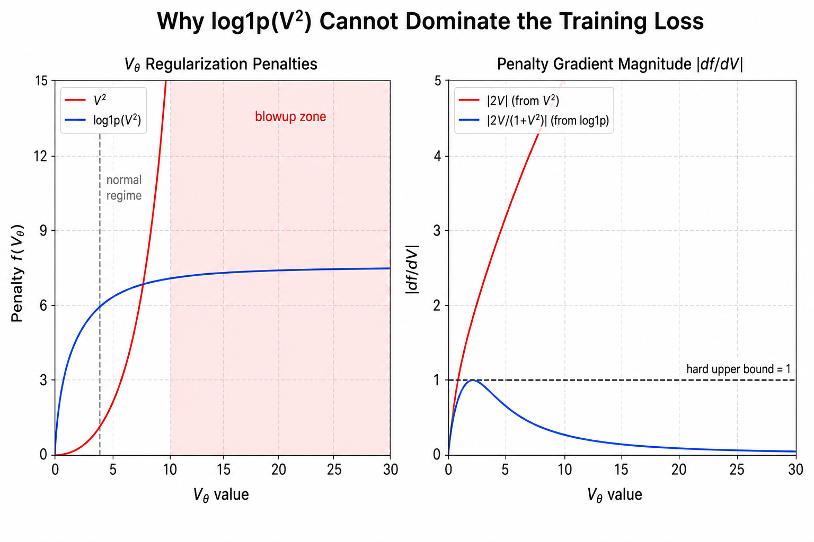
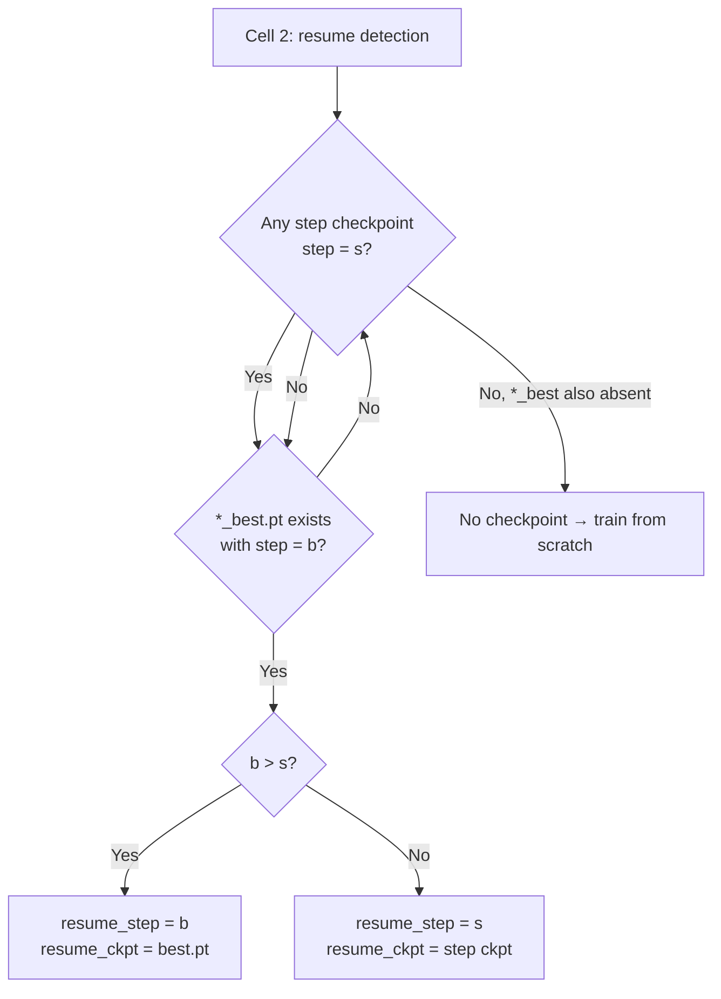

# Fixes, the EMA Watchdog, and Residual Risk

**What this note is.** §6–§8 of the training-instabilities record: the fixes applied after the three blowups with their mathematical justification, the design of the EMA watchdog, and the risk that remained. It was split on 2026-11-21 from [`Training_Instabilities_in_Fock-PARFLM_with_structured_V_theta.md`](https://github.com/dimitarpg13/semsimula-paper/blob/5551315/companion_notes/Training_Instabilities_in_Fock-PARFLM_with_structured_V_theta.md) (written June to August 2026). The text is that document's, unchanged except for its links, and keeps its section numbers, so a reference to "§N" anywhere in the record or in other notes finds its note through [the index](README.md).

> **Causal-leak caveat.** Every experiment in §1–§23 used the pre-fix, leaky Fock architecture: the reverse channel read a shared full-window register state, before the `prefix_causal_registers` fix. The stability findings stand; every perplexity reported here is leak-contaminated (optimistically low). The full caveat is in [the index](README.md#causal-leak).

## Contents

- [6. Fixes Applied and Their Mathematical Justification](#6-fixes-applied-and-their-mathematical-justification)
- [7. EMA Watchdog Design](#7-ema-watchdog-design)
- [8. Residual Risk and Recommendations](#8-residual-risk-and-recommendations)

---

## 6. Fixes Applied and Their Mathematical Justification

### Fix 1: Bounded regulariser — log1p(V_θ²)

**Applied after Blowup 1.**

Replace $\mathcal{R}_{\mathrm{quad}} = \mathbb{E}[V_\theta^2]$ with:

$$
\mathcal{R}_{\mathrm{log}}(V_\theta)
 = \mathbb{E}\bigl[\log(1 + V_\theta^2)\bigr]
$$

**Why it works:**

1. **Normal regime equivalence.** For $|V_\theta| \ll 1$:
 $\log(1+V^2) \approx V^2$, so the landscape compression is identical.

2. **Gradient bound.** The gradient with respect to $V_\theta$ is:

$$
\frac{d}{dV}\log(1+V^2) = \frac{2V}{1+V^2}
$$

 This is bounded by $\left|\frac{2V}{1+V^2}\right| \leq 1$ for all
 $V \in \mathbb{R}$, with the maximum at $V=1$. Therefore:

$$
\lambda_V \cdot \frac{\partial \mathcal{R}_{\mathrm{log}}}{\partial \theta}
 \leq \lambda_V \cdot \mathbb{E}\left[\frac{\partial V_\theta}{\partial \theta}\right]
$$

 and the penalty contribution to the total gradient is bounded by
 $\lambda_V$ times the mean magnitude of $\partial V_\theta / \partial\theta$.
 It **cannot** exceed the NTP gradient unless $\lambda_V \gg 1$.

3. **No runaway.** The penalty loss itself is bounded: as $|V_\theta| \to \infty$,
 $\log(1+V^2) \to \log V^2 = 2\log V$, which grows only logarithmically.
 A batch where $V_\theta = 1000$ contributes $\log(10^6+1) \approx 13.8$
 to the penalty, not $10^6$.

**Observed effect:** `v_reg` (now `mean(log1p(V²))`) stabilised at 1.0–1.5
throughout training (vs. 2×10⁵ in the first run).

---

### Fix 2: Lower max LR and tighter grad_clip

**Applied after Blowup 2; tightened again after Blowup 3 (Fix 4).**

| Parameter | Blowup 1 run | After Fix 1 | After Fix 2 | After Fix 4 |
|-----------|-------------|-------------|-------------|-------------|
| `LR` | 3×10⁻⁴ | 2×10⁻⁴ | 1.5×10⁻⁴ | **1.2×10⁻⁴** |
| `GRAD_CLIP` | 0.5 | 0.5 | 0.3 | **0.25** |
| `WARMUP_STEPS` | 5,000 | 8,000 | 8,000 | 8,000 |

**Motivation:**

For a hard batch with $\lVert g \rVert = G$ and clip threshold $C$, the
applied step in any direction is at most:

$$
\lVert \Delta\theta \rVert \leq \eta_t \cdot C
$$

where $\eta_t$ is the learning rate at step $t$. After the cosine
schedule with $\eta_{\max}$ and warmup $T_w$:

$$
\eta_t = \frac{\eta_{\max}}{2}\left(1 + \cos\left(\pi \frac{t-T_w}{T-T_w}\right)\right)
$$

At step 22k of a 200k run (warmup at 8k):

$$
\text{progress} = \frac{22000-8000}{200000-8000} \approx 0.073
\quad\Rightarrow\quad
\eta_{22k} \approx 0.997 \eta_{\max} \approx \eta_{\max}
$$

The cosine schedule had barely started decaying. The maximum per-step
displacement in any direction is:

$$
\lVert \Delta\theta_{\max} \rVert = \eta_{\max} \cdot C
 = \begin{cases}
2\times10^{-4} \times 0.5 = 1\times10^{-4} & \text{(Blowup 2 run)} \\
1.5\times10^{-4} \times 0.3 = 4.5\times10^{-5} & \text{(current run)}
\end{cases}
$$

The new maximum displacement is **2.2× smaller**. Over 100 consecutive hard
steps the cumulative drift in a destabilizing direction is:

$$
\lVert \Delta\theta_{\mathrm{cum}} \rVert
 \lesssim 100 \times 4.5\times10^{-5} = 4.5\times10^{-3}
\quad\text{(vs.} 1\times10^{-2}\text{ before)}
$$

This keeps the model closer to the good basin and makes self-correction
by subsequent normal batches more likely.

---

### Fix 3: Auto-resume from \*\_best.pt (Cell 2)

Cell 2 now checks both the periodic step checkpoints and `*_best.pt`,
selecting whichever is **more recent**:

This means: if a blowup occurs **between** two 25k periodic checkpoints,
the next session automatically recovers the pre-blowup weights without any
manual Drive file operations.

---

### Fix 4: EMA Watchdog Recalibration

**Applied after Blowup 3.**

The three watchdog parameters were recalibrated to the actual gradient scale
of the model after the Fix-2 LR and clip reductions:

| Parameter | Before (broken) | After (calibrated) | Rationale |
|-----------|-----------------|-------------------|-----------|
| `GRAD_NORM_EMA_ALPHA` | 0.02 | **0.05** | Faster EMA (~20-step memory vs 50-step); catches escalation before it fully develops |
| `GRAD_NORM_EMA_THRESHOLD` | 50.0 | **3.5** | Baseline EMA is ~1.3–1.5; threshold = 2.5× baseline; old value of 50 was 35× baseline and permanently unreachable |
| `GRAD_NORM_EMA_PATIENCE` | 100 | **30** | Catch a sustained instability in 30 steps; 100 steps gave the model too long to drift |

Additionally `LR` was reduced from 1.5×10⁻⁴ to **1.2×10⁻⁴** and `GRAD_CLIP`
from 0.3 to **0.25** to further reduce the per-step displacement during any
hard-batch streak that does occur before the watchdog fires.

**Calibration derivation.** With the new parameters, the EMA at steady state
for a sustained gradient of $G$ converges to $G$ itself. With
$\alpha = 0.05$ and the new threshold $\tau = 3.5$:

- **Normal training** (grad ~1.3): EMA steady-state ≈ 1.3. Well below threshold.
- **Single spike** (grad = 7.6 at step 21,400 followed by immediate recovery): EMA
 reaches ≈ 1.6 in one step, falls back next step. Never approaches 3.5 for
 30 consecutive steps → watchdog does not fire.
- **Slow escalation as in Blowup 3** (grads of 2–5 sustained for 200+ steps):
 EMA converges toward 3–5. Threshold crossed within ~50–100 steps → watchdog
 fires and reloads the best checkpoint before the val PPL degrades further.

---

## 7. EMA Watchdog Design

The EMA watchdog detects a soft-instability spiral before the next periodic
checkpoint is written with corrupted weights.

**Algorithm (parameters after Fix 4):**

Let $\hat{g}_t = \lVert g_t \rVert$ (raw gradient norm before clipping) at step $t$.
Maintain an exponential moving average:

$$
\bar{g}_t = (1-\alpha) \bar{g}_{t-1} + \alpha \hat{g}_t,
\qquad \alpha = 0.05 \text{(~20-step memory)}
$$

Maintain a counter $c_t$:

$$
c_t = \begin{cases}
c_{t-1} + 1 & \text{if } \bar{g}_t > \tau_g \\\\
0 & \text{otherwise}
\end{cases}
\qquad \tau_g = 3.5
$$

If $c_t \geq P = 30$ (30 consecutive steps above threshold):
1. Log the event.
2. Call `_reload_best_checkpoint()` — loads `*_best.pt` into `model` and `optim` in-place.
3. Reset $\bar{g}_t = 0$, $c_t = 0$.
4. Continue training from the next step (LR schedule is unchanged — no warmup repeat).

**Threshold calibration (after Fix 4):**

| Regime | Typical grad | EMA (α=0.05) steady state | Triggers? |
|--------|-------------|--------------------------|-----------|
| Normal training | 1.0–1.5 | ~1.3–1.5 | No (below 3.5) |
| Single spike then recovery | 7–16, then 1.3 | peaks ~1.6–2.0, decays immediately | No (stays below 3.5 within ~10 steps) |
| Slow escalation (Blowup 3 pattern) | 2–5 sustained | converges toward 3–5 | Yes, within 50–100 steps |
| Acute blowup (Blowup 2 pattern) | 50–214 | immediately > 3.5 | Yes, within 1–2 steps |

**Why the original parameters (α=0.02, τ=50) failed (Blowup 3):**

The gradient scale after Blowup-2 fixes (LR 1.5×10⁻⁴, clip 0.3) settled at
1–17. The old threshold of 50 required sustained gradients of 50+ to produce
an EMA above 50 — a condition that never occurred after the fixes. The EMA
peaked at ~1.81 during the entire Blowup 3 event. The design rule is:

$$
\tau_g \approx 2\text{–}3 \times \bar{g}_{\mathrm{baseline}}
$$

With baseline EMA ≈ 1.4, this gives τ ≈ 2.8–4.2; the chosen value is 3.5.

**Failure mode check:** If `*_best.pt` does not exist (first session, no eval
yet), the watchdog logs a warning and continues — it cannot roll back. This
is fine because the first eval at step 2,000 writes `*_best.pt`, after which
the watchdog has a recovery target.

---

## 8. Residual Risk and Recommendations

### Remaining instability sources

After all four fixes, the following risks remain:

1. **Hard-batch streak that exceeds the watchdog patience.** With
 `PATIENCE=30`, a sustained streak of fewer than 30 steps above the EMA
 threshold will not trigger a reload. Because OWT documents are streamed
 sequentially, correlated hard batches can run for hundreds of consecutive
 steps; however, the tighter clip (0.25) and lower LR (1.2×10⁻⁴) reduce
 the per-step damage while the watchdog waits.

2. **Post-cosine-peak LR** is still ~1.2×10⁻⁴ at step 20k (only ~7% decay).
 The schedule will not meaningfully reduce LR until ~50k+ steps. Any third
 hard OWT region encountered before that point relies on the watchdog to
 absorb it.

3. **Fock register salience** can drift during a hard streak (register
 particles may incorrectly gain/lose salience). Even after reloading
 `*_best.pt`, the salience state is restored from the checkpoint, so this
 is recoverable.

4. **Watchdog threshold drift.** If training genuinely improves and the
 gradient scale drops further (e.g., to ~0.7), the current threshold of
 3.5 may become overly sensitive (≈5× baseline). Conversely, if a new
 phase of training raises the baseline, the threshold may need
 recalibrating again. The design rule τ ≈ 2.5× baseline should be
 re-checked at every major training milestone.

### Recommendations for future Fock+structured V_θ scale-ups

| Lever | After Fix 4 | Recommended for 1M-step run |
|-------|-------------|------------------------------|
| `LR_max` | 1.2×10⁻⁴ | 1.0×10⁻⁴ |
| `GRAD_CLIP` | 0.25 | 0.2 |
| `WARMUP_STEPS` | 8,000 | 10,000–15,000 |
| `CKPT_INTERVAL` | 25,000 | 10,000 (more frequent saves) |
| `lambda_V` ramp | constant 0.01 | ramp 0→0.01 over first 2k steps |
| `GRAD_NORM_EMA_ALPHA` | 0.05 | 0.05–0.10 |
| `GRAD_NORM_EMA_THRESHOLD` | 3.5 | 2.5× baseline EMA (re-measure at 10k) |
| `GRAD_NORM_EMA_PATIENCE` | 30 | 20–30 |
| Penalty | log1p(V²) | log1p(V²) — keep |
| Data shuffle | sequential OWT | consider shuffling document order to break consecutive-hard-batch correlations |

### The deeper question: is structured V_θ safe at scale?

The instabilities arise from the interaction of three factors:
(a) an **unbounded** quadratic-in-$h$ potential,
(b) **deep** Verlet integration (L=16), and
(c) **sequential data** with correlated hard batches.

Factor (a) is inherent to the SQ3 parameterisation. The log1p fix is a
sound mitigation but not a cure — it prevents the penalty from dominating
but does not prevent $V_\theta$ from growing large during forward inference.
A more principled long-term fix would be to add a **soft-clamp** on $h$
itself (e.g. via layer normalization before the V_θ force computation) so
that $\lVert h - \mu_k \rVert$ cannot grow arbitrarily. The `ln_after_step=True`
flag provides partial protection (LN is applied after each Verlet step),
but LN is applied to the full $h$ vector, not to the difference
$h - \mu_k(\xi)$, so extreme well-displacement can still occur within a
single step.

For MLP-based V_θ (no structured form), the force $-\nabla_h V_\theta$
is an arbitrary neural network output and is empirically bounded by the
weight norms — an implicit regularisation that the analytical SQ3 form does
not share.
