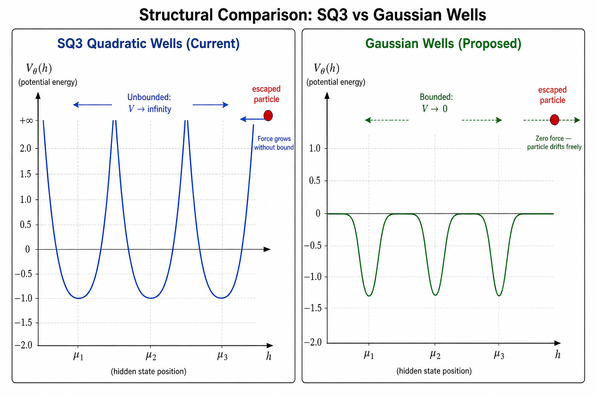
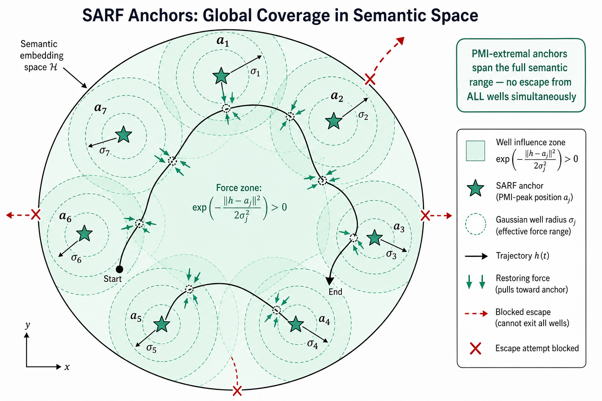
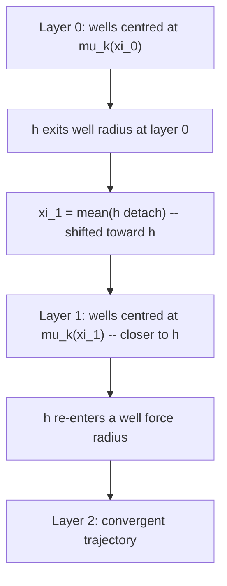
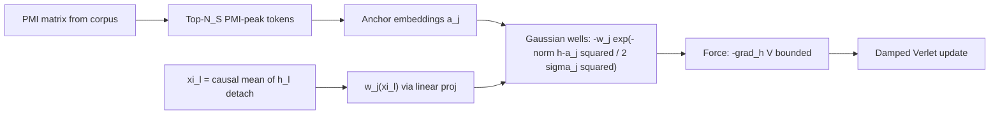
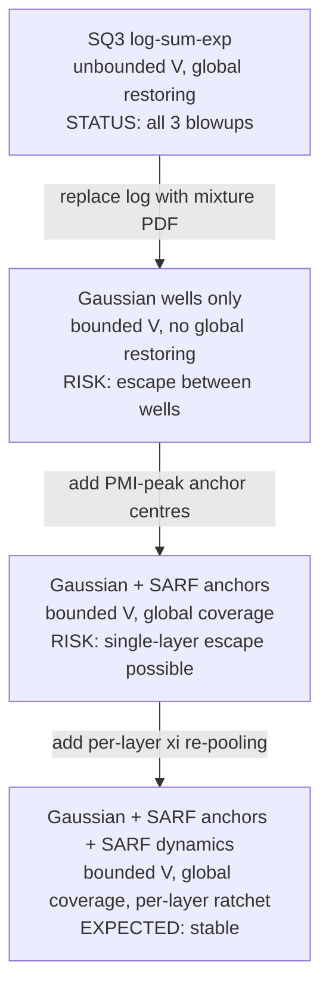
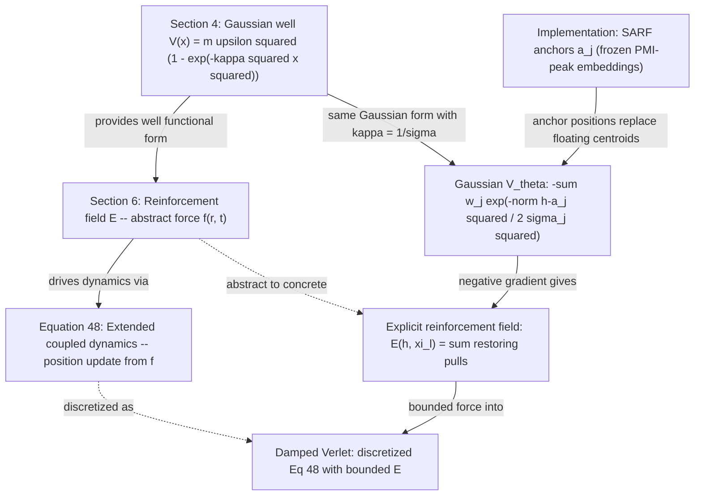

# Gaussian Wells with SARF Anchors: the Architectural Path Forward

**What this note is.** §9 of the training-instabilities record: the proposal to replace the unbounded structured potential with Gaussian wells anchored at SARF anchors. It was split on 2026-11-21 from [`Training_Instabilities_in_Fock-PARFLM_with_structured_V_theta.md`](https://github.com/dimitarpg13/semsimula-paper/blob/5551315/companion_notes/Training_Instabilities_in_Fock-PARFLM_with_structured_V_theta.md) (written June to August 2026). The text is that document's, unchanged except for its links, and keeps its section numbers, so a reference to "§N" anywhere in the record or in other notes finds its note through [the index](README.md).

> **Causal-leak caveat.** Every experiment in §1–§23 used the pre-fix, leaky Fock architecture: the reverse channel read a shared full-window register state, before the `prefix_causal_registers` fix. The stability findings stand; every perplexity reported here is leak-contaminated (optimistically low). The full caveat is in [the index](README.md#causal-leak).

## Contents

- [9. Architectural Path Forward: Gaussian Wells with SARF Anchors](#9-architectural-path-forward-gaussian-wells-with-sarf-anchors)

---

## 9. Architectural Path Forward: Gaussian Wells with SARF Anchors

The three blowups documented above share a single root cause: the SQ3
potential is **quadratic in** $h$ **and therefore unbounded**. Every
remediation applied so far (log1p penalty, lower LR, tighter clip, EMA
watchdog) is a downstream containment mechanism that treats the symptoms.
This section analyses an architectural alternative that eliminates the root
cause: replacing the SQ3 log-sum-exp wells with Gaussian (mixture-PDF)
wells, and compensating for the resulting loss of global restoring force
with SARF (Semantically Anchored Reference Frame) anchor positions and
SARF-faithful dynamics.

### 9.1. Why SQ3 is structurally unbounded

The SQ3 potential is a **negative free energy** of a Boltzmann mixture:

$$
V_\theta(\xi, h) = -\tau \log \sum_{k=1}^{K} \pi_k(\xi) \exp\left(-\frac{E_k(\xi, h)}{\tau}\right)
$$

Each $\exp(-E_k / \tau)$ is a Gaussian density in $h$, but the $\log$
wrapper inverts the boundedness: as $\lVert h - \mu_k \rVert \to \infty$
for all $k$, every Gaussian density decays to zero, their sum decays to
zero, and the log diverges:

$$
V_\theta \to -\tau \log(0^+) = +\infty
$$

The force $-\nabla_h V_\theta$ grows linearly with displacement — a
global restoring force that pulls every escaped hidden state back toward the
nearest well centre. This is a useful property, but it comes at the cost of
an **unbounded penalty** $V_\theta^2$ that was the direct trigger for
Blowup 1.

### 9.2. The Gaussian-well alternative

Replace the log-sum-exp with the **mixture-PDF form** — the sum of
negative Gaussian bumps without the log wrapper:

$$
V_\theta^{\mathrm{G}}(\xi, h) = -\sum_{k=1}^{K} w_k(\xi) \exp\left(-\frac{\lVert a_k^{1/2}(h - \mu_k(\xi)) \rVert^2}{2}\right)
$$

where $w_k(\xi) \gt 0$ are context-dependent weights (softmax over a
linear projection of the multi-xi context) and $a_k(\xi) \gt 0$ are
per-component precisions as before.

**Structural properties.** The key differences from SQ3 are:

| Property | SQ3 (log-sum-exp) | Gaussian wells (mixture PDF) |
|----------|-------------------|------------------------------|
| Range | (−∞, +∞) | [−Σ w_k, 0] |
| Asymptotic behaviour | V → +∞ quadratically | V → 0 (bounded) |
| Force outside wells | linear restoring, grows with displacement | exponential decay to zero |
| Maximum force | unbounded | bounded per well |
| Penalty V² | unbounded → Blowup 1 | bounded by (Σ w_k)² |
| Jacobi metric | degenerate at V = E boundary | valid everywhere (V bounded below) |

**Gradient bound.** The force of a single Gaussian well is:

$$
F_k(h) = -\nabla_h \left[-w_k \exp\left(-\frac{\lVert h - \mu_k \rVert^2}{2\sigma_k^2}\right)\right] = -\frac{w_k}{\sigma_k^2}(h - \mu_k) \exp\left(-\frac{\lVert h - \mu_k \rVert^2}{2\sigma_k^2}\right)
$$

The exponential decay factor bounds the force magnitude. The maximum occurs
at $\lVert h - \mu_k \rVert = \sigma_k$ and equals:

$$
\lVert F_k \rVert_{\max} = \frac{w_k}{\sigma_k} e^{-1/2} \approx \frac{0.607 w_k}{\sigma_k}
$$

This is finite and independent of the hidden state. No outlier token can
produce an arbitrarily large gradient contribution from the potential,
which **structurally prevents Blowup 1**.

### 9.3. The escape problem and why SARF solves it

The Gaussian well force profile is **non-monotone**: it peaks at distance
$\sigma_k$ from the centre and then decays exponentially. Beyond roughly
$2\sigma_k$, the force is negligible. A hidden state that drifts past all
well radii experiences no meaningful restoring force and moves inertially.

This is the fundamental trade-off: **boundedness (stability) vs. global
attraction (convergence)**. The SQ3 form has global attraction but is
unstable; pure Gaussian wells are stable but have no global attraction.

SARF (Semantically Anchored Reference Frame) provides two mechanisms that
close this gap without reintroducing unboundedness.

#### 9.3.1. SARF anchors: PMI-extremal coverage

SARF anchors $\lbrace a_j \rbrace_{j=1}^{N_S}$ are the embeddings of the
top-$N_S$ tokens ranked by $\max_w \mathrm{PMI}(v, w)$ — tokens with the
most strongly peaked pointwise mutual information with at least one other
token. These are the **informationally extremal** points of the vocabulary.

The anchor selection procedure is:

$$
\mathrm{PMI\_peak}(v) = \max_{w \neq v} \mathrm{PMI}(v, w)
$$

$$
\lbrace a_j \rbrace_{j=1}^{N_S} = \mathrm{TopK}\left(\lbrace E(v) \mid v \in \mathcal{V} \rbrace, \mathrm{PMI\_peak}, N_S\right)
$$

When Gaussian wells are centred on SARF anchors, the potential becomes:

$$
V_\theta^{\mathrm{SARF}}(\xi, h) = -\sum_{j=1}^{N_S} w_j(\xi) \exp\left(-\frac{\lVert h - a_j \rVert^2}{2\sigma_j^2}\right)
$$

**Why escape is structurally impossible.** The SARF anchors are PMI
extremes of the vocabulary — they occupy the "corners" of the semantic
embedding space. Because the anchors span the full semantic range, a
hidden state cannot be simultaneously far from **all** anchors. Any
direction away from one anchor necessarily moves toward another.

The coverage guarantee can be formalised. Let $R = \max_j \lVert a_j \rVert$
be the radius of the anchor constellation and
$\delta = \min_{j \neq k} \lVert a_j - a_k \rVert$ the minimum inter-anchor
distance. Then for any $h$ with $\lVert h \rVert \le R$:

$$
\min_j \lVert h - a_j \rVert \le \delta
$$

by the pigeonhole principle on the Voronoi cells of the anchors. If
$\sigma_j \ge \delta / 2$ for all $j$, every point inside the anchor
constellation lies within at least one well's effective force radius.

#### 9.3.2. SARF-faithful dynamics: adaptive restoring force via per-layer xi re-pooling

The second SARF mechanism is **per-layer recomputation of the context
variable** $\xi$. In the standard SPLM, $\xi$ is computed once from the
layer-0 embeddings and held fixed across all $L$ integration steps. In
the SARF-faithful variant:

$$
\xi_\ell = \frac{1}{t}\sum_{s \le t} h_s^{(\ell)}, \qquad \text{recomputed at each layer } \ell = 0, 1, \ldots, L{-}1
$$

where $h_s^{(\ell)}$ is the hidden state of token $s$ at layer $\ell$
(computed from $h_s^{(\ell)}.detach()$ to sever the autograd path and
preserve the per-token Euler-Lagrange structure).

This creates an **adaptive multi-layer ratchet**: the well centres
$\mu_k(\xi_\ell)$ shift at each layer to track the running mean of the
current hidden states. Even if a hidden state exits a well's force radius
at layer $\ell$, the next layer's well centres are closer because $\xi$
updated to include the displaced $h$.

The ratchet does not add backward-graph depth because `h.detach()` severs
the autograd path from $\xi$ to $h$. The force at each layer is the
standard per-token Euler-Lagrange force:

$$
m \ddot{h}\_t = -\nabla_h V_\theta(\xi_\ell, h_t)
$$

with the damped update (Verlet integrator):

$$
v_{t}^{(\ell+1)} = \frac{v_{t}^{(\ell)} + \Delta t \cdot f_t^{(\ell)} / m}{1 + \Delta t \cdot \gamma}, \qquad h_{t}^{(\ell+1)} = h_{t}^{(\ell)} + \Delta t \cdot v_{t}^{(\ell+1)}
$$

The xi recomputation adds only one `cumsum` + division per layer — negligible
relative to the $V_\theta$ force evaluation.

### 9.4. The combined architecture: Gaussian wells + SARF

The proposed architecture combines three elements:

1. **Gaussian (mixture-PDF) wells** for structurally bounded $V_\theta$.
2. **SARF anchor positions** as well centres for global semantic coverage.
3. **SARF-faithful per-layer xi dynamics** for adaptive restoring.

The potential is:

$$
V_\theta^{\mathrm{SARF}}(\xi_\ell, h) = -\sum_{j=1}^{N_S} w_j(\xi_\ell) \exp\left(-\frac{\lVert h - a_j \rVert^2}{2\sigma_j^2}\right)
$$

where:
- $a_j$ are static PMI-peak SARF anchor positions (fixed after corpus analysis)
- $\sigma_j$ are learned per-anchor widths
- $w_j(\xi_\ell)$ are context-dependent weights: a small MLP or linear projection of $\xi_\ell$
- $\xi_\ell$ is recomputed from $h^{(\ell)}.detach()$ at each layer (SARF-faithful)

**Optional background quadratic.** For additional safety, a mild
global quadratic background can be added:

$$
V_\theta^{\mathrm{SARF+bg}}(\xi_\ell, h) = -\sum_{j=1}^{N_S} w_j(\xi_\ell) \exp\left(-\frac{\lVert h - a_j \rVert^2}{2\sigma_j^2}\right) + \epsilon \lVert h \rVert^2
$$

where $\epsilon \ll 1$ is small enough that the Gaussian wells dominate
locally (within the anchor constellation) but the background prevents
unbounded drift if a hidden state somehow escapes all anchors. This is
analogous to layer normalization (`ln_after_step=True`) but acts through the
potential rather than as a post-hoc normalisation.

### 9.5. What each mechanism fixes

| Blowup | Root cause | Gaussian wells | SARF anchors | SARF dynamics |
|--------|-----------|---------------|-------------|--------------|
| 1 (penalty dominance) | V_θ² → ∞ | **Prevented**: V² ≤ (Σ w_k)² | neutral | neutral |
| 2 (directional instability) | deep backward graph | **Partially mitigated**: bounded force | neutral | neutral (same depth) |
| 3 (slow escalation) | sustained moderate gradients | **Partially mitigated**: lower gradient ceiling | **Mitigated**: no dead zones between wells | **Mitigated**: per-layer ratchet prevents sustained drift |

### 9.6. Thermodynamic cost

The SQ3 log-sum-exp has a clean **free-energy interpretation**:
$V_\theta = -\tau \log Z(\xi, h)$ where $Z$ is the partition function
of a Boltzmann mixture. This connects to the paper's variational framework
and Jacobi metric derivations.

The Gaussian mixture-PDF form has no such thermodynamic interpretation —
$V_\theta$ is a sum of bump functions, not a log-partition function. However:

1. **The Jacobi metric is actually better behaved.** Because
 $V_\theta^{\mathrm{G}}$ is bounded below (by $-\sum_k w_k$), the Jacobi
 metric $g_{ij}^J = 2(E - V)\delta_{ij}$ is positive-definite everywhere
 (given $E \gt -\sum_k w_k$), without the degeneracy at energy
 boundaries that plagues the SQ3 form.

2. **The connection to attention.** The softmax attention score between
 query $h$ and key $\mu_k$ is proportional to
 $\exp(-\lVert h - \mu_k \rVert^2 / 2\sigma^2)$ in the Gaussian kernel
 formulation. The Gaussian-well potential is therefore a
 potential-energy analogue of the attention score — a well-known
 connection that strengthens rather than weakens the theoretical
 narrative.

3. **The SARF anchors provide interpretability** that the learned SQ3
 well centres lack. Each anchor corresponds to a specific PMI-extremal
 token, giving the potential landscape a grounded semantic interpretation.

### 9.7. Force profile analysis

The force profile of a single Gaussian well (radial component) is:

$$
F(r) = -\frac{w}{\sigma^2} r \exp\left(-\frac{r^2}{2\sigma^2}\right), \qquad r = \lVert h - \mu \rVert
$$

This has a characteristic non-monotone shape:

- **Near-field** ($r \ll \sigma$): $F \approx -w r / \sigma^2$ (linear,
 harmonic oscillator)
- **Peak** ($r = \sigma$): $F_{\max} = -w e^{-1/2} / \sigma \approx -0.607 w / \sigma$
- **Far-field** ($r \gg \sigma$): $F \to 0$ (exponential decay)

The **escape radius** — beyond which the force is less than 1% of peak — is:

$$
r_{\mathrm{esc}} = \sigma\sqrt{2\ln 100} \approx 3.03\sigma
$$

For the combined SARF architecture, the effective restoring force at any
point $h$ is the superposition of all anchor wells:

$$
F_{\mathrm{total}}(h) = \sum_{j=1}^{N_S} \frac{w_j}{\sigma_j^2}(h - a_j) \exp\left(-\frac{\lVert h - a_j \rVert^2}{2\sigma_j^2}\right)
$$

When the SARF anchor constellation tiles the space with
$\sigma_j \ge \delta / 2$ (half the minimum inter-anchor distance), every
interior point receives nonzero force from at least one anchor, and the
maximum "dead-zone force deficit" (the minimum force at any interior point)
is bounded below by:

$$
\lVert F_{\mathrm{total}} \rVert_{\min} \ge \frac{w_{\min}}{\sigma_{\max}} \exp\left(-\frac{\delta^2}{2\sigma_{\min}^2}\right) \gt 0
$$

### 9.8. Implementation considerations

The transition from SQ3 to Gaussian+SARF requires changes in three places:

1. **V_theta module**: replace the `StructuredVThetaSQ3` forward pass
 (log-sum-exp) with a sum of Gaussian bumps. The gradient computation
 via `torch.autograd.grad` is unchanged — PyTorch differentiates the
 Gaussian form automatically.

2. **Anchor computation**: a one-time offline step that computes the PMI
 matrix from the corpus, identifies the top-$N_S$ PMI-peak tokens, and
 saves their embedding positions. This replaces the learned
 $\mu_k(\xi)$ centres.

3. **Integration loop**: adopt SARF-faithful xi recomputation from
 `model_sarf.py` — a one-line change replacing
 `xi = causal_cumulative_mean(emb)` (computed once) with
 `xi = causal_cumulative_mean(h.detach())` (computed per layer).

The regulariser $\mathcal{R}$ can be simplified. With bounded
$V_\theta^{\mathrm{G}}$, the original `mean(V^2)` penalty is already
bounded. The log1p fix remains harmless but is no longer necessary:

$$
\mathcal{R}(V_\theta^{\mathrm{G}}) = \mathbb{E}[V_\theta^2] \le \left(\sum_k w_k\right)^2 \quad \text{(structurally bounded)}
$$

**Parameter count.** For $N_S$ anchors in $d$ dimensions with $K$ context
weights:

| Component | SQ3 (current) | Gaussian + SARF |
|-----------|-------------|-----------------|
| Well centres μ_k | K × K_ξ × d (learned) | N_S × d (frozen PMI anchors) |
| Precisions a_k | K × K_ξ × d (learned) | N_S (learned σ_j) |
| Weights | K (softmax logits from ξ) | N_S (linear head from ξ) |
| Total V_theta params | 2K·K_ξ·d + K | N_S + N_S (only widths + weight head) |

With $K = 8$, $K_\xi = 4$, $d = 384$: SQ3 has $24577$ learned V_theta
parameters. With $N_S = 64$ SARF anchors: Gaussian+SARF has $128$ learned
parameters (64 widths + 64 weight-head outputs) plus the frozen anchor
positions. The learned parameter count drops by **192x**, which
correspondingly reduces the V_theta contribution to the backward graph.

### 9.9. Connection to the Reinforcement Field and the Paper's SARF Dynamics (Section 6, Equation 48)

The SARF-anchored Gaussian well architecture described above is not an
ad-hoc stability fix — it is a concrete, computable realization of the
**reinforcement field** $\mathcal{E}$ defined in Section 6 of the paper
(paper_v4, §6.2, `eq:reinforcement-field`) and the extended coupled
dynamics of Equation 48 (`eq:extended-dynamics`). This subsection makes the
correspondence explicit.

#### 9.9.1. The reinforcement field in the paper

Section 6 of the paper defines the reinforcement field $\mathcal{E}$ as the
time-dependent, vector-valued force field in which semantic structures evolve.
At each position $\vec{r}$ and time $t$, the field returns the local force
(Eq. 42):

$$
\vec{f}(\vec{r}, t) \in \mathbb{R}^L
$$

The field absorbs the cumulative effect of all existing structures and
is bidirectionally coupled to the model: each newly formed structure both
**responds to** $\mathcal{E}$ and **modifies** it through the
attractive-repulsive contributions of its constituent properties.

The extended coupled dynamics (Equation 48, `eq:extended-dynamics`) governs
how a semantic particle's position $\vec{p}_{c,i}$ evolves under this field.
It has four components:

1. **Energy accumulation**: $E$ updates by the dot product of the local force
   with the displacement
2. **Harmonic-mean energy centroid** $\vec{p}_E$: the energy-weighted
   attractor, including initial-impulse corrections
3. **Per-step displacement** $\Delta\vec{p}_i$: a convex combination of the
   field-pull direction and the impulse direction, weighted by their
   respective energies
4. **Time-dependence**: the field $\mathcal{E}$ changes as new structures
   arrive and displace existing centroids

The driving force in the entire system is $\vec{f}$ — the local restoring
force from the Gaussian wells of Section 4. The paper defines the Gaussian
semantic energy well (Eq. 10, `eq:well`) as:

$$
V(x) = m \upsilon^2 (1 - e^{-\kappa^2 x^2})
$$

with restoring force (Eq. 11, `eq:well-force`):

$$
F(x) = -2 m \upsilon^2 \kappa^2 x e^{-\kappa^2 x^2}
$$

This is the same functional form used in our `SARFGaussianVTheta`
implementation, with the identifications $\upsilon^2 \leftrightarrow w_j$
and $\kappa \leftrightarrow 1/\sigma_j$.

#### 9.9.2. The explicit reinforcement field from SARF-anchored Gaussian wells

Substituting the SARF-anchored potential
$V_\theta^{\mathrm{SARF}}$ into the force law
$-\nabla_h V_\theta$ yields an explicit, computable reinforcement field:

$$
\mathcal{E}(h, \xi_\ell) = \sum_{j=1}^{N_S} \underbrace{\frac{w_j(\xi_\ell)}{\sigma_j^2}}_{\text{context gate}} (a_j - h) \underbrace{\exp\Big(-\frac{\lVert h - a_j \rVert^2}{2\sigma_j^2}\Big)}_{\text{Gaussian locality (Section 4 well)}}
$$

Each term in this sum is a **restoring pull toward anchor** $a_j$,
modulated by two factors:

- **Gaussian locality**: the exponential factor
  $\exp(-\lVert h - a_j \rVert^2 / 2\sigma_j^2)$ ensures the force
  vanishes exponentially for hidden states far from the anchor — exactly
  the Gaussian well of Section 4 with shape parameter
  $\kappa_j = 1/\sigma_j$.

- **Context gate**: the weight $w_j(\xi_\ell) / \sigma_j^2$ is a linear
  projection of the causal-EMA context $\xi_\ell$, determining which
  anchors are relevant at a given point in the sequence.

The per-anchor force maximum occurs at $\lVert h - a_j \rVert = \sigma_j$
and equals $0.607 w_j / \sigma_j$ — matching the Section 4 formula
$F_{\max} = -\sqrt{2/e} \cdot m \upsilon^2 \kappa$ exactly.

#### 9.9.3. Mapping Equation 48 to the Fock-PARFLM implementation

The following table maps each object in Equation 48 (the paper's abstract
coupled dynamics) to its concrete counterpart in the Fock-PARFLM
implementation with SARF-anchored Gaussian wells:

| Paper (Eq. 48) | Fock-PARFLM implementation |
|---|---|
| p_{c,i} — particle position | h_t^(ℓ) — hidden state, token t, layer ℓ |
| f(p_{i,j} + Δp_i, l_{i,j}) — local force | E(h_t^(ℓ), ξ_ℓ) — SARF-anchored Gaussian force |
| Δp_i — per-step displacement | Δh_t = v_t^(ℓ+1) · Δt — Verlet step |
| E(p_{c,i}) — accumulated energy | ξ_ℓ — causal EMA tracking hidden-state history |
| Time t | Layer index ℓ = 0, …, L−1 |
| New structure modifies E | ξ_ℓ recomputed per layer (SARF-faithful dynamics) |

The last row is the most important for understanding the correspondence.
In the paper, time-dependence of $\mathcal{E}$ arises because newly-parsed
structures arrive and displace the centroids of existing Gaussian wells —
each structure both responds to and modifies the field. In the
implementation, this time-dependence is realized through **SARF-faithful
per-layer xi recomputation**: at each layer $\ell$, $\xi_\ell$ is
recomputed from the current hidden states $h^{(\ell)}.detach()$, which
shifts the context-dependent weights $w_j(\xi_\ell)$ and thereby reshapes
the effective force field between layers. The environment actively
reshapes between layers rather than being frozen at the embedding level.

This mapping is also consistent with the **content/environment
factorization** of Remark 6.4 in the paper (Eq. 52,
`eq:traj-functional`):

$$
T_{i,0,k} = F(T_{1,0,k-1}, \ldots, T_{M,0,k-1}, E_{1,0,k-1}, \ldots, E_{M,0,k-1})
$$

The past trajectories $T_{j,0,k-1}$ (content) map to the token hidden-state
histories feeding into the causal EMA; the accumulated energies
$E_{j,0,k-1}$ (environment) map to $\xi_\ell$ itself, which summarises
the interaction history with the reinforcement field up to layer $\ell$.

#### 9.9.4. Two senses of "SARF" — paper vs. implementation

The paper's SARF (Section 6) and the implementation's SARF anchors share
the same mathematical substrate but make different choices about what is
dynamic vs. static:

| | Paper Section 6 SARF | Implementation SARF anchors |
|---|---|---|
| What are the "structures"? | Parsed sentences/documents at dynamic positions | Fixed PMI-peak vocabulary embeddings a_j |
| How does E change? | New structures arrive, centroids move | ξ_ℓ updates per layer, reshaping w_j |
| Anchor positions | Float freely (PARF-governed) | Frozen at corpus-analysis time |
| Force law | Gaussian well from Section 4 at each centroid | Identical functional form, at frozen a_j |
| Regional cutoff | 2/κ distance filter (Eq. 37) | Implicit: Gaussian decay handles locality |

The implementation makes a deliberate trade-off: **giving up dynamic
anchor positions** in exchange for **guaranteed global coverage**. The
PMI-extremal anchors span the vocabulary's semantic range by construction,
so no hidden state can escape all wells simultaneously (Section 9.3.1 above).
The dynamic adaptation that the paper achieves through floating structure
centroids is instead achieved through the context-dependent weights
$w_j(\xi_\ell)$ — a lower-dimensional but computationally cheaper mechanism
that preserves the essential bidirectional coupling between model and field.

#### 9.9.5. The reinforcement field as a force-field summary

The relationship can be summarised as follows. Define the **SARF
reinforcement field** as the mapping from hidden state and context to
force:

$$
\mathcal{E}: \mathbb{R}^d \times \mathbb{R}^{K_\xi d} \to \mathbb{R}^d, \qquad (h, \xi_\ell) \mapsto \sum_{j=1}^{N_S} \frac{w_j(\xi_\ell)}{\sigma_j^2} (a_j - h) \exp\left(-\frac{\lVert h - a_j \rVert^2}{2\sigma_j^2}\right)
$$

This field has the following properties that mirror the paper's abstract
$\mathcal{E}$:

1. **Vector-valued**: $\mathcal{E}(h, \xi_\ell) \in \mathbb{R}^d$,
   matching Eq. 42.

2. **Time-dependent**: the layer index $\ell$ plays the role of time, and
   the recomputed $\xi_\ell$ makes the field change between layers.

3. **Bidirectionally coupled**: the hidden states $h^{(\ell)}$ respond to
   $\mathcal{E}$ (through the Verlet update) and modify it (through
   $\xi_\ell = \mathrm{causal\_mean}(h^{(\ell)}.detach())$).

4. **Gaussian-well substrate**: each anchor contributes a restoring force
   with the identical functional form to the Gaussian well of Section 4,
   with shape parameter $\kappa_j = 1/\sigma_j$.

5. **Bounded**: $\lVert \mathcal{E}(h, \xi_\ell) \rVert$ is bounded for all
   $h$, eliminating the instabilities documented in Sections 2-4 of this
   note.

The Verlet update in the implementation:

$$
v_t^{(\ell+1)} = \frac{v_t^{(\ell)} + \Delta t \cdot \mathcal{E}(h_t^{(\ell)}, \xi_\ell) / m}{1 + \Delta t \cdot \gamma}
$$

$$
h_t^{(\ell+1)} = h_t^{(\ell)} + \Delta t \cdot v_t^{(\ell+1)}
$$

is the discretized form of the paper's extended coupled dynamics (Eq. 48),
with the damping factor $\gamma$ playing the role of the paper's $H_i$
damping, and the SARF reinforcement field $\mathcal{E}$ providing the force
$\vec{f}$ that drives the displacement.

This connection has a significant consequence for the paper narrative: the
SARF-anchored Gaussian well architecture is not merely a pragmatic
stability fix but a **faithful implementation** of the paper's theoretical
framework. The reinforcement field $\mathcal{E}$ — which in the paper
remains an abstract, qualitatively-described object — is here given a
concrete, differentiable, and bounded form. The instabilities documented
in Sections 2-4 arose precisely because the SQ3 parameterisation violated
the boundedness property of the paper's Gaussian wells (Section 4), and
the SARF anchor architecture restores that property while preserving the
dynamic field structure of Section 6.
