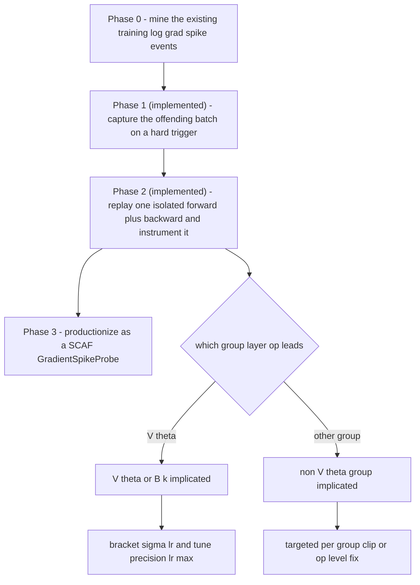

# The L = 8 Runs and the Bracketing Result

**What this note is.** §32–§34 of the training-instabilities record: the extended L = 8 `baoab_cfc` baseline and the switch mid-run, the bracketing result that showed B_k is not the primary driver, and `baoab_cfc_lowrank` at L = 8 (correct and stable, but not production-feasible). It was split on 2026-11-21 from [`CfC_BAOAB_Integrator_and_Mitigations.md`](https://github.com/dimitarpg13/semsimula-paper/blob/5551315/companion_notes/CfC_BAOAB_Integrator_and_Mitigations.md) (written August to October 2026). The text is that document's, unchanged except for its links, and keeps its section numbers, so a reference to "§N" anywhere in the record or in other notes finds its note through [the index](README.md).

## Contents

- [32. L=8 baoab_cfc Baseline: Extended Trajectory (steps 27,000–39,867) and the Decision to Switch Mid-Run](#32-l8-baoab_cfc-baseline-extended-trajectory-steps-2700039867-and-the-decision-to-switch-mid-run)
- [33. The Bracketing Result Is Modest and Non-Escalating: B_k Is Not the Primary Driver, and a Root-Cause Workflow for the Non-V_\theta Spikes](#33-the-bracketing-result-is-modest-and-non-escalating-b_k-is-not-the-primary-driver-and-a-root-cause-workflow-for-the-non-v_theta-spikes)
- [34. baoab_cfc_lowrank at L=8 Scale: Correct and Stable, but Not Production-Feasible](#34-baoab_cfc_lowrank-at-l8-scale-correct-and-stable-but-not-production-feasible)

---

## 32. L=8 `baoab_cfc` Baseline: Extended Trajectory (steps 27,000–39,867) and the Decision to Switch Mid-Run

This section records the L=8 probe's behaviour for ~13,000 further steps
past the step-27,000 best (extending §31's preamble, which covered only
the two hard-trigger events themselves), and the resulting decision to
switch this run to `baoab_cfc_lowrank` before it reaches `TOTAL_STEPS`
rather than let the plain-`baoab_cfc` arm run to completion.

### 32.1 The extended trajectory is a noisy plateau, not a decreasing trend

Across steps 30,000–39,867 (all still within the WSD **stable** phase,
LR pinned at 3e-4 until step 65,000):

- **No new best.** Every eval PPL from step 30,500 through 39,500 landed
  in a 101–113 band; the running best has stayed frozen at 100.47 (step
  27,000) the entire time.
- **Spikes did not slow down.** 33 pre-clip spikes >100 occurred over
  ≈8,600 steps (steps 31,272–39,867) — one every ~260 steps on average —
  and the rate is essentially unchanged before vs. after the second
  hard-trigger (18 of the 33 in the 5,776 steps following step 34,091,
  max 265.4). Two of the 33 (701.1 at step 32,139; 5,864.9 at step
  34,091) were severe enough to trigger `GRAD_NORM_HARD_TRIGGER` and
  force a full reload to the step-27,000 checkpoint, each discarding
  several thousand steps of intervening optimizer state.
- **A faint downward drift is visible underneath the noise, though.**
  The five evals immediately after the second reload (34,500–36,500)
  average 107.71; the five most recent at the time of this note
  (37,500–39,500) average 103.48, briefly touching 101.46 at step 38,000
  before another spike pushed it back up. So this is not simply frozen
  noise around a fixed level — there is slow, bumpy net progress — but
  it has not yet recovered past the pre-spike best, ~13,000 steps later.

**Reading.** This is consistent with, and adds a second, independent
line of evidence for, §28.6's amplification mechanism and §28.2b's
"$B_k$ keeps growing, unbounded, no plateau" measurement: nothing in
plain `baoab_cfc` bounds the off-diagonal channel, so there is no
structural reason for the spike rate to decay on its own, and it hasn't,
over an interval nearly 2.5x longer than the one analysed in §31's
preamble.

### 32.2 Will it converge below 100 PPL by step 100,000?

Two effects pull in opposite directions, and neither is resolved by the
data in hand:

- **Against:** the driving mechanism (unbounded $B_k$ curvature) has no
  reason to weaken with further training under plain `baoab_cfc` — if
  anything §28.2b's measurements suggest it should compound, not fade.
- **For:** the run has not yet reached the WSD **decay** phase
  (65,000→100,000, LR 3e-4 → floor 1.5e-5). WSD-style schedules
  typically produce much of their net improvement during this anneal —
  a shrinking LR directly shrinks the magnitude of *every* gradient
  step, spike or not — so both the instability and the underlying loss
  could improve substantially once decay starts, independent of whether
  the off-diagonal channel itself is ever fixed.

Net: a soft landing somewhere near, but probably not dramatically below,
100 PPL by step 100,000 is plausible; a clean, convincing win is not
supported by the trend so far. Not enough of the stable-phase budget
has gone to net progress (vs. fighting and recovering from spikes) to
be confident either way from trend extrapolation alone.

### 32.3 Decision: switch to `baoab_cfc_lowrank` now rather than complete this arm to 100,000

**Decided 27 August 2026, given single-GPU compute (no parallel session
available for a simultaneous baseline).** Reasoning:

1. §32.1's ~13,000 steps already constitute a solid, well-characterized
   "before" picture (frozen best, ~260-step average spike interval, two
   forced reloads) — completing the remaining ~60,000 steps under the
   same integrator mostly re-confirms this rather than adding new
   information, since the driving mechanism is not expected to resolve
   itself (§32.1's reading).
2. The comparison that actually matters — whether `baoab_cfc_lowrank`
   changes the trajectory — only requires resuming from the *same*
   step-27,000 checkpoint under the new integrator; it does not require
   first finishing the plain-`baoab_cfc` arm to `TOTAL_STEPS`.
3. On a single GPU, finishing a run already showing this signature is a
   worse use of the one available compute slot than testing the
   implemented-and-ready fix (§29.2/§29.3, §29.7) sooner.
4. Nothing here is destroyed: the plain-`baoab_cfc`-to-100,000 baseline
   can still be run later from the same step-27,000 checkpoint whenever
   a second GPU/session is available, using
   `RESUME_VARIANT_TAG_OVERRIDE` (Cell 1b) to redirect back to this run's
   own checkpoint folder.

**Early read to watch for after switching:** compare the spike
frequency/magnitude over the first 5,000–10,000 steps past 27,000 under
`baoab_cfc_lowrank` against §32.1's ~260-step/spike, ≤265 (soft) /
up to 5,865 (hard) baseline from the same step range under plain
`baoab_cfc`. A visibly lower spike rate and/or the absence of a new
hard-trigger over a comparable window would be the first concrete
evidence the fix is doing what §29.2's theory predicts, ahead of any
`precision_lr_max` tuning (§31).

---

## 33. The Bracketing Result Is Modest and Non-Escalating: $B_k$ Is Not the Primary Driver, and a Root-Cause Workflow for the Non-$V_\theta$ Spikes

§31.4 step 1 wrote down an explicit escape hatch before any numbers were in
hand: if the raw low-rank curvature $\sigma_{\max}(B_k)^2$ does **not** grow
visibly from a healthy checkpoint to a spike-regime one, then "$B_k$ growth
isn't actually the driver of *this particular* burst and `precision_lr_max`
is the wrong lever for it." This section records that the L=8 bracket pair
(§31.6) was measured on 28 August 2026 — and the escape hatch fired.

### 33.1 The measurement: healthy vs. both spike-regime snapshots are elevated by +1% to +24%, non-monotonically

All three checkpoints from §31.6 were run through the Cell 6b-2
`sigma_lr_report` diagnostic (the dependency-free notebook mirror of SCAF's
`sigma_lr_*` percentiles, §31.3), each on the same fixed seed-0 probe batch,
pooling 1,310,720 samples over layers, wells, and xi-channels:

| percentile | healthy (step 27,000 best, PPL 100.47) | spike-regime (step 32,139 prereload, 1st hard trigger) | delta vs. healthy | spike-regime (step 34,091 prereload, 2nd hard trigger) | delta vs. healthy |
|:---|---:|---:|---:|---:|---:|
| p50 | 282.11 | 350.07 | +24.1% | 305.59 | +8.3% |
| p90 | 663.61 | 758.32 | +14.3% | 700.53 | +5.6% |
| p99 | 1047.00 | 1145.95 | +9.5% | 1082.80 | +3.4% |
| p99.9 | 2322.33 | 2514.92 | +8.3% | 2499.07 | +7.6% |
| max | 6364.81 | 7285.88 | +14.5% | 6427.16 | +1.0% |


With the second bracket point in hand, the picture is more nuanced than a
flat null result, but the qualitative conclusion is unchanged. Both
spike-regime snapshots sit consistently *above* healthy at every percentile
(ten comparisons, ten positive deltas) — this is a real, repeatable effect,
not measurement noise straddling zero. But two features argue against $B_k$
being the driver of the bursts rather than a weak correlate of them:

- **The magnitude is far too small.** The largest deltas (p50 +24%, max
  +14–15%) correspond to at most a $\sqrt{1.24}\approx 1.11\times$ increase
  in the well's own frequency $\omega\propto\sqrt{\kappa}$ — nowhere near
  the scale of the recorded pre-clip grad-norms at these two hard triggers
  (701.1 at step 32,139; 5,864.9 at step 34,091; §32.1), both an order of
  magnitude or more above the `GRAD_NORM_HARD_TRIGGER=500.0` threshold and
  far above the sub-100 norms typical of untroubled steps. A curvature
  effect of at most $1.11\times$ cannot by itself produce spikes of that
  size.
- **It does not escalate monotonically.** Step 32,139 fired *first* and is
  the *more* elevated of the two snapshots at four of five percentiles
  (p50, p90, p99, max); step 34,091, which fired ~2,000 steps later, is
  closer to healthy. If $B_k$ were progressively drifting toward the
  crisis, later triggers should show more elevation than earlier ones, not
  less. The pattern is consistent instead with each hard trigger being an
  **independent excursion** from the same step-27,000 reload point — two
  separate draws of "how large $B_k$'s bulk happens to be by the time some
  other mechanism trips the watchdog," not a single escalating trend.

Both snapshots are finite; the `PPL=nan` recorded in each prereload
snapshot's metadata (an expected artefact of a snapshot taken at the instant
the loss went non-finite, not a fresh validation pass) did not contaminate
the $B_k$ measurement.

**Caveat on the probe batch.** `sigma_lr_report` evaluates $B_k$ on a fixed
generic batch, so it measures the *weights'* capacity to produce large
$\sigma_{\max}(B_k)^2$ on a typical input, not what happened on the specific
batch that tripped the watchdog at each crisis step ($B_k$ is
context-dependent, `context_components(xis)`). The modest-and-non-monotonic
result therefore rules out a *drifting baseline* — the parameters defining
$B_k$ did not migrate into a permanently, progressively stiffer regime going
into the crisis — but does not by itself rule out a transient, batch-specific
$B_k$ excursion on the offending step. The per-group gradient log at the
crisis step (§33.3) is what closes that remaining gap.

### 33.2 What this rules in and out

Three independent lines of evidence now point the same way — away from
$V_\theta$'s low-rank correction as the *primary driver* of the L=8 bursts:

1. **The bracket is elevated but not escalating, and far too small in
   magnitude (§33.1).** Both crises sit +1% to +24% above healthy,
   non-monotonically between the two triggers, versus the $\gt 100\times$ scale
   of the observed grad-norm spikes. `precision_lr_max` caps a real but
   minor and non-escalating quantity.
2. **The per-group grad log points elsewhere.** The recorded spike groups for
   this architecture are `depth_code`, `E`, `P`, `creation_gate`, `register`,
   `reverse_channel_scale` — the **non-$V_\theta$** groups (§23.1's d=1024
   table shows exactly this cast of characters; the L=8 bursts are the same
   family). $V_\theta$'s own group is not the one that spikes.
3. **The mechanism is already documented as depth-driven, not curvature-driven
   for these groups** — the second-order force cascade of §23.2 and the
   boundary-layer depth-code growth of §27 are gradient-topology effects, not
   $B_k$-magnitude effects.

The practical conclusion: **`baoab_cfc_lowrank` + `precision_lr_max` remains
sound hygiene** (unbounded-by-construction curvature is a real hazard, the
+24% bulk shift and +14% tail shift at the crisis are genuine and worth
trimming, and it is good that the channel is now removable), but it is **not
the primary lever that will stop these specific bursts** — a $\lesssim
1.1\times$ frequency effect cannot explain a $\gt 100\times$ gradient-norm
spike. The A/B run of §31.5 is still worth doing as a falsification check,
but §33.1 lowers its prior: expect the burst signature to largely persist,
because the bulk of the burst was never coming through $B_k$.

### 33.3 A root-cause workflow for the non-$V_\theta$ spikes

The bursts live in the non-$V_\theta$ groups, so the diagnostic has to target
those groups directly. The good news is that the training loop already emits
most of the raw material; the workflow below is ordered cheapest-first, and
each phase unlocks the next.



**Phase 0 — mine what is already logged. Status: DONE (28 August 2026),
findings below.** With `GRAD_SPIKE_DEBUG=True` the loop already writes an
`event: grad_spike` record (top-8 pre-clip groups + loss breakdown) to
`RESULTS_DIR/training_log.jsonl`, plus a watchdog record on every reload.
Mining the L=8 run's log (964 lines, steps 50–40,900, downloaded from
Drive) answers the first-order question — *which group leads each burst,
and is it always the same one* — with no new run, no code change, and no
Phase 1/2 capture needed:

| population | n | lead: `depth_code` | lead: E/P (tied) | other |
|:---|---:|---:|---:|---:|
| `grad_spike` events, pre-clip < 200 | 42 | 32 (76%) | 7 (17%) | 3 (7%) |
| `grad_spike` events, pre-clip ≥ 200 | 9 | 4 (44%) | 5 (56%) | 0 |
| `watchdog_hard_reload` events (32,139 / 34,091) | 2 | 0 (0%) | 2 (100%) | 0 |

(51 `grad_spike` events total, threshold 100, plus the 2 hard triggers;
zero EMA `watchdog_reload` events occurred in this run — every reload was
a hard trigger, consistent with §32.1.) Two findings fall out of this:

1. **`depth_code` dominates the small/frequent end** (76% lead-share
   below pre-clip 200, and in the top-3 breakdown 94% of the time across
   all 51 events) — it is the single most informative "leading indicator"
   group for the run's baseline spikiness.
2. **But at the severe end, leadership flips to `E`/`P`, and they are
   *always* tied for first at both hard triggers** — `E`=413.24/`P`=413.24
   at step 32,139, `P`=3106.93/`E`=3106.92 at step 34,091 (agreement to
   4 significant figures at the larger of the two). This is not a
   coincidence: `model_parf.py` defines
   `h0 = self.E(x) + self.P[position_offset:position_offset+T]` — the
   token embedding and the *additively combined* positional embedding.
   Both receive gradient as different linear reductions
   (scatter-by-token-id vs. sum-over-batch-at-each-position) of the exact
   same upstream tensor $\partial L/\partial h_0$, which is why their
   *norms* track so closely without the parameters being tied. (`E` is
   *also* weight-tied to the output logits projection,
   `logits = h_L @ self.E.weight.T`, so it has a second, direct gradient
   source P entirely lacks — the fact that E and P still agree this
   closely even so implies that direct output-side contribution is small
   next to the embedding-boundary one, i.e. **the crisis signal reaching
   `E`/`P` is overwhelmingly the one that has been backpropagated through
   all $L$ layers back to $h_0$, not a locally-large output-layer
   gradient.**)

**Reading the two findings together points at a cascade, not two
independent culprits.** The severity-band split (44%→56% for `depth_code`
vs. E/P moving from the <200 to the ≥200 band, then 0%→100% at the two
hard triggers) looks like a single mechanism crossing a threshold, not a
population of unrelated causes: `depth_code`'s own gradient (present at
every layer, per §33.4) is the visible signal while a disturbance is
still small and local; once it is large enough, the same disturbance
propagates backward through the $L=8$ stack and is amplified layer over
layer (the second-order force cascade of §23.2, the boundary-layer
`depth_code` growth of §27), arriving at the embedding boundary the
*largest* it will ever be simply because that is the far end of the
backward pass. This yields a sharp, falsifiable prediction for Phase 2,
once it has a capture to work with: **the per-layer $h$-gradient-norm
profile at a hard trigger should show growth from layer $L-1$ toward
layer $0$ (cascade amplification), not an isolated spike confined to one
interior layer** — and `depth_code`'s own per-layer grad norm should be
large at whichever layer the amplification *starts*, even if it is no
longer the largest single number by the time gradient reaches $E$/$P$.
This refines candidate hypothesis 4 in §33.4 below: it is not necessarily
that `depth_code` pushes $V_\theta$ into a stiff regime specifically, but
that it (or something correlated with it) seeds a disturbance the
existing $L$-layer cascade amplifies regardless of which downstream
mechanism carries it.

One subtlety must be corrected for at this stage: the scalar `grad_norm` the
watchdog thresholds on is `sqrt(sum of gn_k^2)` over groups **excluding**
`reverse_channel_scale` and `reverse_ch` (`WATCHDOG_EXCLUDE_GROUPS`). So if
the reverse channel is the true instigator, the aggregate under-reports it and
the hard trigger only fires once the disturbance bleeds into an *included*
group. Read the per-group breakdown (`_last_pg_norms`), never the single
aggregate, when attributing a burst. (`reverse_channel_scale` is in fact in
the top-8 breakdown of 50 of the 53 events mined above, including both hard
triggers — always behind `depth_code`/E/P, never masking a trigger outright
in this run, but consistently present.)

**Phase 1 — capture the offending batch. Status: IMPLEMENTED (28 August
2026), notebook `Cell 6` (config block + training loop).** The `_prereload`
snapshot preserves the *weights* at the crisis but not the *token batch*
that caused it — which is exactly why the §33.1 fixed-seed probe could not
reproduce the event, and it is *not* the pre-step weights either: by the
time `_reload_best` runs, `optim.step()` has already applied the crisis
update (§33.1's own bracket measured that post-update state, which is
useful for a different question — "how stiff did $B_k$ get" — but the
wrong state for replaying the forward+backward that *produced* the
gradient). The implemented fix does not touch `_reload_best` itself;
instead it moves the capture *earlier*, into the training loop, right
after `grad_norm` is computed but **before** the `optim.step()` call that
would mutate the weights:

- A new `CAPTURE_SPIKE_BATCH` / `SPIKEBATCH_SNAPSHOT_MAX_KEEP` config pair
  (mirroring `PRERELOAD_SNAPSHOT_MAX_KEEP`'s rotation policy) guards a new
  branch that fires exactly when `GRAD_NORM_HARD_TRIGGER` is about to.
- Two cheap, *unconditional* per-step additions feed it: the torch CPU/CUDA
  RNG state is captured right after `optim.zero_grad()` (the Langevin
  thermostat noise draw inside the forward pass consumes it, so replay
  needs it to reproduce that draw bit-for-bit), and each microbatch's raw
  `(xb, yb)` arrays are appended to a per-step list inside the
  `GRAD_ACCUM` loop (bypassing `get_batch`'s own RNG entirely — the saved
  arrays are replayed directly, so nothing needs to reproduce *which*
  windows `get_batch` would have drawn).
- Only in the rare case the hard trigger is about to fire does the
  (comparatively expensive) full `model.state_dict()` CPU clone happen,
  bundled with the batches/RNG state into a new
  `{CKPT_PREFIX}_step{step}_spikebatch.pt` sidecar — a new, additive
  artifact alongside (not replacing) `_prereload.pt`.
- **Scope decision: hard-trigger only.** The slow EMA-based watchdog path
  is a sustained drift across ~200 steps, not a single anomalous step, so
  there is no one well-defined "offending batch" for it — that path is
  left to Phase 0 log-mining (the `grad_spike` time series) rather than
  forced into a single-batch replay it doesn't fit. Both of the run's
  documented crises (701.1 at step 32,139; 5,864.9 at step 34,091, §32.1)
  are hard triggers, so this scope covers the evidence in hand.

**Phase 2 — op- and layer-resolved forensics on the replay. Status:
IMPLEMENTED (28 August 2026), new notebook `Cell 6d`
(`replay_spike_batch(step_tag)`).** Given a `_spikebatch.pt` bundle, the
cell loads the pinned pre-step weights and RNG state into the live model,
replays every captured microbatch through one isolated `backward()`, and
instruments it with:

- **per-parameter** grad norms (finer than per-group) to pinpoint the exact
  tensor — e.g. `creation_gate_qkv.log_tau` vs. `W_Q`, or a single
  `reverse_channel_scale[k]`;
- **per-layer** grad attribution via a tensor hook (`h_new.register_hook`)
  installed by temporarily wrapping whatever `_fock_layer_step` is
  currently bound to (composing with the aniso depth-routing patch rather
  than clobbering it) — there is no per-layer `nn.Module` to attach
  `register_full_backward_hook` to (the $L$ layers share most submodules
  through a plain Python loop, routed by `layer_idx`), so a tensor hook on
  $h$ at each layer boundary is the mechanism that actually applies here;
- **forward-activation extremes** at the numerically risky ops per group —
  the creation-gate softmax temperature
  $\tau = \exp(\log\tau).\mathrm{clamp}(10^{-4})$ and its cumulative-softmax
  weight (a direct hook on `forward_prefix`, which bypasses `__call__` and
  so cannot be reached by a standard forward hook), the reverse-channel
  `logit_scale.exp().clamp(max=100)` and the $Q_{\mathrm{force}}$ it
  injects (a standard forward hook on `reverse_ch`), the destruction-gate
  output, and the $V_\theta$ quadratic-form exponent and the depth-code-shifted
  xi norm (recomputed from each per-channel bank's own public
  `_components()` on the exact `(xi, h)` the forward call saw, via a
  `with_kwargs=True` forward hook — no source-file changes to
  `model_fock_parf_v2.py` / `model_fock_parf_multixi.py` /
  `model_aniso_gaussian_vtheta.py` were needed).
- **A fidelity check is built in:** the replayed matching-groups total is
  compared against the `pre_clip_grad_norm` recorded at capture time; a gap
  under a few percent is the signal that the RNG-state/batch capture
  actually reproduced the crisis bit-for-bit (or close to it), and a large
  gap is a warning that something about the replay is not exact before any
  attribution conclusions are drawn from it. The replay also reports the
  matching-groups total *and* the all-groups total side by side, so the
  reverse-channel contribution the watchdog aggregate is blind to (§33.3
  Phase 0's caveat) is visible directly rather than inferred.
- **Non-pollution:** the cell saves the live model's weights, every
  parameter's `.grad`, and the RNG state up front and restores all three
  in a `finally` block, so resuming the training loop afterward is safe —
  mirroring the SCAF `GradientSpikeProbe` design's save/zero/restore
  contract before that probe exists.
- **Caveat.** (a) and (b) above only touch already-used, documented
  training-loop machinery and are exact. (c)'s hooks were derived from
  reading the three model source files, not exercised against the live
  model yet; each is independently try/except-guarded, so a
  `[replay][WARN] could not instrument ...` line for any one of them
  narrows down what to fix without sinking the rest of the report.


This turns "group X is big" into a mechanism, e.g. "a near-degenerate
creation-gate temperature at layer $k$ produced a huge softmax Jacobian" or "a
large $Q_{\mathrm{force}}$ at layer $k$ hit the non-conservative reverse-channel
injection $(\Delta t^2/\mathfrak{m}).\tanh(s).Q_{\mathrm{force}}$."

**Phase 3 — productionize as a SCAF probe.** Once the manual harness proves
out, fold it into SCAF as a reusable, unit-tested `GradientSpikeProbe`. The
full requirements, interface, and design — including how it stays inside
SCAF's "probing must not pollute training `.grad`" invariant as the library's
first backward-aware probe — are in the SCAF design document
[`Gradient_Spike_Probe_Requirements_and_Design.md`](https://github.com/dimitarpg13/semsimula-scaf/blob/spike_diagnostic/docs/Gradient_Spike_Probe_Requirements_and_Design.md)
(branch `spike_diagnostic`).

### 33.4 Candidate hypotheses the workflow discriminates between

The instrumentation above is designed to separate these, which the raw
grad-norm log alone cannot:

- **Cascade amplification through the $L=8$ stack (favoured by §33.3
  Phase 0's findings).** `depth_code` (or something correlated with it)
  seeds a disturbance that is small and local while it is small, then
  gets amplified layer-over-layer on the way back to $h_0$ (the
  second-order force cascade of §23.2, the boundary-layer growth of
  §27) — consistent with `depth_code` leading 76% of smaller spikes while
  `E`/`P` (which only ever see the *cumulative* signal that has
  backpropagated through every layer, §33.3 Phase 0) take over 100% of
  the time at the two severe hard triggers. Predicts a per-layer
  $h$-gradient-norm profile that *grows* from layer $L-1$ toward layer
  $0$, not an isolated single-layer spike.
- **Sharp-softmax Jacobian** in the creation gate or reverse channel (small
  $\tau$ / saturated logits) — batch-triggered, transient.
- **Non-conservative reverse-channel kick** — a large $Q_{\mathrm{force}}$ on
  particular tokens injected via $\tanh(s).Q_{\mathrm{force}}$; note this
  channel is the one masked from the watchdog aggregate (§33.3, Phase 0),
  though the mined log shows it present (if never leading) in 50/53 events.
- **Hard salience/threshold gating** in the register path creating
  near-discontinuous gradients at the 0.005 boundary.
- **`depth_code` pushing $V_\theta$ into a stiff regime** for particular token
  contexts — this would re-implicate $V_\theta$ *indirectly* (via the shifted
  xi, not via $B_k$ magnitude) and would show up as correlated `depth_code`
  and $V_\theta$ grads at the same boundary layer. (A special case of the
  cascade hypothesis above if $V_\theta$'s own layer-local amplification
  turns out to be the specific mechanism carrying the disturbance forward;
  a distinct, competing mechanism if the amplification instead runs
  through the dynamics independent of $V_\theta$'s curvature.)

### 33.5 Status and next step

**§33.1 done (both bracket points); §33.3 Phase 0 done — cascade
hypothesis identified from the mined log; Phases 1 and 2 done (code
landed, not yet run against a real crisis); a fresh GRAD_NORM_HARD_TRIGGER
event (to actually exercise Phases 1/2 and test the per-layer growth
prediction) is the immediate next step.** The bracket measurement is
complete: $B_k$ is modestly and non-monotonically elevated at both crises
but far too small in magnitude to be the primary driver. Phase 0 mining of
the L=8 run's `training_log.jsonl` (downloaded from Drive, 964 lines,
steps 50–40,900) found `depth_code` leading 76% of smaller (<200) spikes
but `E`/`P` — tied, to 4 significant figures, at both severe events —
leading 100% of the two hard triggers, which reads as a single
cascade-amplification mechanism crossing a severity threshold rather than
two unrelated culprits (§33.3, §33.4). Phase 1 (spike-batch capture) and
Phase 2 (`replay_spike_batch`, per-parameter/per-layer/activation-extreme
forensics) are implemented in the training notebook (`Cell 6`'s config
and loop, and the new `Cell 6d`) — but they were added *after* the two
existing hard triggers (steps 32,139 / 34,091), which therefore have no
`_spikebatch.pt` sidecar to replay; the harness needs the run to hit a
*new* `GRAD_NORM_HARD_TRIGGER` (expected roughly every ~1,000–2,000 steps
per §32.1's rate) before it has real data to run on. Phase 0 log-mining
against the live L=8 run's `training_log.jsonl` (already on Drive) remains
available immediately, with no new run needed, and may resolve the
leading-group question before Phase 2 even gets a capture to work with.
The SCAF `GradientSpikeProbe` (Phase 3) is specified in the companion
design doc but not yet implemented; Phases 1/2 landing first in the
notebook is intentional (§33.3's "manual harness proves out" precondition
for productionising it).


---

## 34. `baoab_cfc_lowrank` at L=8 Scale: Correct and Stable, but Not Production-Feasible

While §33's Phase 1/2 harness was being built and awaiting a fresh
`GRAD_NORM_HARD_TRIGGER` to fire against, the still-open §29.2/§30 low-rank
exponential substep — `integrator='baoab_cfc_lowrank'`, which integrates
the anisotropic Gaussian's off-diagonal $B_k B_k^\top$ coupling exactly
rather than explicitly — was finally exercised end-to-end at the live
L=8, $d=384$, OWT scale, resuming from the §32 `baoab_cfc` run's step
37,500 checkpoint. It surfaced three implementation bugs (below), all now
fixed and unit-tested, before landing on the negative verdict that gives
this section its title.

### 34.1 Three bugs surfaced getting it running at scale

**1. `torch.svd_lowrank` is not safe under gradient checkpointing.**
Re-running the training loop with `LOG_INTERVAL=1` after an in-session
edit reproduced

```
CheckpointError: torch.utils.checkpoint: Recomputed values for the
following tensors have different metadata than during the forward pass.
```

with dozens of shape/dtype/device mismatches. `torch.svd_lowrank`'s
internal projection draws from the *global* RNG and silently falls back
through several code paths (including a CPU last resort) depending on
conditioning, so PyTorch's activation-checkpoint recompute — which must
take the *same* branch the forward pass took, tensor-for-tensor — has no
guarantee of doing so. `lowrank_modes` (`cfc_baoab.py`) was rewritten to
call a new `_randomised_svd_det`: a local-`torch.Generator`, branch-free,
GPU-resident randomised SVD whose output shape/dtype/device is a pure
function of its inputs, with no internal fallback.

**2. NaN modes from a degenerate GPU SVD poisoned the whole gradient.**
Even after fix 1, `grad=nan` appeared from the very first training step.
A fully degenerate token (all wells numerically zero-weight at that
position) can make cusolver return `NaN` singular vectors/values
*without raising an exception*; the old masking, `U * keep`, computed
`NaN * 0 = NaN` and injected it into the differentiable substep. Fixed
with `torch.where`-based masking, which picks the zero branch regardless
of the NaN in the discarded branch, plus a final `nan_to_num` scrub on
`U` and `kappa`.

**3. `sqrt(g)` in `harmonic_terms_lowrank` had an infinite backward at
$g=0$.** The same bug class as the `_OMEGA_SQ_FLOOR` fix already
documented at the top of `cfc_baoab.py`, but for the per-well Gaussian
weight $g = w\exp(-\tfrac12 e)$ rather than the stiffness: any well far
enough from $h$ underflows $g\to0$ forward-safely, but
`g.clamp(min=0).sqrt()`'s backward, $1/(2\sqrt g)$, times the upstream
$dg/de = g = 0$, evaluates as $\infty \cdot 0 = \mathrm{NaN}$ in
floating point. Fixed in `model_aniso_gaussian_vtheta.py` by computing

$$\sqrt g = \sqrt w \cdot \exp\left(-\tfrac14\left(e_{\mathrm{diag}} + e_{\mathrm{lr}}\right)\right)$$

directly — identical value to $\sqrt{w e^{-e/2}}$, but analytic in the
exponent $e$, so it has no $1/\sqrt{\cdot}$ node to differentiate through.

### 34.2 Cost controls added

Two config knobs were added to `model_parf_multixi.PARFConfig` so the
(now-correct) exact arm's cost could be tuned down before being measured:
`lowrank_layers` (restrict the expensive path to a subset of layers,
falling back to the cheap diagonal `baoab_cfc` substep elsewhere) and
`lowrank_niter` / `lowrank_oversample` (subspace-iteration and
probe-oversampling knobs for `_randomised_svd_det`, cheaper at the cost of
slightly less accurate top modes — safe here because demoted modes still
go to the stable explicit kick). `lowrank_max_modes` (§30, already
existing) truncates to the $k$ stiffest modes per token via the same
randomised path.

### 34.3 Measured cost: 4-12x `baoab_cfc`, at any layer-count setting

| Configuration | s/step (measured) | vs. `baoab_cfc` (≈10-15 s/step) |
|---|---|---|
| All 8 layers, `lowrank_max_modes=16`, `niter=2`, `oversample=4` | ≈120 s | ≈8-12x |
| 2 stiffest layers only, `niter=1`, `oversample=2` | ≈50 s | ≈4-5x |

The batched per-token SVD is the entire extra cost; it does not amortize
with fewer layers as cheaply as hoped because the remaining SVDs are per
*token* (not per layer) and dominate even a 2-layer configuration. At
~50 s/step, the remaining 62,500 steps of a 100,000-step run would take
roughly **36 days** of wall-clock on a single GPU — not a run that
finishes.

### 34.4 Verdict: retained for completeness, not used in production

**`baoab_cfc_lowrank` is mathematically correct and unconditionally
stable** (no NaNs, no divergence, in every configuration tested) **but is
not production-feasible at L=8/$d$=384/OWT scale**, on cost grounds alone.
It is also, independently, aimed at a target that §33's bracket
measurement already showed to be a weak lever: $\sigma_{\max}(B_k)^2$ —
the exact quantity this arm integrates without approximation — was found
elevated by only +1% to +24%, non-monotonically, between the healthy
checkpoint and both hard-trigger snapshots (§33.1), while `E`/`P` and
`depth_code`, not $V_\theta$'s off-diagonal curvature, lead the actual
gradient spikes (§33.3 Phase 0). Fixing the off-diagonal integration
exactly, even if it were free, would not be expected to address the
dominant spike mechanism.

The code is kept in the repository — `cfc_baoab.py`'s module docstring
now carries this status note alongside the three-bug writeup, and
`model_parf_multixi.PARFConfig.integrator`'s docstring carries a shorter
pointer — because the underlying idea (exact rather than explicit
integration of stiff channels) remains architecturally sound and may
become practical at smaller scale ($d$, $L$, or context length), or if the
per-token batched SVD cost is amortized differently in the future (e.g.
sharing a decomposition across nearby tokens, or a cheaper structured
approximation to $B_k B_k^\top$). **Production training reverts to
`integrator='baoab_cfc'`** — resuming the §32 trajectory from step 37,500
— and the §33 root-cause workflow (Phases 1/2, already landed in the
notebook) remains the active line of investigation for the non-$V_\theta$
spikes.
