# The Localized Mode Under baoab_cfc_lowrank, and Three Chronic Replays

**What this note is.** §40–§41 of the training-instabilities record: whether `baoab_cfc_lowrank` addresses the localized mode, and three new replays showing it is chronic, which motivated turning on `precision_lr_max`. It was split on 2026-11-21 from [`CfC_BAOAB_Integrator_and_Mitigations.md`](https://github.com/dimitarpg13/semsimula-paper/blob/5551315/companion_notes/CfC_BAOAB_Integrator_and_Mitigations.md) (written August to October 2026). The text is that document's, unchanged except for its links, and keeps its section numbers, so a reference to "§N" anywhere in the record or in other notes finds its note through [the index](README.md).

## Contents

- [40. Does baoab_cfc_lowrank Address the Localized Mode? Reconciling §33's Verdict, and a Targeted Ablation Test](#40-does-baoab_cfc_lowrank-address-the-localized-mode-reconciling-33s-verdict-and-a-targeted-ablation-test)
- [41. Chronic, Not Transient: Three New Replays Refine §33 and §38, and Motivate Turning On precision_lr_max](#41-chronic-not-transient-three-new-replays-refine-33-and-38-and-motivate-turning-on-precision_lr_max)

---

## 40. Does `baoab_cfc_lowrank` Address the Localized Mode? Reconciling §33's Verdict, and a Targeted Ablation Test

§34.4 closed with a negative verdict on `baoab_cfc_lowrank`: not
production-feasible on cost, and independently "aimed at a target §33's
bracket measurement already showed to be a weak lever." §39 leaves the
localized mode pointing at exactly that target -- weight-space
`sigma_max(B_k)` stiffness. This section asks directly whether the earlier
verdict actually rules that out, and lays out the cheap offline test that
would settle it without touching the cost question at all.

### 40.1 The old verdict was measured against a different-looking crisis

§33's bracket used a fixed, generic probe batch (not the batches that
tripped the two triggers it measured) and found `sigma_max(B_k)^2` elevated
by only +1% to +24%, non-monotonically, between a healthy checkpoint and the
step-32,139 / step-34,091 hard-trigger snapshots -- far too small to explain
grad-norm spikes two orders of magnitude larger. The mechanism §33.3
identified instead was a cascade that amplifies through all eight layers and
lands equally on `E` and `P` at the embedding boundary.

That signature -- gradual amplification across the whole stack, landing on
the embedding groups -- is structurally the **smooth-cascade** mode of §38,
not the **localized** L0-2-cliff mode that motivates §39's weight-space
hypothesis and is the only mode ever observed to cross the 500 hard trigger.
Two gaps mean §33's verdict does not automatically transfer:

1. §33.1 flags its own limitation: a generic probe batch "does not by itself
   rule out a transient, batch-specific `B_k` excursion on the offending
   step." §38-§39's Phase 1/2 replays are the first measurement made
   directly on the actual offending batches.
2. §33's two triggers (32,139 / 34,091) predate every localized-mode capture
   on record (37,763 onward, all after the step-37,500 reload that
   preceded §34's `baoab_cfc_lowrank` trial). The bracket was never run
   against the failure mode this section is asking about.

### 40.2 What the existing `baoab_cfc_lowrank` trial already hints at

§34's own end-to-end trial ran from that same step-37,500 checkpoint and
reported the exact arm "mathematically correct and unconditionally stable --
no NaNs, no divergence, in every configuration tested." That window
temporally brackets where localized events start appearing under plain
`baoab_cfc`. No instability of the localized kind was reported while running
the exact arm -- weak evidence (the mode taxonomy did not exist yet, so
nobody was explicitly looking for it), but a real, standing absence-of-signal
worth stating plainly rather than re-discovering from scratch.

### 40.3 The cost floor is unchanged, but a layer-restricted deployment was never tried

§34.3 measured cost for two configurations only -- all 8 layers
(8-12x `baoab_cfc`) and 2 layers picked generically (4-5x). §38.7's salience
profile now says *which* layers the localized mode actually lives in:
0-2, identically across every replay (salience roughly 0.32 / 0.14-0.22 /
0.06-0.15 at layers 0-2 versus 0.001-0.0001 at layers 5-6). Restricting
`lowrank_layers` to `frozenset({0, 1, 2})` -- informed by that finding rather
than a generic pick -- has not been measured, and per-token SVD cost does
not amortize cleanly with layer count (§34.3), so it should be treated as an
open number, not assumed to land near the 4-5x point.

### 40.4 The direct test: an integrator-ablation replay against the existing bundles

The question can be answered without a training run at all. The
`_spikebatch.pt` bundles already pin weights, batch, and RNG state for every
captured event; `replay_spike_batch`'s snapshot/restore invariant already
proves this kind of ablation is safe to run against a live session. The only
new ingredient is swapping `model.cfg.integrator` between arms before
replaying the same pinned bundle, since `model_parf_multixi.py` reads
`cfg.integrator` and `cfg.lowrank_layers` as plain runtime branches
(`use_cfc = cfg.integrator == "baoab_cfc"`, `use_lowrank = cfg.integrator ==
"baoab_cfc_lowrank"`) -- the weights themselves (`B_proj`, `mu_proj`, etc.)
are identical either way, so no new checkpoint or retraining is needed.

```python
def replay_integrator_ablation(step_tag, lowrank_layers=frozenset({0, 1, 2}),
                                mdl=None, verbose=True):
    """SS40. Re-run a captured spike batch under two integrator configs --
    the recorded 'baoab_cfc' and 'baoab_cfc_lowrank' restricted to
    lowrank_layers -- with weights, batch, and RNG state held bit-identical
    to the capture, and compare the resulting pre-clip gradient norm and
    per-layer h-gradient profile (SS38's discriminator). Same non-pollution
    invariant as replay_spike_batch: weights, .grad tensors, RNG state, and
    now also cfg.integrator / cfg.lowrank_layers are snapshotted up front
    and restored in a finally block.
    """
    mdl = mdl if mdl is not None else model
    path = CKPT_DIR / f'{CKPT_PREFIX}_step{step_tag}_spikebatch.pt'
    bundle = torch.load(path, map_location='cpu', weights_only=False)

    saved_sd = _copy.deepcopy(mdl.state_dict())
    saved_grads = _isolated_grad_snapshot(mdl)
    saved_rng_cpu = torch.get_rng_state()
    saved_rng_cuda = torch.cuda.get_rng_state_all() if DEVICE == 'cuda' else None
    saved_integrator = mdl.cfg.integrator
    saved_lowrank_layers = getattr(mdl.cfg, 'lowrank_layers', None)

    layer_grad = {}
    orig_layer_step = mdl._fock_layer_step

    def instrumented_layer_step(h, h_prev, r, salience, m_b, gamma, dt,
                                 layer_idx, *args, **kwargs):
        out = orig_layer_step(h, h_prev, r, salience, m_b, gamma, dt,
                               layer_idx, *args, **kwargs)
        h_new = out[0]
        if torch.is_tensor(h_new) and h_new.requires_grad:
            h_new.register_hook(
                lambda g, li=layer_idx: layer_grad.setdefault(li, float(g.detach().norm())))
        return out

    arms = [
        ('baoab_cfc as captured', 'baoab_cfc', None),
        (f'baoab_cfc_lowrank layers {sorted(lowrank_layers)}',
         'baoab_cfc_lowrank', lowrank_layers),
    ]
    results = {}
    try:
        mdl.load_state_dict(
            {k: v.to(DEVICE) for k, v in bundle['model_state_dict'].items()},
            strict=False)
        mdl._fock_layer_step = instrumented_layer_step
        grad_accum = bundle.get('grad_accum', len(bundle['batches']))
        mdl.train()
        for label, integrator, layers in arms:
            mdl.cfg.integrator = integrator
            mdl.cfg.lowrank_layers = layers
            layer_grad.clear()
            for p in mdl.parameters():
                p.grad = None
            torch.set_rng_state(bundle['rng_state_cpu'])
            if bundle.get('rng_state_cuda') is not None and DEVICE == 'cuda':
                torch.cuda.set_rng_state_all(bundle['rng_state_cuda'])
            for xb, yb in bundle['batches']:
                x = torch.from_numpy(xb).to(DEVICE)
                y = torch.from_numpy(yb).to(DEVICE)
                loss, *_ = forward_with_vreg(
                    x, y, LAMBDA_V, LAMBDA_FOCK_REG, FOCK_REG_EPS)
                (loss / grad_accum).backward()
            total_sq = sum(float(p.grad.detach().norm()) ** 2
                           for p in mdl.parameters() if p.grad is not None)
            results[label] = {
                'pre_clip_grad_norm': total_sq ** 0.5,
                'per_layer_h_grad': dict(sorted(layer_grad.items())),
            }
            if verbose:
                print(f'[ablation] {label}: pre_clip_grad_norm='
                      f'{results[label]["pre_clip_grad_norm"]:.2f}  '
                      f'per_layer={results[label]["per_layer_h_grad"]}')
    finally:
        mdl._fock_layer_step = orig_layer_step
        mdl.cfg.integrator = saved_integrator
        mdl.cfg.lowrank_layers = saved_lowrank_layers
        mdl.load_state_dict(saved_sd)
        _isolated_grad_restore(mdl, saved_grads)
        torch.set_rng_state(saved_rng_cpu)
        if saved_rng_cuda is not None and DEVICE == 'cuda':
            torch.cuda.set_rng_state_all(saved_rng_cuda)
    return results
```

Cost note: even a `lowrank_layers={0,1,2}` replay pays §34.3's per-token SVD
cost, so a handful of forward/backward passes offline against an existing
bundle is a several-second-to-minute affair, not a multi-day commitment --
the sketch above is deliberately cheap to actually run, unlike the question
of deploying it live.

| Outcome | Localized pre-clip norm under the exact arm | Per-layer profile | Reading |
|---|---|---|---|
| Confirms the hypothesis | drops toward the sub-100 healthy range | loses the L0-2 cliff, flattens toward the smooth-mode shape | the approximate off-diagonal kick in plain `baoab_cfc` was generating the spike; exact integration removes it |
| Falsifies the hypothesis | stays comparable to the `baoab_cfc` replay | keeps the same L0-2 cliff shape | the localized mode survives exact dynamics; `sigma_max(B_k)` growth (or something else) acts through the true force too, not through an integration artifact |

```mermaid
flowchart LR
    A["captured localized event<br>step 39983 or 41837"] --> B["replay under baoab&#95;cfc<br>as captured baseline norm"]
    A --> C["replay under baoab&#95;cfc&#95;lowrank<br>layers 0 1 2 only"]
    B --> D{"compare pre clip norm<br>and per layer profile"}
    C --> D
    D -->|lowrank suppresses cliff| E["mechanism confirmed<br>try a live layer restricted trial"]
    D -->|no change| F["mechanism falsified<br>search a non V theta cause"]
```



### 40.5 Decision rule

If the exact arm suppresses both the pre-clip norm and the L0-2 cliff on the
localized captures (39,983 / 41,837), the mechanism is confirmed for this
mode specifically -- contradicting nothing in §33, which was scoped to a
different crisis signature -- and the next real experiment is measuring
`lowrank_layers={0,1,2}`'s actual per-step cost live, since §34.3 never
measured that configuration. If it does not, the hypothesis is falsified for
the localized mode too, in which case the search needs a localized-mode
analogue of §33.3's non-`V_theta` root-cause workflow: something other than
`V_theta`'s off-diagonal curvature is producing a layer-0-2-concentrated
cliff that plain `baoab_cfc`'s explicit off-diagonal kick and the exact
`baoab_cfc_lowrank` arm reproduce equally.

---

## 41. Chronic, Not Transient: Three New Replays Refine §33 and §38, and Motivate Turning On `precision_lr_max`

Following the `dc_ratio` / `b_proj_sigma_max` logging added in §38.7/§39.5,
the run produced a fresh `GRAD_NORM_HARD_TRIGGER` (step 47,116, pre-clip
13,139.5 -- by a wide margin the largest single-step gradient norm recorded
in this run's history) plus two moderate captures either side of it
(48,507 and 48,917). All three were replayed with `replay_spike_batch`, and
47,116 was additionally run through `attribute_spike_rows`. Together they
refine three of this note's earlier claims and point at a concrete,
already-implemented fix.

### 41.1 The three replays at a glance

| step | pre-clip | leader (norm) | `dc_ratio` | L0 to L3 h-grad | L0/L3 ratio | mean lr_term_share (banks 0-4) | fidelity gap |
|---|---|---|---|---|---|---|---|
| 47,116 | 13,139.5 | depth_code (8,611.4) | 1.50 | 0.0662, 0.0568, 0.0398, 0.0292 | 2.27x | 0.9993 / 0.9992 / 0.9986 / 0.9966 / 0.9964 | 0.0000092 percent |
| 48,507 | 203.1 | depth_code (128.2) | 1.35 | 0.0446, 0.0379, 0.0264, 0.0196 | 2.28x | 0.9993 / 0.9992 / 0.9984 / 0.9952 / 0.9952 | 0.0017 percent |
| 48,917 | 202.0 | reverse_channel_scale (132.3) | 0.94 | 19.15, 13.44, 6.39, 0.14 | 142x | 0.9993 / 0.9993 / 0.9984 / 0.9956 / 0.9959 | 0.0019 percent |

All three replayed at essentially perfect fidelity (worst case 0.0019
percent), so every number below is a bit-exact reproduction of what
actually happened at that step, not an approximation.

Raw `replay_spike_batch` output per step:
[replay_spike_batch_47116_output.txt](../../notebooks/conservative_arch/scaleup/results/cfc_baoab_owt_xi5long_topk16_dt32da16_mh4_aniso_dcvt5x8_L8probe_ob_untied_wsd_e5c_plgate_rep0.05_fockreg0.005_g0.1_baoab_cfc/replay_spike_batch_47116_output.txt),
[replay_spike_batch_48507_output.txt](../../notebooks/conservative_arch/scaleup/results/cfc_baoab_owt_xi5long_topk16_dt32da16_mh4_aniso_dcvt5x8_L8probe_ob_untied_wsd_e5c_plgate_rep0.05_fockreg0.005_g0.1_baoab_cfc/replay_spike_batch_48507_output.txt),
[replay_spike_batch_48917_output.txt](../../notebooks/conservative_arch/scaleup/results/cfc_baoab_owt_xi5long_topk16_dt32da16_mh4_aniso_dcvt5x8_L8probe_ob_untied_wsd_e5c_plgate_rep0.05_fockreg0.005_g0.1_baoab_cfc/replay_spike_batch_48917_output.txt);
plus `attribute_spike_rows(47116)`:
[attribute_spike_rows_47116_output.txt](../../notebooks/conservative_arch/scaleup/results/cfc_baoab_owt_xi5long_topk16_dt32da16_mh4_aniso_dcvt5x8_L8probe_ob_untied_wsd_e5c_plgate_rep0.05_fockreg0.005_g0.1_baoab_cfc/attribute_spike_rows_47116_output.txt).

### 41.2 Finding 1: the low-rank channel is chronically dominant, not a transient excursion -- closing §33.1's own caveat, but not the way it expected

`lr_term_share` -- the fraction of $V_\theta$'s exponent contributed by
$B_kB_k^{\top}$ rather than $\mathrm{diag}(a_k)$ -- sits at 0.995-0.9999 in
every bank of every one of these three replays, whether the pre-clip norm
is 202 or 13,139. So does the exponent-occupancy structure: bank 0's live
fraction is 3.0e-5 at 47,116 and identically 3.0e-5 at 48,507 (a
65x-smaller event); its exponent tail is actually *slightly more* extreme
at 48,507 (minimum -197,368) than at 47,116 (minimum -174,097).

§33.1 flagged this exact gap in its own bracket measurement: a fixed
generic probe batch "does not by itself rule out a transient,
batch-specific $B_k$ excursion on the offending step." These three
replays are the first direct, batch-specific measurement of that
excursion -- and the answer is not "yes, transient": the low-rank channel
is not doing anything special at the crisis moment. It looks the same, at
the same order of severity, whether the resulting gradient is unremarkable
or catastrophic. This does not contradict §33's magnitude argument (its
bracket measured how much $\sigma_{\max}(B_k)^2$ shifts between
*checkpoints* on a generic batch, a different question); it says the term
§33 called "at most a weak correlate" is, on the batches that actually
matter, essentially the entire computation, all the time -- a standing
property of the current weights (`PRECISION_LR_MAX=None`, unbounded), not
something that switches on during a spike.

### 41.3 Finding 2: 47,116 and 48,507 are smooth-cascade-shaped, and 47,116 falsifies §38.3's working hypothesis outright

By both of the taxonomy's own discriminators -- `dc_ratio` (1.50, 1.35:
both comfortably under the 1.8 smooth-cascade ceiling of §38.7) and the
per-layer h-gradient ratio (2.27x, 2.28x: both *below* the smooth-cascade
floor of 2.6x recorded across the original five smooth replays) --
47,116 and 48,507 are smooth-cascade events, not localized ones.

§38.3 proposed, with an explicit falsification test attached, that the
smooth cascade "self-limits under per-group clipping... caps its own
contribution before the aggregate can compound much past ~400," and that
only the localized mode had ever crossed the 500 hard trigger, with the
caveat that "if a smooth-cascade event eventually also crosses 500... the
hypothesis needs revising." 47,116 is exactly that event: a smooth-shaped
cascade at pre-clip 13,139.5 -- not just past 500, but 26x past it, and
30x past the previous smooth-cascade ceiling of 432.8 (§38.1's table).
**§38.3's working hypothesis is falsified.** Both modes can cross the hard
trigger; the smooth cascade is not self-limiting, it is simply less
frequent at extreme severity.

The per-group ratios between 47,116 and 48,507 support one mechanism
scaling, not two: `depth_code` 67.2x, `E` 63.6x, `P` 60.6x, `creation_gate`
58.7x, `V_theta` 78.7x, `reverse_channel_scale` 31.9x -- all within a
factor of 2.5 of the aggregate's own 64.7x ratio. Whatever varies batch to
batch to produce this range, it varies the *same* chronic mechanism's
output roughly uniformly across every group it touches, rather than
turning on a qualitatively different one at the severe end.

**Caveat on the h-gradient magnitudes specifically (not the
classification).** Both captures have `grad_accum=4`, and the per-layer
hook in `replay_spike_batch` overwrites rather than accumulates across the
four microbatches' backward calls (`_layer_grad_norms[ell] = ...` on every
hook firing), so the reported profile reflects only the last of four
microbatches. The *classification* above does not depend on this being
exact -- the pre-clip total (13,139.5, 203.1) is measured independently
and exactly (0.002 percent fidelity gap) by the parameter-level sum, and
it is that number, not the per-layer hook, that falsifies §38.3. But the
h-gradient numbers themselves should be treated as indicative of shape,
not a trustworthy magnitude, until the hook is fixed to accumulate
(sum-of-squares or track-max) across microbatches -- see §41.7.

### 41.4 Finding 3: 48,917 is a genuine localized event, and `dc_ratio` alone would have missed it

48,917 tells the opposite story. Its per-layer profile -- 19.15, 13.44,
6.39 at layers 0-2, then a hard cliff to 0.14 at layer 3 (L0/L3 = 142x) --
sits squarely in the localized band (50-177x, §38.2), and unlike
47,116/48,507 these numbers are large enough that the grad_accum-overwrite
caveat above cannot explain them away as noise.

But its leading group is `reverse_channel_scale` (132.3), not `depth_code`
(124.3, a close second), and `dc_ratio` -- `depth_code`'s norm over the
*next-largest* group's norm -- comes out to 0.94, comfortably in the
smooth range by §38.7's rule. **`dc_ratio` classifies this event as
smooth. The per-layer profile says it is localized.** This is the first
disagreement between the two discriminators since `dc_ratio` was
discovered, and it happens precisely in the one case where the leading
group is not `depth_code`.

The parameter list confirms this is mechanistically distinct from
47,116/48,507: `reverse_ch.W_V_rev.weight` (20.1) appears in the top-12
for the first time across all replays to date. Combined with §33.3's own
count that `reverse_channel_scale` was present, if never leading, in 50
of 53 mined Phase-0 events, the working picture is now **two coexisting
mechanisms**, not one taxonomy with two shapes:

- **Mechanism A -- chronic $V_\theta$/low-rank stiffness (§41.2).**
  Present in every replay to date, feeds `depth_code`/`E`/`P`/
  `creation_gate` roughly proportionally to how much of the batch happens
  to sit in the razor-thin live band, and is what makes an ordinary
  smooth cascade capable of reaching 13,139.5 at 47,116.
- **Mechanism B -- an episodic reverse-channel-driven early-layer
  cascade.** A real, structured h-boundary gradient concentrated at
  layers 0-2, led by `reverse_channel_scale`/`W_V_rev`, which is what
  actually produces the L0-2 cliff -- i.e. plausibly what "localized" in
  §38 has been all along, independent of `depth_code`'s chronic
  background contribution.

Because `dc_ratio` is keyed specifically to `depth_code`, it is blind to
mechanism B whenever `reverse_channel_scale` leads instead of
`depth_code`. Given `dc_ratio` is the metric now logged every
`LOG_INTERVAL` step as the leading-indicator candidate (§38.7/§39.5), this
is a real gap: a future localized-mode event led by `reverse_channel_scale`
(48,917's own pattern) could climb toward a hard trigger without
`dc_ratio` ever leaving the "smooth" range. §41.7 proposes a fix.

### 41.5 Finding 4: `attribute_spike_rows` cannot be trusted on 47,116 -- the isolated-row replay reconstructs less than 0.03 percent of the real gradient

`attribute_spike_rows(47116)` ranked row (microbatch 3, row 2) as the top
single contributor to `depth_code`'s gradient (26.4 percent of the summed
row-norms, 8.4x the flat-batch baseline of 3.1 percent), with the same row
also leading `layer0_h_grad` and `total_grad_norm`.

That ranking cannot be trusted at face value. Summing the 32 isolated-row
gradients as vectors gives `norm_of_summed_grad = 2.35` for `depth_code`;
the actual full-batch value from `replay_spike_batch` is 8,611.4 -- a
3,663x gap. Neither documented caveat in `attribute_spike_rows` (RNG/noise
realism, which is moot with `LANGEVIN_T=0.0`; vector cancellation, which
only accounts for the 7.60-to-2.35 gap, about 3x) comes close to covering
this. The most likely explanation: `V_phi`'s top-k routing uses
Gumbel-softmax, which draws noise sized to the actual batch shape;
isolating one row to batch-size-1 shifts that row's noise realization
relative to what it experienced inside the batch of 8, and given
`lr_term_share`'s razor-thin live occupancy (as low as 3e-5, §41.2), a
different draw is more than enough to flip which handful of tokens land
in the numerically catastrophic regime.

**Implication.** `attribute_spike_rows`, as currently built, is unreliable
for attributing this specific (mechanism-A) failure mode to individual
rows -- isolating a row changes which computational regime it lands in,
not just which noise realization it sees. §41.7 proposes a fix.

### 41.6 A concrete, already-implemented fix: turn on `precision_lr_max`

`model_aniso_gaussian_vtheta.py` already implements exactly the cap
§41.2's finding calls for, and this run has it switched off:

```python
def _bound_lowrank(self, B: torch.Tensor) -> torch.Tensor:
    """Smoothly cap the low-rank factor's spectral norm (mitigation #2).
    Bounds sigma_max(B_k)^2 <= precision_lr_max via a tanh soft cap on the
    Frobenius norm of each well's factor -- identity for small norms,
    strictly below the budget for large ones, differentiable everywhere,
    never divides by zero. No-op when precision_lr_max is None."""
    if self._precision_lr_max is None or self.rank == 0:
        return B
    budget = self._precision_lr_max ** 0.5
    fro = B.flatten(-2, -1).norm(dim=-1).clamp(min=1e-12)
    scale = budget * torch.tanh(fro / budget) / fro
    return B * scale.unsqueeze(-1).unsqueeze(-1)
```

`PRECISION_LR_MAX = None` in Cell 0 leaves it a no-op for this entire run;
`precision_max` (the *diagonal* term's hard cap, $2/d\approx0.0052$) is
active, but the off-diagonal channel §41.2 just found responsible for
essentially the entire exponent has been unbounded throughout.

This directly targets both symptoms found above: the exponent blow-up
($\lVert B^{\top}\mathrm{diff}\rVert^2$ unbounded) and the
parameter-gradient blow-up (d(exponent)/dB scales with B itself, so an
unbounded B lets even a barely-alive token produce an enormous
`B_proj`/`mu_proj` gradient). Because the cap is applied to `B_proj(xi)`'s
*output* at forward time, not to the stored weights, it can be enabled on
the live model and resumed from any existing checkpoint immediately -- no
retraining from scratch and no checkpoint surgery, though Adam's
per-parameter step-size history for `B_proj`/`mu_proj` will have adapted
to the old, much-larger gradients and may need a few hundred steps to
re-equilibrate.

**Suggested starting point.** `baoab_cfc`'s explicit off-diagonal kick has
an $\omega \Delta t \lt 2$ stability wall (§29); with $\Delta t\approx1$ that is
$\sigma_{\max}(B_k)\le2$, i.e. `precision_lr_max` $\approx4$. Start
tighter for margin -- `precision_lr_max = 1.0` -- and relax if PPL
suffers; the exponents actually observed (`lr_term` up to roughly 400,000
against a `diff` norm on the order of a few hundred, implying an effective
$\sigma_{\max}(B_k)^2$ in the thousands) are so far past any reasonable
value that even a loose cap is a drastic tightening from the current,
effectively-unbounded state.

**How this relates to §40.** §40 asks whether `baoab_cfc_lowrank` (an
*integrator* choice: exact propagation of whatever $B_k$ the model has)
addresses the localized mode. `precision_lr_max` is a different,
complementary lever: it changes the *model* (bounds how sharp a well can
ever get), applies regardless of integrator, costs nothing extra per step
(it is already in the forward pass, just currently a no-op), and is now
backed by direct evidence from all three of this section's replays, not
just the theoretical argument of §28-§29. It is not expected to touch
mechanism B (§41.4's reverse-channel cascade) at all -- that needs its own
lever.

### 41.7 Status and next steps

1. **Offline validation, no live run needed. Status: implemented (31
   August 2026), `Cell 6d`, `replay_precision_cap_ablation(step_tag,
   budgets=(1.0, 4.0, None))`.** Reuses the existing `*_spikebatch.pt`
   bundles, mirrors `replay_integrator_ablation`'s snapshot/restore
   invariant, and swaps `bank._precision_lr_max` across arms (a plain
   Python attribute `_bound_lowrank` reads fresh on every forward call, so
   no new checkpoint is needed) instead of `cfg.integrator`. Reports, per
   budget, the matching-groups pre-clip norm, per-group breakdown,
   per-layer $h$-gradient profile, and each bank's exponent minimum --
   the last of these is the direct check that a given budget is actually
   biting. Syntax-checked (`ast.parse` on every notebook cell); not yet
   run against a live GPU session with real captures.
2. **Fix the per-layer hook to accumulate, not overwrite, across
   `grad_accum` microbatches** (sum-of-squares or track-max) in
   `replay_spike_batch` / `attribute_spike_rows` -- needed before
   trusting per-layer *magnitudes* (not shapes) on any `grad_accum>1`
   capture, including a re-check of whether this changes anything about
   the original seven §38 replays.
3. **Investigate mechanism B (reverse-channel-led localized cascade) on
   its own track.** Add a `reverse_ch`-side stiffness proxy (spectral
   norm of `W_V_rev.weight` or similar) to Cell 6's `LOG_INTERVAL`
   logging, the same way `b_proj_sigma_max` tracks mechanism A, and widen
   the Phase-0 leading-indicator logic beyond `dc_ratio` alone (e.g. also
   track `reverse_channel_scale`'s own group norm against its post-warmup
   baseline) so a mechanism-B event does not hide from the cheap per-step
   monitor the way 48,917 just did.
4. **Do not trust `attribute_spike_rows`'s row ranking on mechanism-A
   events as literal attribution.** A more surgical tool -- replay the
   full 8-row microbatch unchanged but zero out 7 of the 8 rows' *loss*
   contribution before `.backward()`, rather than isolating a row to
   batch-size-1 -- would preserve batch-shape-dependent RNG/routing
   behaviour and give a trustworthy per-row breakdown; not yet built.
5. **If step 1 validates, resume live training with `PRECISION_LR_MAX` set
   to the chosen value.** No checkpoint surgery required.
