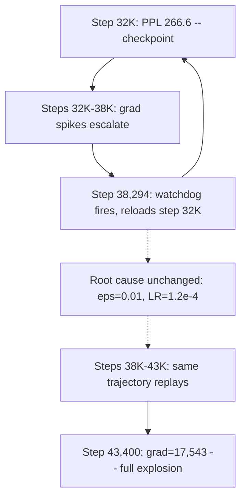

# The Multi-Head 1/r Gradient Explosion and Gradient Management

**What this note is.** §15–§16 of the training-instabilities record: the multi-head experiment's 1/r gradient explosion at step 43K, and the refinements that followed: per-module clipping, gradient centralisation and the choice of optimizer. It was split on 2026-11-21 from [`Training_Instabilities_in_Fock-PARFLM_with_structured_V_theta.md`](https://github.com/dimitarpg13/semsimula-paper/blob/5551315/companion_notes/Training_Instabilities_in_Fock-PARFLM_with_structured_V_theta.md) (written June to August 2026). The text is that document's, unchanged except for its links, and keeps its section numbers, so a reference to "§N" anywhere in the record or in other notes finds its note through [the index](README.md).

> **Causal-leak caveat.** Every experiment in §1–§23 used the pre-fix, leaky Fock architecture: the reverse channel read a shared full-window register state, before the `prefix_causal_registers` fix. The stability findings stand; every perplexity reported here is leak-contaminated (optimistically low). The full caveat is in [the index](README.md#causal-leak).

## Contents

- [15. Multi-Head Experiment: 1/r Gradient Explosion at Step 43K](#15-multi-head-experiment-1r-gradient-explosion-at-step-43k)
- [16. Gradient-Management Refinements: Per-Module Clipping, Centralisation, and Optimizer Choice](#16-gradient-management-refinements-per-module-clipping-centralisation-and-optimizer-choice)

---

## 15. Multi-Head Experiment: 1/r Gradient Explosion at Step 43K

### 15.1. Context

The multi-head experiment (`colab_fock_multihead_openwebtext.ipynb`) was the
first run incorporating the D0-driven remediations from
[`Xi_Bottleneck_Diagnosis_Phase5.md`](../Xi_Bottleneck_Diagnosis_Phase5.md)
and [`Fock-PARFLM_vs_GPT-2_on_OpenWebText_Next_Steps.md`](../Fock-PARFLM_vs_GPT-2_on_OpenWebText_Next_Steps.md):

| Component | Configuration |
|-----------|---------------|
| V\_phi | `structural_competitive` x 4 heads (`MultiHeadVPhi`) |
| V\_theta | Gaussian wells, K=8, learned centres |
| Xi channels | 5 (alpha inits: 0.25, 0.50, 0.75, 0.95, 0.99) |
| Output bias | Enabled, init to log-unigram-frequency |
| LM head | Tied (E^T) |
| d, L, M | 384, 16, 32 |
| Total params | 33,973,355 |
| LR | 1.2e-4 (cosine decay) |
| Grad clip | 1.0 |
| Plummer eps | 0.01 (default) |
| Watchdog | EMA alpha=0.05, threshold=40, patience=200 |

The multi-head V\_phi sums four independent
`StructuralCompetitiveVPhi` sub-potentials, each computing:

$$
V_\phi^{(m)}(h_t, h_s) = -C \cdot \Theta^{(m)} \cdot \Phi^{(m)} \;/\; r
$$

where $r = \sqrt{\lVert h_t - h_s \rVert^2 + \varepsilon^2}$ is the
Plummer-softened distance and $\varepsilon = 0.01$ is the softening
parameter.

### 15.2. Training trajectory: healthy descent then oscillating progress

The run showed clean descent through the first 16K steps, with every
eval setting a new best. After step 16K the descent became intermittent,
alternating between near-stalls and breakthroughs:

| Step | Val PPL | Note |
|------|---------|------|
| 2K | 1042.5 | first eval |
| 8K | 469.4 | smooth descent |
| 16K | 342.9 | last smooth eval |
| 18K | 331.0 | |
| 20K | 329.6 | near-stall (delta = -1.4) |
| 22K | 300.4 | breakthrough |
| 24K | 300.9 | stall (no new best) |
| 26K | 281.2 | breakthrough, new best |
| 28K | 297.3 | stall |
| 30K | 273.4 | new best |
| 32K | **266.6** | **last new best** |
| 34K | 282.6 | regression |
| 36K | 290.1 | regression |
| 38K | 286.7 | regression |
| 40K | 290.4 | regression |
| 42K | 283.9 | regression |

### 15.3. Gradient escalation timeline

The gradient norm (pre-clip) showed a clear escalation pattern starting
around step 16K and accelerating after step 30K:

| Step range | Max grad (pre-clip) | Frequency of spikes > 50 |
|-----------|--------------------|-----------------------|
| 0 -- 16K | 19.7 | 0 |
| 16K -- 26K | 113.8 | 3 events |
| 26K -- 32K | 72.1 | 2 events |
| 32K -- 38K | 142.0 | 5 events |
| 38K -- 43K | **17,543** | 8 events, then explosion |

The critical sequence:

```
step 33200  grad=142.03
step 35800  grad=92.67
step 37200  grad=52.72

[watchdog] EMA grad_norm=50.1 > 40.0 for 200 steps at step 38294
[watchdog] Reloaded best: step 32,000 PPL 266.61

step 38600  grad=81.39     ← post-reload, instability returns
step 41600  grad=101.24
step 43000  grad=228.35
step 43400  grad=17,543.63  ← EXPLOSION
```

### 15.4. Root cause: Plummer softening too small for converging hidden states

The `StructuralCompetitiveVPhi` potential contains a $1/r$ radial
kernel:

$$
V_\phi(h_t, h_s) \propto \frac{1}{\sqrt{\lVert h_t - h_s \rVert^2 + \varepsilon^2}}
$$

The gradient of $1/r$ with respect to $h_t$ grows as $r^{-2}$. With
$\varepsilon = 0.01$, the softening only bounds the gradient when
$\lVert h_t - h_s \rVert \lesssim 0.01$. As training progresses, hidden
states of semantically similar tokens converge in embedding space,
and token pairs routinely satisfy $\lVert h_t - h_s \rVert \lt 0.1$,
placing them in the steep $r^{-2}$ gradient region.

With 4 independent V\_phi heads, each contributing its own $1/r$ term,
the gradient contributions sum. A single batch containing several
close-distance token pairs can produce:

$$
\lVert \nabla_{h_t} V_\phi \rVert \sim 4 \times \frac{C}{\varepsilon^2} \approx \frac{4}{10^{-4}} = 40{,}000
$$

This is consistent with the observed explosion to grad = 17,543 at
step 43,400.

### 15.5. Why the watchdog reload did not prevent the explosion

The EMA watchdog correctly detected the instability at step 38,294
(EMA = 50.1 > threshold 40) and reloaded the step-32K best checkpoint.
However, the reload only restored the model weights and optimiser state
-- it did not change the hyperparameters that caused the instability.

The root cause is architectural ($\varepsilon$ too small) and
hyperparameter-related (LR too high for the gradient scale). Reloading
the checkpoint simply placed the model back at the edge of the unstable
region with the same LR and the same $\varepsilon$. Within 5,000 steps
the instability returned, because the training dynamics that caused the
hidden-state convergence (which triggered the $1/r$ spikes) are
deterministic given the same data stream.



### 15.6. Comparison with prior blowups

This instability shares features with several prior blowups but has a
distinct mechanism:

| Property | Blowup 2 (SQ3) | Blowup 3 (SQ3) | Phase 5 LR doom loop | **Multi-head 1/r** |
|----------|----------------|-----------------|---------------------|-------------------|
| Source | V_θ force | V_θ force | Full model | **V_ϕ distance kernel** |
| Mechanism | Unbounded potential | Sustained moderate grads | LR above stability threshold | **1/r singularity at close pairs** |
| Onset | Sudden spike | Slow escalation | Warmup peak | **Slow escalation then explosion** |
| Bounded V? | No | No | Yes | Yes |
| Bounded F? | No | No | Partially | **No (1/r unbounded)** |
| Watchdog effective? | N/A (pre-watchdog) | No (miscalibrated) | Yes (reloaded, but doom loop) | **No (root cause architectural)** |

The key insight is that this blowup originates in $V_\phi$, not
$V_\theta$. All prior instabilities in this document (Sections 2--14)
involved the one-body potential. The multi-head experiment is the first
case where the **pair potential** is the instability source. The
stability hierarchy of Section 13.5 must be extended to include a
fifth constraint:

$$
\varepsilon \gg \min_{t,s} \lVert h_t - h_s \rVert_{\text{typical}}
$$

### 15.7. Fix applied: reduced LR + tighter clip + increased Plummer softening

Three changes were applied to the notebook for the restart from the
step-32K checkpoint:

| Parameter | Before (blew up) | After (fix) | Rationale |
|-----------|-----------------|-------------|-----------|
| LR | 1.2e-4 | **5e-5** | Below the stability threshold for the multi-head 1/r gradient scale |
| GRAD\_CLIP | 1.0 | **0.3** | Caps the per-step displacement even when pre-clip norms are large |
| `v_phi_eps` | 0.01 | **0.1** | Plummer softening 10x larger; bounds gradient at close pairs by 100x |
| Watchdog threshold | 40.0 | **20.0** | Matches the tighter gradient regime |

The Plummer softening change is the structural fix. With
$\varepsilon = 0.1$, the maximum gradient contribution from a single
pair per head is:

$$
\frac{C}{\varepsilon^2} = \frac{1}{0.01} = 100 \quad\text{(vs. }10{,}000\text{ at }\varepsilon = 0.01\text{)}
$$

For 4 heads: worst-case total $\approx 400$, which is within the range
that `GRAD_CLIP=0.3` can absorb without persistent directional damage.

The LR reduction (5e-5 vs 1.2e-4) provides additional safety margin.
The maximum per-step displacement is:

$$
\lVert \Delta\theta_{\max} \rVert = \eta \times C = 5 \times 10^{-5} \times 0.3 = 1.5 \times 10^{-5}
$$

This is 8x smaller than the original ($1.2 \times 10^{-4} \times 1.0 = 1.2 \times 10^{-4}$).

### 15.8. The extended stability hierarchy

Incorporating this blowup, the full constraint set for stable training
of Fock-PARFLM with structured potentials is:

$$
\underbrace{V \in [-\sum w_k, 0]}_{\text{(1) bounded potential}} + \underbrace{\sigma_{\min} \le \sigma_k \le \sigma_{\max}}_{\text{(2) bounded V}_\theta\text{ force}} + \underbrace{\eta \le \eta_{\max}(d, L, M)}_{\text{(3) scale-appropriate LR}} + \underbrace{\varepsilon \gg \min \lVert h_t - h_s \rVert}_{\text{(4) Plummer softening}}
$$

| Constraint | What it prevents | Where it acts |
|-----------|-----------------|--------------|
| (1) Bounded potential | Blowup 1 (penalty dominance) | V\_theta only |
| (2) Bounded V\_theta force | Blowup 2 (delta spikes), well deactivation | V\_theta only |
| (3) Scale-appropriate LR | Full-model gradient explosion | All parameters |
| (4) Plummer softening | 1/r singularity at close token pairs | V\_phi only |

Constraints (1)-(3) were established in Sections 9-13 for the one-body
potential. Constraint (4) is new and specific to the pair-potential $V_\phi$.
The multi-head architecture amplifies the Plummer sensitivity by a factor
of `n_heads` because each head independently evaluates $1/r$ at the same
close pair.

### 15.9. Implications for future experiments

1. **Default `v_phi_eps` should be 0.1, not 0.01.** The original default was
   set during TinyStories experiments where hidden states occupied a wider
   distribution and close-pair events were rare. At OpenWebText scale with
   multi-head V\_phi, close-pair events are common enough to trigger
   instability within ~40K steps.

2. **Multi-head V\_phi amplifies 1/r sensitivity linearly.** With $n$ heads,
   the worst-case gradient scales as $n / \varepsilon^2$. Future experiments
   with more heads should verify that $\varepsilon$ is large enough:
   $\varepsilon \ge 0.1 \sqrt{n/4}$ is a conservative rule of thumb.

3. **The watchdog cannot fix architectural root causes.** Reloading a
   checkpoint without changing the hyperparameters that caused the instability
   is at best a delay. The watchdog should be augmented with an
   LR-reduction policy on reload (e.g. halve LR on each watchdog trigger).

4. **`ln_before_distance=True` (Patch A) helps but is insufficient.** The
   notebook already had this enabled, which normalises the inputs to the
   distance computation. This reduces the variance of $\lVert h_t - h_s \rVert$
   but does not prevent it from becoming small when two tokens are genuinely
   similar in the normalised space.

## 16. Gradient-Management Refinements: Per-Module Clipping, Centralisation, and Optimizer Choice

Sections 13 and 15 diagnosed two sources of gradient imbalance in
Fock-PARFLM at OpenWebText scale:

1. **V\_phi 1/r spikes** — close token pairs produce extreme per-step
   gradients that dominate the global norm and starve every other module
   of learning signal when a single global `grad_clip` is applied.
2. **Cross-module scale mismatch** — even outside spike events, the
   embedding layer, V\_theta, xi channels, and V\_phi operate at
   naturally different gradient scales, yet AdamW's per-element adaptive
   scaling does not normalise across layers.

The uniform `grad_clip=0.3` applied in Section 15.7 stopped the blowup
but was a blunt instrument: it kept V\_phi stable while shrinking every
other module's effective step size to ~30% of what it could safely use.
The refinements below address that overcorrection surgically.

### 16.1. Per-module gradient clipping

The core observation is that V\_phi is the only module whose gradients
exhibit 1/r spikes. Clipping it separately before the global clip lets
the rest of the model retain a larger gradient budget.

**Implementation** (training loop, after `backward()`, before
`optim.step()`):

```python
# 1. Pre-clip V_phi — its 1/r kernel is the spike source.
nn.utils.clip_grad_norm_(model.V_phi.parameters(), GRAD_CLIP_VPHI)

# 2. Global clip — applies to all params (incl. already-clipped V_phi).
grad_norm = nn.utils.clip_grad_norm_(
    [p for p in model.parameters() if p.requires_grad], GRAD_CLIP,
)
```

With `GRAD_CLIP_VPHI = 0.3` and `GRAD_CLIP = 1.0`, V\_phi's worst-case
contribution to the global norm is capped at 0.3 (same as before), but
the embedding, V\_theta, and xi channels now see a budget of 1.0 —
roughly 3x more learning signal per step.

**Why two-stage clipping works.** Let $g_\phi$ and $g_\text{rest}$
denote the gradient sub-vectors for V\_phi and everything else. After
stage 1:

$$
\lVert g_\phi' \rVert \le C_\phi = 0.3
$$

The global norm presented to stage 2 is:

$$
\lVert g \rVert = \sqrt{\lVert g_\phi' \rVert^2 + \lVert g_\text{rest} \rVert^2} \le \sqrt{0.09 + \lVert g_\text{rest} \rVert^2}
$$

If $\lVert g_\text{rest} \rVert \le 0.95$, then
$\lVert g \rVert \le 1.0$ and the global clip is a no-op — every module
keeps its full learning signal. In the old single-clip regime, a V\_phi
spike of 50+ would trigger the global clip and shrink $g_\text{rest}$
by a factor of $0.3 / 50 \approx 0.006$.

| Regime | V\_phi effective clip | Rest-of-model effective clip | V\_phi spike impact on rest |
|--------|---------------------|----------------------------|---------------------------|
| Single global clip = 0.3 | 0.3 | 0.3 | Severe — rest is shrunk proportionally |
| Per-module pre-clip + global 1.0 | 0.3 | 1.0 | Negligible — spike is absorbed before global |

### 16.2. Gradient centralisation

Gradient centralisation (Yong et al. 2020, arXiv:2004.01461) subtracts
the per-tensor mean from every gradient before the optimizer update.
For a weight matrix $W \in \mathbb{R}^{m \times n}$, the centralised
gradient is:

$$
\hat{g}_{i,:} = g_{i,:} - \frac{1}{n} \sum_{j=1}^{n} g_{i,j}
$$

applied row-wise (i.e. along all dimensions except the output
dimension). The operation projects out the DC component — the uniform
shift that only translates all activations by a constant and carries
no useful learning signal.

**Why it helps Fock-PARFLM specifically.**

1. **Embedding layer.** All vocabulary entries share a common gradient
   shift from the cross-entropy loss (tokens that did not appear in the
   batch contribute a near-identical gradient through the softmax
   normaliser). Removing this DC component can cut the embedding
   gradient norm by 30-50%, making it less likely to trigger global
   clipping.

2. **V\_phi MLPs.** The bounded MLP value-aligner inside
   `StructuralCompetitiveVPhi` has weight matrices whose gradients
   include a DC offset from the constant (type-independent) background
   interaction. Centralising removes this offset, making the gradient
   more aligned with the type-discriminative signal.

3. **Composability.** Centralisation is a pre-processing step on the
   raw gradients. It composes cleanly with per-module clipping (applied
   after centralisation) and with any optimizer choice.

**Implementation.** Applied after `backward()`, before clipping.
Only tensors with `dim >= 2` are centralised — 1-D parameters (biases,
LayerNorm weights/biases) are excluded because their mean IS the
learning signal:

```python
if GRAD_CENTRALIZATION:
    for p in model.parameters():
        if p.grad is not None and p.grad.dim() >= 2:
            p.grad.sub_(p.grad.mean(
                dim=tuple(range(1, p.grad.dim())), keepdim=True))
```

**Computational cost:** negligible — one mean and subtraction per
parameter tensor. No additional memory. No new hyperparameters.

### 16.3. Optimizer choice: AdamW, LAMB, and Lion

Section 13.7 discussed alternative optimizers theoretically. The
notebook now implements three choices as a single `OPTIMIZER` knob.

#### 16.3.1. AdamW (default)

Standard Adam with decoupled weight decay (Loshchilov & Hutter, 2019).
Per-element adaptive scaling via second-moment estimates:

$$
\theta_{t+1} = \theta_t - \eta \left( \frac{\hat{m}_t}{\sqrt{\hat{v}_t} + \epsilon} + \lambda \theta_t \right)
$$

**Strength:** well-understood, stable baseline, extensive community
tooling (LR schedules, warmup strategies).

**Weakness for Fock-PARFLM:** adaptive scaling is per-element, not
per-layer. A large gradient on one element of V\_phi does not
automatically reduce the effective LR for V\_phi as a whole. This is
why per-module clipping (Section 16.1) is needed as a complement.

#### 16.3.2. LAMB (Layer-wise Adaptive Moments)

LAMB (You et al., 2020) wraps Adam's per-element update with a
per-layer trust ratio:

$$
\Delta\theta_l = -\eta \cdot \frac{\lVert \theta_l \rVert}{\lVert r_l \rVert} \cdot r_l, \quad r_l = \frac{\hat{m}_l}{\sqrt{\hat{v}_l} + \epsilon} + \lambda \theta_l
$$

The ratio $\lVert \theta_l \rVert / \lVert r_l \rVert$ gives each
layer its own effective learning rate, automatically shrinking steps
for layers with large gradient norms and expanding them for
well-behaved layers.

**Expected benefit for Fock-PARFLM:** V\_phi parameters (small norm,
large gradient) would get a naturally smaller step, while the embedding
(large norm, moderate gradient) retains a larger step — without manual
per-module clipping. LAMB was designed for large-batch BERT training
where similar cross-module imbalances arise.

**Trade-offs:**
- Introduces the trust ratio as an implicit hyperparameter (though it
  is self-tuning).
- Requires `torch_optimizer` package (auto-installed if missing).
- Less community experience in the language-modelling setting compared
  to AdamW.
- Checkpoint compatibility: switching from AdamW to LAMB resets
  optimizer state (momentum/variance buffers have different semantics),
  so a switch mid-run is effectively a warm restart.

#### 16.3.3. Lion (EvoLved Sign Momentum)

Lion (Chen et al., 2024) is a sign-based optimizer discovered through
program search:

$$
\theta_{t+1} = \theta_t - \eta \bigl(\text{sign}(\beta_1 m_t + (1 - \beta_1) g_t) + \lambda \theta_t\bigr)
$$

$$
m_{t+1} = \beta_2 m_t + (1 - \beta_2) g_t
$$

The `sign()` operation makes the update magnitude exactly 1 per
element, regardless of gradient scale. This means a V\_phi spike of
17,000 and a V\_theta gradient of 0.01 produce identical step sizes.

**Expected benefit for Fock-PARFLM:** natural immunity to gradient
scale spikes. No clipping of any kind should be needed — the sign
function is the ultimate normaliser. Also uses less memory than Adam
(one momentum buffer instead of two).

**Trade-offs:**
- Typically requires 3-10x **lower** learning rate than AdamW because
  the effective step is larger (every element moves by exactly
  $\eta$, not $\eta \cdot g / \sqrt{v}$).
- Less exploration of loss landscape — sign-based updates cannot
  express the magnitude of the gradient, so the optimizer may miss
  shallow directions.
- Requires `lion-pytorch` package (auto-installed if missing).
- Even less community experience than LAMB for language modelling.

### 16.4. Interaction matrix

The three refinements are orthogonal and can be combined freely. The
following table summarises which combinations are sensible:

| Configuration | Per-module clip | Centralisation | Optimizer | Notes |
|--------------|----------------|---------------|-----------|-------|
| Current default | Yes | No | AdamW | Surgical fix for V\_phi spikes |
| Conservative + | Yes | Yes | AdamW | Centralisation further lowers baseline norm |
| LAMB experiment | Optional | Optional | LAMB | LAMB's trust ratio handles per-layer scaling natively |
| Lion experiment | Not needed | Not needed | Lion | Sign function eliminates gradient scale entirely |
| Full stack | Yes | Yes | LAMB | Maximum protection — LAMB + GC + pre-clip |

When LAMB or Lion is selected, per-module clipping is still compatible
(it cannot hurt) but may be unnecessary. The recommendation is:

1. **First experiment:** add `GRAD_CENTRALIZATION = True` to the current
   AdamW + per-module-clip setup. Zero risk, zero new hyperparameters,
   composable.
2. **Second experiment:** switch to `OPTIMIZER = 'lamb'` with the same
   LR. LAMB's trust ratio should make per-module clipping redundant,
   but keep it enabled initially as a safety net.
3. **Third experiment:** switch to `OPTIMIZER = 'lion'` with LR reduced
   to ~1e-5. Most disruptive change — new hyperparameter regime.

### 16.5. Variant isolation

Each non-default optimizer or centralisation choice automatically
appends to the checkpoint variant tag (`lamb`, `lion`, `gc`), creating
a **separate checkpoint directory**. This ensures that:

- Optimizer state incompatibilities do not corrupt existing checkpoints.
- Different optimiser runs can be compared side-by-side without manual
  checkpoint management.
- The hyperparameter dict logged with each checkpoint records both
  `optimizer` and `grad_centralization` for full reproducibility.

### 16.6. Connection to the stability hierarchy

Section 15.8 established four constraints for stable training. The
refinements in this section do not add new constraints; they improve
how existing constraints are enforced:

| Constraint | Original enforcement | Refinement |
|-----------|---------------------|-----------|
| (4) Plummer softening | `v_phi_eps = 0.1` | Unchanged — structural fix |
| (3) Scale-appropriate LR | Global `LR = 5e-5` | LAMB/Lion auto-scale per layer; GC reduces norm |
| Global gradient clip | `GRAD_CLIP = 0.3` (all params) | Per-module: V\_phi at 0.3, rest at 1.0 |

The per-module clip and gradient centralisation are **enforcement
improvements** — they make the existing gradient clip constraint more
precise, not more restrictive. LAMB and Lion are **architectural
alternatives** to manual clipping that achieve the same goal (bounded
per-step displacement) through different mechanisms.
