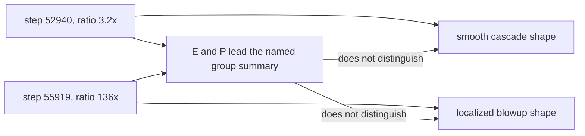

# Near-Trigger Replays and the Clip Ablation

**What this note is.** §44–§45 of the training-instabilities record: two near-trigger replays in which the layer-profile shape discriminates the mechanisms, and why a `precision_lr_max`-style clip ablation does not make sense while `replay_clip_ablation` tests the question. It was split on 2026-11-21 from [`CfC_BAOAB_Integrator_and_Mitigations.md`](https://github.com/dimitarpg13/semsimula-paper/blob/5551315/companion_notes/CfC_BAOAB_Integrator_and_Mitigations.md) (written August to October 2026). The text is that document's, unchanged except for its links, and keeps its section numbers, so a reference to "§N" anywhere in the record or in other notes finds its note through [the index](README.md).

## Contents

- [44. Two Near-Trigger E/P-Led Replays: Layer-Profile Shape, Not Group Identity, Discriminates the Mechanisms, and the §39 Anti-Correlation Extends to This Regime](#44-two-near-trigger-ep-led-replays-layer-profile-shape-not-group-identity-discriminates-the-mechanisms-and-the-39-anti-correlation-extends-to-this-regime)
- [45. A precision_lr_max-Style Clip Ablation Doesn't Make Sense, and replay_clip_ablation Tests the Question That Does: Clip Order](#45-a-precision_lr_max-style-clip-ablation-doesnt-make-sense-and-replay_clip_ablation-tests-the-question-that-does-clip-order)

---

## 44. Two Near-Trigger E/P-Led Replays: Layer-Profile Shape, Not Group Identity, Discriminates the Mechanisms, and the §39 Anti-Correlation Extends to This Regime

Training continued past §43's checkpoint and broke the §32/§36 plateau
outright — two new bests, `val_ppl=98.57` at step 51,500 and `98.45` at
step 52,500, the first genuine improvement on the 100.47 record since it
was set. Alongside that, spike magnitudes crept upward: `441.9` at step
52,940 and `446.3` at step 55,919, both nominally led by `E`/`P` in the
Phase-0 summary and both within **6-9% of `hard_trigger=500`** — the
closest this run has come to another `[watchdog-hard]` reload since
resuming at 47,116. `replay_spike_batch` + `attribute_spike_rows` on both
gives a fidelity-perfect (0.0% diff) forensic pair. Raw combined output:
[replay_spike_batch_attribute_spike_rows_52940_output.txt](../../notebooks/conservative_arch/scaleup/results/cfc_baoab_owt_xi5long_topk16_dt32da16_mh4_aniso_dcvt5x8_L8probe_ob_untied_wsd_e5c_plgate_rep0.05_fockreg0.005_g0.1_baoab_cfc/replay_spike_batch_attribute_spike_rows_52940_output.txt),
[replay_spike_batch_attribute_spike_rows_55919_output.txt](../../notebooks/conservative_arch/scaleup/results/cfc_baoab_owt_xi5long_topk16_dt32da16_mh4_aniso_dcvt5x8_L8probe_ob_untied_wsd_e5c_plgate_rep0.05_fockreg0.005_g0.1_baoab_cfc/replay_spike_batch_attribute_spike_rows_55919_output.txt).

### 44.1 The watchdog's own aggregate undercounts the true total

Both replays report a gap between the matching-groups total (what the
watchdog compares against `hard_trigger`) and the full total including
the reverse-channel groups:

| step | pre-clip (watched) | incl. reverse-channel | % of hard_trigger (watched) | % of hard_trigger (full) |
|---|---|---|---|---|
| 52,940 | 441.9 | 469.4 | 88.4% | 93.9% |
| 55,919 | 446.3 | 457.1 | 89.3% | 91.4% |

The watchdog aggregate is undercounting the true gradient norm by
2.4-6.2% in both cases (a known gap since SS33.3 Phase 0, not new here,
but the margin to `hard_trigger` is now small enough that it matters):
the run is closer to its next reload than the printed `grad=` number
alone would suggest.

### 44.2 Same nominal leader, opposite layer-profile shape

Both events show `E`/`P` (260-274 each) as the two largest *named*
groups in the Phase-0 summary, which is architecturally expected — they
feed `h_0` directly via the tied `h_0 = E(x) + P` sum (§33.3) and are
always large in absolute terms whenever anything downstream amplifies.
But the per-layer boundary-gradient profile — the actual discriminator
established in §38 — is completely different between the two:

| step | layer 0 | layer 1 | layer 2 | layer 3 | layer0/layer3 ratio | §38 mode match |
|---|---|---|---|---|---|---|
| 52,940 | 0.16 | 0.12 | 0.07 | 0.05 | 3.2x | smooth cascade (2.6-6.3x) |
| 55,919 | 38.15 | 19.88 | 2.31 | 0.28 | 136x | localized blowup (50-177x) |

52,940 is a textbook smooth cascade -- gentle, monotone decay across all
8 layers, matching §35's original signature almost exactly. 55,919 is a
textbook localized blowup -- a sharp cliff between layer 1 and layer 3,
landing inside the same 50-177x range as the two original localized
events from §38. Both are labelled "E/P-led" by the Phase-0 summary;
only the layer profile tells them apart. **Named-group leadership does
not discriminate mechanism shape** — it never did (§38 already noted
`depth_code` leads one event of each mode), and this pair confirms the
same is true for `E`/`P` leadership. The layer-profile shape from §38
remains the only reliable discriminator found so far.

$V_\theta$'s own group norm stays modest in both events (47.3 at 52,940,
38.0 at 55,919 -- smaller in the *steeper*, more localized-looking one)
against `E`/`P` at 260-274. `precision_lr_max` continues doing exactly
the job §42 validated: even as overall spike magnitude climbs toward the
hard trigger, the low-rank $V_\theta$ channel's own contribution is not
what is growing. Whatever is driving the localized-shaped blowup at
55,919, it is not a resurgence of unbounded $B_k$ curvature -- it is
happening through the same architectural cascade (`creation_gate`,
`depth_code`, the reverse-channel overrides) that §38's smooth-cascade
mechanism already implicated, just concentrated into the first two
layers this time instead of spread across all eight.

### 44.3 The §39 row-concentration anti-correlation extends to this regime

§39 found a "clean monotonic anti-correlation between layer-0-2 severity
and row concentration" for the original localized-vs-smooth pair: the
more severe the early-layer cliff, the *flatter* (more batch-wide) the
per-row attribution. `attribute_spike_rows` on this new pair points the
same direction:

| step | layer0/layer3 ratio | `total_grad_norm` top-1 row share | top-3 share | (uniform baseline 3.1%) |
|---|---|---|---|---|
| 52,940 (smooth) | 3.2x | 38.7% | 72.2% | -- |
| 55,919 (localized) | 136x | 23.4% | 47.9% | -- |

The smoother event (52,940) is the *more* row-concentrated one (nearly
39% of the whole event sitting in a single row), and the sharper,
more-localized-looking event (55,919) is comparatively flatter -- the
same direction §39 already established, now confirmed in an `E`/`P`-led
near-trigger regime rather than the original `V_theta`/`reverse_ch`-led
one. One coincidental detail from 52,940 did **not** repeat: its two
hottest rows both happened to land in the same microbatch (mb 3, rows 3
and 6); 55,919's two hottest rows are in different microbatches (mb 2
row 0, mb 1 row 6). At n=2 that same-microbatch clustering looks like
noise, not a pattern -- worth remembering if a future capture repeats it,
but not worth acting on yet.

### 44.4 A persistent, and slightly worsening, side-observation on $V_\theta$ bank 3

In both captures, bank 3 of the five $V_\theta$ context banks is the
most saturated ("dead") of the group by a wide margin, and got worse
between the two events:

| step | bank 3 `live_frac` | next-lowest bank |
|---|---|---|
| 52,940 | 25.0% | bank 4 at 50.2% |
| 55,919 | 7.7% | bank 4 at 46.3% |

The other four banks stay in the 46-84% live range at both steps. This
is not yet tied to either spike mechanism -- $V_\theta$'s own group norm
is small and shrinking (47.3 -> 38.0) across the same two events, the
opposite direction bank 3's death would suggest if it were the driver --
but a bank going from one-quarter to one-thirteenth "live" in three
thousand steps is a large enough swing to keep on the watch list
alongside `b_proj_sigma_max`.

### 44.5 Status

Not acting on any of this yet -- both events remain under `hard_trigger`
(91-94% including the reverse-channel gap from §44.1) and training is
past its old plateau, not regressing. Documented here so the next
near-trigger or actual `[watchdog-hard]` event has this pair as a
baseline for comparison. If a hard reload does fire, `replay_spike_batch`
+ `attribute_spike_rows` on it should be compared against both rows of
§44.2/§44.3's table rather than assumed to match either one.

## 45. A `precision_lr_max`-Style Clip Ablation Doesn't Make Sense, and `replay_clip_ablation` Tests the Question That Does: Clip Order

§44's `E`/`P`-led near-trigger pair (441.9 at step 52,940, 446.3 at step
55,919) raised the obvious follow-up: could tightening `E`/`P`'s
per-group clip override (currently the `default_clip=1.0` fallback,
since neither is in `GRAD_CLIP_OVERRIDES` -- `grad_clip_utils.py`)
reduce whatever residual risk these events carry, and can that be
checked offline the way §42 checked `precision_lr_max` -- replay the two
captured bundles under a few candidate thresholds and compare?

### 45.1 Why the direct analogue to §42 doesn't work

It doesn't, and the reason is worth recording so it isn't retried later.
`precision_lr_max` is read live inside the forward pass
(`_bound_lowrank` reads `self._precision_lr_max` on every call), so
swapping it and replaying genuinely recomputes a different gradient --
that's what made `replay_precision_cap_ablation` a real ablation.
Per-group clipping is different in kind: `clip_grads_per_group` calls
`nn.utils.clip_grad_norm_(ps, thr[key])`, and that function *returns the
norm it computed before rescaling* -- the value used everywhere else in
this note as "pre-clip grad norm" (what the watchdog compares against
`hard_trigger`, what `replay_spike_batch` reports) is therefore
completely independent of `thr[key]`. The threshold only changes the
in-place rescale applied to `.grad` afterward. Concretely:
`clip_grads_per_group` is never even called by `replay_spike_batch` or
`replay_precision_cap_ablation` -- they only ever read the pre-clip
per-group norms via `per_group_grad_norms`, which takes no threshold
argument at all. So "replay the batch under a tighter `E`/`P` threshold
and see what the gradient looks like" is not a meaningful experiment:
the gradient is identical in every arm by construction, and the applied
update at any threshold `t` is just `min(t, raw_norm)` -- arithmetic,
not something a replay is needed to discover, and already implied by
the raw norms §44 already recorded (260.8 and 274.3 for `E`, both
already saturating the current `default_clip=1.0` by a factor of ~260x,
so tightening from 1.0 to, say, 0.3 only ever shrinks an already-tiny
applied step further).

### 45.2 The question that *is* worth an offline replay: clip order

What a threshold value cannot fix, but *when* the clip is applied might,
is the mechanism §44.3 flagged: the live training loop accumulates raw
gradients across all `GRAD_ACCUM` microbatches (successive `.backward()`
calls into the same `.grad` tensors) and clips the accumulated total
exactly once, after the loop. `attribute_spike_rows` found 39-72% of a
spike's `total_grad_norm` sitting in just 1-3 of the 32 rows across
those microbatches. Under the current `sum_then_clip` order, one such
outlier row's contribution is baked into the accumulated sum *before*
any clip sees it -- a tighter threshold rescales the resulting vector
uniformly but cannot change the fact that the outlier row set its
direction. An alternative order, `clip_then_sum` -- clip each
microbatch's own `E`/`P` gradient to `threshold` individually, before
adding it into the running total -- bounds any single microbatch's
influence on the final update at the source, which no choice of
threshold under `sum_then_clip` can do. This is a real, replay-worthy
ablation: `clip_then_sum`'s result depends on how the raw gradient is
distributed *across* microbatches, which isn't derivable from the
already-known aggregate norm alone.

`replay_clip_ablation(step_tag, groups=('E', 'P'), thresholds=(1.0, 0.3,
0.1, 0.03))` (Cell 6d, alongside `replay_precision_cap_ablation` and
`replay_integrator_ablation`, same snapshot/restore non-pollution
invariant) implements this: it replays the captured microbatches once,
and for each requested group accumulates two parallel running totals --
the plain sum (`sum_then_clip`, matching the live loop) and, per
candidate threshold, the sum of each microbatch's own gradient
pre-clipped to that threshold (`clip_then_sum`). It reports, per
threshold: the two arms' applied-update norms, their ratio, and the
cosine similarity between the two arms' final applied-update
*directions* -- the more informative number, since a threshold where the
two orders agree in direction (cosine near 1.0) means clip order is
cosmetic at that threshold, while a noticeably lower cosine means the
two regimes disagree about which way `E`/`P` should actually move, which
would be the concrete case for preferring `clip_then_sum`.

### 45.3 Results: run against both live bundles, and the finding replicates

Both bundles replayed cleanly against the fresh, post-§46 session --
neither hit the `CheckpointError` that had taken the previous session
down, confirming that failure was session-level corruption rather than
a reproducible bug in the model or the replay path itself. Raw
`replay_clip_ablation` output:
[replay_clip_ablation_52940_output.txt](../../notebooks/conservative_arch/scaleup/results/cfc_baoab_owt_xi5long_topk16_dt32da16_mh4_aniso_dcvt5x8_L8probe_ob_untied_wsd_e5c_plgate_rep0.05_fockreg0.005_g0.1_baoab_cfc/replay_clip_ablation_52940_output.txt),
[replay_clip_ablation_55919_output.txt](../../notebooks/conservative_arch/scaleup/results/cfc_baoab_owt_xi5long_topk16_dt32da16_mh4_aniso_dcvt5x8_L8probe_ob_untied_wsd_e5c_plgate_rep0.05_fockreg0.005_g0.1_baoab_cfc/replay_clip_ablation_55919_output.txt).

`replay_clip_ablation(52940)` (raw accumulated norm: E=261.20, P=261.12,
1 param each, 4 microbatches):

| threshold | E ratio | E cos | P ratio | P cos |
|---|---|---|---|---|
| 1.0  | 1.453 | 0.691 | 1.441 | 0.693 |
| 0.3  | 1.808 | 0.556 | 1.793 | 0.556 |
| 0.1  | 1.992 | 0.504 | 1.988 | 0.500 |
| 0.03 | 1.992 | 0.504 | 1.988 | 0.500 |

`replay_clip_ablation(55919)` (raw accumulated norm: E=274.26, P=274.11):

| threshold | E ratio | E cos | P ratio | P cos |
|---|---|---|---|---|
| 1.0  | 1.479 | 0.690 | 1.462 | 0.680 |
| 0.3  | 1.881 | 0.542 | 1.879 | 0.530 |
| 0.1  | 1.991 | 0.513 | 1.988 | 0.502 |
| 0.03 | 1.991 | 0.513 | 1.988 | 0.502 |

Three findings:

1. **Clip order already disagrees on direction at the current production
   threshold.** `default_clip=1.0` is what `E`/`P` actually run under
   today (neither is in `GRAD_CLIP_OVERRIDES`), and at that threshold
   `cos(applied dirs)` is already only 0.68-0.69 (~46-47 degrees) in
   every one of the four (bundle, group) combinations above. This isn't
   a hypothetical effect that only appears if the clip is tightened --
   it's live in production right now, every time `E`/`P` saturate the
   clip.

2. Tightening the threshold makes the disagreement *worse*, not better,
   plateauing at cos ≈0.50-0.51 (~60 degrees) by `threshold=0.1` and
   identical at `0.03` -- confirming §45.1's arithmetic point
   empirically. Below whatever the smallest individual microbatch's own
   `E`/`P` gradient norm happens to be (evidently somewhere in the
   0.1-1.0 range, since that's the span across which ratio/cosine keep
   moving before going flat), *every* microbatch gets clipped under
   `clip_then_sum` and the result becomes a fixed linear combination of
   unit directions -- tightening further from there is a pure rescale
   with zero additional effect on direction.

3. **The pattern is essentially identical across both bundles**, despite
   §44 recording them as having opposite layer-profile shapes (52940:
   3.2x smooth cascade; 55919: 136x localized blowup). Every ratio/cosine
   pair between the two bundles agrees to within ~0.01-0.02. This is the
   strongest evidence yet that the clip-order effect is a structural
   property of how `E`/`P` gradients accumulate across microbatches (one
   or a few outlier microbatches dominating the sum -- the microbatch-
   level analogue of §39/§44's row-concentration finding), not an
   artifact of either spike's particular geometry: it generalizes.

### 45.4 Status, and a caveat: `clip_then_sum` at the same threshold is a *bigger* step, not a smaller one

Ratio is >1 throughout (1.44-1.99x): at any given threshold value,
`clip_then_sum` produces a *larger* applied-update norm than
`sum_then_clip` does today, because the accumulated sum (261-274) so
vastly exceeds `default_clip=1.0` that `sum_then_clip` is always fully
saturated to exactly the threshold regardless of direction, while
`clip_then_sum` at threshold=1.0 already lets several microbatches
contribute close to their own (>1.0) magnitude before any capping ever
touches the sum. So naively swapping `sum_then_clip` for `clip_then_sum`
**without recalibrating the threshold** would make the applied step
44-99% *larger* during exactly these events -- the opposite of the
original goal. If `clip_then_sum` is wired in, its threshold needs to be
chosen to target a comparable (or deliberately smaller) applied
magnitude to what `sum_then_clip(1.0)` gives today -- e.g. something in
the ballpark of `1.0 / 1.47 ~= 0.68` for rough magnitude parity -- rather
than reusing `default_clip=1.0` as-is; the two orders are not
interchangeable at a shared threshold value.

Both bundles now replayed and analyzed; the direction-divergence finding
is real and reproduces across both. Given the finding's consistency
across two structurally different spikes, and that this session had only
just resumed from the step-52,500 restore (§46) -- the cheapest possible
point to take one more short interrupt-and-restart, versus doing this
surgery on a training loop that's already hours deep into a run --
`clip_then_sum` was implemented immediately rather than deferred:

- `CLIP_THEN_SUM_GROUPS = {'E', 'P'}`, `CLIP_THEN_SUM_THRESHOLD = 0.3`
  (Cell 6, next to `_GRAD_CLIP_CFG`). `0.3` chosen directly from §45.3's
  table rather than by chasing exact magnitude parity with today's
  `sum_then_clip(1.0)` output (the ratio isn't constant across
  thresholds, so there's no single clean parity number anyway):
  `clip_then_sum(0.3)` measured ~0.54 on both bundles, already smaller
  than today's applied norm of 1.0 (satisfies the original "tighten the
  clip" ask) while still solidly in the direction-divergent regime
  (`cos~0.55`, i.e. a genuinely different, not just rescaled, direction).
- Mechanism: `_CLIP_THEN_SUM_PARAMS` groups `model.named_parameters()` by
  `assign_clip_group` once at setup (matching exactly how
  `clip_grads_per_group` and `replay_clip_ablation` build their own
  groupings, so "group E" always means the same parameters everywhere).
  Inside the `GRAD_ACCUM` microbatch loop, right after each microbatch's
  own `.backward()` and before the next one's accumulates on top,
  `nn.utils.clip_grad_norm_(group_params, CLIP_THEN_SUM_THRESHOLD)` clips
  that microbatch's own contribution jointly across the group (correct
  even if a group ever holds more than one tensor, not just today's
  single-param `E`/`P`), folds it into a running total keyed by
  `id(param)`, then zeros `.grad` so the normal full-sum accumulation
  every other group still relies on never sees it. After the microbatch
  loop, the running total is spliced back into `.grad` for exactly these
  params -- everything downstream (`GRAD_CENTRALIZATION`,
  `clip_grads_per_group`'s existing post-hoc per-group safety clip, the
  watchdog, spike-batch capture, logging) needs no other change; it just
  now reads this group's already-outlier-bounded total instead of the
  raw microbatch sum. `CLIP_THEN_SUM_GROUPS = None`/empty reverts to
  `sum_then_clip` for every group, matching pre-SS45.3 behavior exactly.
- Validated offline before trusting it live: a standalone numeric check
  (synthetic two-tensor group, four microbatches with magnitudes spanning
  50x to mimic the real one-dominant-microbatch pattern) confirmed the
  live per-microbatch-clip-accumulate-zero-splice algorithm is
  numerically identical (matches to float precision) to the closed-form
  computation `replay_clip_ablation` already used to produce §45.3's
  table -- i.e. what's now running live is provably the same arithmetic
  that was validated offline, not just "should be equivalent."

One expected side effect worth flagging for later: `E`/`P`'s reported
pre-clip group norm (in `[spike]` log lines, the watchdog EMA/hard-
trigger aggregate, and `CAPTURE_SPIKE_THRESHOLD`-gated bundle capture)
will now reflect the post-clip_then_sum total (order ~0.5) rather than
the previous raw sums (~260-275) whenever `E`/`P` would have led a spike
-- this is the intended effect (it's the whole point), but it does mean
future `E`/`P`-led events from before this change won't have a like-for-
like comparison against events captured after it, and the
`CAPTURE_SPIKE_THRESHOLD=100`-gated spikebatch harvesting may simply stop
firing for this specific failure mode if it's genuinely fixed. Not yet
observed running live -- next real signal is whether the `grad_norm` EMA
and hard-trigger reload frequency drop after this deploys.
