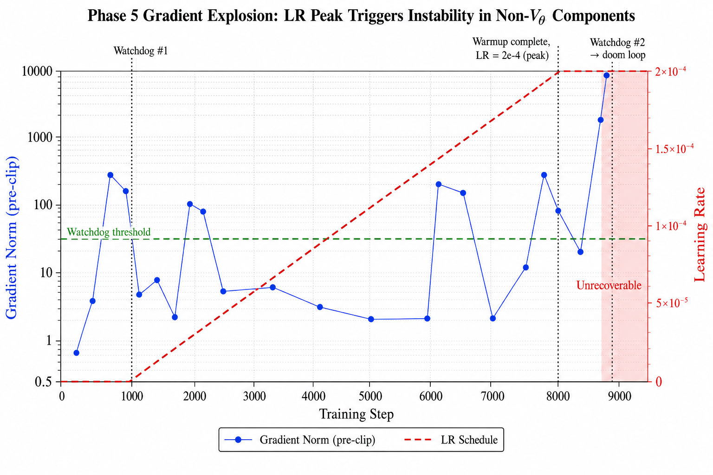
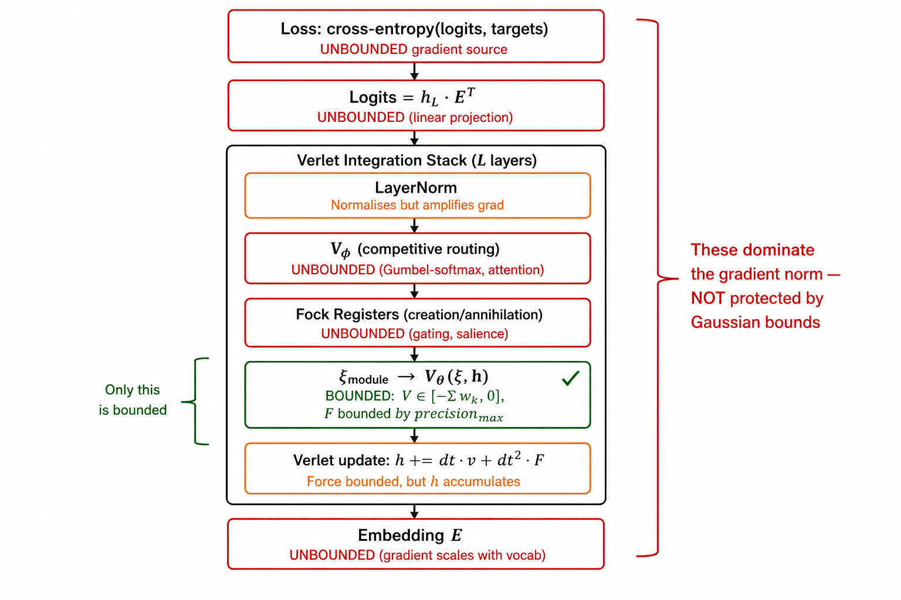

# The Phase 5 Learning-Rate Blowup, and Why TinyStories Is Stable and OpenWebText Is Not

**What this note is.** §13–§14 of the training-instabilities record: the Phase 5 blowup driven by the learning rate beyond the bounded potential, and the scale-diversity analysis of TinyStories against OpenWebText. It was split on 2026-11-21 from [`Training_Instabilities_in_Fock-PARFLM_with_structured_V_theta.md`](https://github.com/dimitarpg13/semsimula-paper/blob/5551315/companion_notes/Training_Instabilities_in_Fock-PARFLM_with_structured_V_theta.md) (written June to August 2026). The text is that document's, unchanged except for its links, and keeps its section numbers, so a reference to "§N" anywhere in the record or in other notes finds its note through [the index](README.md).

> **Causal-leak caveat.** Every experiment in §1–§23 used the pre-fix, leaky Fock architecture: the reverse channel read a shared full-window register state, before the `prefix_causal_registers` fix. The stability findings stand; every perplexity reported here is leak-contaminated (optimistically low). The full caveat is in [the index](README.md#causal-leak).

## Contents

- [13. Phase 5 Blowup: LR-Induced Instability Beyond the Bounded Potential](#13-phase-5-blowup-lr-induced-instability-beyond-the-bounded-potential)
- [14. Scale-Diversity Analysis: Why TinyStories Is Stable and OpenWebText Is Not](#14-scale-diversity-analysis-why-tinystories-is-stable-and-openwebtext-is-not)

---

## 13. Phase 5 Blowup: LR-Induced Instability Beyond the Bounded Potential

### 13.1. Context

Phase 5 scaled the TinyStories-validated G1 architecture (Gaussian
`MixtureGaussianVTheta`, K=8, `precision_max=2/d`) to OpenWebText with
a larger model: $d=384$, $L=16$, $M=32$ Fock registers, 31.5M parameters.
The initial configuration used `LR=2e-4` (higher than Phase 4's `1.2e-4`),
based on the assumption that bounded V_theta would tolerate a more
aggressive learning rate.

### 13.2. Symptom: Doom Loop at LR Peak

Training proceeded normally through warmup but became unstable as the
learning rate approached its peak:

| Step | LR | grad (pre-clip) | v\_reg | val\_ppl |
|------|----|----------------|--------|---------|
| 2000 | 5.0e-5 | 3.6 | 0.017 | 1893.58 |
| 4000 | 1.0e-4 | 2.4 | 0.099 | 933.30 |
| 6000 | 1.5e-4 | 1.9 | 0.138 | 583.91 |
| 6200 | 1.55e-4 | **31.1** | 0.132 | — |
| 6600 | 1.65e-4 | **26.2** | 0.130 | — |
| 7800 | 1.95e-4 | **39.9** | 0.159 | — |
| 8000 | **2.0e-4** (peak) | 13.8 | 0.174 | 492.72 |
| 8702 | 2.0e-4 | watchdog trigger (EMA=34.7) | — | — |
| 8800 | 2.0e-4 | **459.5** | 0.165 | — |
| 8910 | 2.0e-4 | EMA=**9898** | — | — |

The EMA watchdog reloaded the best checkpoint (step 8000) at step 8702,
but the peak LR immediately pushed the model back into instability.
The gradient EMA reached 9898 within 208 steps of the reload — a
classic doom loop where the recovery checkpoint is itself at the edge
of the unstable region.



### 13.3. Root Cause: Bounded V_theta Does Not Bound the Full Gradient

The Gaussian well architecture guarantees:

$$
V(\mathbf{h}) \in \Bigl[-\sum_k w_k, 0\Bigr], \qquad \lVert \mathbf{F} \rVert = \lVert -\nabla_h V \rVert \le \frac{0.607 \cdot w_k}{\sigma_{\min}}
$$

However, the total gradient norm $\lVert \nabla_\theta \mathcal{L} \rVert$
is computed over **all** 31.5M parameters, most of which lie outside V_theta.
The gradient flows through an unbounded computational chain:

$$
\mathcal{L} = \underbrace{-\log \mathrm{softmax}(\underbrace{h_L \cdot E^\top}_{\text{logits}})}_{\text{cross-entropy}}
$$

where $h_L$ is produced by the Verlet integration stack:

$$
h_{l+1} = \mathrm{LN}\Bigl(h_l + \Delta t \cdot v_l + \Delta t^2 \cdot \bigl(\underbrace{F_{V_\theta}}_{\text{bounded}} + \underbrace{F_{V_\phi}}_{\text{unbounded}}\bigr)\Bigr)
$$

The backward pass computes:

$$
\frac{\partial \mathcal{L}}{\partial \theta_i} =
\frac{\partial \mathcal{L}}{\partial h_L} \cdot
\prod_{l=1}^{L} \frac{\partial h_{l+1}}{\partial h_l} \cdot
\frac{\partial h_1}{\partial \theta_i}
$$

Each factor in this product involves:

| Component | Bounded? | Gradient contribution |
|-----------|---------|----------------------|
| V_θ (Gaussian wells) | **Yes** | Force ≤ 0.607 w_k / σ_min |
| V_ϕ (competitive routing) | No | Gumbel-softmax, attention scores |
| Fock registers (creation/annihilation) | No | Gating, salience thresholding |
| LayerNorm | Normalises h, but **amplifies** ∂h | Jacobian has 1/σ terms |
| Embedding E (50257 × d) | No | Gradient scales with vocabulary |
| Logit projection h_L · E^T | No | Linear in ‖h_L‖ |

The bounded V_theta contributes a small, well-behaved fraction of the
total gradient. The dominant terms come from V_phi, the Fock register
machinery, and the embedding layer — none of which benefit from the
Gaussian boundedness.



### 13.4. Why d=384 Is More Sensitive Than d=256

On TinyStories ($d=256$, 14M params), G1 trained stably at `LR=5e-4` —
four times higher than the Phase 5 peak that caused the blowup. Three
factors explain the scale dependence:

**1. Parameter count scales as $O(d^2)$.** The embedding layer alone
has $50257 \times d$ parameters. At $d=384$ this is 19.3M vs 12.9M at
$d=256$. The gradient norm $\lVert \nabla_\theta \mathcal{L} \rVert$
grows with the square root of the parameter count even for i.i.d.
gradient components:

$$
\lVert \nabla_\theta \mathcal{L} \rVert \approx \bar{g} \cdot \sqrt{P}
$$

where $\bar{g}$ is the per-parameter gradient scale and $P$ is the
parameter count. The ratio $\sqrt{31.5\text{M} / 14\text{M}} \approx 1.5$
means that the same per-parameter gradient produces a 1.5x larger
total gradient norm at $d=384$.

**2. LayerNorm Jacobian amplification.** With `ln_after_step=True`, each
layer applies LayerNorm after the Verlet update. The Jacobian of
LayerNorm with respect to its input has terms proportional to $1/\sigma$,
where $\sigma$ is the standard deviation of the input. At larger $d$,
the variance is better estimated (law of large numbers) but the
centering operation interacts with more dimensions, creating
correlated gradient directions that can align constructively.

**3. Fock register interactions.** With $M=32$ registers (vs 16 on
TinyStories), the register attention mechanism has $32 \times d$ key/query
parameters per layer. The creation/annihilation gating involves softmax
over 32 positions, and the salience computation scales with $M$. More
registers create a richer but more fragile attention landscape.

The net effect is that the **maximum stable learning rate** decreases
with model scale. Empirically:

$$
\text{LR}_{\max}(d=256) \approx 5 \times 10^{-4}, \qquad
\text{LR}_{\max}(d=384) \lt 2 \times 10^{-4}
$$

Phase 4 (SQ3 on OpenWebText, $d=384$) used `LR=1.2e-4` and was stable
(apart from V_theta-specific blowups). This confirms that `1.2e-4` is
within the stable region for the non-V_theta components at this scale.

### 13.5. The Stability Hierarchy: Four Independent Constraints

Sections 9–13 collectively establish that stable training requires
**four independent constraints**, not just bounded potential:

$$
\underbrace{V \in [-\sum w_k, 0]}_{\text{(1) bounded potential}} \quad + \quad \underbrace{\sigma_{\min} \le \sigma_k \le \sigma_{\max}}_{\text{(2) bounded force}} \quad + \quad \underbrace{\text{LR} \le \text{LR}_{\max}(d, L, M)}_{\text{(3) scale-appropriate LR}} \quad \Longrightarrow \quad \text{stable training}
$$

| Constraint | What it prevents | Where it acts |
|-----------|-----------------|--------------|
| (1) Bounded potential | Blowup 1 (penalty dominance) | V_theta only |
| (2) Bounded force | Blowup 2 (delta spikes), well deactivation | V_theta only |
| (3) Scale-appropriate LR | Full-model gradient explosion | All parameters |

Constraints (1) and (2) are **architectural** — they are enforced by the
Gaussian well design and hold regardless of hyperparameters. Constraint
(3) is **optimiser-dependent** — it depends on the learning rate, the
model scale, and the optimiser's update rule.

### 13.6. Fix: Reduce Peak LR to Phase 4 Baseline

The immediate fix matches the Phase 4 hyperparameters that were stable
at $d=384$:

| Parameter | Phase 5 v1 (blew up) | Phase 5 v2 (fix) |
|-----------|---------------------|-----------------|
| Peak LR | 2e-4 | **1.2e-4** |
| Warmup steps | 8000 | **4000** |
| Grad clip | 0.5 | **1.0** |

The shorter warmup (4000 steps) reflects the lower peak LR: the model
reaches `1.2e-4` at step 4000 with the old warmup rate, so there is no
benefit to extending the ramp further. The looser grad clip (`1.0` vs
`0.5`) preserves more gradient information per step — at `0.5`, the
clip was discarding gradient direction information even during stable
training (most pre-clip norms were 1–6, so a clip of 0.5 was truncating
the majority of updates).

### 13.7. Alternative Optimisers: Could They Prevent This?

The LR sensitivity arises because AdamW applies a **uniform learning
rate** to all parameter groups, regardless of their gradient scale or
the boundedness of their associated module. Several alternative
optimisers address this in different ways:

**LAMB (Layer-wise Adaptive Moments for Batch training).**
LAMB normalises each layer's update by the ratio of the parameter norm
to the gradient norm:

$$
\Delta \theta_l = -\eta \cdot \frac{\lVert \theta_l \rVert}{\lVert \hat{m}_l / (\hat{v}_l^{1/2} + \epsilon) \rVert} \cdot \frac{\hat{m}_l}{\hat{v}_l^{1/2} + \epsilon}
$$

This automatically reduces the effective LR for layers with large
gradient norms (e.g. V_phi, embedding) while preserving it for
well-behaved layers (e.g. V_theta). LAMB was designed for large-batch
training of BERT and would likely tolerate higher peak LR without
blowing up.

**Adafactor.**
Adafactor uses row/column factorised second-moment estimates and
includes relative step sizing:

$$
\rho_t = \min\bigl(\rho_{\max}, 1/\sqrt{t}\bigr)
$$

This provides automatic LR decay without a manual schedule. The
factorised second moments also reduce memory (important at 31.5M
params).

**Gradient centralisation.**
A simple modification to any optimiser: subtract the mean from each
gradient tensor before the update:

$$
\hat{g} = g - \mathrm{mean}(g)
$$

This removes the "DC component" of the gradient, which is often the
dominant contributor to large gradient norms (especially for the
embedding layer where all vocab entries share a common gradient shift).
Gradient centralisation can be added to AdamW with a single line and
has been shown to improve training stability at no computational cost.

**Per-module learning rate groups.**
The simplest approach: assign different learning rates to different
parameter groups in the optimiser. For example:

```python
param_groups = [
    {'params': model.V_theta.parameters(), 'lr': LR},
    {'params': model.V_phi_params(),       'lr': LR * 0.5},
    {'params': [model.E.weight],           'lr': LR * 0.3},
    {'params': other_params,               'lr': LR},
]
```

This is the most transparent approach — it makes the per-module LR
scaling explicit rather than relying on the optimiser to discover it
adaptively. Phase 4 used a version of this (separate LR for V_theta
parameters) as Fix B.

### 13.8. Recommendation

For Phase 5, the conservative approach is `LR=1.2e-4` with AdamW,
matching the validated Phase 4 configuration. This avoids introducing
a new optimiser (and its own hyperparameter tuning surface) while
staying within the empirically stable region.

If future experiments require higher effective LR for faster convergence,
LAMB or per-module LR groups are the recommended next steps. Both
directly address the root cause (non-uniform gradient scale across
modules) rather than relying on global LR reduction as a blunt
instrument.

---

## 14. Scale-Diversity Analysis: Why TinyStories Is Stable and OpenWebText Is Not

### 14.1. The Puzzle

Every instability documented in Sections 1-13 was first observed on
OpenWebText. On TinyStories, both the SQ3 (mixture of quadratic wells)
and Gaussian (mixture of Gaussian wells) architectures trained stably
and achieved competitive perplexity:

| Architecture | TinyStories PPL | Instabilities observed |
|---|---|---|
| SQ3 (Phase 2, d=256, 14M) | **~10** | None |
| Gaussian G1 (K=8, d=256, 14M) | **15.95** | Mild transient spikes (max grad=198) |
| Gaussian G2 (K=16, d=256, 14M) | **17.61** | None |
| Gaussian G3 (SARF N=64, d=256, 14M) | **18.67** | v\_reg drift (fixed by `log_sigma_max`) |

When the same architectures were scaled to OpenWebText (Phase 4 for
SQ3, Phase 5 for Gaussian):

| Architecture | OpenWebText | Instabilities observed |
|---|---|---|
| SQ3 (Phase 4, d=384, 31.5M) | Blowups 1, 2, 3 | Penalty dominance, force spikes, watchdog miscalibration |
| Gaussian G1 (Phase 5, d=384, 31.5M) | LR doom loop, progress trap | Full-model gradient explosion, watchdog reload cycles |

The structured V_theta is not the root cause — the instabilities
arise from the interaction of model scale, data diversity, and learning
rate. This section provides a unified framework for predicting when
instabilities will appear.

### 14.2. The Stability Product

Training stability is governed by a product of three factors:

$$
\mathcal{S} = \underbrace{\sqrt{P}}_{\text{model scale}} \times \underbrace{\sigma_{\text{batch}}(\nabla \mathcal{L})}_{\text{gradient variance}} \times \underbrace{\eta}_{\text{learning rate}}
$$

where $P$ is the total parameter count, $\sigma_{\text{batch}}$ is the
standard deviation of the gradient across different batches, and $\eta$
is the learning rate. The model is stable when $\mathcal{S}$ is below
an architecture-dependent threshold $\mathcal{S}_{\max}$:

$$
\mathcal{S} \lt \mathcal{S}_{\max} \quad \Longrightarrow \quad \text{stable training}
$$

Each factor contributes differently on TinyStories vs OpenWebText.

### 14.3. Factor 1: Model Scale ($\sqrt{P}$)

The total gradient norm scales with the square root of the parameter
count for i.i.d. gradient components:

$$
\lVert \nabla_\theta \mathcal{L} \rVert \approx \bar{g} \cdot \sqrt{P}
$$

| Configuration | P | √P | Ratio vs TinyStories |
|---|---|---|---|
| TinyStories (d=256) | 14.0M | 3,742 | 1.0x |
| OpenWebText (d=384) | 31.5M | 5,612 | **1.50x** |

This factor alone increases the gradient norm by 50% on OpenWebText.
The effect is amplified by the larger Fock register pool ($M=32$ vs 16)
and deeper integration stack ($L=16$ layers with $d=384$-dimensional
states).

### 14.4. Factor 2: Gradient Variance ($\sigma_{\text{batch}}$)

This is the dominant factor and the qualitative difference between
the two corpora. With a batch of 8 sequences at block_size=512, each
training step sees only 4,096 tokens. The gradient computed from these
tokens is a noisy estimate of the full-dataset gradient, and the noise
level depends on the homogeneity of the corpus.

**TinyStories** is a highly homogeneous corpus:
- Approximately 2.3M short children's stories.
- Vocabulary: ~5,000 active tokens out of 50,257 (simple nouns,
  verbs, names like "Lily" and "Tom").
- Syntax: almost exclusively SVO order, past tense, conjunctions.
- Semantics: concrete objects, simple emotions, fairy-tale logic.
- Any batch of 8 stories looks statistically similar to any other.

**OpenWebText** is a high-entropy, heavy-tailed corpus:
- Approximately 8B tokens from 8M web documents.
- Full vocabulary utilisation — technical jargon, URLs, code,
  foreign words, named entities, numbers.
- Syntax: news prose, Reddit comments, blog posts, code, recipes,
  academic writing — all interleaved.
- A batch of 8 random documents can span wildly different domains.

The gradient variance decomposes across model components:

**Embedding gradient ($E$, 61% of params).**
The embedding gradient for token $i$ is non-zero only when token $i$
appears in the batch. On TinyStories, the same ~5K tokens appear in
nearly every batch, so $\nabla_E \mathcal{L}$ is dense and stable.
On OpenWebText, rare tokens appear sporadically — when a batch happens
to contain a rare technical term, the gradient for that embedding row
spikes while all other rows see zero gradient. The embedding gradient
has a heavy-tailed distribution across batches.

**V\_phi routing gradient (score head, 0.6% of params).**
The Gumbel-softmax top-k routing learns which past tokens to attend
to. On TinyStories, the optimal routing is predictable (similar
syntactic patterns across stories). On OpenWebText, the optimal
routing changes dramatically between batches — a code snippet needs
different routing than a news paragraph. The score head gradient
direction fluctuates strongly.

**Fock register gradients (2.3M params).**
The creation/destruction gates learn when to activate registers
based on token-register attention scores. On TinyStories, the same
register activation patterns recur (e.g., "character introduced"
triggers creation, "story ends" triggers destruction). On OpenWebText,
the activation patterns are far more variable, creating gradient
noise in the QKV creation gate and destruction gate parameters.

**V\_theta gradient (9.5M params for Gaussian G1).**
The Gaussian wells learn centres $\mu_k(\xi)$, precisions $a_k(\xi)$,
and weights $w_k(\xi)$ conditioned on the multi-channel context
$\xi$. On TinyStories, the context distribution is narrow — the
model sees similar $\xi$ vectors across batches. On OpenWebText,
$\xi$ spans a much wider subspace of $\mathbb{R}^{K_\xi \cdot d}$,
and the projections $\mu_k(\xi)$ must cover a much larger volume.
The gradient of the mu\_proj and a\_proj linear layers fluctuates
as different regions of $\xi$-space are sampled in each batch.

**Estimated variance ratio.** Combining these effects, the inter-batch
gradient standard deviation on OpenWebText is estimated to be
3-5x larger than on TinyStories:

$$
\frac{\sigma_{\text{batch}}(\text{OWT})}{\sigma_{\text{batch}}(\text{TS})} \approx 3 \text{--} 5
$$

### 14.5. Factor 3: Learning Rate ($\eta$)

The learning rate multiplies the (noisy) gradient to produce the
parameter update. Higher $\eta$ amplifies the gradient noise linearly.

| Run | Peak LR | Stable? |
|---|---|---|
| TinyStories G1 (d=256) | 5.0e-4 | Yes |
| TinyStories G2 (d=256) | 5.0e-4 | Yes |
| OpenWebText Phase 4 SQ3 (d=384) | 1.2e-4 | Yes (after Blowup 1-3 fixes) |
| OpenWebText Phase 5 (d=384, LR=2e-4) | 2.0e-4 | **No** — doom loop at step 8700 |
| OpenWebText Phase 5 (d=384, LR=1.2e-4) | 1.2e-4 | **Marginal** — watchdog triggers, progress trap |

TinyStories tolerates 4x higher LR because the other two factors are
much smaller.

### 14.6. The Stability Product in Practice

Combining the three factors:

$$
\frac{\mathcal{S}(\text{OWT, } d\!=\!384)}{\mathcal{S}(\text{TS, } d\!=\!256)} = \underbrace{1.5}_{\sqrt{P}} \times \underbrace{3 \text{--} 5}_{\sigma_{\text{batch}}} \times \underbrace{\frac{\eta_{\text{OWT}}}{\eta_{\text{TS}}}}_{\text{LR ratio}}
$$

At $\eta_{\text{OWT}} = 2 \times 10^{-4}$ and $\eta_{\text{TS}} = 5 \times 10^{-4}$:

$$
\mathcal{S}_{\text{ratio}} = 1.5 \times 4 \times 0.4 = 2.4
$$

At $\eta_{\text{OWT}} = 1.2 \times 10^{-4}$:

$$
\mathcal{S}_{\text{ratio}} = 1.5 \times 4 \times 0.24 = 1.44
$$

The first configuration ($\eta = 2 \times 10^{-4}$) pushes $\mathcal{S}$
2.4x above the TinyStories baseline, triggering the doom loop. The
second ($\eta = 1.2 \times 10^{-4}$) keeps $\mathcal{S}$ only 1.44x
above baseline — above the stability threshold but close enough that
the model functions with occasional watchdog interventions.

### 14.7. Architecture-Specific Amplifiers

The stability product determines **whether** instability occurs. The
V_theta architecture determines **which** instability manifests:

**SQ3 (unbounded quadratic wells).**
The quadratic penalty term $\lambda \cdot V_\theta^2$ couples the
potential depth to the gradient norm. When a diverse OWT batch drives
$V$ to large values in some hidden-state region, the penalty gradient
scales as $O(V)$, creating a positive feedback loop:

$$
\text{diverse batch} \to \text{large } V \to \text{large } \nabla(V^2) \to \text{large update} \to \text{even larger } V
$$

On TinyStories, $V$ remains moderate because the hidden states occupy
a narrow, predictable region of $\mathbb{R}^d$. The feedback loop
never activates.

**Gaussian wells (bounded potential).**
The bounded potential $V \in [-\sum w_k, 0]$ eliminates the penalty
amplification channel. But it does not protect the non-V_theta
components — the embedding, V_phi, and Fock register gradients are
still subject to the full gradient variance. The instability shifts
from V_theta-internal (Blowup 1) to full-model (Phase 5 LR blowup,
progress trap).

### 14.8. Predictive Framework for Future Scale-Ups

The stability product provides a practical formula for anticipating
instabilities when scaling to new model sizes or corpora:

$$
\eta_{\max}(\text{new}) \approx \eta_{\text{stable}}(\text{ref}) \times \frac{\sqrt{P_{\text{ref}}}}{\sqrt{P_{\text{new}}}} \times \frac{\sigma_{\text{batch}}(\text{ref})}{\sigma_{\text{batch}}(\text{new})}
$$

where "ref" is a known-stable configuration.

**Example: scaling to d=512 (Phase 6).**
If $P_{\text{new}} \approx 80\text{M}$ and the corpus remains
OpenWebText:

$$
\eta_{\max}(d\!=\!512) \approx 1.2 \times 10^{-4} \times \frac{\sqrt{31.5\text{M}}}{\sqrt{80\text{M}}} \approx 1.2 \times 10^{-4} \times 0.63 \approx 7.5 \times 10^{-5}
$$

**Example: scaling to a more diverse corpus (e.g., The Pile).**
If the batch gradient variance is ~2x higher than OpenWebText:

$$
\eta_{\max}(\text{Pile}) \approx 1.2 \times 10^{-4} \times 0.5 = 6.0 \times 10^{-5}
$$

These estimates are rough (the exponents depend on the model's
specific gradient structure), but they provide the correct order
of magnitude and prevent the trial-and-error that characterised the
Phase 4 and Phase 5 debugging process.

### 14.9. Implications for the Paper

The stability analysis yields three claims relevant to the
mega-paper:

**Claim 1: Corpus diversity, not model architecture, is the
primary driver of training instability.**
The Fock-PARFLM architecture is stable on homogeneous corpora at all
tested scales. Instabilities emerge only when corpus diversity
(measured by inter-batch gradient variance) exceeds a threshold that
depends on model scale and learning rate. This is not specific to the
PARFLM framework — standard transformers face analogous instabilities
at scale (learning rate warmup, gradient clipping, and loss spikes are
standard mitigations in large-scale transformer training).

**Claim 2: Bounded V_theta narrows but does not eliminate the
instability surface.**
The Gaussian well architecture eliminates V_theta-specific failure
modes (Blowups 1-3) by construction. The remaining instabilities
are in the non-V_theta components (embedding, V_phi, Fock registers)
and are amenable to standard optimisation mitigations (LR reduction,
gradient clipping, EMA watchdog). This decomposition —
architecture-level boundedness + optimiser-level robustness — is a
principled design pattern for conservative-dynamics language models.

**Claim 3: TinyStories ablation validates architecture; OpenWebText
validates optimisation.**
The TinyStories experiments establish that the V_theta architecture
(SQ3, Gaussian, SARF) produces competitive perplexity under
controlled conditions. The OpenWebText experiments test whether the
architecture's stability properties hold under realistic data
diversity. Both are necessary: TinyStories alone would miss all
scale-diversity instabilities; OpenWebText alone would conflate
architectural and optimisation issues.
