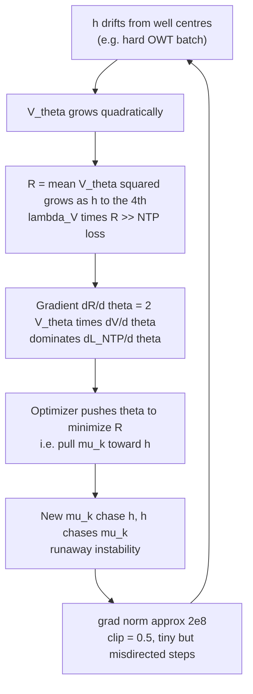
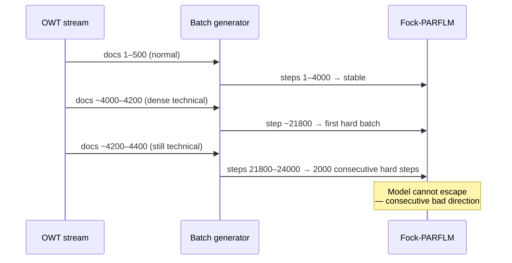
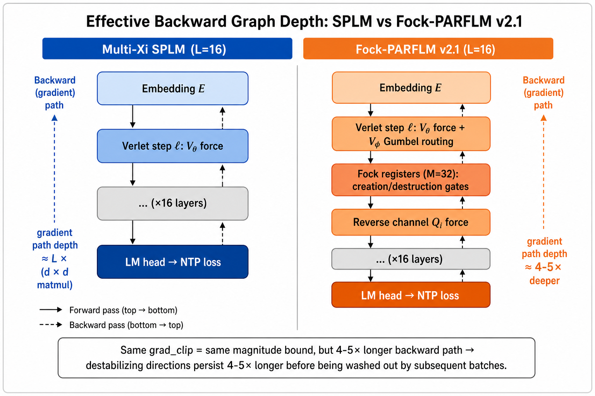

# The Three Blowups of the Phase 4 Scale-Up and Their Causes

**What this note is.** §1–§5 of the training-instabilities record: the background of the Phase 4 OpenWebText scale-up, the three blowups it hit (penalty dominance, directional instability, a miscalibrated EMA watchdog), and why Fock-PARFLM is more susceptible than SPLM. It was split on 2026-11-21 from [`Training_Instabilities_in_Fock-PARFLM_with_structured_V_theta.md`](https://github.com/dimitarpg13/semsimula-paper/blob/5551315/companion_notes/Training_Instabilities_in_Fock-PARFLM_with_structured_V_theta.md) (written June to August 2026). The text is that document's, unchanged except for its links, and keeps its section numbers, so a reference to "§N" anywhere in the record or in other notes finds its note through [the index](README.md).

> **Causal-leak caveat.** Every experiment in §1–§23 used the pre-fix, leaky Fock architecture: the reverse channel read a shared full-window register state, before the `prefix_causal_registers` fix. The stability findings stand; every perplexity reported here is leak-contaminated (optimistically low). The full caveat is in [the index](README.md#causal-leak).

## Contents

- [1. Background](#1-background)
- [2. Blowup 1 — Penalty Dominance](#2-blowup-1--penalty-dominance)
- [3. Blowup 2 — Directional Instability](#3-blowup-2--directional-instability)
- [4. Blowup 3 — EMA Watchdog Miscalibration](#4-blowup-3--ema-watchdog-miscalibration)
- [5. Why Fock-PARFLM is More Susceptible than SPLM](#5-why-fock-parflm-is-more-susceptible-than-splm)

---

## 1. Background

### Architecture

The SQ3 structured V_θ replaces the MLP scalar potential with a
$K_{\mathrm{mix}}$-component mixture of diagonal quadratic wells:

$$
V_\theta(\xi, h) = -\tau \log\sum_{k=1}^{K} \pi_k(\xi) 
\exp\left(-\frac{E_k(\xi, h)}{\tau}\right) + b(\xi)
$$

where the per-component energy is

$$
E_k(\xi, h) = \tfrac{1}{2} a_k(\xi)^\top (h - \mu_k(\xi))^2, \qquad a_k > 0.
$$

The attractor centres $\mu_k(\xi)$ and precisions $a_k(\xi)$ are linear
projections of the flattened multi-xi context
$\xi_{\mathrm{flat}}$ which is the flattened multi-xi vector
in $\mathbb{R}^{K_\xi d}$.

**Key structural fact:** $V_\theta$ is quadratic in $h$ and has **no upper bound**. As $\lVert h - \mu_k \rVert$ grows, every $E_k$ grows without limit, and
so does $V_\theta$.

### The regulariser

To prevent the learned potential from becoming arbitrarily flat (zero-force
landscape), we add a penalty term to the training loss:

$$
\mathcal{L} = \mathcal{L}_{\mathrm{NTP}} + \lambda_V \cdot \mathcal{R}(V_\theta)
$$

with $\lambda_V = 0.01$. The choice of $\mathcal{R}$ is the source of both
blowups.

### Training setup

| Parameter | Value |
|-----------|-------|
| `d` | 384 |
| `L` | 16 |
| `M` (Fock registers) | 32 |
| `K_mix` | 8 |
| `K_xi` | 4 |
| Corpus | OpenWebText ~200M tokens |
| Total steps | 200,000 |

---

## 2. Blowup 1 — Penalty Dominance

### Symptom (step ~5,200)

```
step 5200 ntp=10.52 v_reg=27770.6 lr=3.00e-04 grad=216,392,624
step 5400 ntp= 9.91 v_reg=18680.0 lr=3.00e-04 grad= 51,402,900
step 5600 ntp=10.27 v_reg=232,649 lr=3.00e-04 grad= 601,585
```

The model never recovered. Val PPL went from ~535 (step 4k) to 106,078 (step 20k).

### Root cause: unbounded mean(V_θ²)

The original regulariser was:

$$
\mathcal{R}_{\mathrm{quad}}(V_\theta) = \mathbb{E}_{x,h}\bigl[V_\theta(\xi, h)^2\bigr]
$$

where $x$ is an input sequence drawn from the training corpus and $h = h_L(x, t)$
is the final-layer hidden state at token position $t$ within that sequence.
The expectation is over both the data distribution and all token positions;
in practice it is computed as a simple batch mean over every token in the
current minibatch. A **single token** whose hidden state
$h$ drifts far from every well centre produces:

$$
V_\theta(\xi, h) \approx \tfrac{1}{2} \min_k a_k^\top(h-\mu_k)^2
 \sim \lVert h \rVert^2 \quad \text{(quadratic in } \lVert h \rVert)
$$

so $V_\theta^2 \sim \lVert h \rVert^4$. One outlier token with $\lVert h \rVert \approx 10$
contributes $\sim 10^4$ to $\mathcal{R}_{\mathrm{quad}}$, pulling
$\lambda_V \cdot \mathcal{R} \approx 100$ — far exceeding the NTP loss of
$\sim 10$ nats.

### The feedback loop



The critical insight is that **gradient clipping cannot stop this loop**.
Clipping bounds the step size but not the direction. Once
$\lambda_V \mathcal{R} \gg \mathcal{L}_{\mathrm{NTP}}$, every clipped step
points toward reducing $\mathcal{R}$ (pulling attractor centres toward
the outlier hidden states), which does not reduce NTP loss. The model is
trapped.

### Gradient of the original penalty

$$
\frac{\partial}{\partial \theta}\bigl(\lambda_V V_\theta^2\bigr)
 = 2\lambda_V V_\theta \cdot \frac{\partial V_\theta}{\partial \theta}
 \propto V_\theta
$$

Since $V_\theta$ is unbounded, so is this gradient — the penalty is a
**linearly amplified** version of the already-large force, making recovery
impossible once the runaway starts.

---

## 3. Blowup 2 — Directional Instability

After applying the `log1p` fix (Section 5), a second, structurally different
instability occurred at step ~22,000.

### Symptom (step ~21,800–24,000)

```
step 21800 ntp=5.670 v_reg=1.23 grad=214.28 ← first spike
step 22000 EVAL val_ppl=301.75 best=268.84 ← regression
step 22600 ntp=6.193 v_reg=2.74 grad=167.78
step 23200 ntp=6.624 v_reg=4.98 grad= 93.79
step 24000 EVAL val_ppl=388.65 best=268.84 ← continued regression
```

This time: `v_reg` peaked at ~5 (not 2×10⁵), `grad_norm` peaked at 214
(not 2×10⁸), NTP reached 6.7 (not 16+). The log1p fix contained the
severity, but the model failed to self-correct over 2,000+ affected steps.

### Root cause: directional persistence under gradient clipping

`clip_grad_norm_` rescales the gradient vector $g$ as:

$$
\hat{g} = g \cdot \frac{\min(\lVert g \rVert, C)}{\lVert g \rVert}
$$

so the applied update has magnitude exactly $\min(\lVert g \rVert, C)$. With
$\lVert g \rVert = 214$ and $C = 0.5$:

$$
\hat{g} = g \cdot \frac{0.5}{214} \approx 0.0023 g
$$

The step is tiny, but it points in the **same direction as** $g$. The
direction of $g$ is determined by which loss component dominates, and
when the Verlet backward graph is deep, a hard batch can induce a gradient
direction that is persistently destabilizing even at tiny step sizes.

### Why it did not self-correct

At step ~21,800 a hard batch produced $\lVert g \rVert = 214$. The clipped update
moved parameters by $0.5/214 \approx 0.002$ in that direction. If the
next batch is also hard (OWT is streamed sequentially — consecutive batches
share document context), the direction accumulates. Over 2,000 steps the
cumulative displacement from the best basin is:

$$
\Delta\theta_{\mathrm{cum}} \approx \sum_{t=T_0}^{T_0+2000} \hat{g}_t
 \sim 2000 \times 0.5 = 1000 \quad \text{(in gradient units)}
$$

This is enough to move a 31.5M-parameter model substantially out of the
basin of attraction reached at step 20k. Because the cosine-decay LR was
still near its maximum (only 7% decay had occurred by step 22k of a 200k
run), the effective step size was not diminishing fast enough to contain
the drift.

### The OWT sequential streaming factor

OpenWebText is streamed document-by-document. Within a run, the model sees
the same sequence of documents in the same order. This means:



On TinyStories (i.i.d. story chunks), a hard batch at step $t$ is
statistically independent from the batch at step $t+1$, so the
destabilizing directions partially cancel. On OWT they are correlated.

---

## 4. Blowup 3 — EMA Watchdog Miscalibration

After applying all Blowup-2 fixes (log1p regulariser, LR 1.5×10⁻⁴, clip 0.3, EMA
watchdog), training resumed from the step-20k checkpoint (PPL 268.84) and
immediately made genuine progress, reaching a new best PPL of **252.75 at
step 22,000**. Two thousand steps later the model had diverged to PPL 367.98. The
watchdog never fired.

### Symptom (steps 22,000 – 24,000)

```
step 22000 EVAL val_ppl=252.75 *** NEW BEST *** ← checkpoint saved
step 22200 ntp=5.6232 v_reg=1.044 grad= 1.19
step 22400 ntp=5.6164 v_reg=1.171 grad= 1.33
step 22600 ntp=5.6311 v_reg=1.267 grad= 1.31
step 22800 ntp=5.6398 v_reg=1.291 grad= 3.37 ← first elevated spike
step 23000 ntp=5.6362 v_reg=1.279 grad= 1.22
step 23200 ntp=5.6439 v_reg=1.260 grad= 2.14
step 23400 ntp=5.7605 v_reg=1.717 grad= 3.52 ← inflection point
step 23600 ntp=5.6823 v_reg=1.263 grad= 2.66
step 23800 ntp=5.7243 v_reg=1.298 grad= 5.05
step 24000 ntp=5.8080 v_reg=1.527 grad=16.76 ← confirmed blowup
step 24000 EVAL val_ppl=367.98 best=252.75 ← 45% regression
```

This blowup is structurally different from Blowup 2. The gradients are
moderate (peak 16.76, not 214), `v_reg` stays below 1.8 (not 5), and the
onset is gradual — a slow escalation over 2,000 steps rather than a sudden
spike.

### Root cause: the EMA threshold was mathematically unreachable

The watchdog parameters were:

```python
GRAD_NORM_EMA_ALPHA = 0.02 # slow EMA (~50-step memory)
GRAD_NORM_EMA_THRESHOLD = 50.0 # EMA > 50 → consider unstable
GRAD_NORM_EMA_PATIENCE = 100
```

The EMA update is:

$$
\bar{g}_t = (1 - 0.02) \bar{g}_{t-1} + 0.02 \hat{g}_t
= 0.98 \bar{g}_{t-1} + 0.02 \hat{g}_t
$$

The **steady-state** value of the EMA when the gradient is held constant at
$\hat{g}$ is exactly $\hat{g}$ itself. But with $\alpha = 0.02$ the
convergence is slow: from a baseline of 1.3, even 100 consecutive steps at
$\hat{g} = 17$ bring the EMA to only:

$$
\bar{g}_{100} = 17\bigl(1 - 0.98^{100}\bigr) + 1.3 \times 0.98^{100}
 \approx 17 \times 0.87 + 1.3 \times 0.13 \approx 14.9 + 0.17 \approx 15.1
$$

The threshold of 50 requires **sustained** gradients of at least 50 for
hundreds of steps — far above anything this model produces. Working through
the actual log, the EMA stayed near its baseline throughout the blowup:

| Step | grad | EMA (α=0.02, cumulative) |
|---|---|---|
| baseline 22200–23000 | 1.0–1.4 | ~1.30 |
| 22800 | 3.37 | 1.34 |
| 23200 | 2.14 | 1.36 |
| 23400 | 3.52 | 1.40 |
| 23800 | 5.05 | 1.50 |
| 24000 | **16.76** | **~1.81** |

**The EMA peaked at roughly 1.81. The threshold was 50.0. The watchdog was
effectively disabled for this model's gradient scale.** The threshold
calibration was borrowed from a setting where gradient norms could reach
50–200 (as in Blowup 2); after the LR and clip reductions, the gradient
scale shrank to 1–17, making the old threshold permanently unreachable.

### The slow-escalation pattern

Unlike Blowup 2 (single catastrophic spike), Blowup 3 is a
**slow directional drift**: v_reg creeps up from 1.04 to 1.72, ntp rises
from 5.61 to 5.81, and the gradient norm escalates over 2,000 steps. This
pattern is exactly what the EMA watchdog was designed to catch — but only
if the threshold is calibrated to the actual gradient scale.

The inflection point at step 23,400 (ntp jumps from 5.64 to 5.76, v_reg
from 1.26 to 1.72) suggests a particularly hard OWT batch knocked the model
onto a diverging trajectory. The partial recovery at step 23,600 (ntp
falls back to 5.68) is deceptive: the model was already displaced from the
good basin and continued to drift.

---

## 5. Why Fock-PARFLM is More Susceptible than SPLM

The Multi-Xi SPLM at the same `d=384`, `L=16` never exhibited these
instabilities at `LR=3e-4` and `clip=0.5`. The Fock architecture has four
additional instability sources:



| Component | SPLM | Fock-PARFLM v2.1 | Instability mechanism |
|-----------|------|------------------|-----------------------|
| V_θ force | −∇_h V_θ | same | quadratic, unbounded |
| V_φ routing | — | Gumbel-softmax top-k | stochastic routes add gradient noise; wrong routes persist for a full Verlet step |
| Fock registers | — | M=32 register particles | 32 extra hidden states through L=16 backward graph; register creation/destruction gates add non-differentiable-like switching |
| Per-register τ | — | learnable temperature | τ drift can make routing sharper mid-training, amplifying the Gumbel noise |
| Reverse channel | — | non-conservative Q_i | no energy conservation guarantee; small errors in Q_i can compound across layers |

> **⚠ Causal-leak note.** The reverse channel is not only the *non-conservative*
> force tabled above — it is the **causal-leak carrier** identified in the audit.
> Its ability to inject a directed force from the shared full-window register
> state back onto earlier tokens is precisely what lets future tokens influence
> past predictions. The "small errors compound across layers" stability concern
> and the leak are two faces of the same unconstrained pathway. See the
> top-of-document banner.

### Effective backward graph depth

For the SPLM with L layers the backward graph is roughly:

$$
\text{depth}_{\mathrm{SPLM}} \approx L \times d^2
$$

For Fock-PARFLM v2.1, each layer has Verlet step + V_φ routing
(top-k gather) + Fock register dynamics + reverse channel. A conservative
estimate:

$$
\text{depth}_{\mathrm{Fock}} \approx L \times \bigl(d^2 + 2 d k + M d + d^2\bigr)
 \approx 4\text{–}5 \times \text{depth}_{\mathrm{SPLM}}
$$

Same `grad_clip` → same magnitude bound, but 4–5× longer backward path →
a destabilizing gradient direction persists 4–5× longer before it is washed
out by the curvature of subsequent batches.
