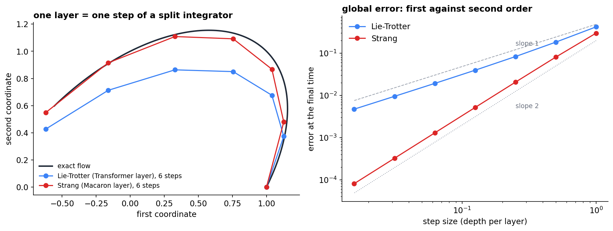
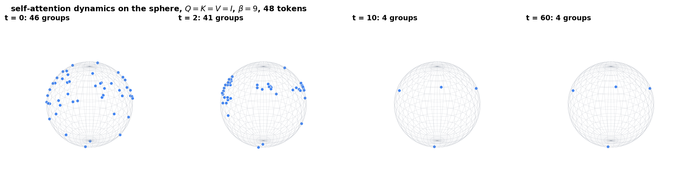
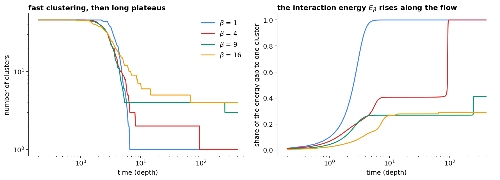
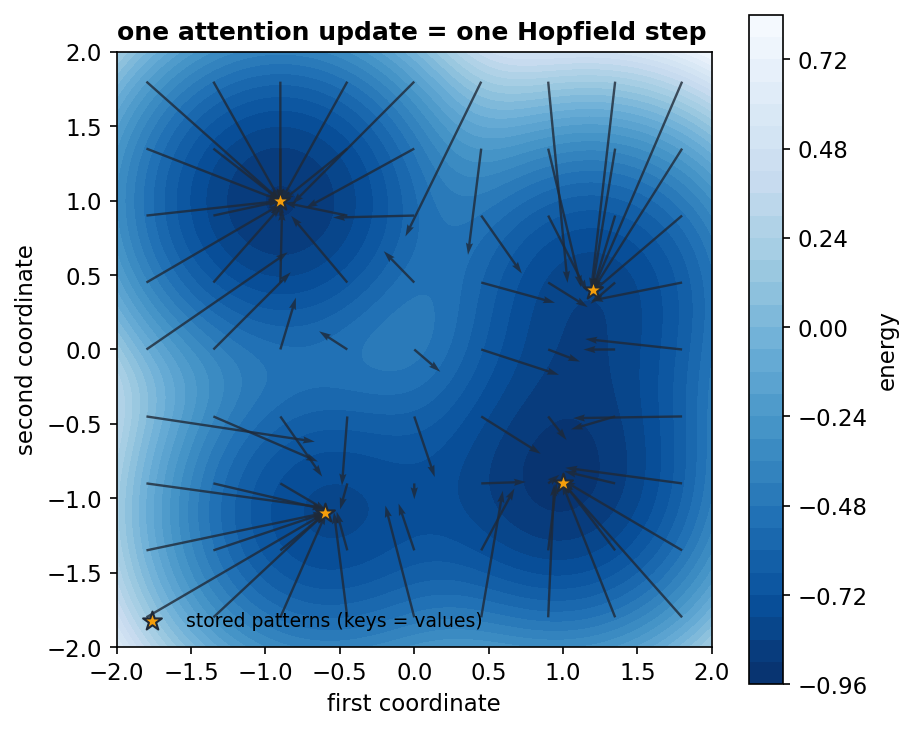
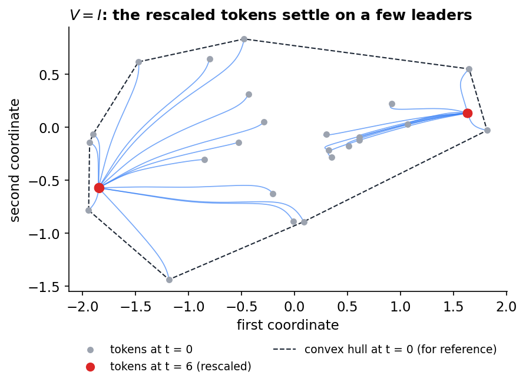
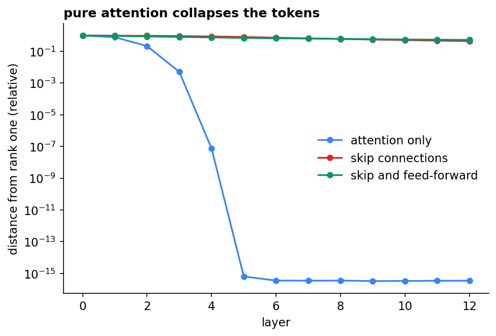

# Transformers as Dynamical Systems: A Reading Guide

**What this note is.** An overview of the papers that read an attention-based transformer as a dynamical system: depth as time, each layer as one step of a discrete-time flow, the tokens as interacting particles. For each paper, it gives the equations it works with, what it proves, and what it assumes. Written on 2026-11-27 at the author's request, during the comparison of SR2-NP-L8 with the matched GPT-2 ([Depth_and_Architecture_Battery.md](../semantic_templates/Depth_and_Architecture_Battery.md)). The figures are computed from the papers' model equations by [`_make_transformer_dynamics_figs.py`](../figures/_make_transformer_dynamics_figs.py); none is read from a trained model.

**In brief.**
- **A residual layer is one Euler step.** Adding a layer's output to its input is one forward step of an ordinary differential equation, with the layer index as time (E 2017; Haber and Ruthotto 2017; Chen et al. 2018).
- **A transformer layer is one step of a split integrator.** Attention is the interaction between particles, the feed-forward block a force on each particle alone, and the layer applies them one after the other (Lu et al. 2019). Applying them in the symmetric order gives a second-order scheme, the "Macaron" layer.
- **With LayerNorm, the tokens move on a sphere, and they cluster.** With constant weights, the tokens gather into clusters and in the end into one point, through long metastable stages with several clusters (Geshkovski, Letrouit, Polyanskiy, Rigollet 2023, 2024; Geshkovski, Koubbi, Polyanskiy, Rigollet 2024).
- **There is an energy only in special cases.** Self-attention on the sphere is a gradient flow of an interaction energy when $Q^{\top} K$ is symmetric and $V = Q^{\top} K$, under a modified metric; a surrogate without the softmax normalisation is one under the standard metric. Off the sphere, softmax attention is not a Wasserstein gradient flow; a doubly stochastic attention is (Sander, Ablin, Blondel, Peyré 2022). One attention update is one step of a modern Hopfield network descending an energy (Ramsauer et al. 2021).
- **What the theory assumes, a trained transformer does not satisfy.** The theorems take the same weights at every layer, symmetric or identity weight matrices, and long times. A trained GPT-2 has different weights at each of its eight layers, no such symmetry, and only eight steps. The reading is exact as a description and partial as an explanation.
- **For SemSimula:** the conservative step has, by construction, what the theory has to assume: one potential, a known integrator, and a time step. Whether that buys anything when the two are compared at equal depth is call GA3 of the battery.

---

## Contents

1. [Depth as time: the residual step](#1-depth-as-time-the-residual-step)
2. [A transformer layer as a split integrator step](#2-a-transformer-layer-as-a-split-integrator-step)
3. [Tokens as particles on the sphere](#3-tokens-as-particles-on-the-sphere)
4. [Is there an energy behind attention?](#4-is-there-an-energy-behind-attention)
5. [Without the sphere: leaders and polytopes](#5-without-the-sphere-leaders-and-polytopes)
6. [What the skip connections do: rank collapse](#6-what-the-skip-connections-do-rank-collapse)
7. [What the theory assumes and a trained transformer breaks](#7-what-the-theory-assumes-and-a-trained-transformer-breaks)
8. [Set against the conservative step](#8-set-against-the-conservative-step)
9. [A reading order](#9-a-reading-order)
10. [References](#10-references)

---

## 1. Depth as time: the residual step

A residual network updates a vector $x$ through layers $k = 0, \dots, L-1$ by adding to it:

$$
x(k+1) = x(k) + f\big(x(k), \theta(k)\big).
$$

Read $k$ as a time and the update as one forward Euler step of size one, and the network is a discretisation of the ordinary differential equation

$$
\dot{x}(t) = f\big(x(t), \theta(t)\big), \qquad x(0) = x .
$$

The parameters $\theta(t)$ depend on time, because each layer has its own weights: the equation is **non-autonomous**. Three papers set this up at the same time: E (2017) proposed it as a programme, Haber and Ruthotto (2017) used it to design stable networks (they ask that the Jacobian of $f$ keep the flow from blowing up or collapsing, and build Hamiltonian and antisymmetric layers for that purpose), and Chen et al. (2018) made the continuous limit a model in its own right, the neural ODE.

A transformer is a residual network of this kind, with one change: it moves $n$ vectors at once, the tokens $x_1, \dots, x_n$, and the force on each depends on all of them. That makes it an **interacting particle system**, which is where the papers below start.

## 2. A transformer layer as a split integrator step

**The paper.** Lu, Li, He et al., *Understanding and Improving Transformer from a Multi-Particle Dynamic System Point of View* (2019).

**The equation.** Each token is a particle; its velocity is the sum of an interaction with the other particles, $F$, and a force on the particle alone, $G$:

$$
\frac{d x_i}{dt} = F\big(x_i(t), [x_1(t), \dots, x_n(t)], t\big) + G\big(x_i(t), t\big), \qquad i = 1, \dots, n .
$$

In the paper's language $F$ is the diffusion term and $G$ the convection term, of a convection-diffusion equation for the particles.

**The layer as a step.** Splitting methods integrate such a sum by integrating each part in turn. The Lie–Trotter splitting with step $\gamma$ takes a full step of $F$, then a full step of $G$:

$$
\tilde{x}_i = x_i(t) + \gamma F\big(x_i(t), [x(t)], t\big), \qquad x_i(t+\gamma) = \tilde{x}_i + \gamma G\big(\tilde{x}_i, t\big).
$$

That is exactly a transformer layer: self-attention (the $F$ step, which mixes the tokens) with its skip connection, then the feed-forward block (the $G$ step, token by token) with its skip connection. The number of layers is the number of time steps.

**The improvement.** Lie–Trotter splitting is first order: its error over a fixed time falls in proportion to the step. The Strang–Marchuk splitting takes half a step of $G$, a full step of $F$, and another half step of $G$:

$$
\tilde{x}_i = x_i + \tfrac{\gamma}{2} G(x_i, t), \qquad \hat{x}_i = \tilde{x}_i + \gamma F(\tilde{x}_i, [\tilde{x}], t), \qquad x_i(t+\gamma) = \hat{x}_i + \tfrac{\gamma}{2} G\big(\hat{x}_i, t + \tfrac{\gamma}{2}\big).
$$

It is second order. As a layer it reads feed-forward (half), attention, feed-forward (half), which the authors call the Macaron layer; in their experiments it outperformed the standard Transformer on both supervised and unsupervised tasks.

**Figure 1.** A linear system whose two parts do not commute (a rotation, standing for the interaction, and a strain, standing for the per-token force), integrated by both splittings. Left: six steps of each against the exact flow. Right: the error at the final time against the step size; Lie–Trotter falls with slope 1, Strang with slope 2. Neither part is attention; the figure shows only the order of the two schemes.

**What to take from it.** The paper makes the layer an integrator step, with the step size absorbed into the weights. It is the closest of these papers to how the conservative models are built, where the integrator is chosen first and the layer is derived from it. The paper's claim is about the form of the update, not about what the trained forces are.

## 3. Tokens as particles on the sphere

**The papers.** Geshkovski, Letrouit, Polyanskiy, Rigollet, *A mathematical perspective on Transformers* (2023, revised to 2025; the best single entry point), and *The emergence of clusters in self-attention dynamics* (NeurIPS 2023).

**LayerNorm puts the tokens on a sphere.** Layer normalisation divides each token by its norm (and multiplies by a trained diagonal matrix, which the authors set to the identity). The tokens then live on the unit sphere $\mathbb{S}^{d-1}$, and the update has to be projected onto the sphere's tangent plane at each token. Write $P^{\perp}_{x} y = y - \langle x, y\rangle x$ for that projection.

**The model.** With query, key and value matrices $Q(t), K(t), V(t)$ and an inverse temperature $\beta \gt 0$, token $i$ moves as

$$
\dot{x}_i(t) = P^{\perp}_{x_i(t)}\Big( \frac{1}{Z_{\beta,i}(t)} \sum_{j=1}^{n} e^{\beta \langle Q(t) x_i(t), K(t) x_j(t)\rangle} V(t) x_j(t) \Big), \qquad Z_{\beta,i}(t) = \sum_{k=1}^{n} e^{\beta \langle Q(t) x_i(t), K(t) x_k(t)\rangle}.
$$

The weights

$$
A_{ij}(t) = \frac{e^{\beta \langle Q(t) x_i(t), K(t) x_j(t)\rangle}}{Z_{\beta,i}(t)}
$$

form the self-attention matrix: each row is a probability vector, the attention token $i$ pays to each token $j$. Most of the paper takes the weights constant and equal to the identity, $Q = K = V = I$, which gives the dynamics they call (SA):

$$
\dot{x}_i(t) = P^{\perp}_{x_i(t)}\Big( \frac{1}{Z_{\beta,i}(t)} \sum_{j=1}^{n} e^{\beta \langle x_i(t), x_j(t)\rangle} x_j(t) \Big).
$$

Each token is pulled toward a weighted mean of the others, and more strongly toward those it already points near: an attraction that grows sharper with $\beta$.

**Figure 2.** (SA) with 48 tokens on the sphere in three dimensions, $\beta = 9$, integrated by small Euler steps with a renormalisation after each step (which is what a sequence of layers with LayerNorm does). "Groups" counts tokens within 0.05 of each other. Within ten time units the tokens gather into four groups, which hold to $t = 60$ (Figure 3 shows a merger near $t = 250$).

**What is proved.**
- **One cluster in the end.** For almost every initial configuration of the tokens, all of them converge to a single point, when $\beta$ is small enough ($\beta$ at most a constant over $n$, or at most one when $d = 2$; their Theorem 4.3) and, by a result of Markdahl, Thunberg and Gonçalves (2017) revisited by Criscitiello, Rebjock, McRae and Boumal (2024), for every $\beta \ge 0$ when $d \ge 3$ (their Theorem 6.1). When $d \ge n$ the convergence is exponentially fast (their Theorem 6.3).
- **Metastability on the way.** For large $\beta$, the tokens first form several clusters quickly, then stay near that configuration for a time exponentially long in $\beta$, merging only slowly. Proved in Geshkovski, Koubbi, Polyanskiy, Rigollet, *Dynamic metastability in the self-attention model* (2024).
- **The same with random weights.** The authors show numerically that the clustering looks the same for $Q = K = V = \lambda I$ and for generic random constant weights, and that trained models (ALBERT) show clusters across their layers.

**Figure 3.** The same 48 tokens under (SA) at four values of $\beta$, time on a logarithmic axis. Left: the number of groups falls fast, then sits on plateaus whose length grows with $\beta$ (at $\beta = 1$ one cluster by $t \approx 7$; at $\beta = 4$ two clusters until $t \approx 95$; at $\beta = 9$ and 16 several clusters past $t = 400$). Right: the interaction energy $E_\beta$ of §4, as a share of the way from its starting value to its value at one cluster; it only rises, and it jumps at each merger.

The clustering results and their link to synchronisation (Kuramoto oscillators) are worked through in more depth in [Two_Clustering_Mechanisms_Saturation_and_Synchronization.md](../Two_Clustering_Mechanisms_Saturation_and_Synchronization.md), which also covers the causal mask (Karagodin, Polyanskiy, Rigollet 2024).

## 4. Is there an energy behind attention?

This is the question that separates a transformer from a conservative model: is the flow the gradient of some potential, so that it has wells to read? The answer is "in special cases, and with care about the metric".

### 4.1 The interaction energy

For tokens on the sphere, define the **interaction energy**

$$
E_\beta(X) = \frac{1}{2\beta n^2} \sum_{i=1}^{n} \sum_{j=1}^{n} e^{\beta \langle x_i, x_j\rangle}, \qquad X = (x_1, \dots, x_n) \in (\mathbb{S}^{d-1})^n .
$$

It is largest when all tokens sit at one point. Over probability measures on the sphere, its unique minimiser is the uniform measure and its maximisers are the point masses (Geshkovski et al. 2023, Proposition 3.4).

### 4.2 Two gradient flows of the same energy

- **Without the normalisation.** Replace $Z_{\beta,i}$ by $n$ in (SA). The result, which they call (USA), is exactly gradient ascent of $E_\beta$ in the standard metric on the product of spheres:

$$
\dot{X}(t) = n \nabla_X E_\beta\big(X(t)\big).
$$

(USA) behaves qualitatively like (SA): every result of the paper holds for both.

- **With the normalisation, in a modified metric.** When $Q^{\top} K$ is symmetric and $V = Q^{\top} K$, (SA) itself is a gradient flow of $E_\beta$ (with the inner product $\langle x, x'\rangle$ replaced by the one $Q^{\top} K$ defines), in a metric that weights the tangent space at each token by its normaliser:

$$
\big\langle (a_1, \dots, a_n), (b_1, \dots, b_n) \big\rangle_X = \sum_{i=1}^{n} Z_{\beta,i}(X) \langle a_i, b_i \rangle .
$$

(Their §3.4.) So the energy rises along (SA) too; Figure 3 shows it.

### 4.3 Off the sphere: the Wasserstein picture

**The paper.** Sander, Ablin, Blondel, Peyré, *Sinkformers: Transformers with doubly stochastic attention* (AISTATS 2022).

Treat the tokens as an empirical measure $\mu$ in $\mathbb{R}^d$ (a point mass of weight $1/n$ at each token), without LayerNorm. A residual attention layer with a small step moves the measure along a vector field built from $\mu$; with infinitely many layers this is a continuity equation, $\partial_t \mu + \nabla \cdot (\mu T_\mu) = 0$, where $T_\mu$ is the attention map applied to a point. The question is whether $T_\mu$ is the gradient of the first variation of some energy, which would make the flow a Wasserstein gradient flow.

The paper shows that, even with a symmetric kernel, softmax attention (each row normalised) does not give a Wasserstein gradient flow, while doubly stochastic attention (rows and columns normalised, by Sinkhorn's iterations) does. In a limit of many tokens with rescaling, the Sinkformer flow becomes the heat equation. The authors also observe that the attention matrices of trained transformers drift toward doubly stochastic during training.

The two results fit together: on the sphere and in the modified metric of §4.2, the row normalisation is absorbed into the metric; in the flat Wasserstein metric it is not.

### 4.4 One attention update as one step down an energy

**The paper.** Ramsauer et al., *Hopfield Networks is All You Need* (ICLR 2021).

Store patterns as the columns of a matrix $X = (x_1, \dots, x_N)$. The modern Hopfield energy of a state $\xi$ is

$$
E(\xi) = -\frac{1}{\beta} \log \sum_{k=1}^{N} e^{\beta x_k^{\top} \xi} + \frac{1}{2} \xi^{\top} \xi + \text{const},
$$

and the update that lowers it is

$$
\xi^{\text{new}} = X \mathrm{softmax}\big(\beta X^{\top} \xi\big).
$$

This is attention with $\xi$ as the query and the stored patterns as keys and values. The update reaches a fixed point, typically in one step when the patterns are well separated; the fixed points are a single pattern, a mean over a subset of patterns (metastable), or the mean over all of them. The energy is for one update with given patterns; it does not make a stack of layers with different weights a single gradient flow.

**Figure 4.** The modern Hopfield energy in the plane with four stored patterns (stars), $\beta = 3$. Each arrow is one attention update from a query on the grid: most land on a pattern in one step; queries between patterns land between them (the metastable means).

The conservative framework's relation to Hopfield networks is discussed in [SemSimula_connection_to_Hopfield_networks_and_Restricted_Boltzman_Machines.md](../SemSimula_connection_to_Hopfield_networks_and_Restricted_Boltzman_Machines.md).

### 4.5 The reverse direction: a transformer built from an energy

Hoover et al., *Energy Transformer* (NeurIPS 2023), build a transformer whose token updates descend one global energy (an attention term and a Hopfield term), so that the layers are steps of a gradient descent by construction. It is the same move as the conservative models: choose the energy, derive the layer.

## 5. Without the sphere: leaders and polytopes

Without LayerNorm the tokens are not confined, and the attention sharpens as they grow. *The emergence of clusters in self-attention dynamics* studies, with constant weights and the attention matrix $A(t)$ of §3,

$$
\dot{x}_i(t) = \sum_{j=1}^{n} A_{ij}(t) V x_j(t),
$$

after rescaling the tokens by $e^{-tV}$ to remove the overall growth. Which shape the rescaled tokens approach depends on the spectrum of $V$. With $V = I$ they approach the vertices of a convex polytope (their Theorem 3.1). In one dimension with $V \gt 0$, the attention matrix approaches a low-rank matrix of zeros and ones: a few tokens, the **leaders**, receive all the attention, as Vaswani et al. had observed in trained models.

**Figure 5.** 24 tokens in the plane with $Q = K = V = I$, rescaled by $e^{-t}$. In the rescaled variables the attention is a softmax at inverse temperature $e^{2t}$, so it hardens with time: each token ends up attending only to the token it is most aligned with, and the tokens settle on two points.

## 6. What the skip connections do: rank collapse

**The paper.** Dong, Cordonnier, Loukas, *Attention is not all you need: pure attention loses rank doubly exponentially with depth* (ICML 2021).

Stack self-attention layers without skip connections or feed-forward blocks, and the token matrix converges to rank one (every token the same) doubly exponentially in depth: their bound on the distance from rank one after $L$ layers involves the starting distance raised to the power $3^L$. Skip connections stop this; feed-forward blocks help. In the dynamical reading, pure attention is a map that contracts to consensus in a few steps, and the skip connection is what makes a layer a small step of a flow rather than the whole contraction at once.

**Figure 6.** 32 tokens in 64 dimensions through twelve layers with random weights (LayerNorm before each block), the geometric mean over 20 draws. Without skip connections the distance from rank one reaches machine precision by layer 5; with them, it barely moves.

## 7. What the theory assumes and a trained transformer breaks

| assumption of the theorems | in a trained transformer such as the matched GPT-2 |
| --- | --- |
| the same weights at every time (an autonomous flow) | different weights at each of the eight blocks: a non-autonomous flow |
| query, key and value matrices equal to the identity, or a symmetric bilinear form with the value matrix equal to it | learned, unrelated matrices; no symmetry |
| one attention head | six heads, each with its own form, summed |
| attention only, or attention with a simple per-token term | a feed-forward block of 1,536 units after each attention |
| all tokens see all tokens | a causal mask: each token sees only itself and the tokens before it (studied by Karagodin et al. 2024) |
| long times: clusters, plateaus and convergence | eight steps of unknown size: a short stretch of a trajectory |
| LayerNorm as division by the norm | LayerNorm with a learned scale and bias, applied before each block (pre-LN), so the residual stream itself is not on a sphere |

So the dynamical reading of a trained transformer is exact as a description (each block is one step of a non-autonomous particle flow) and partial as an explanation (the theorems hold for simplified, autonomous versions of it). The clustering is nonetheless seen in trained models, which is the authors' main empirical argument.

In GPT-2 the residual stream grows along depth (the state at "Therefore" in a test premise has norm about 1 at the embedding and about 80 after the last block, measured 2026-11-27), which is the pre-LN arrangement: each block reads a normalised copy of the stream and adds to the unnormalised stream.

## 8. Set against the conservative step

| | attention-based transformer (as read in §2 to §7) | SemSimula's conservative models |
| --- | --- | --- |
| what a layer is | one step of a non-autonomous particle flow, found after the fact | one step of a chosen integrator of a damped second-order flow, designed first |
| how tokens interact | attention: each token reads a weighted mean of the others | no attention; context reaches a token through the context channels (and, in some arms, a pair force) |
| an energy | only in special cases (§4), and not for trained weights | a learned potential with wells, by construction |
| what can be read from the states | the states themselves | the states, each layer's displacement, and each token's position among the wells |
| the time step | absorbed into the weights | explicit |

The comparison the depth-and-architecture battery runs is whether the conservative structure helps a template reader at equal depth: SR2-NP-L8 against the matched GPT-2, both eight layers of width 384 trained on the same tokens (call GA3, [Depth_and_Architecture_Battery.md](../semantic_templates/Depth_and_Architecture_Battery.md)). One reading on GPT-2 alone came in on 2026-11-27 (task A, preliminary, its report pending): read at the final token "Therefore", the logical form of a premise appears in GPT-2's residual stream only after the third block, while SR2-NP carries it after its first layer. After that GPT-2 is level with SR2-NP. The note on the battery holds the scores.

## 9. A reading order

1. Geshkovski, Letrouit, Polyanskiy, Rigollet, *A mathematical perspective on Transformers*: Part 1 (the model, the energy, §2 and §3), then Part 2 for the clustering theorems.
2. Lu et al.: the splitting reading of a layer, short and concrete.
3. Sander et al., *Sinkformers*: whether attention is a gradient flow, in the flat setting.
4. Ramsauer et al.: the one-step energy reading, and its fixed points.
5. Geshkovski et al., *The emergence of clusters*: leaders and polytopes without the sphere.
6. Dong et al.: why the skip connection matters.
7. For the background, E (2017), Haber and Ruthotto (2017), Chen et al. (2018); for the reverse construction, Hoover et al. (2023); for metastability, Geshkovski, Koubbi, Polyanskiy, Rigollet (2024).

## 10. References

Checked against the papers or their abstracts on 2026-11-27: Geshkovski et al. 2023 (both), Geshkovski, Koubbi et al. 2024, Lu et al., Sander et al., Ramsauer et al. (the abstract; the energy formula is the standard one, not read from the paper), Dong et al. The statements of §3 and §4.1 to §4.2 were read from the text of arXiv:2312.10794. The others are cited from the agent's knowledge; their venues and years should be checked before the book cites them.

- B. Geshkovski, C. Letrouit, Y. Polyanskiy, P. Rigollet, *A mathematical perspective on Transformers*, 2023, revised 2025, [arXiv:2312.10794](https://arxiv.org/abs/2312.10794). Used: the model (2.3) and (SA), (USA), the energy (3.5), Proposition 3.4, Lemma 3.6 and (3.11), §3.4, Theorems 4.3, 6.1, 6.3.
- B. Geshkovski, C. Letrouit, Y. Polyanskiy, P. Rigollet, *The emergence of clusters in self-attention dynamics*, NeurIPS 2023, [arXiv:2305.05465](https://arxiv.org/abs/2305.05465). Used: clustering toward the vertices of a convex polytope for $V = I$ (Theorem 3.1), the leaders in one dimension.
- B. Geshkovski, H. Koubbi, Y. Polyanskiy, P. Rigollet, *Dynamic metastability in the self-attention model*, 2024, [arXiv:2410.06833](https://arxiv.org/abs/2410.06833).
- Y. Lu, Z. Li, D. He, Z. Sun, B. Dong, T. Qin, L. Wang, T.-Y. Liu, *Understanding and improving Transformer from a multi-particle dynamic system point of view*, 2019, [arXiv:1906.02762](https://arxiv.org/abs/1906.02762); code: [macaron-net](https://github.com/zhuohan123/macaron-net).
- M. E. Sander, P. Ablin, M. Blondel, G. Peyré, *Sinkformers: Transformers with doubly stochastic attention*, AISTATS 2022, PMLR 151:3515–3530, [arXiv:2110.11773](https://arxiv.org/abs/2110.11773).
- H. Ramsauer et al., *Hopfield networks is all you need*, ICLR 2021, [arXiv:2008.02217](https://arxiv.org/abs/2008.02217).
- B. Hoover et al., *Energy Transformer*, NeurIPS 2023.
- Y. Dong, J.-B. Cordonnier, A. Loukas, *Attention is not all you need: pure attention loses rank doubly exponentially with depth*, ICML 2021, [arXiv:2103.03404](https://arxiv.org/abs/2103.03404).
- W. E, *A proposal on machine learning via dynamical systems*, Communications in Mathematics and Statistics, 2017.
- E. Haber, L. Ruthotto, *Stable architectures for deep neural networks*, Inverse Problems, 2017.
- R. T. Q. Chen, Y. Rubanova, J. Bettencourt, D. Duvenaud, *Neural ordinary differential equations*, NeurIPS 2018.
- N. Karagodin, Y. Polyanskiy, P. Rigollet, *Clustering in causal attention masking*, 2024, [arXiv:2411.04990](https://arxiv.org/abs/2411.04990).
- J. Markdahl, J. Thunberg, J. Gonçalves, *Almost global consensus on the n-sphere*, IEEE Transactions on Automatic Control 63(6), 2017; C. Criscitiello, Q. Rebjock, A. D. McRae, N. Boumal, *Synchronization on circles and spheres with nonlinear interactions*, 2024 (the two sources of Theorem 6.1, as cited in arXiv:2312.10794).
